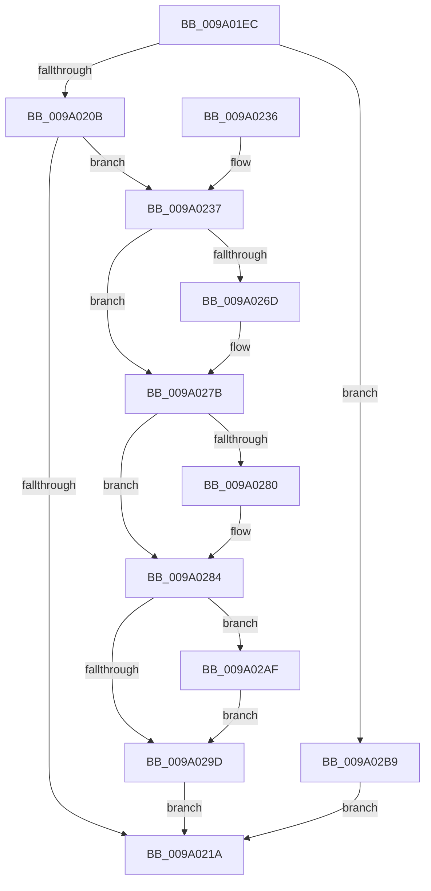

# sub_009A01EC

- RVA: `0x009A01EC`–`0x009A02C3` (길이 `215` bytes)
- VA: `0x00000001409A01EC`
- 실행 섹션: `PAGE`
- PDB 이름 있음: `아니요`; PDB Function 태그: `아니요`
- unwind 정보 RVA: `0x0009B358`
- 디코드: `58`개 명령, `215/215` bytes 표시
- 미해석 바이트: `0` (있으면 어셈블리에 `.byte`로 보존)

> 이 문서는 커널 이미지의 기계어와 PDB 기호를 분석해 생성했습니다. 4번과 5번은 함수 원형과 자료형을 바이너리 사용 방식에서 추정한 C 해석이며 원본 소스 복구 결과는 아닙니다.

## 1. Dependencies

- 직접 호출 지점: **8**; 고유 호출 대상: **8**
- 직접 호출자로 확인된 함수: **1**
- RIP 상대 이미지 참조: **0**

### Outgoing calls
- `0x009A020F` → [sub_009A051C](Unknown_function_009A051C.md) (function, `0x009A051C`)
- `0x009A021F` → [sub_009A0698](Unknown_function_009A0698.md) (function, `0x009A0698`)
- `0x009A025D` → [KeAbPreAcquire](../../text/21/KeAbPreAcquire_function_00210230.md) (function, `0x00210230`)
- `0x009A0276` → [ExfAcquirePushLockExclusiveEx](../../text/20/ExfAcquirePushLockExclusiveEx_function_0020FC90.md) (function, `0x0020FC90`)
- `0x009A0289` → [sub_009A0DF0](Unknown_function_009A0DF0.md) (function, `0x009A0DF0`)
- `0x009A02A0` → [KeAbPostRelease](../../text/2E/KeAbPostRelease_function_002E1600.md) (function, `0x002E1600`)
- `0x009A02A5` → [KeLeaveGuardedRegion](../../text/2E/KeLeaveGuardedRegion_function_002E2C40.md) (function, `0x002E2C40`)
- `0x009A02B2` → [ExfTryToWakePushLock](../../text/26/ExfTryToWakePushLock_function_00265DD0.md) (function, `0x00265DD0`)

### Direct callers
- [sub_008D3420](../8D/Unknown_function_008D3420.md) at `0x008D361C`

### Static image references
- 디코드된 RIP-relative 메모리 참조가 없습니다.

## 2. Other-region calls and transfers

- 다른 실행 섹션으로 향하는 call: **5**
  - `0x009A025D` → [KeAbPreAcquire](../../text/21/KeAbPreAcquire_function_00210230.md) (`PAGE` → `.text`)
  - `0x009A0276` → [ExfAcquirePushLockExclusiveEx](../../text/20/ExfAcquirePushLockExclusiveEx_function_0020FC90.md) (`PAGE` → `.text`)
  - `0x009A02A0` → [KeAbPostRelease](../../text/2E/KeAbPostRelease_function_002E1600.md) (`PAGE` → `.text`)
  - `0x009A02A5` → [KeLeaveGuardedRegion](../../text/2E/KeLeaveGuardedRegion_function_002E2C40.md) (`PAGE` → `.text`)
  - `0x009A02B2` → [ExfTryToWakePushLock](../../text/26/ExfTryToWakePushLock_function_00265DD0.md) (`PAGE` → `.text`)
- 별도 외부 분기/꼬리 이동을 확인하지 못했습니다.

## 3. Assembly (complete function range)

```asm
009A01EC  48 8B C4                        mov rax, rsp
009A01EF  48 89 58 08                     mov qword ptr [rax + 8], rbx
009A01F3  48 89 70 10                     mov qword ptr [rax + 0x10], rsi
009A01F7  57                              push rdi
009A01F8  48 83 EC 20                     sub rsp, 0x20
009A01FC  48 83 60 20 00                  and qword ptr [rax + 0x20], 0
009A0201  41 83 F8 10                     cmp r8d, 0x10
009A0205  0F 82 AE 00 00 00               jb 0x1409a02b9
009A020B  4C 8D 48 20                     lea r9, [rax + 0x20]
009A020F  E8 08 03 00 00                  call 0x1409a051c
009A0214  8B F0                           mov esi, eax
009A0216  85 C0                           test eax, eax
009A0218  79 1D                           jns 0x1409a0237
009A021A  48 8B 4C 24 48                  mov rcx, qword ptr [rsp + 0x48]
009A021F  E8 74 04 00 00                  call 0x1409a0698
009A0224  48 8B 5C 24 30                  mov rbx, qword ptr [rsp + 0x30]
009A0229  8B C6                           mov eax, esi
009A022B  48 8B 74 24 38                  mov rsi, qword ptr [rsp + 0x38]
009A0230  48 83 C4 20                     add rsp, 0x20
009A0234  5F                              pop rdi
009A0235  C3                              ret
009A0236  CC                              int3
009A0237  65 48 8B 04 25 88 01 00 00      mov rax, qword ptr gs:[0x188]
009A0240  48 83 CB FF                     or rbx, 0xffffffffffffffff
009A0244  48 8B 7C 24 48                  mov rdi, qword ptr [rsp + 0x48]
009A0249  45 33 C0                        xor r8d, r8d
009A024C  48 83 C7 08                     add rdi, 8
009A0250  33 D2                           xor edx, edx
009A0252  48 8B CF                        mov rcx, rdi
009A0255  66 01 98 E6 01 00 00            add word ptr [rax + 0x1e6], bx
009A025C  90                              nop
009A025D  E8 CE FF 86 FF                  call 0x140210230
009A0262  F0 48 0F BA 2F 00               lock bts qword ptr [rdi], 0
009A0268  48 8B F0                        mov rsi, rax
009A026B  73 0E                           jae 0x1409a027b
009A026D  4C 8B C7                        mov r8, rdi
009A0270  48 8B D0                        mov rdx, rax
009A0273  48 8B CF                        mov rcx, rdi
009A0276  E8 15 FA 86 FF                  call 0x14020fc90
009A027B  48 85 F6                        test rsi, rsi
009A027E  74 04                           je 0x1409a0284
009A0280  C6 46 0A 01                     mov byte ptr [rsi + 0xa], 1
009A0284  48 8B 4C 24 48                  mov rcx, qword ptr [rsp + 0x48]
009A0289  E8 62 0B 00 00                  call 0x1409a0df0
009A028E  8B F0                           mov esi, eax
009A0290  F0 48 0F C1 1F                  lock xadd qword ptr [rdi], rbx
009A0295  80 E3 06                        and bl, 6
009A0298  80 FB 02                        cmp bl, 2
009A029B  74 12                           je 0x1409a02af
009A029D  48 8B CF                        mov rcx, rdi
009A02A0  E8 5B 13 94 FF                  call 0x1402e1600
009A02A5  E8 96 29 94 FF                  call 0x1402e2c40
009A02AA  E9 6B FF FF FF                  jmp 0x1409a021a
009A02AF  48 8B CF                        mov rcx, rdi
009A02B2  E8 19 5B 8C FF                  call 0x140265dd0
009A02B7  EB E4                           jmp 0x1409a029d
009A02B9  BE 0D 00 00 C0                  mov esi, 0xc000000d
009A02BE  E9 57 FF FF FF                  jmp 0x1409a021a
```

## 4. C-style interpretation (structured pseudocode)

```c
__int64 __fastcall sub_009A01EC(__int64 a1, int a2, int a3)
{
    __int64 result;
    __int64 v_rbx;
    __int64 v_rdi;
    __int64 v_rsp;
    unsigned __int64 v_stack_p10;
    unsigned __int64 v_stack_p20;
    unsigned __int64 v_stack_p48;
    unsigned __int64 v_stack_p8;

    *(unsigned __int64 *)(v_rsp + 8) = v_rbx;
    *(unsigned __int64 *)(v_rsp + 16) = v_rsi;
    v_rsp = (v_rsp) - (32);
    if (a3 < 16) goto loc_009A02B9;
    result = sub_009A051C(a1, a2, a3, v_rsp + 32);
    if (!sign_flag) goto loc_009A0237;
loc_009A021A:
    result = sub_009A0698(v_stack_p20, a2, a3, v_rsp + 32);
    v_rsp = (v_rsp) + (32);
    return (unsigned int)((unsigned int)((unsigned int)((unsigned int)(result))));
loc_009A0237:
    v_rbx = (v_stack_p8) | (-1);
    a3 = 0;
    v_rdi = (v_stack_p48) + (8);
    a2 = 0;
    result = KeAbPreAcquire(v_rdi, a2, a3, v_rsp + 32);
    if (!(condition_is_above_or_equal)) {
        a3 = v_rdi;
        a2 = result;
        a1 = v_rdi;
        result = ExfAcquirePushLockExclusiveEx(a1, a2, a3, v_rsp + 32);
    }
    if (result != 0) {
        *(unsigned __int8 *)(result + 10) = 1;
    }
    result = sub_009A0DF0(v_stack_p48, a2, a3, v_rsp + 32);
    v_rbx = (unsigned __int8)((v_rbx) & (6));
    if (((unsigned __int8)(v_rbx)) == 2) goto loc_009A02AF;
loc_009A029D:
    result = KeAbPostRelease(v_rdi, a2, a3, v_rsp + 32);
    result = KeLeaveGuardedRegion(v_rdi, a2, a3, v_rsp + 32);
    goto loc_009A021A;
loc_009A02AF:
    result = ExfTryToWakePushLock(v_rdi, a2, a3, v_rsp + 32);
    goto loc_009A029D;
loc_009A02B9:
    goto loc_009A021A;
}
```

## 5. (Beta) C Style

```c
int64_t sub_009A01EC(int64_t Arg1, int32_t Arg2, int32_t Arg3)
{
    int64_t result;
    int64_t local_rbx;
    int64_t local_rdi;
    int64_t local_rsp;
    uint64_t v_stack_p10;
    uint64_t v_stack_p20;
    uint64_t v_stack_p48;
    uint64_t v_stack_p8;

    *(uint64_t *)(local_rsp + 0x8) = local_rbx;
    *(uint64_t *)(local_rsp + 0x10) = local_rsi;
    local_rsp = (local_rsp) - (32);
    if (Arg3 < 16) goto loc_009A02B9;
    result = sub_009A051C(Arg1, Arg2, Arg3, local_rsp + 32);
    if (!sign_flag) goto loc_009A0237;
loc_009A021A:
    result = sub_009A0698(v_stack_p20, Arg2, Arg3, local_rsp + 32);
    local_rsp = (local_rsp) + (32);
    return (uint32_t)((uint32_t)((uint32_t)((uint32_t)(result))));
loc_009A0237:
    local_rbx = (v_stack_p8) | (-1);
    Arg3 = 0;
    local_rdi = (v_stack_p48) + (8);
    Arg2 = 0;
    result = KeAbPreAcquire(local_rdi, Arg2, Arg3, local_rsp + 32);
    if (!(condition_is_above_or_equal)) {
        Arg3 = local_rdi;
        Arg2 = result;
        Arg1 = local_rdi;
        result = ExfAcquirePushLockExclusiveEx(Arg1, Arg2, Arg3, local_rsp + 32);
    }
    if (result != 0) {
        *(uint8_t *)(result + 0xA) = 1;
    }
    result = sub_009A0DF0(v_stack_p48, Arg2, Arg3, local_rsp + 32);
    local_rbx = (uint8_t)((local_rbx) & (6));
    if (((uint8_t)(local_rbx)) == 2) goto loc_009A02AF;
loc_009A029D:
    result = KeAbPostRelease(local_rdi, Arg2, Arg3, local_rsp + 32);
    result = KeLeaveGuardedRegion(local_rdi, Arg2, Arg3, local_rsp + 32);
    goto loc_009A021A;
loc_009A02AF:
    result = ExfTryToWakePushLock(local_rdi, Arg2, Arg3, local_rsp + 32);
    goto loc_009A029D;
loc_009A02B9:
    goto loc_009A021A;
}
```

## 6. Execution-region graph

[열기: 2D/3D 그래프와 함수 탐색 컨트롤 패널](../../../control-panel.html?section=page&rva=0x009A01EC&view=graph)

- 2D 그래프는 위에서 아래로 흐르고, 3D 그래프는 빈 공간을 드래그해 회전합니다. Shift+드래그는 이동, 휠은 확대·축소, 함수 노드 선택은 대상 보고서 이동입니다.

### Static fallback


