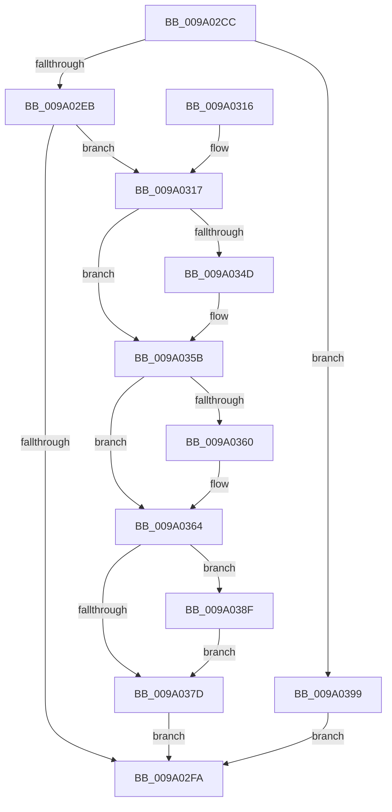

# sub_009A02CC

- RVA: `0x009A02CC`–`0x009A03A3` (길이 `215` bytes)
- VA: `0x00000001409A02CC`
- 실행 섹션: `PAGE`
- PDB 이름 있음: `아니요`; PDB Function 태그: `아니요`
- unwind 정보 RVA: `0x0009B358`
- 디코드: `58`개 명령, `215/215` bytes 표시
- 미해석 바이트: `0` (있으면 어셈블리에 `.byte`로 보존)

> 이 문서는 커널 이미지의 기계어와 PDB 기호를 분석해 생성했습니다. 4번과 5번은 함수 원형과 자료형을 바이너리 사용 방식에서 추정한 C 해석이며 원본 소스 복구 결과는 아닙니다.

## 1. Dependencies

- 직접 호출 지점: **8**; 고유 호출 대상: **8**
- 직접 호출자로 확인된 함수: **1**
- RIP 상대 이미지 참조: **0**

### Outgoing calls
- `0x009A02EF` → [sub_009A051C](Unknown_function_009A051C.md) (function, `0x009A051C`)
- `0x009A02FF` → [sub_009A0698](Unknown_function_009A0698.md) (function, `0x009A0698`)
- `0x009A033D` → [KeAbPreAcquire](../../text/21/KeAbPreAcquire_function_00210230.md) (function, `0x00210230`)
- `0x009A0356` → [ExfAcquirePushLockExclusiveEx](../../text/20/ExfAcquirePushLockExclusiveEx_function_0020FC90.md) (function, `0x0020FC90`)
- `0x009A0369` → [sub_009A1148](Unknown_function_009A1148.md) (function, `0x009A1148`)
- `0x009A0380` → [KeAbPostRelease](../../text/2E/KeAbPostRelease_function_002E1600.md) (function, `0x002E1600`)
- `0x009A0385` → [KeLeaveGuardedRegion](../../text/2E/KeLeaveGuardedRegion_function_002E2C40.md) (function, `0x002E2C40`)
- `0x009A0392` → [ExfTryToWakePushLock](../../text/26/ExfTryToWakePushLock_function_00265DD0.md) (function, `0x00265DD0`)

### Direct callers
- [sub_008D3420](../8D/Unknown_function_008D3420.md) at `0x008D3602`

### Static image references
- 디코드된 RIP-relative 메모리 참조가 없습니다.

## 2. Other-region calls and transfers

- 다른 실행 섹션으로 향하는 call: **5**
  - `0x009A033D` → [KeAbPreAcquire](../../text/21/KeAbPreAcquire_function_00210230.md) (`PAGE` → `.text`)
  - `0x009A0356` → [ExfAcquirePushLockExclusiveEx](../../text/20/ExfAcquirePushLockExclusiveEx_function_0020FC90.md) (`PAGE` → `.text`)
  - `0x009A0380` → [KeAbPostRelease](../../text/2E/KeAbPostRelease_function_002E1600.md) (`PAGE` → `.text`)
  - `0x009A0385` → [KeLeaveGuardedRegion](../../text/2E/KeLeaveGuardedRegion_function_002E2C40.md) (`PAGE` → `.text`)
  - `0x009A0392` → [ExfTryToWakePushLock](../../text/26/ExfTryToWakePushLock_function_00265DD0.md) (`PAGE` → `.text`)
- 별도 외부 분기/꼬리 이동을 확인하지 못했습니다.

## 3. Assembly (complete function range)

```asm
009A02CC  48 8B C4                        mov rax, rsp
009A02CF  48 89 58 08                     mov qword ptr [rax + 8], rbx
009A02D3  48 89 70 10                     mov qword ptr [rax + 0x10], rsi
009A02D7  57                              push rdi
009A02D8  48 83 EC 20                     sub rsp, 0x20
009A02DC  48 83 60 20 00                  and qword ptr [rax + 0x20], 0
009A02E1  41 83 F8 10                     cmp r8d, 0x10
009A02E5  0F 82 AE 00 00 00               jb 0x1409a0399
009A02EB  4C 8D 48 20                     lea r9, [rax + 0x20]
009A02EF  E8 28 02 00 00                  call 0x1409a051c
009A02F4  8B F0                           mov esi, eax
009A02F6  85 C0                           test eax, eax
009A02F8  79 1D                           jns 0x1409a0317
009A02FA  48 8B 4C 24 48                  mov rcx, qword ptr [rsp + 0x48]
009A02FF  E8 94 03 00 00                  call 0x1409a0698
009A0304  48 8B 5C 24 30                  mov rbx, qword ptr [rsp + 0x30]
009A0309  8B C6                           mov eax, esi
009A030B  48 8B 74 24 38                  mov rsi, qword ptr [rsp + 0x38]
009A0310  48 83 C4 20                     add rsp, 0x20
009A0314  5F                              pop rdi
009A0315  C3                              ret
009A0316  CC                              int3
009A0317  65 48 8B 04 25 88 01 00 00      mov rax, qword ptr gs:[0x188]
009A0320  48 83 CB FF                     or rbx, 0xffffffffffffffff
009A0324  48 8B 7C 24 48                  mov rdi, qword ptr [rsp + 0x48]
009A0329  45 33 C0                        xor r8d, r8d
009A032C  48 83 C7 08                     add rdi, 8
009A0330  33 D2                           xor edx, edx
009A0332  48 8B CF                        mov rcx, rdi
009A0335  66 01 98 E6 01 00 00            add word ptr [rax + 0x1e6], bx
009A033C  90                              nop
009A033D  E8 EE FE 86 FF                  call 0x140210230
009A0342  F0 48 0F BA 2F 00               lock bts qword ptr [rdi], 0
009A0348  48 8B F0                        mov rsi, rax
009A034B  73 0E                           jae 0x1409a035b
009A034D  4C 8B C7                        mov r8, rdi
009A0350  48 8B D0                        mov rdx, rax
009A0353  48 8B CF                        mov rcx, rdi
009A0356  E8 35 F9 86 FF                  call 0x14020fc90
009A035B  48 85 F6                        test rsi, rsi
009A035E  74 04                           je 0x1409a0364
009A0360  C6 46 0A 01                     mov byte ptr [rsi + 0xa], 1
009A0364  48 8B 4C 24 48                  mov rcx, qword ptr [rsp + 0x48]
009A0369  E8 DA 0D 00 00                  call 0x1409a1148
009A036E  8B F0                           mov esi, eax
009A0370  F0 48 0F C1 1F                  lock xadd qword ptr [rdi], rbx
009A0375  80 E3 06                        and bl, 6
009A0378  80 FB 02                        cmp bl, 2
009A037B  74 12                           je 0x1409a038f
009A037D  48 8B CF                        mov rcx, rdi
009A0380  E8 7B 12 94 FF                  call 0x1402e1600
009A0385  E8 B6 28 94 FF                  call 0x1402e2c40
009A038A  E9 6B FF FF FF                  jmp 0x1409a02fa
009A038F  48 8B CF                        mov rcx, rdi
009A0392  E8 39 5A 8C FF                  call 0x140265dd0
009A0397  EB E4                           jmp 0x1409a037d
009A0399  BE 0D 00 00 C0                  mov esi, 0xc000000d
009A039E  E9 57 FF FF FF                  jmp 0x1409a02fa
```

## 4. C-style interpretation (structured pseudocode)

```c
__int64 __fastcall sub_009A02CC(__int64 a1, int a2, int a3)
{
    __int64 result;
    __int64 v_rbx;
    __int64 v_rdi;
    __int64 v_rsp;
    unsigned __int64 v_stack_p10;
    unsigned __int64 v_stack_p20;
    unsigned __int64 v_stack_p48;
    unsigned __int64 v_stack_p8;

    *(unsigned __int64 *)(v_rsp + 8) = v_rbx;
    *(unsigned __int64 *)(v_rsp + 16) = v_rsi;
    v_rsp = (v_rsp) - (32);
    if (a3 < 16) goto loc_009A0399;
    result = sub_009A051C(a1, a2, a3, v_rsp + 32);
    if (!sign_flag) goto loc_009A0317;
loc_009A02FA:
    result = sub_009A0698(v_stack_p20, a2, a3, v_rsp + 32);
    v_rsp = (v_rsp) + (32);
    return (unsigned int)((unsigned int)((unsigned int)((unsigned int)(result))));
loc_009A0317:
    v_rbx = (v_stack_p8) | (-1);
    a3 = 0;
    v_rdi = (v_stack_p48) + (8);
    a2 = 0;
    result = KeAbPreAcquire(v_rdi, a2, a3, v_rsp + 32);
    if (!(condition_is_above_or_equal)) {
        a3 = v_rdi;
        a2 = result;
        a1 = v_rdi;
        result = ExfAcquirePushLockExclusiveEx(a1, a2, a3, v_rsp + 32);
    }
    if (result != 0) {
        *(unsigned __int8 *)(result + 10) = 1;
    }
    result = sub_009A1148(v_stack_p48, a2, a3, v_rsp + 32);
    v_rbx = (unsigned __int8)((v_rbx) & (6));
    if (((unsigned __int8)(v_rbx)) == 2) goto loc_009A038F;
loc_009A037D:
    result = KeAbPostRelease(v_rdi, a2, a3, v_rsp + 32);
    result = KeLeaveGuardedRegion(v_rdi, a2, a3, v_rsp + 32);
    goto loc_009A02FA;
loc_009A038F:
    result = ExfTryToWakePushLock(v_rdi, a2, a3, v_rsp + 32);
    goto loc_009A037D;
loc_009A0399:
    goto loc_009A02FA;
}
```

## 5. (Beta) C Style

```c
int64_t sub_009A02CC(int64_t Arg1, int32_t Arg2, int32_t Arg3)
{
    int64_t result;
    int64_t local_rbx;
    int64_t local_rdi;
    int64_t local_rsp;
    uint64_t v_stack_p10;
    uint64_t v_stack_p20;
    uint64_t v_stack_p48;
    uint64_t v_stack_p8;

    *(uint64_t *)(local_rsp + 0x8) = local_rbx;
    *(uint64_t *)(local_rsp + 0x10) = local_rsi;
    local_rsp = (local_rsp) - (32);
    if (Arg3 < 16) goto loc_009A0399;
    result = sub_009A051C(Arg1, Arg2, Arg3, local_rsp + 32);
    if (!sign_flag) goto loc_009A0317;
loc_009A02FA:
    result = sub_009A0698(v_stack_p20, Arg2, Arg3, local_rsp + 32);
    local_rsp = (local_rsp) + (32);
    return (uint32_t)((uint32_t)((uint32_t)((uint32_t)(result))));
loc_009A0317:
    local_rbx = (v_stack_p8) | (-1);
    Arg3 = 0;
    local_rdi = (v_stack_p48) + (8);
    Arg2 = 0;
    result = KeAbPreAcquire(local_rdi, Arg2, Arg3, local_rsp + 32);
    if (!(condition_is_above_or_equal)) {
        Arg3 = local_rdi;
        Arg2 = result;
        Arg1 = local_rdi;
        result = ExfAcquirePushLockExclusiveEx(Arg1, Arg2, Arg3, local_rsp + 32);
    }
    if (result != 0) {
        *(uint8_t *)(result + 0xA) = 1;
    }
    result = sub_009A1148(v_stack_p48, Arg2, Arg3, local_rsp + 32);
    local_rbx = (uint8_t)((local_rbx) & (6));
    if (((uint8_t)(local_rbx)) == 2) goto loc_009A038F;
loc_009A037D:
    result = KeAbPostRelease(local_rdi, Arg2, Arg3, local_rsp + 32);
    result = KeLeaveGuardedRegion(local_rdi, Arg2, Arg3, local_rsp + 32);
    goto loc_009A02FA;
loc_009A038F:
    result = ExfTryToWakePushLock(local_rdi, Arg2, Arg3, local_rsp + 32);
    goto loc_009A037D;
loc_009A0399:
    goto loc_009A02FA;
}
```

## 6. Execution-region graph

[열기: 2D/3D 그래프와 함수 탐색 컨트롤 패널](../../../control-panel.html?section=page&rva=0x009A02CC&view=graph)

- 2D 그래프는 위에서 아래로 흐르고, 3D 그래프는 빈 공간을 드래그해 회전합니다. Shift+드래그는 이동, 휠은 확대·축소, 함수 노드 선택은 대상 보고서 이동입니다.

### Static fallback


