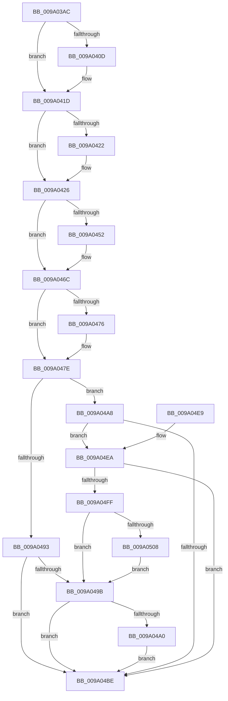

# sub_009A03AC

- RVA: `0x009A03AC`–`0x009A0515` (길이 `361` bytes)
- VA: `0x00000001409A03AC`
- 실행 섹션: `PAGE`
- PDB 이름 있음: `아니요`; PDB Function 태그: `아니요`
- unwind 정보 RVA: `0x0009B36C`
- 디코드: `110`개 명령, `361/361` bytes 표시
- 미해석 바이트: `0` (있으면 어셈블리에 `.byte`로 보존)

> 이 문서는 커널 이미지의 기계어와 PDB 기호를 분석해 생성했습니다. 4번과 5번은 함수 원형과 자료형을 바이너리 사용 방식에서 추정한 C 해석이며 원본 소스 복구 결과는 아닙니다.

## 1. Dependencies

- 직접 호출 지점: **12**; 고유 호출 대상: **10**
- 직접 호출자로 확인된 함수: **1**
- RIP 상대 이미지 참조: **0**

### Outgoing calls
- `0x009A03F7` → [KeAbPreAcquire](../../text/21/KeAbPreAcquire_function_00210230.md) (function, `0x00210230`)
- `0x009A0418` → [ExfAcquirePushLockSharedEx](../../text/21/ExfAcquirePushLockSharedEx_function_0021044C.md) (function, `0x0021044C`)
- `0x009A0447` → [sub_008D3DC0](../8D/Unknown_function_008D3DC0.md) (function, `0x008D3DC0`)
- `0x009A0456` → [sub_009A08EC](Unknown_function_009A08EC.md) (function, `0x009A08EC`)
- `0x009A0479` → [ExfReleasePushLockShared](../../text/26/ExfReleasePushLockShared_function_00263440.md) (function, `0x00263440`)
- `0x009A0481` → [KeAbPostRelease](../../text/2E/KeAbPostRelease_function_002E1600.md) (function, `0x002E1600`)
- `0x009A0486` → [KeLeaveGuardedRegion](../../text/2E/KeLeaveGuardedRegion_function_002E2C40.md) (function, `0x002E2C40`)
- `0x009A04AF` → [sub_009A0908](Unknown_function_009A0908.md) (function, `0x009A0908`)
- `0x009A04C1` → [sub_009A0698](Unknown_function_009A0698.md) (function, `0x009A0698`)
- `0x009A04CA` → [sub_009A0698](Unknown_function_009A0698.md) (function, `0x009A0698`)
- `0x009A04F4` → [sub_0099FC70](../99/Unknown_function_0099FC70.md) (function, `0x0099FC70`)
- `0x009A050B` → [sub_009A0698](Unknown_function_009A0698.md) (function, `0x009A0698`)

### Direct callers
- [sub_009A051C](Unknown_function_009A051C.md) at `0x009A0584`

### Static image references
- 디코드된 RIP-relative 메모리 참조가 없습니다.

## 2. Other-region calls and transfers

- 다른 실행 섹션으로 향하는 call: **5**
  - `0x009A03F7` → [KeAbPreAcquire](../../text/21/KeAbPreAcquire_function_00210230.md) (`PAGE` → `.text`)
  - `0x009A0418` → [ExfAcquirePushLockSharedEx](../../text/21/ExfAcquirePushLockSharedEx_function_0021044C.md) (`PAGE` → `.text`)
  - `0x009A0479` → [ExfReleasePushLockShared](../../text/26/ExfReleasePushLockShared_function_00263440.md) (`PAGE` → `.text`)
  - `0x009A0481` → [KeAbPostRelease](../../text/2E/KeAbPostRelease_function_002E1600.md) (`PAGE` → `.text`)
  - `0x009A0486` → [KeLeaveGuardedRegion](../../text/2E/KeLeaveGuardedRegion_function_002E2C40.md) (`PAGE` → `.text`)
- 별도 외부 분기/꼬리 이동을 확인하지 못했습니다.

## 3. Assembly (complete function range)

```asm
009A03AC  48 89 5C 24 10                  mov qword ptr [rsp + 0x10], rbx
009A03B1  55                              push rbp
009A03B2  56                              push rsi
009A03B3  57                              push rdi
009A03B4  41 54                           push r12
009A03B6  41 55                           push r13
009A03B8  41 56                           push r14
009A03BA  41 57                           push r15
009A03BC  48 8B EC                        mov rbp, rsp
009A03BF  48 83 EC 40                     sub rsp, 0x40
009A03C3  65 48 8B 04 25 88 01 00 00      mov rax, qword ptr gs:[0x188]
009A03CC  48 8D 99 B0 00 00 00            lea rbx, [rcx + 0xb0]
009A03D3  4D 8B F0                        mov r14, r8
009A03D6  4C 8B FA                        mov r15, rdx
009A03D9  48 8B F1                        mov rsi, rcx
009A03DC  45 33 E4                        xor r12d, r12d
009A03DF  45 33 C0                        xor r8d, r8d
009A03E2  4C 89 65 58                     mov qword ptr [rbp + 0x58], r12
009A03E6  66 FF 88 E6 01 00 00            dec word ptr [rax + 0x1e6]
009A03ED  33 D2                           xor edx, edx
009A03EF  48 8B CB                        mov rcx, rbx
009A03F2  4C 89 65 F8                     mov qword ptr [rbp - 8], r12
009A03F6  90                              nop
009A03F7  E8 34 FE 86 FF                  call 0x140210230
009A03FC  48 8B F8                        mov rdi, rax
009A03FF  45 8D 6C 24 11                  lea r13d, [r12 + 0x11]
009A0404  33 C0                           xor eax, eax
009A0406  F0 4C 0F B1 2B                  lock cmpxchg qword ptr [rbx], r13
009A040B  74 10                           je 0x1409a041d
009A040D  4C 8B CB                        mov r9, rbx
009A0410  4C 8B C7                        mov r8, rdi
009A0413  33 D2                           xor edx, edx
009A0415  48 8B CB                        mov rcx, rbx
009A0418  E8 2F 00 87 FF                  call 0x14021044c
009A041D  48 85 FF                        test rdi, rdi
009A0420  74 04                           je 0x1409a0426
009A0422  C6 47 0A 01                     mov byte ptr [rdi + 0xa], 1
009A0426  48 8D 45 40                     lea rax, [rbp + 0x40]
009A042A  4C 89 65 F0                     mov qword ptr [rbp - 0x10], r12
009A042E  48 8D 8E 88 00 00 00            lea rcx, [rsi + 0x88]
009A0435  48 89 44 24 20                  mov qword ptr [rsp + 0x20], rax
009A043A  4C 8D 4D F0                     lea r9, [rbp - 0x10]
009A043E  41 B8 10 00 00 00               mov r8d, 0x10
009A0444  49 8B D7                        mov rdx, r15
009A0447  E8 74 39 F3 FF                  call 0x1408d3dc0
009A044C  8B F8                           mov edi, eax
009A044E  85 C0                           test eax, eax
009A0450  78 1A                           js 0x1409a046c
009A0452  48 8B 4D F0                     mov rcx, qword ptr [rbp - 0x10]
009A0456  E8 91 04 00 00                  call 0x1409a08ec
009A045B  48 8B 4D 58                     mov rcx, qword ptr [rbp + 0x58]
009A045F  85 C0                           test eax, eax
009A0461  8B F8                           mov edi, eax
009A0463  48 0F 49 4D F0                  cmovns rcx, qword ptr [rbp - 0x10]
009A0468  48 89 4D 58                     mov qword ptr [rbp + 0x58], rcx
009A046C  49 8B C5                        mov rax, r13
009A046F  F0 4C 0F B1 23                  lock cmpxchg qword ptr [rbx], r12
009A0474  74 08                           je 0x1409a047e
009A0476  48 8B CB                        mov rcx, rbx
009A0479  E8 C2 2F 8C FF                  call 0x140263440
009A047E  48 8B CB                        mov rcx, rbx
009A0481  E8 7A 11 94 FF                  call 0x1402e1600
009A0486  E8 B5 27 94 FF                  call 0x1402e2c40
009A048B  81 FF 72 02 00 C0               cmp edi, 0xc0000272
009A0491  74 15                           je 0x1409a04a8
009A0493  48 8B 5D 58                     mov rbx, qword ptr [rbp + 0x58]
009A0497  85 FF                           test edi, edi
009A0499  78 23                           js 0x1409a04be
009A049B  4D 85 F6                        test r14, r14
009A049E  74 1E                           je 0x1409a04be
009A04A0  49 89 1E                        mov qword ptr [r14], rbx
009A04A3  49 8B DC                        mov rbx, r12
009A04A6  EB 16                           jmp 0x1409a04be
009A04A8  48 8D 55 58                     lea rdx, [rbp + 0x58]
009A04AC  49 8B CF                        mov rcx, r15
009A04AF  E8 54 04 00 00                  call 0x1409a0908
009A04B4  48 8B 5D 58                     mov rbx, qword ptr [rbp + 0x58]
009A04B8  8B F8                           mov edi, eax
009A04BA  85 C0                           test eax, eax
009A04BC  79 2C                           jns 0x1409a04ea
009A04BE  48 8B CB                        mov rcx, rbx
009A04C1  E8 D2 01 00 00                  call 0x1409a0698
009A04C6  48 8B 4D F8                     mov rcx, qword ptr [rbp - 8]
009A04CA  E8 C9 01 00 00                  call 0x1409a0698
009A04CF  48 8B 9C 24 88 00 00 00         mov rbx, qword ptr [rsp + 0x88]
009A04D7  8B C7                           mov eax, edi
009A04D9  48 83 C4 40                     add rsp, 0x40
009A04DD  41 5F                           pop r15
009A04DF  41 5E                           pop r14
009A04E1  41 5D                           pop r13
009A04E3  41 5C                           pop r12
009A04E5  5F                              pop rdi
009A04E6  5E                              pop rsi
009A04E7  5D                              pop rbp
009A04E8  C3                              ret
009A04E9  CC                              int3
009A04EA  4C 8D 45 F8                     lea r8, [rbp - 8]
009A04EE  48 8B D3                        mov rdx, rbx
009A04F1  48 8B CE                        mov rcx, rsi
009A04F4  E8 77 F7 FF FF                  call 0x14099fc70
009A04F9  8B F8                           mov edi, eax
009A04FB  85 C0                           test eax, eax
009A04FD  78 BF                           js 0x1409a04be
009A04FF  48 8B 75 F8                     mov rsi, qword ptr [rbp - 8]
009A0503  48 85 F6                        test rsi, rsi
009A0506  74 93                           je 0x1409a049b
009A0508  48 8B CB                        mov rcx, rbx
009A050B  E8 88 01 00 00                  call 0x1409a0698
009A0510  48 8B DE                        mov rbx, rsi
009A0513  EB 86                           jmp 0x1409a049b
```

## 4. C-style interpretation (structured pseudocode)

```c
__int64 __fastcall sub_009A03AC(__int64 a1, __int64 a2, __int64 a3)
{
    __int64 result;
    __int64 v_r12;
    __int64 v_rdi;
    __int64 v_rsp;
    unsigned __int64 v_stack_m40;
    unsigned __int64 v_stack_m48;
    unsigned __int64 v_stack_m58;
    unsigned __int64 v_stack_p10;
    unsigned __int64 v_stack_p20;
    unsigned __int64 v_stack_p8;

    v_stack_p10 = v_rbx;
    v_rsp = (v_rsp) - (64);
    v_r12 = 0;
    a3 = 0;
    v_stack_p20 = 0;
    a2 = 0;
    v_stack_m40 = 0;
    result = KeAbPreAcquire(a1 + 176, a2, a3, a4);
    result = 0;
    if (!(condition_is_equal)) {
        a4 = a1 + 176;
        a3 = 0;
        a2 = 0;
        a1 = a1 + 176;
        result = ExfAcquirePushLockSharedEx(a1, a2, a3, a4);
    }
    if (result != 0) {
        *(unsigned __int8 *)(result + 10) = 1;
    }
    v_stack_m48 = 0;
    v_stack_m58 = v_stack_p8;
    result = sub_008D3DC0(a1 + 136, 0, 16, v_stack_m48);
    v_rdi = (unsigned int)((unsigned int)(result));
    if (!(sign_flag)) {
        a1 = v_stack_m48;
        result = sub_009A08EC(a1, 0, 16, v_stack_m48);
        a1 = v_stack_p20;
        v_rdi = (unsigned int)(result);
        if (!sign_flag) { a1 = v_stack_m48; }
        v_stack_p20 = a1;
    }
    result = v_r12 + 17;
    if ((unsigned int)(result) != 0) {
        a1 = a1 + 176;
        result = ExfReleasePushLockShared(a1, 0, 16, v_stack_m48);
    }
    result = KeAbPostRelease(a1 + 176, 0, 16, v_stack_m48);
    result = KeLeaveGuardedRegion(a1 + 176, 0, 16, v_stack_m48);
    if (((unsigned int)(v_rdi)) == 0xC0000272ULL) goto loc_009A04A8;
    if (sign_flag) goto loc_009A04BE;
loc_009A049B:
    if (a3 == 0) goto loc_009A04BE;
    *(unsigned __int64 *)(a3) = v_stack_p20;
    goto loc_009A04BE;
loc_009A04A8:
    result = sub_009A0908(0, v_stack_p20, 16, v_stack_m48);
    if (!sign_flag) goto loc_009A04EA;
loc_009A04BE:
    result = sub_009A0698(v_stack_p20, v_stack_p20, 16, v_stack_m48);
    result = sub_009A0698(v_stack_m40, v_stack_p20, 16, v_stack_m48);
    v_rsp = (v_rsp) + (64);
    return (unsigned int)((unsigned int)((unsigned int)((unsigned int)(result))));
loc_009A04EA:
    result = sub_0099FC70(a1, v_stack_p10, v_stack_m40, v_stack_m48);
    if (sign_flag) goto loc_009A04BE;
    if (v_stack_m40 == 0) goto loc_009A049B;
    result = sub_009A0698(v_stack_p10, v_stack_p10, v_stack_m40, v_stack_m48);
    goto loc_009A049B;
}
```

## 5. (Beta) C Style

```c
int64_t sub_009A03AC(void *Arg1, int64_t Arg2, int64_t Arg3)
{
    uint8_t *arg1 = (uint8_t *)Arg1;

    int64_t result;
    int64_t local_r12;
    int64_t local_rdi;
    int64_t local_rsp;
    uint64_t v_stack_m40;
    uint64_t v_stack_m48;
    uint64_t v_stack_m58;
    uint64_t v_stack_p10;
    uint64_t v_stack_p20;
    uint64_t v_stack_p8;

    v_stack_p10 = local_rbx;
    local_rsp = (local_rsp) - (64);
    local_r12 = 0;
    Arg3 = 0;
    v_stack_p20 = 0;
    Arg2 = 0;
    v_stack_m40 = 0;
    result = KeAbPreAcquire(Arg1 + 176, Arg2, Arg3, a4);
    result = 0;
    if (!(condition_is_equal)) {
        a4 = Arg1 + 176;
        Arg3 = 0;
        Arg2 = 0;
        Arg1 = Arg1 + 176;
        result = ExfAcquirePushLockSharedEx(Arg1, Arg2, Arg3, a4);
    }
    if (result != 0) {
        *(uint8_t *)(result + 0xA) = 1;
    }
    v_stack_m48 = 0;
    v_stack_m58 = v_stack_p8;
    result = sub_008D3DC0(Arg1 + 136, 0, 16, v_stack_m48);
    local_rdi = (uint32_t)((uint32_t)(result));
    if (!(sign_flag)) {
        Arg1 = v_stack_m48;
        result = sub_009A08EC(Arg1, 0, 16, v_stack_m48);
        Arg1 = v_stack_p20;
        local_rdi = (uint32_t)(result);
        if (!sign_flag) { Arg1 = v_stack_m48; }
        v_stack_p20 = Arg1;
    }
    result = local_r12 + 17;
    if ((uint32_t)(result) != 0) {
        Arg1 = Arg1 + 176;
        result = ExfReleasePushLockShared(Arg1, 0, 16, v_stack_m48);
    }
    result = KeAbPostRelease(Arg1 + 176, 0, 16, v_stack_m48);
    result = KeLeaveGuardedRegion(Arg1 + 176, 0, 16, v_stack_m48);
    if (((uint32_t)(local_rdi)) == 0xC0000272ULL) goto loc_009A04A8;
    if (sign_flag) goto loc_009A04BE;
loc_009A049B:
    if (Arg3 == 0) goto loc_009A04BE;
    *(uint64_t *)(Arg3) = v_stack_p20;
    goto loc_009A04BE;
loc_009A04A8:
    result = sub_009A0908(0, v_stack_p20, 16, v_stack_m48);
    if (!sign_flag) goto loc_009A04EA;
loc_009A04BE:
    result = sub_009A0698(v_stack_p20, v_stack_p20, 16, v_stack_m48);
    result = sub_009A0698(v_stack_m40, v_stack_p20, 16, v_stack_m48);
    local_rsp = (local_rsp) + (64);
    return (uint32_t)((uint32_t)((uint32_t)((uint32_t)(result))));
loc_009A04EA:
    result = sub_0099FC70(Arg1, v_stack_p10, v_stack_m40, v_stack_m48);
    if (sign_flag) goto loc_009A04BE;
    if (v_stack_m40 == 0) goto loc_009A049B;
    result = sub_009A0698(v_stack_p10, v_stack_p10, v_stack_m40, v_stack_m48);
    goto loc_009A049B;
}
```

### 관측된 메모리 오프셋

구조체 형식이 확인되지 않은 접근은 인자 기준의 오프셋으로만 기록했습니다.

| 기준 인자 | 오프셋 표현 | 폭 (bit) | 접근 |
|---|---:|---:|---|
| `Arg1` | `+ 0x0` | `64` | `R` |
| `Arg1` | `+ 0x88` | `64` | `R` |
| `Arg1` | `+ 0xB0` | `64` | `R` |

## 6. Execution-region graph

[열기: 2D/3D 그래프와 함수 탐색 컨트롤 패널](../../../control-panel.html?section=page&rva=0x009A03AC&view=graph)

- 2D 그래프는 위에서 아래로 흐르고, 3D 그래프는 빈 공간을 드래그해 회전합니다. Shift+드래그는 이동, 휠은 확대·축소, 함수 노드 선택은 대상 보고서 이동입니다.

### Static fallback


