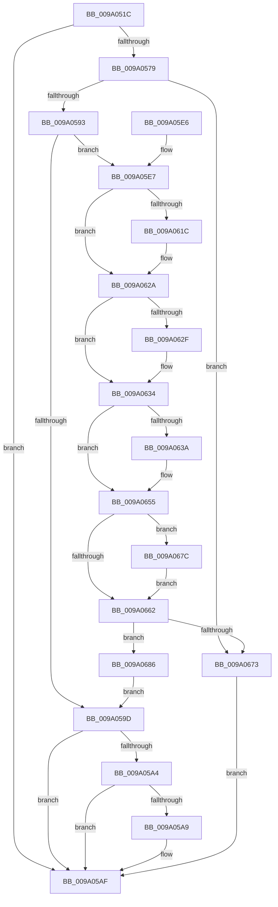

# sub_009A051C

- RVA: `0x009A051C`–`0x009A068F` (길이 `371` bytes)
- VA: `0x00000001409A051C`
- 실행 섹션: `PAGE`
- PDB 이름 있음: `아니요`; PDB Function 태그: `아니요`
- unwind 정보 RVA: `0x0009B388`
- 디코드: `112`개 명령, `371/371` bytes 표시
- 미해석 바이트: `0` (있으면 어셈블리에 `.byte`로 보존)

> 이 문서는 커널 이미지의 기계어와 PDB 기호를 분석해 생성했습니다. 4번과 5번은 함수 원형과 자료형을 바이너리 사용 방식에서 추정한 C 해석이며 원본 소스 복구 결과는 아닙니다.

## 1. Dependencies

- 직접 호출 지점: **11**; 고유 호출 대상: **11**
- 직접 호출자로 확인된 함수: **2**
- RIP 상대 이미지 참조: **1**

### Outgoing calls
- `0x009A056E` → [WbValidateEncryptionSegmentArguments](WbValidateEncryptionSegmentArguments_function_009A06CC.md) (function, `0x009A06CC`)
- `0x009A0584` → [sub_009A03AC](Unknown_function_009A03AC.md) (function, `0x009A03AC`)
- `0x009A05B2` → [sub_009A0698](Unknown_function_009A0698.md) (function, `0x009A0698`)
- `0x009A05BB` → [PdcCloseEvent](../8D/PdcCloseEvent_function_008D2404.md) (function, `0x008D2404`)
- `0x009A05C9` → [_security_check_cookie](../../text/6A/_security_check_cookie_function_006AC640.md) (function, `0x006AC640`)
- `0x009A060C` → [KeAbPreAcquire](../../text/21/KeAbPreAcquire_function_00210230.md) (function, `0x00210230`)
- `0x009A0625` → [ExfAcquirePushLockExclusiveEx](../../text/20/ExfAcquirePushLockExclusiveEx_function_0020FC90.md) (function, `0x0020FC90`)
- `0x009A064E` → [sub_0099FE78](../99/Unknown_function_0099FE78.md) (function, `0x0099FE78`)
- `0x009A0665` → [KeAbPostRelease](../../text/2E/KeAbPostRelease_function_002E1600.md) (function, `0x002E1600`)
- `0x009A066A` → [KeLeaveGuardedRegion](../../text/2E/KeLeaveGuardedRegion_function_002E2C40.md) (function, `0x002E2C40`)
- `0x009A067F` → [ExfTryToWakePushLock](../../text/26/ExfTryToWakePushLock_function_00265DD0.md) (function, `0x00265DD0`)

### Direct callers
- [sub_009A01EC](Unknown_function_009A01EC.md) at `0x009A020F`
- [sub_009A02CC](Unknown_function_009A02CC.md) at `0x009A02EF`

### Static image references
- `0x009A0533` → RVA `0x00E0A740` (`.data`; read)

## 2. Other-region calls and transfers

- 다른 실행 섹션으로 향하는 call: **6**
  - `0x009A05C9` → [_security_check_cookie](../../text/6A/_security_check_cookie_function_006AC640.md) (`PAGE` → `.text`)
  - `0x009A060C` → [KeAbPreAcquire](../../text/21/KeAbPreAcquire_function_00210230.md) (`PAGE` → `.text`)
  - `0x009A0625` → [ExfAcquirePushLockExclusiveEx](../../text/20/ExfAcquirePushLockExclusiveEx_function_0020FC90.md) (`PAGE` → `.text`)
  - `0x009A0665` → [KeAbPostRelease](../../text/2E/KeAbPostRelease_function_002E1600.md) (`PAGE` → `.text`)
  - `0x009A066A` → [KeLeaveGuardedRegion](../../text/2E/KeLeaveGuardedRegion_function_002E2C40.md) (`PAGE` → `.text`)
  - `0x009A067F` → [ExfTryToWakePushLock](../../text/26/ExfTryToWakePushLock_function_00265DD0.md) (`PAGE` → `.text`)
- 별도 외부 분기/꼬리 이동을 확인하지 못했습니다.

## 3. Assembly (complete function range)

```asm
009A051C  48 89 5C 24 18                  mov qword ptr [rsp + 0x18], rbx
009A0521  55                              push rbp
009A0522  56                              push rsi
009A0523  57                              push rdi
009A0524  41 54                           push r12
009A0526  41 55                           push r13
009A0528  41 56                           push r14
009A052A  41 57                           push r15
009A052C  48 8B EC                        mov rbp, rsp
009A052F  48 83 EC 70                     sub rsp, 0x70
009A0533  48 8B 05 06 A2 46 00            mov rax, qword ptr [rip + 0x46a206]
009A053A  48 33 C4                        xor rax, rsp
009A053D  48 89 45 F0                     mov qword ptr [rbp - 0x10], rax
009A0541  41 8B C0                        mov eax, r8d
009A0544  4C 8B EA                        mov r13, rdx
009A0547  4D 8B E1                        mov r12, r9
009A054A  4C 8D 45 C0                     lea r8, [rbp - 0x40]
009A054E  48 8B D9                        mov rbx, rcx
009A0551  4C 8D 4D E0                     lea r9, [rbp - 0x20]
009A0555  0F 57 C0                        xorps xmm0, xmm0
009A0558  0F 57 C9                        xorps xmm1, xmm1
009A055B  33 FF                           xor edi, edi
009A055D  8B D0                           mov edx, eax
009A055F  49 8B CD                        mov rcx, r13
009A0562  48 89 7D B0                     mov qword ptr [rbp - 0x50], rdi
009A0566  0F 11 45 E0                     movups xmmword ptr [rbp - 0x20], xmm0
009A056A  0F 11 4D C0                     movups xmmword ptr [rbp - 0x40], xmm1
009A056E  E8 59 01 00 00                  call 0x1409a06cc
009A0573  8B F0                           mov esi, eax
009A0575  85 C0                           test eax, eax
009A0577  78 36                           js 0x1409a05af
009A0579  4C 8D 45 B0                     lea r8, [rbp - 0x50]
009A057D  48 8B CB                        mov rcx, rbx
009A0580  48 8D 55 E0                     lea rdx, [rbp - 0x20]
009A0584  E8 23 FE FF FF                  call 0x1409a03ac
009A0589  8B F0                           mov esi, eax
009A058B  85 C0                           test eax, eax
009A058D  0F 88 E0 00 00 00               js 0x1409a0673
009A0593  48 8B 7D B0                     mov rdi, qword ptr [rbp - 0x50]
009A0597  83 7F 10 00                     cmp dword ptr [rdi + 0x10], 0
009A059B  74 4A                           je 0x1409a05e7
009A059D  8B 77 14                        mov esi, dword ptr [rdi + 0x14]
009A05A0  85 F6                           test esi, esi
009A05A2  78 0B                           js 0x1409a05af
009A05A4  4D 85 E4                        test r12, r12
009A05A7  74 06                           je 0x1409a05af
009A05A9  49 89 3C 24                     mov qword ptr [r12], rdi
009A05AD  33 FF                           xor edi, edi
009A05AF  48 8B CF                        mov rcx, rdi
009A05B2  E8 E1 00 00 00                  call 0x1409a0698
009A05B7  48 8B 4D C8                     mov rcx, qword ptr [rbp - 0x38]
009A05BB  E8 44 1E F3 FF                  call 0x1408d2404
009A05C0  8B C6                           mov eax, esi
009A05C2  48 8B 4D F0                     mov rcx, qword ptr [rbp - 0x10]
009A05C6  48 33 CC                        xor rcx, rsp
009A05C9  E8 72 C0 D0 FF                  call 0x1406ac640
009A05CE  48 8B 9C 24 C0 00 00 00         mov rbx, qword ptr [rsp + 0xc0]
009A05D6  48 83 C4 70                     add rsp, 0x70
009A05DA  41 5F                           pop r15
009A05DC  41 5E                           pop r14
009A05DE  41 5D                           pop r13
009A05E0  41 5C                           pop r12
009A05E2  5F                              pop rdi
009A05E3  5E                              pop rsi
009A05E4  5D                              pop rbp
009A05E5  C3                              ret
009A05E6  CC                              int3
009A05E7  65 48 8B 04 25 88 01 00 00      mov rax, qword ptr gs:[0x188]
009A05F0  48 83 CB FF                     or rbx, 0xffffffffffffffff
009A05F4  4C 8B 75 B0                     mov r14, qword ptr [rbp - 0x50]
009A05F8  45 33 C0                        xor r8d, r8d
009A05FB  49 83 C6 08                     add r14, 8
009A05FF  33 D2                           xor edx, edx
009A0601  49 8B CE                        mov rcx, r14
009A0604  66 01 98 E6 01 00 00            add word ptr [rax + 0x1e6], bx
009A060B  90                              nop
009A060C  E8 1F FC 86 FF                  call 0x140210230
009A0611  F0 49 0F BA 2E 00               lock bts qword ptr [r14], 0
009A0617  4C 8B F8                        mov r15, rax
009A061A  73 0E                           jae 0x1409a062a
009A061C  4D 8B C6                        mov r8, r14
009A061F  48 8B D0                        mov rdx, rax
009A0622  49 8B CE                        mov rcx, r14
009A0625  E8 66 F6 86 FF                  call 0x14020fc90
009A062A  4D 85 FF                        test r15, r15
009A062D  74 05                           je 0x1409a0634
009A062F  41 C6 47 0A 01                  mov byte ptr [r15 + 0xa], 1
009A0634  83 7F 10 00                     cmp dword ptr [rdi + 0x10], 0
009A0638  75 1B                           jne 0x1409a0655
009A063A  0F 28 45 C0                     movaps xmm0, xmmword ptr [rbp - 0x40]
009A063E  48 8D 4D D0                     lea rcx, [rbp - 0x30]
009A0642  4C 8B 45 B0                     mov r8, qword ptr [rbp - 0x50]
009A0646  49 8B D5                        mov rdx, r13
009A0649  66 0F 7F 45 D0                  movdqa xmmword ptr [rbp - 0x30], xmm0
009A064E  E8 25 F8 FF FF                  call 0x14099fe78
009A0653  8B F0                           mov esi, eax
009A0655  F0 49 0F C1 1E                  lock xadd qword ptr [r14], rbx
009A065A  80 E3 06                        and bl, 6
009A065D  80 FB 02                        cmp bl, 2
009A0660  74 1A                           je 0x1409a067c
009A0662  49 8B CE                        mov rcx, r14
009A0665  E8 96 0F 94 FF                  call 0x1402e1600
009A066A  E8 D1 25 94 FF                  call 0x1402e2c40
009A066F  85 F6                           test esi, esi
009A0671  79 13                           jns 0x1409a0686
009A0673  48 8B 7D B0                     mov rdi, qword ptr [rbp - 0x50]
009A0677  E9 33 FF FF FF                  jmp 0x1409a05af
009A067C  49 8B CE                        mov rcx, r14
009A067F  E8 4C 57 8C FF                  call 0x140265dd0
009A0684  EB DC                           jmp 0x1409a0662
009A0686  48 8B 7D B0                     mov rdi, qword ptr [rbp - 0x50]
009A068A  E9 0E FF FF FF                  jmp 0x1409a059d
```

## 4. C-style interpretation (structured pseudocode)

```c
__int64 __fastcall sub_009A051C(__int64 a1, __int64 a2, int a3, __int64 a4)
{
    __int64 result;
    __int64 v_r14;
    __int64 v_rbx;
    __int64 v_rdi;
    __int64 v_rsi;
    __int64 v_rsp;
    unsigned __int64 v_stack_m48;
    unsigned __int64 v_stack_m58;
    unsigned __int64 v_stack_m68;
    unsigned __int64 v_stack_m70;
    unsigned __int64 v_stack_m78;
    unsigned __int64 v_stack_m88;
    unsigned __int64 v_stack_p18;

    v_stack_p18 = v_rbx;
    v_rsp = (v_rsp) - (112);
    result = (*(unsigned __int64 *)(v_rip + 4628998)) ^ (v_rsp);
    v_stack_m48 = result;
    v_rdi = 0;
    v_stack_m88 = 0;
    v_stack_m58 = v_xmm0;
    v_stack_m78 = v_xmm1;
    result = WbValidateEncryptionSegmentArguments(a2, (unsigned int)((unsigned int)((unsigned int)(a3))), v_stack_m78, v_stack_m58);
    if (sign_flag) goto loc_009A05AF;
    result = sub_009A03AC(a1, v_stack_m58, v_stack_m88, v_stack_m58);
    if (sign_flag) goto loc_009A0673;
    if ((*(unsigned int *)(v_stack_m88 + 16)) == 0) goto loc_009A05E7;
loc_009A059D:
    if (sign_flag) goto loc_009A05AF;
    v_rdi = v_stack_m88;
    if (a4 != 0) {
        *(unsigned __int64 *)(a4) = v_stack_m88;
        v_rdi = 0;
    }
    result = sub_009A0698(0, v_stack_m58, v_stack_m88, v_stack_m58);
    result = PdcCloseEvent(v_stack_m70, v_stack_m58, v_stack_m88, v_stack_m58);
    a1 = (v_stack_m48) ^ (v_rsp);
    result = _security_check_cookie(a1, v_stack_m58, v_stack_m88, v_stack_m58);
    v_rsp = (v_rsp) + (112);
    return result;
loc_009A05E7:
    v_rbx = (v_stack_p18) | (-1);
    a3 = 0;
    v_r14 = (v_stack_m88) + (8);
    a2 = 0;
    result = KeAbPreAcquire(v_r14, a2, a3, v_stack_m58);
    if (!(condition_is_above_or_equal)) {
        a3 = v_r14;
        a2 = result;
        a1 = v_r14;
        result = ExfAcquirePushLockExclusiveEx(a1, a2, a3, v_stack_m58);
    }
    if (result != 0) {
        *(unsigned __int8 *)(result + 10) = 1;
    }
    v_rsi = (unsigned int)(*(unsigned int *)(v_stack_m88 + 20));
    if ((*(unsigned int *)(v_rdi + 16)) == 0) {
        a1 = v_stack_m68;
        a3 = v_stack_m88;
        a2 = a2;
        v_stack_m68 = v_xmm0;
        result = sub_0099FE78(a1, a2, a3, v_stack_m58);
        v_rsi = (unsigned int)(result);
    }
    v_rbx = (unsigned __int8)((v_rbx) & (6));
    if (((unsigned __int8)(v_rbx)) == 2) goto loc_009A067C;
loc_009A0662:
    result = KeAbPostRelease(v_r14, a2, a3, v_stack_m58);
    result = KeLeaveGuardedRegion(v_r14, a2, a3, v_stack_m58);
    if (!sign_flag) goto loc_009A0686;
loc_009A0673:
    goto loc_009A05AF;
loc_009A067C:
    result = ExfTryToWakePushLock(v_r14, a2, a3, v_stack_m58);
    goto loc_009A0662;
loc_009A0686:
    goto loc_009A059D;
}
```

## 5. (Beta) C Style

```c
int64_t sub_009A051C(int64_t Arg1, int64_t Arg2, int32_t Arg3, int64_t Arg4)
{
    int64_t result;
    int64_t local_r14;
    int64_t local_rbx;
    int64_t local_rdi;
    int64_t local_rsi;
    int64_t local_rsp;
    uint64_t v_stack_m48;
    uint64_t v_stack_m58;
    uint64_t v_stack_m68;
    uint64_t v_stack_m70;
    uint64_t v_stack_m78;
    uint64_t v_stack_m88;
    uint64_t v_stack_p18;

    v_stack_p18 = local_rbx;
    local_rsp = (local_rsp) - (112);
    result = (*(uint64_t *)(v_rip + 0x46A206)) ^ (local_rsp);
    v_stack_m48 = result;
    local_rdi = 0;
    v_stack_m88 = 0;
    v_stack_m58 = v_xmm0;
    v_stack_m78 = v_xmm1;
    result = WbValidateEncryptionSegmentArguments(Arg2, (uint32_t)((uint32_t)((uint32_t)(Arg3))), v_stack_m78, v_stack_m58);
    if (sign_flag) goto loc_009A05AF;
    result = sub_009A03AC(Arg1, v_stack_m58, v_stack_m88, v_stack_m58);
    if (sign_flag) goto loc_009A0673;
    if ((*(uint32_t *)(v_stack_m88 + 0x10)) == 0) goto loc_009A05E7;
loc_009A059D:
    if (sign_flag) goto loc_009A05AF;
    local_rdi = v_stack_m88;
    if (Arg4 != 0) {
        *(uint64_t *)(Arg4) = v_stack_m88;
        local_rdi = 0;
    }
    result = sub_009A0698(0, v_stack_m58, v_stack_m88, v_stack_m58);
    result = PdcCloseEvent(v_stack_m70, v_stack_m58, v_stack_m88, v_stack_m58);
    Arg1 = (v_stack_m48) ^ (local_rsp);
    result = _security_check_cookie(Arg1, v_stack_m58, v_stack_m88, v_stack_m58);
    local_rsp = (local_rsp) + (112);
    return result;
loc_009A05E7:
    local_rbx = (v_stack_p18) | (-1);
    Arg3 = 0;
    local_r14 = (v_stack_m88) + (8);
    Arg2 = 0;
    result = KeAbPreAcquire(local_r14, Arg2, Arg3, v_stack_m58);
    if (!(condition_is_above_or_equal)) {
        Arg3 = local_r14;
        Arg2 = result;
        Arg1 = local_r14;
        result = ExfAcquirePushLockExclusiveEx(Arg1, Arg2, Arg3, v_stack_m58);
    }
    if (result != 0) {
        *(uint8_t *)(result + 0xA) = 1;
    }
    local_rsi = (uint32_t)(*(uint32_t *)(v_stack_m88 + 0x14));
    if ((*(uint32_t *)(local_rdi + 0x10)) == 0) {
        Arg1 = v_stack_m68;
        Arg3 = v_stack_m88;
        Arg2 = Arg2;
        v_stack_m68 = v_xmm0;
        result = sub_0099FE78(Arg1, Arg2, Arg3, v_stack_m58);
        local_rsi = (uint32_t)(result);
    }
    local_rbx = (uint8_t)((local_rbx) & (6));
    if (((uint8_t)(local_rbx)) == 2) goto loc_009A067C;
loc_009A0662:
    result = KeAbPostRelease(local_r14, Arg2, Arg3, v_stack_m58);
    result = KeLeaveGuardedRegion(local_r14, Arg2, Arg3, v_stack_m58);
    if (!sign_flag) goto loc_009A0686;
loc_009A0673:
    goto loc_009A05AF;
loc_009A067C:
    result = ExfTryToWakePushLock(local_r14, Arg2, Arg3, v_stack_m58);
    goto loc_009A0662;
loc_009A0686:
    goto loc_009A059D;
}
```

## 6. Execution-region graph

[열기: 2D/3D 그래프와 함수 탐색 컨트롤 패널](../../../control-panel.html?section=page&rva=0x009A051C&view=graph)

- 2D 그래프는 위에서 아래로 흐르고, 3D 그래프는 빈 공간을 드래그해 회전합니다. Shift+드래그는 이동, 휠은 확대·축소, 함수 노드 선택은 대상 보고서 이동입니다.

### Static fallback


