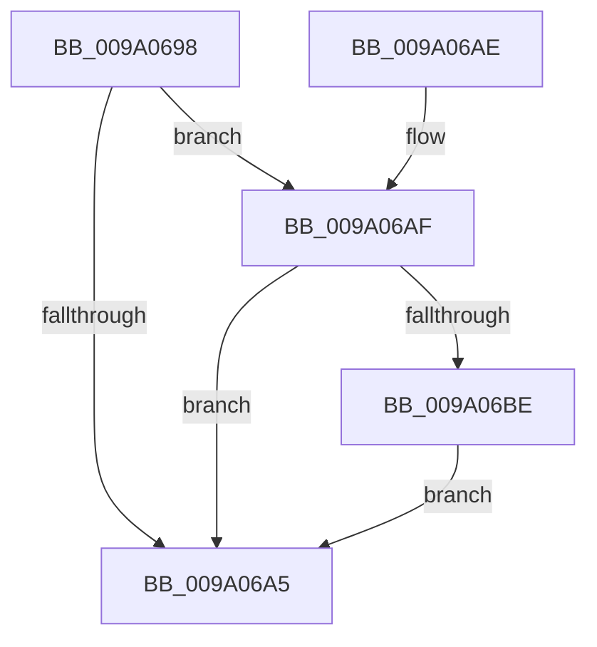

# sub_009A0698

- RVA: `0x009A0698`–`0x009A06C5` (길이 `45` bytes)
- VA: `0x00000001409A0698`
- 실행 섹션: `PAGE`
- PDB 이름 있음: `아니요`; PDB Function 태그: `아니요`
- unwind 정보 RVA: `0x00068804`
- 디코드: `16`개 명령, `45/45` bytes 표시
- 미해석 바이트: `0` (있으면 어셈블리에 `.byte`로 보존)

> 이 문서는 커널 이미지의 기계어와 PDB 기호를 분석해 생성했습니다. 4번과 5번은 함수 원형과 자료형을 바이너리 사용 방식에서 추정한 C 해석이며 원본 소스 복구 결과는 아닙니다.

## 1. Dependencies

- 직접 호출 지점: **1**; 고유 호출 대상: **1**
- 직접 호출자로 확인된 함수: **7**
- RIP 상대 이미지 참조: **0**

### Outgoing calls
- `0x009A06BE` → [sub_00AAB8F8](../AA/Unknown_function_00AAB8F8.md) (function, `0x00AAB8F8`)

### Direct callers
- [sub_0099FC70](../99/Unknown_function_0099FC70.md) at `0x0099FE20`
- [sub_009A01EC](Unknown_function_009A01EC.md) at `0x009A021F`
- [sub_009A02CC](Unknown_function_009A02CC.md) at `0x009A02FF`
- [sub_009A03AC](Unknown_function_009A03AC.md) at `0x009A04C1`
- [sub_009A03AC](Unknown_function_009A03AC.md) at `0x009A04CA`
- [sub_009A03AC](Unknown_function_009A03AC.md) at `0x009A050B`
- [sub_009A051C](Unknown_function_009A051C.md) at `0x009A05B2`
- [sub_009A0908](Unknown_function_009A0908.md) at `0x009A098F`
- [sub_00A67E80](../A6/Unknown_function_00A67E80.md) at `0x00A67F8D`

### Static image references
- 디코드된 RIP-relative 메모리 참조가 없습니다.

## 2. Other-region calls and transfers

- 다른 실행 섹션으로 향하는 call: **0**
- 별도 외부 분기/꼬리 이동을 확인하지 못했습니다.

## 3. Assembly (complete function range)

```asm
009A0698  40 53                           push rbx
009A069A  48 83 EC 20                     sub rsp, 0x20
009A069E  33 DB                           xor ebx, ebx
009A06A0  48 85 C9                        test rcx, rcx
009A06A3  75 0A                           jne 0x1409a06af
009A06A5  48 8B C3                        mov rax, rbx
009A06A8  48 83 C4 20                     add rsp, 0x20
009A06AC  5B                              pop rbx
009A06AD  C3                              ret
009A06AE  CC                              int3
009A06AF  48 83 CB FF                     or rbx, 0xffffffffffffffff
009A06B3  F0 48 0F C1 19                  lock xadd qword ptr [rcx], rbx
009A06B8  48 83 EB 01                     sub rbx, 1
009A06BC  75 E7                           jne 0x1409a06a5
009A06BE  E8 35 B2 10 00                  call 0x140aab8f8
009A06C3  EB E0                           jmp 0x1409a06a5
```

## 4. C-style interpretation (structured pseudocode)

```c
__int64 __fastcall sub_009A0698(__int64 a1)
{
    __int64 result;
    __int64 v_rbx;
    __int64 v_rsp;

    v_rsp = (v_rsp) - (32);
    v_rbx = 0;
    if (a1 != 0) goto loc_009A06AF;
loc_009A06A5:
    v_rsp = (v_rsp) + (32);
    return 0;
loc_009A06AF:
    v_rbx = (v_rbx) | (-1);
    v_rbx = (v_rbx) - (1);
    if (condition_is_not_equal) goto loc_009A06A5;
    result = sub_00AAB8F8(a1, a2, a3, a4);
    goto loc_009A06A5;
}
```

## 5. (Beta) C Style

```c
int64_t sub_009A0698(int64_t Arg1)
{
    int64_t result;
    int64_t local_rbx;
    int64_t local_rsp;

    local_rsp = (local_rsp) - (32);
    local_rbx = 0;
    if (Arg1 != 0) goto loc_009A06AF;
loc_009A06A5:
    local_rsp = (local_rsp) + (32);
    return 0;
loc_009A06AF:
    local_rbx = (local_rbx) | (-1);
    local_rbx = (local_rbx) - (1);
    if (condition_is_not_equal) goto loc_009A06A5;
    result = sub_00AAB8F8(Arg1, a2, a3, a4);
    goto loc_009A06A5;
}
```

## 6. Execution-region graph

[열기: 2D/3D 그래프와 함수 탐색 컨트롤 패널](../../../control-panel.html?section=page&rva=0x009A0698&view=graph)

- 2D 그래프는 위에서 아래로 흐르고, 3D 그래프는 빈 공간을 드래그해 회전합니다. Shift+드래그는 이동, 휠은 확대·축소, 함수 노드 선택은 대상 보고서 이동입니다.

### Static fallback


