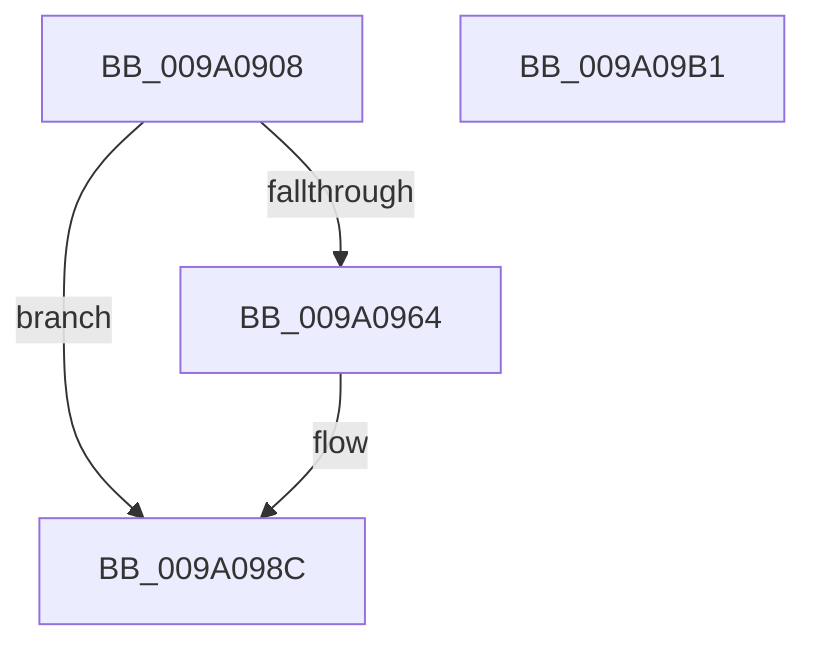

# sub_009A0908

- RVA: `0x009A0908`–`0x009A09B2` (길이 `170` bytes)
- VA: `0x00000001409A0908`
- 실행 섹션: `PAGE`
- PDB 이름 있음: `아니요`; PDB Function 태그: `아니요`
- unwind 정보 RVA: `0x0007F3F8`
- 디코드: `48`개 명령, `170/170` bytes 표시
- 미해석 바이트: `0` (있으면 어셈블리에 `.byte`로 보존)

> 이 문서는 커널 이미지의 기계어와 PDB 기호를 분석해 생성했습니다. 4번과 5번은 함수 원형과 자료형을 바이너리 사용 방식에서 추정한 C 해석이며 원본 소스 복구 결과는 아닙니다.

## 1. Dependencies

- 직접 호출 지점: **4**; 고유 호출 대상: **4**
- 직접 호출자로 확인된 함수: **1**
- RIP 상대 이미지 참조: **0**

### Outgoing calls
- `0x009A0937` → [ExAllocatePool2](../../poolcode/B8/ExAllocatePool2_function_00B820F0.md) (function, `0x00B820F0`)
- `0x009A095A` → [PdcCloseEvent](../8D/PdcCloseEvent_function_008D2404.md) (function, `0x008D2404`)
- `0x009A096D` → [memset](../../text/6C/memset_function_006C6C40.md) (function, `0x006C6C40`)
- `0x009A098F` → [sub_009A0698](Unknown_function_009A0698.md) (function, `0x009A0698`)

### Direct callers
- [sub_009A03AC](Unknown_function_009A03AC.md) at `0x009A04AF`

### Static image references
- 디코드된 RIP-relative 메모리 참조가 없습니다.

## 2. Other-region calls and transfers

- 다른 실행 섹션으로 향하는 call: **2**
  - `0x009A0937` → [ExAllocatePool2](../../poolcode/B8/ExAllocatePool2_function_00B820F0.md) (`PAGE` → `POOLCODE`)
  - `0x009A096D` → [memset](../../text/6C/memset_function_006C6C40.md) (`PAGE` → `.text`)
- 별도 외부 분기/꼬리 이동을 확인하지 못했습니다.

## 3. Assembly (complete function range)

```asm
009A0908  48 8B C4                        mov rax, rsp
009A090B  48 89 58 08                     mov qword ptr [rax + 8], rbx
009A090F  48 89 70 10                     mov qword ptr [rax + 0x10], rsi
009A0913  48 89 78 18                     mov qword ptr [rax + 0x18], rdi
009A0917  4C 89 70 20                     mov qword ptr [rax + 0x20], r14
009A091B  41 57                           push r15
009A091D  48 83 EC 20                     sub rsp, 0x20
009A0921  4C 8B FA                        mov r15, rdx
009A0924  4C 8B F1                        mov r14, rcx
009A0927  BA 50 00 00 00                  mov edx, 0x50
009A092C  B9 00 01 00 00                  mov ecx, 0x100
009A0931  41 B8 57 41 52 42               mov r8d, 0x42524157
009A0937  E8 B4 17 1E 00                  call 0x140b820f0
009A093C  33 FF                           xor edi, edi
009A093E  48 8B D8                        mov rbx, rax
009A0941  48 85 C0                        test rax, rax
009A0944  48 0F 45 F8                     cmovne rdi, rax
009A0948  48 8B C8                        mov rcx, rax
009A094B  48 F7 D9                        neg rcx
009A094E  1B F6                           sbb esi, esi
009A0950  33 C9                           xor ecx, ecx
009A0952  F7 D6                           not esi
009A0954  81 E6 17 00 00 C0               and esi, 0xc0000017
009A095A  E8 A5 1A F3 FF                  call 0x1408d2404
009A095F  48 85 DB                        test rbx, rbx
009A0962  74 28                           je 0x1409a098c
009A0964  33 D2                           xor edx, edx
009A0966  48 8B CF                        mov rcx, rdi
009A0969  44 8D 42 50                     lea r8d, [rdx + 0x50]
009A096D  E8 CE 62 D2 FF                  call 0x1406c6c40
009A0972  48 C7 07 01 00 00 00            mov qword ptr [rdi], 1
009A0979  41 8B 56 08                     mov edx, dword ptr [r14 + 8]
009A097D  89 57 18                        mov dword ptr [rdi + 0x18], edx
009A0980  49 8B 16                        mov rdx, qword ptr [r14]
009A0983  48 89 57 20                     mov qword ptr [rdi + 0x20], rdx
009A0987  49 89 3F                        mov qword ptr [r15], rdi
009A098A  33 FF                           xor edi, edi
009A098C  48 8B CF                        mov rcx, rdi
009A098F  E8 04 FD FF FF                  call 0x1409a0698
009A0994  48 8B 5C 24 30                  mov rbx, qword ptr [rsp + 0x30]
009A0999  8B C6                           mov eax, esi
009A099B  48 8B 74 24 38                  mov rsi, qword ptr [rsp + 0x38]
009A09A0  48 8B 7C 24 40                  mov rdi, qword ptr [rsp + 0x40]
009A09A5  4C 8B 74 24 48                  mov r14, qword ptr [rsp + 0x48]
009A09AA  48 83 C4 20                     add rsp, 0x20
009A09AE  41 5F                           pop r15
009A09B0  C3                              ret
009A09B1  CC                              int3
```

## 4. C-style interpretation (structured pseudocode)

```c
__int64 __fastcall sub_009A0908(__int64 a1, __int64 a2)
{
    __int64 result;
    __int64 v_rdi;
    __int64 v_rsi;
    __int64 v_rsp;
    unsigned __int64 v_stack_p10;
    unsigned __int64 v_stack_p18;
    unsigned __int64 v_stack_p20;
    unsigned __int64 v_stack_p8;

    *(unsigned __int64 *)(v_rsp + 8) = v_rbx;
    *(unsigned __int64 *)(v_rsp + 16) = v_rsi;
    *(unsigned __int64 *)(v_rsp + 24) = v_rdi;
    *(unsigned __int64 *)(v_rsp + 32) = v_r14;
    v_rsp = (v_rsp) - (32);
    result = ExAllocatePool2(256, 80, (unsigned int)(0x42524157ULL), a4);
    v_rdi = 0;
    if (result != 0) { v_rdi = result; }
    a1 = -(result);
    a1 = 0;
    v_rsi = (unsigned int)(~(v_rsi));
    v_rsi = (unsigned int)((v_rsi) & (0xC0000017ULL));
    result = PdcCloseEvent(a1, 80, (unsigned int)(0x42524157ULL), a4);
    if (result != 0) {
        a2 = 0;
        a1 = v_rdi;
        a3 = a2 + 80;
        result = memset(a1, a2, a3, a4);
        *(unsigned __int64 *)(v_rdi) = 1;
        a2 = *(unsigned int *)(a1 + 8);
        *(unsigned int *)(v_rdi + 24) = (unsigned int)(a2);
        a2 = *(unsigned __int64 *)(a1);
        *(unsigned __int64 *)(v_rdi + 32) = a2;
        *(unsigned __int64 *)(a2) = v_rdi;
        v_rdi = 0;
    }
    result = sub_009A0698(0, a2, a3, a4);
    v_rsp = (v_rsp) + (32);
    return (unsigned int)((unsigned int)(v_rsi));
}
```

## 5. (Beta) C Style

```c
int64_t sub_009A0908(void *Arg1, void *Arg2)
{
    uint8_t *arg1 = (uint8_t *)Arg1;
    uint8_t *arg2 = (uint8_t *)Arg2;

    int64_t result;
    int64_t local_rdi;
    int64_t local_rsi;
    int64_t local_rsp;
    uint64_t v_stack_p10;
    uint64_t v_stack_p18;
    uint64_t v_stack_p20;
    uint64_t v_stack_p8;

    *(uint64_t *)(local_rsp + 0x8) = local_rbx;
    *(uint64_t *)(local_rsp + 0x10) = local_rsi;
    *(uint64_t *)(local_rsp + 0x18) = local_rdi;
    *(uint64_t *)(local_rsp + 0x20) = local_r14;
    local_rsp = (local_rsp) - (32);
    result = ExAllocatePool2(256, 80, (uint32_t)(0x42524157ULL), a4);
    local_rdi = 0;
    if (result != 0) { local_rdi = result; }
    Arg1 = -(result);
    Arg1 = 0;
    local_rsi = (uint32_t)(~(local_rsi));
    local_rsi = (uint32_t)((local_rsi) & (0xC0000017ULL));
    result = PdcCloseEvent(Arg1, 80, (uint32_t)(0x42524157ULL), a4);
    if (result != 0) {
        Arg2 = 0;
        Arg1 = local_rdi;
        a3 = Arg2 + 80;
        result = memset(Arg1, Arg2, a3, a4);
        *(uint64_t *)(local_rdi) = 1;
        Arg2 = *(uint32_t *)(arg1 + 0x8);
        *(uint32_t *)(local_rdi + 0x18) = (uint32_t)(Arg2);
        Arg2 = *(uint64_t *)(arg1);
        *(void **)(local_rdi + 0x20) = Arg2;
        *(uint64_t *)(arg2) = local_rdi;
        local_rdi = 0;
    }
    result = sub_009A0698(0, Arg2, a3, a4);
    local_rsp = (local_rsp) + (32);
    return (uint32_t)((uint32_t)(local_rsi));
}
```

### 관측된 메모리 오프셋

구조체 형식이 확인되지 않은 접근은 인자 기준의 오프셋으로만 기록했습니다.

| 기준 인자 | 오프셋 표현 | 폭 (bit) | 접근 |
|---|---:|---:|---|
| `Arg1` | `+ 0x0` | `64` | `R` |
| `Arg1` | `+ 0x8` | `32` | `R` |
| `Arg2` | `+ 0x0` | `64` | `W` |

## 6. Execution-region graph

[열기: 2D/3D 그래프와 함수 탐색 컨트롤 패널](../../../control-panel.html?section=page&rva=0x009A0908&view=graph)

- 2D 그래프는 위에서 아래로 흐르고, 3D 그래프는 빈 공간을 드래그해 회전합니다. Shift+드래그는 이동, 휠은 확대·축소, 함수 노드 선택은 대상 보고서 이동입니다.

### Static fallback


