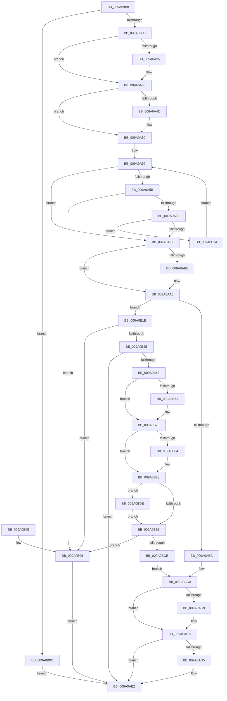

# sub_009A09B8

- RVA: `0x009A09B8`–`0x009A0BE8` (길이 `560` bytes)
- VA: `0x00000001409A09B8`
- 실행 섹션: `PAGE`
- PDB 이름 있음: `아니요`; PDB Function 태그: `아니요`
- unwind 정보 RVA: `0x0009B41C`
- 디코드: `159`개 명령, `560/560` bytes 표시
- 미해석 바이트: `0` (있으면 어셈블리에 `.byte`로 보존)

> 이 문서는 커널 이미지의 기계어와 PDB 기호를 분석해 생성했습니다. 4번과 5번은 함수 원형과 자료형을 바이너리 사용 방식에서 추정한 C 해석이며 원본 소스 복구 결과는 아닙니다.

## 1. Dependencies

- 직접 호출 지점: **15**; 고유 호출 대상: **11**
- 직접 호출자로 확인된 함수: **1**
- RIP 상대 이미지 참조: **0**

### Outgoing calls
- `0x009A0A21` → [KeAbPreAcquire](../../text/21/KeAbPreAcquire_function_00210230.md) (function, `0x00210230`)
- `0x009A0A40` → [ExfAcquirePushLockSharedEx](../../text/21/ExfAcquirePushLockSharedEx_function_0021044C.md) (function, `0x0021044C`)
- `0x009A0A7A` → [sub_009A174C](Unknown_function_009A174C.md) (function, `0x009A174C`)
- `0x009A0AA1` → [ExfReleasePushLockShared](../../text/26/ExfReleasePushLockShared_function_00263440.md) (function, `0x00263440`)
- `0x009A0AA9` → [KeAbPostRelease](../../text/2E/KeAbPostRelease_function_002E1600.md) (function, `0x002E1600`)
- `0x009A0AAE` → [KeLeaveGuardedRegion](../../text/2E/KeLeaveGuardedRegion_function_002E2C40.md) (function, `0x002E2C40`)
- `0x009A0AE5` → [sub_009A0BF0](Unknown_function_009A0BF0.md) (function, `0x009A0BF0`)
- `0x009A0B1F` → [sub_009A0C94](Unknown_function_009A0C94.md) (function, `0x009A0C94`)
- `0x009A0B39` → [sub_009A174C](Unknown_function_009A174C.md) (function, `0x009A174C`)
- `0x009A0B61` → [KeAbPreAcquire](../../text/21/KeAbPreAcquire_function_00210230.md) (function, `0x00210230`)
- `0x009A0B7A` → [ExfAcquirePushLockExclusiveEx](../../text/20/ExfAcquirePushLockExclusiveEx_function_0020FC90.md) (function, `0x0020FC90`)
- `0x009A0BA3` → [sub_008D0970](../8D/Unknown_function_008D0970.md) (function, `0x008D0970`)
- `0x009A0BBB` → [KeAbPostRelease](../../text/2E/KeAbPostRelease_function_002E1600.md) (function, `0x002E1600`)
- `0x009A0BC0` → [KeLeaveGuardedRegion](../../text/2E/KeLeaveGuardedRegion_function_002E2C40.md) (function, `0x002E2C40`)
- `0x009A0BE1` → [ExfTryToWakePushLock](../../text/26/ExfTryToWakePushLock_function_00265DD0.md) (function, `0x00265DD0`)

### Direct callers
- [WbCreateHeapExecutedBlock](../8D/WbCreateHeapExecutedBlock_function_008D4BE8.md) at `0x008D4D81`

### Static image references
- 디코드된 RIP-relative 메모리 참조가 없습니다.

## 2. Other-region calls and transfers

- 다른 실행 섹션으로 향하는 call: **10**
  - `0x009A0A21` → [KeAbPreAcquire](../../text/21/KeAbPreAcquire_function_00210230.md) (`PAGE` → `.text`)
  - `0x009A0A40` → [ExfAcquirePushLockSharedEx](../../text/21/ExfAcquirePushLockSharedEx_function_0021044C.md) (`PAGE` → `.text`)
  - `0x009A0AA1` → [ExfReleasePushLockShared](../../text/26/ExfReleasePushLockShared_function_00263440.md) (`PAGE` → `.text`)
  - `0x009A0AA9` → [KeAbPostRelease](../../text/2E/KeAbPostRelease_function_002E1600.md) (`PAGE` → `.text`)
  - `0x009A0AAE` → [KeLeaveGuardedRegion](../../text/2E/KeLeaveGuardedRegion_function_002E2C40.md) (`PAGE` → `.text`)
  - `0x009A0B61` → [KeAbPreAcquire](../../text/21/KeAbPreAcquire_function_00210230.md) (`PAGE` → `.text`)
  - `0x009A0B7A` → [ExfAcquirePushLockExclusiveEx](../../text/20/ExfAcquirePushLockExclusiveEx_function_0020FC90.md) (`PAGE` → `.text`)
  - `0x009A0BBB` → [KeAbPostRelease](../../text/2E/KeAbPostRelease_function_002E1600.md) (`PAGE` → `.text`)
  - `0x009A0BC0` → [KeLeaveGuardedRegion](../../text/2E/KeLeaveGuardedRegion_function_002E2C40.md) (`PAGE` → `.text`)
  - `0x009A0BE1` → [ExfTryToWakePushLock](../../text/26/ExfTryToWakePushLock_function_00265DD0.md) (`PAGE` → `.text`)
- 별도 외부 분기/꼬리 이동을 확인하지 못했습니다.

## 3. Assembly (complete function range)

```asm
009A09B8  48 89 5C 24 08                  mov qword ptr [rsp + 8], rbx
009A09BD  4C 89 4C 24 20                  mov qword ptr [rsp + 0x20], r9
009A09C2  4C 89 44 24 18                  mov qword ptr [rsp + 0x18], r8
009A09C7  55                              push rbp
009A09C8  56                              push rsi
009A09C9  57                              push rdi
009A09CA  41 54                           push r12
009A09CC  41 55                           push r13
009A09CE  41 56                           push r14
009A09D0  41 57                           push r15
009A09D2  48 8B EC                        mov rbp, rsp
009A09D5  48 83 EC 50                     sub rsp, 0x50
009A09D9  33 C0                           xor eax, eax
009A09DB  44 8B E2                        mov r12d, edx
009A09DE  48 89 45 E0                     mov qword ptr [rbp - 0x20], rax
009A09E2  4C 8B E9                        mov r13, rcx
009A09E5  48 89 45 E8                     mov qword ptr [rbp - 0x18], rax
009A09E9  44 8B F8                        mov r15d, eax
009A09EC  8B F0                           mov esi, eax
009A09EE  44 8B F0                        mov r14d, eax
009A09F1  81 FA 00 00 01 00               cmp edx, 0x10000
009A09F7  0F 87 0F 01 00 00               ja 0x1409a0b0c
009A09FD  65 48 8B 04 25 88 01 00 00      mov rax, qword ptr gs:[0x188]
009A0A06  48 8D B9 E0 00 00 00            lea rdi, [rcx + 0xe0]
009A0A0D  48 83 CB FF                     or rbx, 0xffffffffffffffff
009A0A11  45 33 C0                        xor r8d, r8d
009A0A14  33 D2                           xor edx, edx
009A0A16  48 8B CF                        mov rcx, rdi
009A0A19  66 01 98 E6 01 00 00            add word ptr [rax + 0x1e6], bx
009A0A20  90                              nop
009A0A21  E8 0A F8 86 FF                  call 0x140210230
009A0A26  48 8B F0                        mov rsi, rax
009A0A29  8D 4B 12                        lea ecx, [rbx + 0x12]
009A0A2C  33 C0                           xor eax, eax
009A0A2E  F0 48 0F B1 0F                  lock cmpxchg qword ptr [rdi], rcx
009A0A33  74 10                           je 0x1409a0a45
009A0A35  4C 8B CF                        mov r9, rdi
009A0A38  4C 8B C6                        mov r8, rsi
009A0A3B  33 D2                           xor edx, edx
009A0A3D  48 8B CF                        mov rcx, rdi
009A0A40  E8 07 FA 86 FF                  call 0x14021044c
009A0A45  33 C9                           xor ecx, ecx
009A0A47  48 85 F6                        test rsi, rsi
009A0A4A  74 04                           je 0x1409a0a50
009A0A4C  C6 46 0A 01                     mov byte ptr [rsi + 0xa], 1
009A0A50  8B F1                           mov esi, ecx
009A0A52  41 3B B5 BC 00 00 00            cmp esi, dword ptr [r13 + 0xbc]
009A0A59  73 37                           jae 0x1409a0a92
009A0A5B  49 8B 85 C8 00 00 00            mov rax, qword ptr [r13 + 0xc8]
009A0A62  4C 8D 45 E8                     lea r8, [rbp - 0x18]
009A0A66  8B CE                           mov ecx, esi
009A0A68  41 8B D4                        mov edx, r12d
009A0A6B  41 0F AF 8D B8 00 00 00         imul ecx, dword ptr [r13 + 0xb8]
009A0A73  4C 8B 3C 01                     mov r15, qword ptr [rcx + rax]
009A0A77  49 8B CF                        mov rcx, r15
009A0A7A  E8 CD 0C 00 00                  call 0x1409a174c
009A0A7F  33 C9                           xor ecx, ecx
009A0A81  44 8B F0                        mov r14d, eax
009A0A84  85 C0                           test eax, eax
009A0A86  78 7E                           js 0x1409a0b06
009A0A88  48 39 4D E8                     cmp qword ptr [rbp - 0x18], rcx
009A0A8C  0F 84 82 00 00 00               je 0x1409a0b14
009A0A92  B8 11 00 00 00                  mov eax, 0x11
009A0A97  F0 48 0F B1 0F                  lock cmpxchg qword ptr [rdi], rcx
009A0A9C  74 08                           je 0x1409a0aa6
009A0A9E  48 8B CF                        mov rcx, rdi
009A0AA1  E8 9A 29 8C FF                  call 0x140263440
009A0AA6  48 8B CF                        mov rcx, rdi
009A0AA9  E8 52 0B 94 FF                  call 0x1402e1600
009A0AAE  E8 8D 21 94 FF                  call 0x1402e2c40
009A0AB3  48 8B 4D E8                     mov rcx, qword ptr [rbp - 0x18]
009A0AB7  48 85 C9                        test rcx, rcx
009A0ABA  74 5F                           je 0x1409a0b1b
009A0ABC  48 8B 75 E0                     mov rsi, qword ptr [rbp - 0x20]
009A0AC0  48 8B 45 50                     mov rax, qword ptr [rbp + 0x50]
009A0AC4  48 85 C0                        test rax, rax
009A0AC7  74 03                           je 0x1409a0acc
009A0AC9  48 89 08                        mov qword ptr [rax], rcx
009A0ACC  4C 8B 45 58                     mov r8, qword ptr [rbp + 0x58]
009A0AD0  4D 85 C0                        test r8, r8
009A0AD3  74 0D                           je 0x1409a0ae2
009A0AD5  49 8B 17                        mov rdx, qword ptr [r15]
009A0AD8  49 2B 57 20                     sub rdx, qword ptr [r15 + 0x20]
009A0ADC  48 03 D1                        add rdx, rcx
009A0ADF  49 89 10                        mov qword ptr [r8], rdx
009A0AE2  48 8B CE                        mov rcx, rsi
009A0AE5  E8 06 01 00 00                  call 0x1409a0bf0
009A0AEA  48 8B 9C 24 90 00 00 00         mov rbx, qword ptr [rsp + 0x90]
009A0AF2  41 8B C6                        mov eax, r14d
009A0AF5  48 83 C4 50                     add rsp, 0x50
009A0AF9  41 5F                           pop r15
009A0AFB  41 5E                           pop r14
009A0AFD  41 5D                           pop r13
009A0AFF  41 5C                           pop r12
009A0B01  5F                              pop rdi
009A0B02  5E                              pop rsi
009A0B03  5D                              pop rbp
009A0B04  C3                              ret
009A0B05  CC                              int3
009A0B06  48 8B 75 E0                     mov rsi, qword ptr [rbp - 0x20]
009A0B0A  EB D6                           jmp 0x1409a0ae2
009A0B0C  41 BE 0D 00 00 C0               mov r14d, 0xc000000d
009A0B12  EB CE                           jmp 0x1409a0ae2
009A0B14  FF C6                           inc esi
009A0B16  E9 37 FF FF FF                  jmp 0x1409a0a52
009A0B1B  48 8D 55 E0                     lea rdx, [rbp - 0x20]
009A0B1F  E8 70 01 00 00                  call 0x1409a0c94
009A0B24  44 8B F0                        mov r14d, eax
009A0B27  85 C0                           test eax, eax
009A0B29  78 DB                           js 0x1409a0b06
009A0B2B  48 8B 75 E0                     mov rsi, qword ptr [rbp - 0x20]
009A0B2F  4C 8D 45 E8                     lea r8, [rbp - 0x18]
009A0B33  48 8B CE                        mov rcx, rsi
009A0B36  41 8B D4                        mov edx, r12d
009A0B39  E8 0E 0C 00 00                  call 0x1409a174c
009A0B3E  45 33 E4                        xor r12d, r12d
009A0B41  44 8B F0                        mov r14d, eax
009A0B44  85 C0                           test eax, eax
009A0B46  78 9A                           js 0x1409a0ae2
009A0B48  65 48 8B 04 25 88 01 00 00      mov rax, qword ptr gs:[0x188]
009A0B51  45 33 C0                        xor r8d, r8d
009A0B54  33 D2                           xor edx, edx
009A0B56  48 8B CF                        mov rcx, rdi
009A0B59  66 01 98 E6 01 00 00            add word ptr [rax + 0x1e6], bx
009A0B60  90                              nop
009A0B61  E8 CA F6 86 FF                  call 0x140210230
009A0B66  F0 48 0F BA 2F 00               lock bts qword ptr [rdi], 0
009A0B6C  48 8B F0                        mov rsi, rax
009A0B6F  73 0E                           jae 0x1409a0b7f
009A0B71  4C 8B C7                        mov r8, rdi
009A0B74  48 8B D0                        mov rdx, rax
009A0B77  48 8B CF                        mov rcx, rdi
009A0B7A  E8 11 F1 86 FF                  call 0x14020fc90
009A0B7F  48 85 F6                        test rsi, rsi
009A0B82  74 04                           je 0x1409a0b88
009A0B84  C6 46 0A 01                     mov byte ptr [rsi + 0xa], 1
009A0B88  48 8B 55 E0                     mov rdx, qword ptr [rbp - 0x20]
009A0B8C  49 8D 8D B8 00 00 00            lea rcx, [r13 + 0xb8]
009A0B93  89 5C 24 28                     mov dword ptr [rsp + 0x28], ebx
009A0B97  C7 44 24 20 08 00 00 00         mov dword ptr [rsp + 0x20], 8
009A0B9F  4C 8B 4A 20                     mov r9, qword ptr [rdx + 0x20]
009A0BA3  E8 C8 FD F2 FF                  call 0x1408d0970
009A0BA8  44 8B F0                        mov r14d, eax
009A0BAB  F0 48 0F C1 1F                  lock xadd qword ptr [rdi], rbx
009A0BB0  80 E3 06                        and bl, 6
009A0BB3  80 FB 02                        cmp bl, 2
009A0BB6  74 26                           je 0x1409a0bde
009A0BB8  48 8B CF                        mov rcx, rdi
009A0BBB  E8 40 0A 94 FF                  call 0x1402e1600
009A0BC0  E8 7B 20 94 FF                  call 0x1402e2c40
009A0BC5  45 85 F6                        test r14d, r14d
009A0BC8  0F 88 38 FF FF FF               js 0x1409a0b06
009A0BCE  4C 8B 7D E0                     mov r15, qword ptr [rbp - 0x20]
009A0BD2  49 8B F4                        mov rsi, r12
009A0BD5  48 8B 4D E8                     mov rcx, qword ptr [rbp - 0x18]
009A0BD9  E9 E2 FE FF FF                  jmp 0x1409a0ac0
009A0BDE  48 8B CF                        mov rcx, rdi
009A0BE1  E8 EA 51 8C FF                  call 0x140265dd0
009A0BE6  EB D0                           jmp 0x1409a0bb8
```

## 4. C-style interpretation (structured pseudocode)

```c
__int64 __fastcall sub_009A09B8(__int64 a1, int a2, __int64 a3, __int64 a4)
{
    __int64 result;
    __int64 v_r12;
    __int64 v_rbx;
    __int64 v_rsi;
    __int64 v_rsp;
    unsigned __int64 v_stack_m50;
    unsigned __int64 v_stack_m58;
    unsigned __int64 v_stack_p18;
    unsigned __int64 v_stack_p20;
    unsigned int v_stack_p28;
    unsigned __int64 v_stack_p8;

    v_stack_p8 = v_rbx;
    v_stack_p20 = a4;
    v_stack_p18 = a3;
    v_rsp = (v_rsp) - (80);
    result = 0;
    v_stack_m58 = 0;
    v_stack_m50 = 0;
    if (a2 > 0x10000ULL) goto loc_009A0B0C;
    v_rbx = (v_rbx) | (-1);
    a3 = 0;
    a2 = 0;
    result = KeAbPreAcquire(a1 + 224, a2, a3, a4);
    result = 0;
    if (!(condition_is_equal)) {
        a4 = a1 + 224;
        a3 = 0;
        a2 = 0;
        a1 = a1 + 224;
        result = ExfAcquirePushLockSharedEx(a1, a2, a3, a4);
    }
    a1 = 0;
    if (result != 0) {
        *(unsigned __int8 *)(result + 10) = 1;
    }
loc_009A0A52:
    if (0 >= (*(unsigned int *)(a1 + 188))) goto loc_009A0A92;
    a1 = (unsigned int)((0) * (*(unsigned int *)(a1 + 184)));
    result = sub_009A174C(*(unsigned __int64 *)(a1 + *(unsigned __int64 *)(a1 + 200) * 1), (unsigned int)((unsigned int)((unsigned int)(a2))), v_stack_m50, a4);
    a1 = 0;
    if (sign_flag) goto loc_009A0B06;
    if (v_stack_m50 == 0) goto loc_009A0B14;
loc_009A0A92:
    result = 17;
    if (v_stack_m50 != 0) {
        a1 = a1 + 224;
        result = ExfReleasePushLockShared(a1, (unsigned int)((unsigned int)((unsigned int)(a2))), v_stack_m50, a4);
    }
    result = KeAbPostRelease(a1 + 224, (unsigned int)((unsigned int)((unsigned int)(a2))), v_stack_m50, a4);
    result = KeLeaveGuardedRegion(a1 + 224, (unsigned int)((unsigned int)((unsigned int)(a2))), v_stack_m50, a4);
    if (v_stack_m50 == 0) goto loc_009A0B1B;
loc_009A0AC0:
    if (v_stack_p18 != 0) {
        *(unsigned __int64 *)(v_stack_p18) = v_stack_m50;
    }
    if (v_stack_p20 != 0) {
        a2 = *(unsigned __int64 *)(*(unsigned __int64 *)(a1 + *(unsigned __int64 *)(a1 + 200) * 1));
        a2 = (a2) - (*(unsigned __int64 *)(*(unsigned __int64 *)(a1 + *(unsigned __int64 *)(a1 + 200) * 1) + 32));
        a2 = (a2) + (v_stack_m50);
        *(unsigned __int64 *)(v_stack_p20) = a2;
    }
    result = sub_009A0BF0(v_stack_m58, a2, v_stack_p20, a4);
    v_rsp = (v_rsp) + (80);
    return (unsigned int)((unsigned int)((unsigned int)((unsigned int)(result))));
loc_009A0B06:
    goto loc_009A0AE2;
loc_009A0B0C:
    goto loc_009A0AE2;
loc_009A0B14:
    v_rsi = (unsigned int)((v_stack_m58) + 1);
    goto loc_009A0A52;
loc_009A0B1B:
    result = sub_009A0C94(v_stack_m58, v_stack_m58, v_stack_p20, a4);
    if (sign_flag) goto loc_009A0B06;
    result = sub_009A174C(v_stack_m58, (unsigned int)((unsigned int)((unsigned int)(a2))), v_stack_m50, a4);
    v_r12 = 0;
    if (sign_flag) goto loc_009A0AE2;
    a3 = 0;
    a2 = 0;
    result = KeAbPreAcquire(a1 + 224, a2, a3, a4);
    if (!(condition_is_above_or_equal)) {
        a3 = a1 + 224;
        a2 = result;
        a1 = a1 + 224;
        result = ExfAcquirePushLockExclusiveEx(a1, a2, a3, a4);
    }
    if (result != 0) {
        *(unsigned __int8 *)(result + 10) = 1;
    }
    v_stack_p28 = (unsigned int)(v_stack_p8);
    v_stack_p20 = 8;
    result = sub_008D0970(a1 + 184, v_stack_m58, a3, *(unsigned __int64 *)(v_stack_m58 + 32));
    v_rbx = (unsigned __int8)((v_stack_p8) & (6));
    if (((unsigned __int8)(v_rbx)) == 2) goto loc_009A0BDE;
loc_009A0BB8:
    result = KeAbPostRelease(a1 + 224, v_stack_m58, a3, *(unsigned __int64 *)(v_stack_m58 + 32));
    result = KeLeaveGuardedRegion(a1 + 224, v_stack_m58, a3, *(unsigned __int64 *)(v_stack_m58 + 32));
    if (sign_flag) goto loc_009A0B06;
    goto loc_009A0AC0;
loc_009A0BDE:
    result = ExfTryToWakePushLock(a1 + 224, v_stack_m58, a3, *(unsigned __int64 *)(v_stack_m58 + 32));
    goto loc_009A0BB8;
}
```

## 5. (Beta) C Style

```c
int64_t sub_009A09B8(void *Arg1, int32_t Arg2, int64_t Arg3, int64_t Arg4)
{
    uint8_t *arg1 = (uint8_t *)Arg1;

    int64_t result;
    int64_t local_r12;
    int64_t local_rbx;
    int64_t local_rsi;
    int64_t local_rsp;
    uint64_t v_stack_m50;
    uint64_t v_stack_m58;
    uint64_t v_stack_p18;
    uint64_t v_stack_p20;
    uint32_t v_stack_p28;
    uint64_t v_stack_p8;

    v_stack_p8 = local_rbx;
    v_stack_p20 = Arg4;
    v_stack_p18 = Arg3;
    local_rsp = (local_rsp) - (80);
    result = 0;
    v_stack_m58 = 0;
    v_stack_m50 = 0;
    if (Arg2 > 0x10000ULL) goto loc_009A0B0C;
    local_rbx = (local_rbx) | (-1);
    Arg3 = 0;
    Arg2 = 0;
    result = KeAbPreAcquire(Arg1 + 224, Arg2, Arg3, Arg4);
    result = 0;
    if (!(condition_is_equal)) {
        Arg4 = Arg1 + 224;
        Arg3 = 0;
        Arg2 = 0;
        Arg1 = Arg1 + 224;
        result = ExfAcquirePushLockSharedEx(Arg1, Arg2, Arg3, Arg4);
    }
    Arg1 = 0;
    if (result != 0) {
        *(uint8_t *)(result + 0xA) = 1;
    }
loc_009A0A52:
    if (0 >= (*(uint32_t *)(arg1 + 0xBC))) goto loc_009A0A92;
    Arg1 = (uint32_t)((0) * (*(uint32_t *)(arg1 + 0xB8)));
    result = sub_009A174C(*(uint64_t *)(arg1 + *(uint64_t *)(arg1 + 0xC8) * 1), (uint32_t)((uint32_t)((uint32_t)(Arg2))), v_stack_m50, Arg4);
    Arg1 = 0;
    if (sign_flag) goto loc_009A0B06;
    if (v_stack_m50 == 0) goto loc_009A0B14;
loc_009A0A92:
    result = 17;
    if (v_stack_m50 != 0) {
        Arg1 = Arg1 + 224;
        result = ExfReleasePushLockShared(Arg1, (uint32_t)((uint32_t)((uint32_t)(Arg2))), v_stack_m50, Arg4);
    }
    result = KeAbPostRelease(Arg1 + 224, (uint32_t)((uint32_t)((uint32_t)(Arg2))), v_stack_m50, Arg4);
    result = KeLeaveGuardedRegion(Arg1 + 224, (uint32_t)((uint32_t)((uint32_t)(Arg2))), v_stack_m50, Arg4);
    if (v_stack_m50 == 0) goto loc_009A0B1B;
loc_009A0AC0:
    if (v_stack_p18 != 0) {
        *(uint64_t *)(v_stack_p18) = v_stack_m50;
    }
    if (v_stack_p20 != 0) {
        Arg2 = *(uint64_t *)(*(uint64_t *)(arg1 + *(uint64_t *)(arg1 + 0xC8) * 1));
        Arg2 = (Arg2) - (*(uint64_t *)(*(uint64_t *)(arg1 + *(uint64_t *)(arg1 + 0xC8) * 1) + 0x20));
        Arg2 = (Arg2) + (v_stack_m50);
        *(uint64_t *)(v_stack_p20) = Arg2;
    }
    result = sub_009A0BF0(v_stack_m58, Arg2, v_stack_p20, Arg4);
    local_rsp = (local_rsp) + (80);
    return (uint32_t)((uint32_t)((uint32_t)((uint32_t)(result))));
loc_009A0B06:
    goto loc_009A0AE2;
loc_009A0B0C:
    goto loc_009A0AE2;
loc_009A0B14:
    local_rsi = (uint32_t)((v_stack_m58) + 1);
    goto loc_009A0A52;
loc_009A0B1B:
    result = sub_009A0C94(v_stack_m58, v_stack_m58, v_stack_p20, Arg4);
    if (sign_flag) goto loc_009A0B06;
    result = sub_009A174C(v_stack_m58, (uint32_t)((uint32_t)((uint32_t)(Arg2))), v_stack_m50, Arg4);
    local_r12 = 0;
    if (sign_flag) goto loc_009A0AE2;
    Arg3 = 0;
    Arg2 = 0;
    result = KeAbPreAcquire(Arg1 + 224, Arg2, Arg3, Arg4);
    if (!(condition_is_above_or_equal)) {
        Arg3 = Arg1 + 224;
        Arg2 = result;
        Arg1 = Arg1 + 224;
        result = ExfAcquirePushLockExclusiveEx(Arg1, Arg2, Arg3, Arg4);
    }
    if (result != 0) {
        *(uint8_t *)(result + 0xA) = 1;
    }
    v_stack_p28 = (uint32_t)(v_stack_p8);
    v_stack_p20 = 8;
    result = sub_008D0970(Arg1 + 184, v_stack_m58, Arg3, *(uint64_t *)(v_stack_m58 + 0x20));
    local_rbx = (uint8_t)((v_stack_p8) & (6));
    if (((uint8_t)(local_rbx)) == 2) goto loc_009A0BDE;
loc_009A0BB8:
    result = KeAbPostRelease(Arg1 + 224, v_stack_m58, Arg3, *(uint64_t *)(v_stack_m58 + 0x20));
    result = KeLeaveGuardedRegion(Arg1 + 224, v_stack_m58, Arg3, *(uint64_t *)(v_stack_m58 + 0x20));
    if (sign_flag) goto loc_009A0B06;
    goto loc_009A0AC0;
loc_009A0BDE:
    result = ExfTryToWakePushLock(Arg1 + 224, v_stack_m58, Arg3, *(uint64_t *)(v_stack_m58 + 0x20));
    goto loc_009A0BB8;
}
```

### 관측된 메모리 오프셋

구조체 형식이 확인되지 않은 접근은 인자 기준의 오프셋으로만 기록했습니다.

| 기준 인자 | 오프셋 표현 | 폭 (bit) | 접근 |
|---|---:|---:|---|
| `Arg1` | `+ 0x0` | `64` | `R` |
| `Arg1` | `+ 0x0` | `64` | `R/W` |
| `Arg1` | `+ 0xB8` | `32` | `R` |
| `Arg1` | `+ 0xB8` | `64` | `R` |
| `Arg1` | `+ 0xBC` | `32` | `R` |
| `Arg1` | `+ 0xC8` | `64` | `R` |
| `Arg1` | `+ 0xE0` | `64` | `R` |

## 6. Execution-region graph

[열기: 2D/3D 그래프와 함수 탐색 컨트롤 패널](../../../control-panel.html?section=page&rva=0x009A09B8&view=graph)

- 2D 그래프는 위에서 아래로 흐르고, 3D 그래프는 빈 공간을 드래그해 회전합니다. Shift+드래그는 이동, 휠은 확대·축소, 함수 노드 선택은 대상 보고서 이동입니다.

### Static fallback


