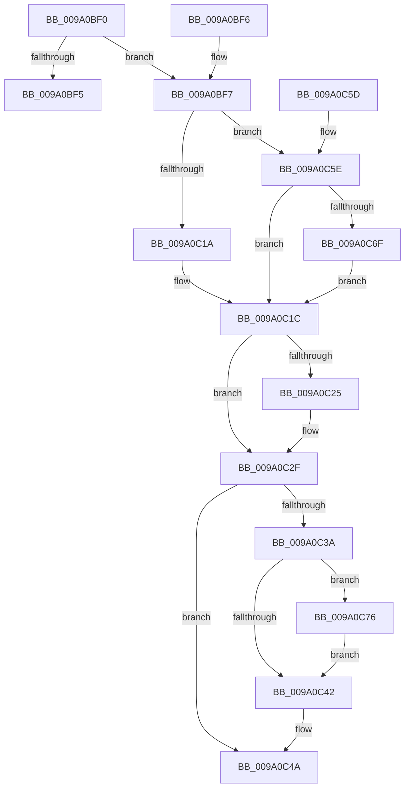

# sub_009A0BF0

- RVA: `0x009A0BF0`–`0x009A0C8D` (길이 `157` bytes)
- VA: `0x00000001409A0BF0`
- 실행 섹션: `PAGE`
- PDB 이름 있음: `아니요`; PDB Function 태그: `아니요`
- unwind 정보 RVA: `0x0009B438`
- 디코드: `45`개 명령, `157/157` bytes 표시
- 미해석 바이트: `0` (있으면 어셈블리에 `.byte`로 보존)

> 이 문서는 커널 이미지의 기계어와 PDB 기호를 분석해 생성했습니다. 4번과 5번은 함수 원형과 자료형을 바이너리 사용 방식에서 추정한 C 해석이며 원본 소스 복구 결과는 아닙니다.

## 1. Dependencies

- 직접 호출 지점: **4**; 고유 호출 대상: **4**
- 직접 호출자로 확인된 함수: **3**
- RIP 상대 이미지 참조: **0**

### Outgoing calls
- `0x009A0C25` → [sub_009A1390](Unknown_function_009A1390.md) (function, `0x009A1390`)
- `0x009A0C4D` → [PdcCloseEvent](../8D/PdcCloseEvent_function_008D2404.md) (function, `0x008D2404`)
- `0x009A0C6F` → [MmUnsecureVirtualMemory](../88/MmUnsecureVirtualMemory_function_0088A2A0.md) (function, `0x0088A2A0`)
- `0x009A0C86` → [ZwFreeVirtualMemory](../../text/6A/ZwFreeVirtualMemory_function_006AD490.md) (function, `0x006AD490`)

### Direct callers
- [sub_008D4104](../8D/Unknown_function_008D4104.md) at `0x008D41ED`
- [sub_009A09B8](Unknown_function_009A09B8.md) at `0x009A0AE5`
- [sub_009A0C94](Unknown_function_009A0C94.md) at `0x009A0D91`

### Static image references
- 디코드된 RIP-relative 메모리 참조가 없습니다.

## 2. Other-region calls and transfers

- 다른 실행 섹션으로 향하는 call: **1**
  - `0x009A0C86` → [ZwFreeVirtualMemory](../../text/6A/ZwFreeVirtualMemory_function_006AD490.md) (`PAGE` → `.text`)
- 별도 외부 분기/꼬리 이동을 확인하지 못했습니다.

## 3. Assembly (complete function range)

```asm
009A0BF0  48 85 C9                        test rcx, rcx
009A0BF3  75 02                           jne 0x1409a0bf7
009A0BF5  C3                              ret
009A0BF6  CC                              int3
009A0BF7  48 89 5C 24 08                  mov qword ptr [rsp + 8], rbx
009A0BFC  57                              push rdi
009A0BFD  48 83 EC 20                     sub rsp, 0x20
009A0C01  65 48 8B 04 25 88 01 00 00      mov rax, qword ptr gs:[0x188]
009A0C0A  48 8B D9                        mov rbx, rcx
009A0C0D  48 8B 90 B8 00 00 00            mov rdx, qword ptr [rax + 0xb8]
009A0C14  48 39 51 10                     cmp qword ptr [rcx + 0x10], rdx
009A0C18  74 44                           je 0x1409a0c5e
009A0C1A  33 FF                           xor edi, edi
009A0C1C  48 8B 4B 18                     mov rcx, qword ptr [rbx + 0x18]
009A0C20  48 85 C9                        test rcx, rcx
009A0C23  74 0A                           je 0x1409a0c2f
009A0C25  E8 66 07 00 00                  call 0x1409a1390
009A0C2A  48 83 63 18 00                  and qword ptr [rbx + 0x18], 0
009A0C2F  48 83 63 20 00                  and qword ptr [rbx + 0x20], 0
009A0C34  48 83 3B 00                     cmp qword ptr [rbx], 0
009A0C38  74 10                           je 0x1409a0c4a
009A0C3A  85 FF                           test edi, edi
009A0C3C  48 8D 7B 08                     lea rdi, [rbx + 8]
009A0C40  75 34                           jne 0x1409a0c76
009A0C42  48 83 23 00                     and qword ptr [rbx], 0
009A0C46  48 83 27 00                     and qword ptr [rdi], 0
009A0C4A  48 8B CB                        mov rcx, rbx
009A0C4D  E8 B2 17 F3 FF                  call 0x1408d2404
009A0C52  48 8B 5C 24 30                  mov rbx, qword ptr [rsp + 0x30]
009A0C57  48 83 C4 20                     add rsp, 0x20
009A0C5B  5F                              pop rdi
009A0C5C  C3                              ret
009A0C5D  CC                              int3
009A0C5E  48 8B 89 38 04 00 00            mov rcx, qword ptr [rcx + 0x438]
009A0C65  BF 01 00 00 00                  mov edi, 1
009A0C6A  48 85 C9                        test rcx, rcx
009A0C6D  74 AD                           je 0x1409a0c1c
009A0C6F  E8 2C 96 EE FF                  call 0x14088a2a0
009A0C74  EB A6                           jmp 0x1409a0c1c
009A0C76  41 B9 00 80 00 00               mov r9d, 0x8000
009A0C7C  4C 8B C7                        mov r8, rdi
009A0C7F  48 8B D3                        mov rdx, rbx
009A0C82  48 83 C9 FF                     or rcx, 0xffffffffffffffff
009A0C86  E8 05 C8 D0 FF                  call 0x1406ad490
009A0C8B  EB B5                           jmp 0x1409a0c42
```

## 4. C-style interpretation (structured pseudocode)

```c
__int64 __fastcall sub_009A0BF0(__int64 a1)
{
    __int64 result;
    __int64 v_rdi;
    __int64 v_rsp;
    unsigned __int64 v_stack_p8;

    if (a1 != 0) goto loc_009A0BF7;
    return result;
loc_009A0BF7:
    v_stack_p8 = v_rbx;
    v_rsp = (v_rsp) - (32);
    if ((*(unsigned __int64 *)(a1 + 16)) == (*(unsigned __int64 *)(*(unsigned __int64 *)(gs_base + (0 + 392)) + 184))) goto loc_009A0C5E;
    v_rdi = 0;
loc_009A0C1C:
    result = *(unsigned __int64 *)(gs_base + (0 + 392));
    if (*(unsigned __int64 *)(a1 + 24) != 0) {
        result = sub_009A1390(*(unsigned __int64 *)(a1 + 24), *(unsigned __int64 *)(*(unsigned __int64 *)(gs_base + (0 + 392)) + 184), a3, a4);
    }
    if ((*(unsigned __int64 *)(a1)) == 0) goto loc_009A0C4A;
    if (0 != 0) goto loc_009A0C76;
loc_009A0C42:
loc_009A0C4A:
    result = PdcCloseEvent(a1, *(unsigned __int64 *)(*(unsigned __int64 *)(gs_base + (0 + 392)) + 184), a3, a4);
    v_rsp = (v_rsp) + (32);
    return result;
loc_009A0C5E:
    if (*(unsigned __int64 *)(a1 + 1080) == 0) goto loc_009A0C1C;
    result = MmUnsecureVirtualMemory(*(unsigned __int64 *)(a1 + 1080), *(unsigned __int64 *)(*(unsigned __int64 *)(gs_base + (0 + 392)) + 184), a3, a4);
    goto loc_009A0C1C;
loc_009A0C76:
    a1 = (*(unsigned __int64 *)(a1 + 1080)) | (-1);
    result = ZwFreeVirtualMemory(a1, v_stack_p8, 1, (unsigned int)(0x8000ULL));
    goto loc_009A0C42;
}
```

## 5. (Beta) C Style

```c
int64_t sub_009A0BF0(int64_t Arg1)
{
    int64_t result;
    int64_t local_rdi;
    int64_t local_rsp;
    uint64_t v_stack_p8;

    if (Arg1 != 0) goto loc_009A0BF7;
    return result;
loc_009A0BF7:
    v_stack_p8 = local_rbx;
    local_rsp = (local_rsp) - (32);
    if ((*(uint64_t *)(Arg1 + 0x10)) == (*(uint64_t *)(*(uint64_t *)(gs_base + (0 + 0x188)) + 0xB8))) goto loc_009A0C5E;
    local_rdi = 0;
loc_009A0C1C:
    result = *(uint64_t *)(gs_base + (0 + 0x188));
    if (*(uint64_t *)(Arg1 + 0x18) != 0) {
        result = sub_009A1390(*(uint64_t *)(Arg1 + 0x18), *(uint64_t *)(*(uint64_t *)(gs_base + (0 + 0x188)) + 0xB8), a3, a4);
    }
    if ((*(uint64_t *)(Arg1)) == 0) goto loc_009A0C4A;
    if (0 != 0) goto loc_009A0C76;
loc_009A0C42:
loc_009A0C4A:
    result = PdcCloseEvent(Arg1, *(uint64_t *)(*(uint64_t *)(gs_base + (0 + 0x188)) + 0xB8), a3, a4);
    local_rsp = (local_rsp) + (32);
    return result;
loc_009A0C5E:
    if (*(uint64_t *)(Arg1 + 0x438) == 0) goto loc_009A0C1C;
    result = MmUnsecureVirtualMemory(*(uint64_t *)(Arg1 + 0x438), *(uint64_t *)(*(uint64_t *)(gs_base + (0 + 0x188)) + 0xB8), a3, a4);
    goto loc_009A0C1C;
loc_009A0C76:
    Arg1 = (*(uint64_t *)(Arg1 + 0x438)) | (-1);
    result = ZwFreeVirtualMemory(Arg1, v_stack_p8, 1, (uint32_t)(0x8000ULL));
    goto loc_009A0C42;
}
```

## 6. Execution-region graph

[열기: 2D/3D 그래프와 함수 탐색 컨트롤 패널](../../../control-panel.html?section=page&rva=0x009A0BF0&view=graph)

- 2D 그래프는 위에서 아래로 흐르고, 3D 그래프는 빈 공간을 드래그해 회전합니다. Shift+드래그는 이동, 휠은 확대·축소, 함수 노드 선택은 대상 보고서 이동입니다.

### Static fallback


