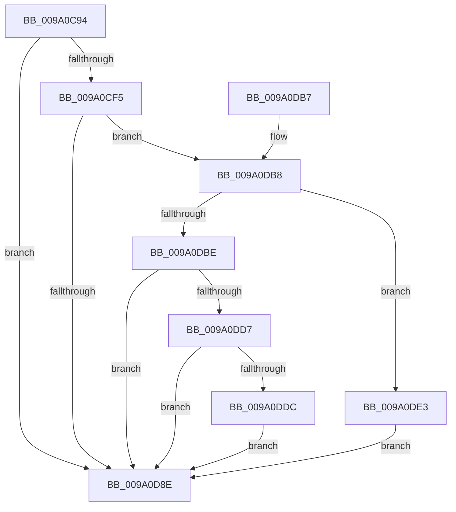

# sub_009A0C94

- RVA: `0x009A0C94`–`0x009A0DEA` (길이 `342` bytes)
- VA: `0x00000001409A0C94`
- 실행 섹션: `PAGE`
- PDB 이름 있음: `아니요`; PDB Function 태그: `아니요`
- unwind 정보 RVA: `0x0009B448`
- 디코드: `88`개 명령, `342/342` bytes 표시
- 미해석 바이트: `0` (있으면 어셈블리에 `.byte`로 보존)

> 이 문서는 커널 이미지의 기계어와 PDB 기호를 분석해 생성했습니다. 4번과 5번은 함수 원형과 자료형을 바이너리 사용 방식에서 추정한 C 해석이며 원본 소스 복구 결과는 아닙니다.

## 1. Dependencies

- 직접 호출 지점: **6**; 고유 호출 대상: **6**
- 직접 호출자로 확인된 함수: **1**
- RIP 상대 이미지 참조: **0**

### Outgoing calls
- `0x009A0CC4` → [ExAllocatePool2](../../poolcode/B8/ExAllocatePool2_function_00B820F0.md) (function, `0x00B820F0`)
- `0x009A0CD7` → [PdcCloseEvent](../8D/PdcCloseEvent_function_008D2404.md) (function, `0x008D2404`)
- `0x009A0D41` → [memset](../../text/6C/memset_function_006C6C40.md) (function, `0x006C6C40`)
- `0x009A0D83` → [MmAllocateVirtualMemory](MmAllocateVirtualMemory_function_009A1A40.md) (function, `0x009A1A40`)
- `0x009A0D91` → [sub_009A0BF0](Unknown_function_009A0BF0.md) (function, `0x009A0BF0`)
- `0x009A0DCC` → [WbMakeUserExecutablePagesKernelWritable](WbMakeUserExecutablePagesKernelWritable_function_009A14F4.md) (function, `0x009A14F4`)

### Direct callers
- [sub_009A09B8](Unknown_function_009A09B8.md) at `0x009A0B1F`

### Static image references
- 디코드된 RIP-relative 메모리 참조가 없습니다.

## 2. Other-region calls and transfers

- 다른 실행 섹션으로 향하는 call: **2**
  - `0x009A0CC4` → [ExAllocatePool2](../../poolcode/B8/ExAllocatePool2_function_00B820F0.md) (`PAGE` → `POOLCODE`)
  - `0x009A0D41` → [memset](../../text/6C/memset_function_006C6C40.md) (`PAGE` → `.text`)
- 별도 외부 분기/꼬리 이동을 확인하지 못했습니다.

## 3. Assembly (complete function range)

```asm
009A0C94  48 8B C4                        mov rax, rsp
009A0C97  48 89 58 08                     mov qword ptr [rax + 8], rbx
009A0C9B  48 89 68 10                     mov qword ptr [rax + 0x10], rbp
009A0C9F  48 89 70 18                     mov qword ptr [rax + 0x18], rsi
009A0CA3  48 89 78 20                     mov qword ptr [rax + 0x20], rdi
009A0CA7  41 54                           push r12
009A0CA9  41 56                           push r14
009A0CAB  41 57                           push r15
009A0CAD  48 83 EC 60                     sub rsp, 0x60
009A0CB1  4C 8B F2                        mov r14, rdx
009A0CB4  B9 00 01 00 00                  mov ecx, 0x100
009A0CB9  BA 40 04 00 00                  mov edx, 0x440
009A0CBE  41 B8 57 41 52 42               mov r8d, 0x42524157
009A0CC4  E8 27 14 1E 00                  call 0x140b820f0
009A0CC9  33 FF                           xor edi, edi
009A0CCB  48 8B D8                        mov rbx, rax
009A0CCE  48 85 C0                        test rax, rax
009A0CD1  48 0F 45 F8                     cmovne rdi, rax
009A0CD5  33 C9                           xor ecx, ecx
009A0CD7  E8 28 17 F3 FF                  call 0x1408d2404
009A0CDC  48 8B CB                        mov rcx, rbx
009A0CDF  48 F7 D9                        neg rcx
009A0CE2  1B F6                           sbb esi, esi
009A0CE4  F7 D6                           not esi
009A0CE6  81 E6 17 00 00 C0               and esi, 0xc0000017
009A0CEC  48 85 DB                        test rbx, rbx
009A0CEF  0F 84 99 00 00 00               je 0x1409a0d8e
009A0CF5  48 83 27 00                     and qword ptr [rdi], 0
009A0CF9  4C 8D 7F 08                     lea r15, [rdi + 8]
009A0CFD  49 C7 07 00 00 01 00            mov qword ptr [r15], 0x10000
009A0D04  48 8D 9F 38 04 00 00            lea rbx, [rdi + 0x438]
009A0D0B  48 83 67 18 00                  and qword ptr [rdi + 0x18], 0
009A0D10  33 D2                           xor edx, edx
009A0D12  48 83 67 20 00                  and qword ptr [rdi + 0x20], 0
009A0D17  41 B8 00 04 00 00               mov r8d, 0x400
009A0D1D  48 83 23 00                     and qword ptr [rbx], 0
009A0D21  65 48 8B 04 25 88 01 00 00      mov rax, qword ptr gs:[0x188]
009A0D2A  48 8B 88 B8 00 00 00            mov rcx, qword ptr [rax + 0xb8]
009A0D31  48 89 4F 10                     mov qword ptr [rdi + 0x10], rcx
009A0D35  48 8D 4F 2C                     lea rcx, [rdi + 0x2c]
009A0D39  48 83 A7 30 04 00 00 00         and qword ptr [rdi + 0x430], 0
009A0D41  E8 FA 5E D2 FF                  call 0x1406c6c40
009A0D46  48 89 5C 24 50                  mov qword ptr [rsp + 0x50], rbx
009A0D4B  41 B9 00 10 00 00               mov r9d, 0x1000
009A0D51  C7 44 24 48 02 00 00 00         mov dword ptr [rsp + 0x48], 2
009A0D59  4D 8B C7                        mov r8, r15
009A0D5C  C7 44 24 40 00 00 00 20         mov dword ptr [rsp + 0x40], 0x20000000
009A0D64  48 8B D7                        mov rdx, rdi
009A0D67  C6 44 24 38 00                  mov byte ptr [rsp + 0x38], 0
009A0D6C  48 83 C9 FF                     or rcx, 0xffffffffffffffff
009A0D70  83 64 24 30 00                  and dword ptr [rsp + 0x30], 0
009A0D75  48 83 64 24 28 00               and qword ptr [rsp + 0x28], 0
009A0D7B  C7 44 24 20 20 00 00 00         mov dword ptr [rsp + 0x20], 0x20
009A0D83  E8 B8 0C 00 00                  call 0x1409a1a40
009A0D88  8B F0                           mov esi, eax
009A0D8A  85 C0                           test eax, eax
009A0D8C  79 2A                           jns 0x1409a0db8
009A0D8E  48 8B CF                        mov rcx, rdi
009A0D91  E8 5A FE FF FF                  call 0x1409a0bf0
009A0D96  4C 8D 5C 24 60                  lea r11, [rsp + 0x60]
009A0D9B  8B C6                           mov eax, esi
009A0D9D  49 8B 5B 20                     mov rbx, qword ptr [r11 + 0x20]
009A0DA1  49 8B 6B 28                     mov rbp, qword ptr [r11 + 0x28]
009A0DA5  49 8B 73 30                     mov rsi, qword ptr [r11 + 0x30]
009A0DA9  49 8B 7B 38                     mov rdi, qword ptr [r11 + 0x38]
009A0DAD  49 8B E3                        mov rsp, r11
009A0DB0  41 5F                           pop r15
009A0DB2  41 5E                           pop r14
009A0DB4  41 5C                           pop r12
009A0DB6  C3                              ret
009A0DB7  CC                              int3
009A0DB8  48 83 3B 00                     cmp qword ptr [rbx], 0
009A0DBC  74 25                           je 0x1409a0de3
009A0DBE  41 8B 17                        mov edx, dword ptr [r15]
009A0DC1  4C 8D 4F 20                     lea r9, [rdi + 0x20]
009A0DC5  48 8B 0F                        mov rcx, qword ptr [rdi]
009A0DC8  4C 8D 47 18                     lea r8, [rdi + 0x18]
009A0DCC  E8 23 07 00 00                  call 0x1409a14f4
009A0DD1  8B F0                           mov esi, eax
009A0DD3  85 C0                           test eax, eax
009A0DD5  78 B7                           js 0x1409a0d8e
009A0DD7  4D 85 F6                        test r14, r14
009A0DDA  74 B2                           je 0x1409a0d8e
009A0DDC  49 89 3E                        mov qword ptr [r14], rdi
009A0DDF  33 FF                           xor edi, edi
009A0DE1  EB AB                           jmp 0x1409a0d8e
009A0DE3  BE E5 00 00 C0                  mov esi, 0xc00000e5
009A0DE8  EB A4                           jmp 0x1409a0d8e
```

## 4. C-style interpretation (structured pseudocode)

```c
__int64 __fastcall sub_009A0C94(__int64 a1, __int64 a2)
{
    __int64 result;
    __int64 v_rdi;
    __int64 v_rsi;
    __int64 v_rsp;
    unsigned __int64 v_stack_m18;
    unsigned __int64 v_stack_m28;
    unsigned int v_stack_m30;
    unsigned int v_stack_m38;
    unsigned __int8 v_stack_m40;
    unsigned int v_stack_m48;
    unsigned __int64 v_stack_m50;
    unsigned int v_stack_m58;

    *(unsigned __int64 *)(v_rsp + 8) = v_rbx;
    *(unsigned __int64 *)(v_rsp + 16) = v_rbp;
    *(unsigned __int64 *)(v_rsp + 24) = v_rsi;
    *(unsigned __int64 *)(v_rsp + 32) = v_rdi;
    v_rsp = (v_rsp) - (96);
    result = ExAllocatePool2(256, (unsigned int)(0x440ULL), (unsigned int)(0x42524157ULL), a4);
    v_rdi = 0;
    if (result != 0) { v_rdi = result; }
    a1 = 0;
    result = PdcCloseEvent(a1, (unsigned int)(0x440ULL), (unsigned int)(0x42524157ULL), a4);
    a1 = -(result);
    v_rsi = (unsigned int)(~(v_rsi));
    v_rsi = (unsigned int)((v_rsi) & (0xC0000017ULL));
    if (result == 0) goto loc_009A0D8E;
    *(unsigned __int64 *)(v_rdi + 8) = 0x10000ULL;
    a2 = 0;
    *(unsigned __int64 *)(v_rdi + 16) = *(unsigned __int64 *)(*(unsigned __int64 *)(gs_base + (0 + 392)) + 184);
    result = memset(v_rdi + 44, a2, (unsigned int)(0x400ULL), a4);
    v_stack_m28 = v_rdi + 1080;
    v_stack_m30 = 2;
    v_stack_m38 = 0x20000000ULL;
    v_stack_m40 = 0;
    a1 = (v_rdi + 44) | (-1);
    v_stack_m58 = 32;
    result = MmAllocateVirtualMemory(a1, v_rdi, v_rdi + 8, (unsigned int)(0x1000ULL));
    if (!sign_flag) goto loc_009A0DB8;
loc_009A0D8E:
    result = sub_009A0BF0(v_rdi, v_rdi, v_rdi + 8, (unsigned int)(0x1000ULL));
    return (unsigned int)((unsigned int)((unsigned int)((unsigned int)(result))));
loc_009A0DB8:
    if ((*(unsigned __int64 *)(*(unsigned __int64 *)(v_stack_m18 + 32))) == 0) goto loc_009A0DE3;
    result = WbMakeUserExecutablePagesKernelWritable(*(unsigned __int64 *)(*(unsigned __int64 *)(v_stack_m18 + 56)), (unsigned int)(*(unsigned int *)(v_rdi + 8)), *(unsigned __int64 *)(v_stack_m18 + 56) + 24, *(unsigned __int64 *)(v_stack_m18 + 56) + 32);
    if (sign_flag) goto loc_009A0D8E;
    if (0 == 0) goto loc_009A0D8E;
    *(unsigned __int64 *)(a2) = *(unsigned __int64 *)(v_stack_m18 + 56);
    v_rdi = 0;
    goto loc_009A0D8E;
loc_009A0DE3:
    goto loc_009A0D8E;
}
```

## 5. (Beta) C Style

```c
int64_t sub_009A0C94(int64_t Arg1, int64_t Arg2)
{
    int64_t result;
    int64_t local_rdi;
    int64_t local_rsi;
    int64_t local_rsp;
    uint64_t v_stack_m18;
    uint64_t v_stack_m28;
    uint32_t v_stack_m30;
    uint32_t v_stack_m38;
    uint8_t v_stack_m40;
    uint32_t v_stack_m48;
    uint64_t v_stack_m50;
    uint32_t v_stack_m58;

    *(uint64_t *)(local_rsp + 0x8) = local_rbx;
    *(uint64_t *)(local_rsp + 0x10) = local_rbp;
    *(uint64_t *)(local_rsp + 0x18) = local_rsi;
    *(uint64_t *)(local_rsp + 0x20) = local_rdi;
    local_rsp = (local_rsp) - (96);
    result = ExAllocatePool2(256, (uint32_t)(0x440ULL), (uint32_t)(0x42524157ULL), a4);
    local_rdi = 0;
    if (result != 0) { local_rdi = result; }
    Arg1 = 0;
    result = PdcCloseEvent(Arg1, (uint32_t)(0x440ULL), (uint32_t)(0x42524157ULL), a4);
    Arg1 = -(result);
    local_rsi = (uint32_t)(~(local_rsi));
    local_rsi = (uint32_t)((local_rsi) & (0xC0000017ULL));
    if (result == 0) goto loc_009A0D8E;
    *(uint64_t *)(local_rdi + 0x8) = 0x10000ULL;
    Arg2 = 0;
    *(uint64_t *)(local_rdi + 0x10) = *(uint64_t *)(*(uint64_t *)(gs_base + (0 + 0x188)) + 0xB8);
    result = memset(local_rdi + 44, Arg2, (uint32_t)(0x400ULL), a4);
    v_stack_m28 = local_rdi + 1080;
    v_stack_m30 = 2;
    v_stack_m38 = 0x20000000ULL;
    v_stack_m40 = 0;
    Arg1 = (local_rdi + 44) | (-1);
    v_stack_m58 = 32;
    result = MmAllocateVirtualMemory(Arg1, local_rdi, local_rdi + 8, (uint32_t)(0x1000ULL));
    if (!sign_flag) goto loc_009A0DB8;
loc_009A0D8E:
    result = sub_009A0BF0(local_rdi, local_rdi, local_rdi + 8, (uint32_t)(0x1000ULL));
    return (uint32_t)((uint32_t)((uint32_t)((uint32_t)(result))));
loc_009A0DB8:
    if ((*(uint64_t *)(*(uint64_t *)(v_stack_m18 + 0x20))) == 0) goto loc_009A0DE3;
    result = WbMakeUserExecutablePagesKernelWritable(*(uint64_t *)(*(uint64_t *)(v_stack_m18 + 0x38)), (uint32_t)(*(uint32_t *)(local_rdi + 0x8)), *(uint64_t *)(v_stack_m18 + 0x38) + 24, *(uint64_t *)(v_stack_m18 + 0x38) + 32);
    if (sign_flag) goto loc_009A0D8E;
    if (0 == 0) goto loc_009A0D8E;
    *(uint64_t *)(Arg2) = *(uint64_t *)(v_stack_m18 + 0x38);
    local_rdi = 0;
    goto loc_009A0D8E;
loc_009A0DE3:
    goto loc_009A0D8E;
}
```

## 6. Execution-region graph

[열기: 2D/3D 그래프와 함수 탐색 컨트롤 패널](../../../control-panel.html?section=page&rva=0x009A0C94&view=graph)

- 2D 그래프는 위에서 아래로 흐르고, 3D 그래프는 빈 공간을 드래그해 회전합니다. Shift+드래그는 이동, 휠은 확대·축소, 함수 노드 선택은 대상 보고서 이동입니다.

### Static fallback


