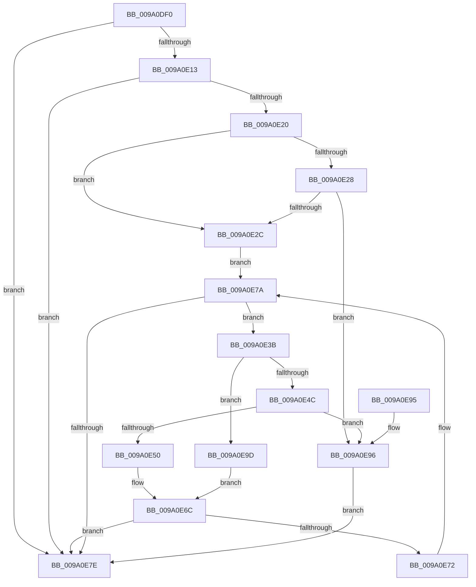

# sub_009A0DF0

- RVA: `0x009A0DF0`–`0x009A0EBD` (길이 `205` bytes)
- VA: `0x00000001409A0DF0`
- 실행 섹션: `PAGE`
- PDB 이름 있음: `아니요`; PDB Function 태그: `아니요`
- unwind 정보 RVA: `0x000848E8`
- 디코드: `66`개 명령, `205/205` bytes 표시
- 미해석 바이트: `0` (있으면 어셈블리에 `.byte`로 보존)

> 이 문서는 커널 이미지의 기계어와 PDB 기호를 분석해 생성했습니다. 4번과 5번은 함수 원형과 자료형을 바이너리 사용 방식에서 추정한 C 해석이며 원본 소스 복구 결과는 아닙니다.

## 1. Dependencies

- 직접 호출 지점: **2**; 고유 호출 대상: **2**
- 직접 호출자로 확인된 함수: **1**
- RIP 상대 이미지 참조: **0**

### Outgoing calls
- `0x009A0E67` → [sub_009A0EC4](Unknown_function_009A0EC4.md) (function, `0x009A0EC4`)
- `0x009A0EB6` → [sub_00811EE0](../81/Unknown_function_00811EE0.md) (function, `0x00811EE0`)

### Direct callers
- [sub_009A01EC](Unknown_function_009A01EC.md) at `0x009A0289`

### Static image references
- 디코드된 RIP-relative 메모리 참조가 없습니다.

## 2. Other-region calls and transfers

- 다른 실행 섹션으로 향하는 call: **0**
- 별도 외부 분기/꼬리 이동을 확인하지 못했습니다.

## 3. Assembly (complete function range)

```asm
009A0DF0  48 89 5C 24 08                  mov qword ptr [rsp + 8], rbx
009A0DF5  48 89 6C 24 10                  mov qword ptr [rsp + 0x10], rbp
009A0DFA  48 89 74 24 18                  mov qword ptr [rsp + 0x18], rsi
009A0DFF  57                              push rdi
009A0E00  48 83 EC 20                     sub rsp, 0x20
009A0E04  48 8B D9                        mov rbx, rcx
009A0E07  33 C9                           xor ecx, ecx
009A0E09  48 8B 43 40                     mov rax, qword ptr [rbx + 0x40]
009A0E0D  48 83 F8 FF                     cmp rax, -1
009A0E11  74 6B                           je 0x1409a0e7e
009A0E13  48 FF C0                        inc rax
009A0E16  48 89 43 40                     mov qword ptr [rbx + 0x40], rax
009A0E1A  48 83 F8 01                     cmp rax, 1
009A0E1E  75 5E                           jne 0x1409a0e7e
009A0E20  8B 43 30                        mov eax, dword ptr [rbx + 0x30]
009A0E23  83 F8 01                        cmp eax, 1
009A0E26  74 04                           je 0x1409a0e2c
009A0E28  85 C0                           test eax, eax
009A0E2A  75 6A                           jne 0x1409a0e96
009A0E2C  48 8B 43 38                     mov rax, qword ptr [rbx + 0x38]
009A0E30  8B 7B 48                        mov edi, dword ptr [rbx + 0x48]
009A0E33  8B B0 F0 00 00 00               mov esi, dword ptr [rax + 0xf0]
009A0E39  EB 3F                           jmp 0x1409a0e7a
009A0E3B  8B 43 30                        mov eax, dword ptr [rbx + 0x30]
009A0E3E  33 ED                           xor ebp, ebp
009A0E40  3B 7B 4C                        cmp edi, dword ptr [rbx + 0x4c]
009A0E43  40 0F 93 C5                     setae bpl
009A0E47  83 F8 01                        cmp eax, 1
009A0E4A  74 51                           je 0x1409a0e9d
009A0E4C  85 C0                           test eax, eax
009A0E4E  75 46                           jne 0x1409a0e96
009A0E50  8B C7                           mov eax, edi
009A0E52  8B D5                           mov edx, ebp
009A0E54  48 8D 0C 40                     lea rcx, [rax + rax*2]
009A0E58  48 8B 43 38                     mov rax, qword ptr [rbx + 0x38]
009A0E5C  48 8D 49 3D                     lea rcx, [rcx + 0x3d]
009A0E60  4C 8D 04 88                     lea r8, [rax + rcx*4]
009A0E64  48 8B CB                        mov rcx, rbx
009A0E67  E8 58 00 00 00                  call 0x1409a0ec4
009A0E6C  8B C8                           mov ecx, eax
009A0E6E  85 C0                           test eax, eax
009A0E70  78 0C                           js 0x1409a0e7e
009A0E72  FF 43 48                        inc dword ptr [rbx + 0x48]
009A0E75  01 6B 4C                        add dword ptr [rbx + 0x4c], ebp
009A0E78  FF C7                           inc edi
009A0E7A  3B FE                           cmp edi, esi
009A0E7C  72 BD                           jb 0x1409a0e3b
009A0E7E  48 8B 5C 24 30                  mov rbx, qword ptr [rsp + 0x30]
009A0E83  8B C1                           mov eax, ecx
009A0E85  48 8B 6C 24 38                  mov rbp, qword ptr [rsp + 0x38]
009A0E8A  48 8B 74 24 40                  mov rsi, qword ptr [rsp + 0x40]
009A0E8F  48 83 C4 20                     add rsp, 0x20
009A0E93  5F                              pop rdi
009A0E94  C3                              ret
009A0E95  CC                              int3
009A0E96  B9 0D 00 00 C0                  mov ecx, 0xc000000d
009A0E9B  EB E1                           jmp 0x1409a0e7e
009A0E9D  4C 8B 43 38                     mov r8, qword ptr [rbx + 0x38]
009A0EA1  8B D5                           mov edx, ebp
009A0EA3  49 81 C0 F8 00 00 00            add r8, 0xf8
009A0EAA  8B CF                           mov ecx, edi
009A0EAC  48 C1 E1 04                     shl rcx, 4
009A0EB0  4C 03 C1                        add r8, rcx
009A0EB3  48 8B CB                        mov rcx, rbx
009A0EB6  E8 25 10 E7 FF                  call 0x140811ee0
009A0EBB  EB AF                           jmp 0x1409a0e6c
```

## 4. C-style interpretation (structured pseudocode)

```c
__int64 __fastcall sub_009A0DF0(__int64 a1)
{
    __int64 result;
    __int64 v_rbp;
    __int64 v_rdi;
    __int64 v_rsp;
    unsigned __int64 v_stack_p10;
    unsigned __int64 v_stack_p18;
    unsigned __int64 v_stack_p8;

    v_stack_p8 = v_rbx;
    v_stack_p10 = v_rbp;
    v_stack_p18 = v_rsi;
    v_rsp = (v_rsp) - (32);
    a1 = 0;
    if ((*(unsigned __int64 *)(a1 + 64)) == -1) goto loc_009A0E7E;
    result = (*(unsigned __int64 *)(a1 + 64)) + 1;
    *(unsigned __int64 *)(a1 + 64) = result;
    if (result != 1) goto loc_009A0E7E;
    if (((unsigned int)((unsigned int)(*(unsigned int *)(a1 + 48)))) == 1) goto loc_009A0E2C;
    if ((unsigned int)((unsigned int)(*(unsigned int *)(a1 + 48))) != 0) goto loc_009A0E96;
loc_009A0E2C:
    goto loc_009A0E7A;
loc_009A0E3B:
    v_rbp = 0;
    v_rbp = (((unsigned int)((unsigned int)(*(unsigned int *)(a1 + 72)))) >= (*(unsigned int *)(a1 + 76))) ? 1 : 0;
    if (((unsigned int)((unsigned int)(*(unsigned int *)(a1 + 48)))) == 1) goto loc_009A0E9D;
    if ((unsigned int)((unsigned int)(*(unsigned int *)(a1 + 48))) != 0) goto loc_009A0E96;
    result = sub_009A0EC4(0, (unsigned int)((unsigned int)(v_rbp)), *(unsigned __int64 *)(a1 + 56) + (unsigned int)((unsigned int)((unsigned int)(*(unsigned int *)(a1 + 72)))) + (unsigned int)((unsigned int)((unsigned int)(*(unsigned int *)(a1 + 72)))) * 2 + 61 * 4, a4);
loc_009A0E6C:
    if (sign_flag) goto loc_009A0E7E;
    v_rdi = (unsigned int)(((unsigned int)(*(unsigned int *)(a1 + 72))) + 1);
loc_009A0E7A:
    if (((unsigned int)(v_rdi)) < ((unsigned int)((unsigned int)(*(unsigned int *)(*(unsigned __int64 *)(a1 + 56) + 240))))) goto loc_009A0E3B;
loc_009A0E7E:
    v_rsp = (v_rsp) + (32);
    return (unsigned int)((unsigned int)((unsigned int)((unsigned int)(result))));
loc_009A0E96:
    goto loc_009A0E7E;
loc_009A0E9D:
    a3 = (*(unsigned __int64 *)(v_stack_p8 + 56)) + (248);
    a1 = ((unsigned int)((unsigned int)(v_rdi))) << (4);
    a3 = (a3) + (a1);
    result = sub_00811EE0(v_stack_p8, (unsigned int)((unsigned int)(v_stack_p10)), a3, a4);
    goto loc_009A0E6C;
}
```

## 5. (Beta) C Style

```c
int64_t sub_009A0DF0(void *Arg1)
{
    uint8_t *arg1 = (uint8_t *)Arg1;

    int64_t result;
    int64_t local_rbp;
    int64_t local_rdi;
    int64_t local_rsp;
    uint64_t v_stack_p10;
    uint64_t v_stack_p18;
    uint64_t v_stack_p8;

    v_stack_p8 = local_rbx;
    v_stack_p10 = local_rbp;
    v_stack_p18 = local_rsi;
    local_rsp = (local_rsp) - (32);
    Arg1 = 0;
    if ((*(uint64_t *)(arg1 + 0x40)) == -1) goto loc_009A0E7E;
    result = (*(uint64_t *)(arg1 + 0x40)) + 1;
    *(uint64_t *)(arg1 + 0x40) = result;
    if (result != 1) goto loc_009A0E7E;
    if (((uint32_t)((uint32_t)(*(uint32_t *)(arg1 + 0x30)))) == 1) goto loc_009A0E2C;
    if ((uint32_t)((uint32_t)(*(uint32_t *)(arg1 + 0x30))) != 0) goto loc_009A0E96;
loc_009A0E2C:
    goto loc_009A0E7A;
loc_009A0E3B:
    local_rbp = 0;
    local_rbp = (((uint32_t)((uint32_t)(*(uint32_t *)(arg1 + 0x48)))) >= (*(uint32_t *)(arg1 + 0x4C))) ? 1 : 0;
    if (((uint32_t)((uint32_t)(*(uint32_t *)(arg1 + 0x30)))) == 1) goto loc_009A0E9D;
    if ((uint32_t)((uint32_t)(*(uint32_t *)(arg1 + 0x30))) != 0) goto loc_009A0E96;
    result = sub_009A0EC4(0, (uint32_t)((uint32_t)(local_rbp)), *(uint64_t *)(arg1 + 0x38) + (uint32_t)((uint32_t)((uint32_t)(*(uint32_t *)(arg1 + 0x48)))) + (uint32_t)((uint32_t)((uint32_t)(*(uint32_t *)(arg1 + 0x48)))) * 2 + 61 * 4, a4);
loc_009A0E6C:
    if (sign_flag) goto loc_009A0E7E;
    local_rdi = (uint32_t)(((uint32_t)(*(uint32_t *)(arg1 + 0x48))) + 1);
loc_009A0E7A:
    if (((uint32_t)(local_rdi)) < ((uint32_t)((uint32_t)(*(uint32_t *)(*(uint64_t *)(arg1 + 0x38) + 0xF0))))) goto loc_009A0E3B;
loc_009A0E7E:
    local_rsp = (local_rsp) + (32);
    return (uint32_t)((uint32_t)((uint32_t)((uint32_t)(result))));
loc_009A0E96:
    goto loc_009A0E7E;
loc_009A0E9D:
    a3 = (*(uint64_t *)(v_stack_p8 + 0x38)) + (248);
    Arg1 = ((uint32_t)((uint32_t)(local_rdi))) << (4);
    a3 = (a3) + (Arg1);
    result = sub_00811EE0(v_stack_p8, (uint32_t)((uint32_t)(v_stack_p10)), a3, a4);
    goto loc_009A0E6C;
}
```

### 관측된 메모리 오프셋

구조체 형식이 확인되지 않은 접근은 인자 기준의 오프셋으로만 기록했습니다.

| 기준 인자 | 오프셋 표현 | 폭 (bit) | 접근 |
|---|---:|---:|---|
| `Arg1` | `+ 0x30` | `32` | `R` |
| `Arg1` | `+ 0x38` | `64` | `R` |
| `Arg1` | `+ 0x40` | `64` | `R` |
| `Arg1` | `+ 0x40` | `64` | `W` |
| `Arg1` | `+ 0x48` | `32` | `R` |
| `Arg1` | `+ 0x48` | `32` | `R/W` |
| `Arg1` | `+ 0x4C` | `32` | `R` |
| `Arg1` | `+ 0x4C` | `32` | `R/W` |

## 6. Execution-region graph

[열기: 2D/3D 그래프와 함수 탐색 컨트롤 패널](../../../control-panel.html?section=page&rva=0x009A0DF0&view=graph)

- 2D 그래프는 위에서 아래로 흐르고, 3D 그래프는 빈 공간을 드래그해 회전합니다. Shift+드래그는 이동, 휠은 확대·축소, 함수 노드 선택은 대상 보고서 이동입니다.

### Static fallback


