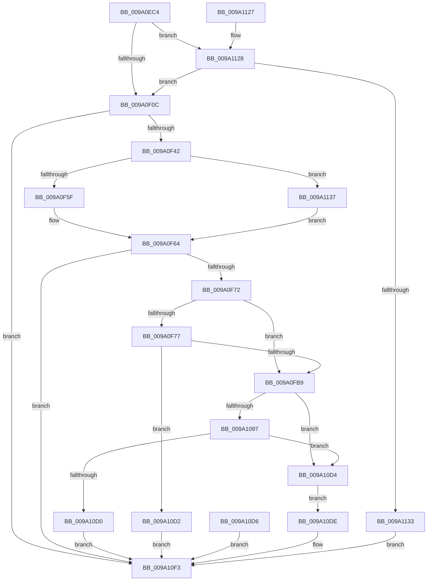

# sub_009A0EC4

- RVA: `0x009A0EC4`–`0x009A1141` (길이 `637` bytes)
- VA: `0x00000001409A0EC4`
- 실행 섹션: `PAGE`
- PDB 이름 있음: `아니요`; PDB Function 태그: `아니요`
- unwind 정보 RVA: `0x0009B468`
- 디코드: `160`개 명령, `637/637` bytes 표시
- 미해석 바이트: `0` (있으면 어셈블리에 `.byte`로 보존)

> 이 문서는 커널 이미지의 기계어와 PDB 기호를 분석해 생성했습니다. 4번과 5번은 함수 원형과 자료형을 바이너리 사용 방식에서 추정한 C 해석이며 원본 소스 복구 결과는 아닙니다.

## 1. Dependencies

- 직접 호출 지점: **9**; 고유 호출 대상: **8**
- 직접 호출자로 확인된 함수: **1**
- RIP 상대 이미지 참조: **3**

### Outgoing calls
- `0x009A0F33` → [sub_009A13B8](Unknown_function_009A13B8.md) (function, `0x009A13B8`)
- `0x009A0F5F` → [WbMakeUserExecutablePagesKernelWritable](WbMakeUserExecutablePagesKernelWritable_function_009A14F4.md) (function, `0x009A14F4`)
- `0x009A0FA6` → [sub_00486B70](../../text/48/Unknown_function_00486B70.md) (function, `0x00486B70`)
- `0x009A1088` → [sub_0040C640](../../text/40/Unknown_function_0040C640.md) (function, `0x0040C640`)
- `0x009A10C1` → [sub_00486B70](../../text/48/Unknown_function_00486B70.md) (function, `0x00486B70`)
- `0x009A10EC` → [ZwFlushInstructionCache](../../text/6A/ZwFlushInstructionCache_function_006AEEF0.md) (function, `0x006AEEF0`)
- `0x009A10F8` → [sub_009A1390](Unknown_function_009A1390.md) (function, `0x009A1390`)
- `0x009A110A` → [_security_check_cookie](../../text/6A/_security_check_cookie_function_006AC640.md) (function, `0x006AC640`)
- `0x009A1137` → [WbMakeUserDataPagesKernelWritable](WbMakeUserDataPagesKernelWritable_function_009A15FC.md) (function, `0x009A15FC`)

### Direct callers
- [sub_009A0DF0](Unknown_function_009A0DF0.md) at `0x009A0E67`

### Static image references
- `0x009A0ED8` → RVA `0x00E0A740` (`.data`; read)
- `0x009A0FCA` → RVA `0x00002A00` (`.rdata`; read)
- `0x009A0FD6` → RVA `0x000029F0` (`.rdata`; read)

## 2. Other-region calls and transfers

- 다른 실행 섹션으로 향하는 call: **5**
  - `0x009A0FA6` → [sub_00486B70](../../text/48/Unknown_function_00486B70.md) (`PAGE` → `.text`)
  - `0x009A1088` → [sub_0040C640](../../text/40/Unknown_function_0040C640.md) (`PAGE` → `.text`)
  - `0x009A10C1` → [sub_00486B70](../../text/48/Unknown_function_00486B70.md) (`PAGE` → `.text`)
  - `0x009A10EC` → [ZwFlushInstructionCache](../../text/6A/ZwFlushInstructionCache_function_006AEEF0.md) (`PAGE` → `.text`)
  - `0x009A110A` → [_security_check_cookie](../../text/6A/_security_check_cookie_function_006AC640.md) (`PAGE` → `.text`)
- 별도 외부 분기/꼬리 이동을 확인하지 못했습니다.

## 3. Assembly (complete function range)

```asm
009A0EC4  48 89 5C 24 10                  mov qword ptr [rsp + 0x10], rbx
009A0EC9  56                              push rsi
009A0ECA  57                              push rdi
009A0ECB  41 55                           push r13
009A0ECD  41 56                           push r14
009A0ECF  41 57                           push r15
009A0ED1  48 81 EC 30 01 00 00            sub rsp, 0x130
009A0ED8  48 8B 05 61 98 46 00            mov rax, qword ptr [rip + 0x469861]
009A0EDF  48 33 C4                        xor rax, rsp
009A0EE2  48 89 84 24 20 01 00 00         mov qword ptr [rsp + 0x120], rax
009A0EEA  49 8B F8                        mov rdi, r8
009A0EED  44 8B FA                        mov r15d, edx
009A0EF0  4C 8B F1                        mov r14, rcx
009A0EF3  48 83 64 24 48 00               and qword ptr [rsp + 0x48], 0
009A0EF9  48 83 64 24 50 00               and qword ptr [rsp + 0x50], 0
009A0EFF  C6 44 24 40 00                  mov byte ptr [rsp + 0x40], 0
009A0F04  85 D2                           test edx, edx
009A0F06  0F 85 1C 02 00 00               jne 0x1409a1128
009A0F0C  41 8B 70 04                     mov esi, dword ptr [r8 + 4]
009A0F10  41 BD FF FF FF 0F               mov r13d, 0xfffffff
009A0F16  49 23 F5                        and rsi, r13
009A0F19  48 03 71 20                     add rsi, qword ptr [rcx + 0x20]
009A0F1D  45 8B 00                        mov r8d, dword ptr [r8]
009A0F20  41 D1 E8                        shr r8d, 1
009A0F23  41 F7 D0                        not r8d
009A0F26  41 83 E0 01                     and r8d, 1
009A0F2A  8B 57 08                        mov edx, dword ptr [rdi + 8]
009A0F2D  41 23 D5                        and edx, r13d
009A0F30  48 8B CE                        mov rcx, rsi
009A0F33  E8 80 04 00 00                  call 0x1409a13b8
009A0F38  8B D8                           mov ebx, eax
009A0F3A  85 C0                           test eax, eax
009A0F3C  0F 88 B1 01 00 00               js 0x1409a10f3
009A0F42  8B 57 08                        mov edx, dword ptr [rdi + 8]
009A0F45  41 23 D5                        and edx, r13d
009A0F48  8B 07                           mov eax, dword ptr [rdi]
009A0F4A  4C 8D 4C 24 48                  lea r9, [rsp + 0x48]
009A0F4F  4C 8D 44 24 50                  lea r8, [rsp + 0x50]
009A0F54  48 8B CE                        mov rcx, rsi
009A0F57  A8 02                           test al, 2
009A0F59  0F 85 D8 01 00 00               jne 0x1409a1137
009A0F5F  E8 90 05 00 00                  call 0x1409a14f4
009A0F64  8B D8                           mov ebx, eax
009A0F66  89 44 24 44                     mov dword ptr [rsp + 0x44], eax
009A0F6A  85 C0                           test eax, eax
009A0F6C  0F 88 81 01 00 00               js 0x1409a10f3
009A0F72  45 85 FF                        test r15d, r15d
009A0F75  74 42                           je 0x1409a0fb9
009A0F77  49 8B 56 38                     mov rdx, qword ptr [r14 + 0x38]
009A0F7B  4D 8B 46 20                     mov r8, qword ptr [r14 + 0x20]
009A0F7F  8B 47 08                        mov eax, dword ptr [rdi + 8]
009A0F82  41 23 C5                        and eax, r13d
009A0F85  4C 8B 4A 38                     mov r9, qword ptr [rdx + 0x38]
009A0F89  4D 2B C8                        sub r9, r8
009A0F8C  89 44 24 30                     mov dword ptr [rsp + 0x30], eax
009A0F90  48 8B 44 24 48                  mov rax, qword ptr [rsp + 0x48]
009A0F95  48 89 44 24 28                  mov qword ptr [rsp + 0x28], rax
009A0F9A  48 89 74 24 20                  mov qword ptr [rsp + 0x20], rsi
009A0F9F  8B 52 30                        mov edx, dword ptr [rdx + 0x30]
009A0FA2  49 8B 4E 28                     mov rcx, qword ptr [r14 + 0x28]
009A0FA6  E8 C5 5B AE FF                  call 0x140486b70
009A0FAB  8B D8                           mov ebx, eax
009A0FAD  89 44 24 44                     mov dword ptr [rsp + 0x44], eax
009A0FB1  85 C0                           test eax, eax
009A0FB3  0F 88 19 01 00 00               js 0x1409a10d2
009A0FB9  4D 8B 46 38                     mov r8, qword ptr [r14 + 0x38]
009A0FBD  8B 57 04                        mov edx, dword ptr [rdi + 4]
009A0FC0  41 23 D5                        and edx, r13d
009A0FC3  44 8B 4F 08                     mov r9d, dword ptr [rdi + 8]
009A0FC7  45 23 CD                        and r9d, r13d
009A0FCA  48 8D 05 2F 1A 66 FF            lea rax, [rip - 0x99e5d1]
009A0FD1  48 89 44 24 70                  mov qword ptr [rsp + 0x70], rax
009A0FD6  48 8D 05 13 1A 66 FF            lea rax, [rip - 0x99e5ed]
009A0FDD  48 89 44 24 70                  mov qword ptr [rsp + 0x70], rax
009A0FE2  83 64 24 58 00                  and dword ptr [rsp + 0x58], 0
009A0FE7  48 8D 44 24 78                  lea rax, [rsp + 0x78]
009A0FEC  41 0F 10 40 50                  movups xmm0, xmmword ptr [r8 + 0x50]
009A0FF1  0F 11 00                        movups xmmword ptr [rax], xmm0
009A0FF4  41 0F 10 48 60                  movups xmm1, xmmword ptr [r8 + 0x60]
009A0FF9  0F 11 48 10                     movups xmmword ptr [rax + 0x10], xmm1
009A0FFD  41 0F 10 40 70                  movups xmm0, xmmword ptr [r8 + 0x70]
009A1002  0F 11 40 20                     movups xmmword ptr [rax + 0x20], xmm0
009A1006  41 0F 10 88 80 00 00 00         movups xmm1, xmmword ptr [r8 + 0x80]
009A100E  0F 11 48 30                     movups xmmword ptr [rax + 0x30], xmm1
009A1012  41 0F 10 80 90 00 00 00         movups xmm0, xmmword ptr [r8 + 0x90]
009A101A  0F 11 40 40                     movups xmmword ptr [rax + 0x40], xmm0
009A101E  41 0F 10 88 A0 00 00 00         movups xmm1, xmmword ptr [r8 + 0xa0]
009A1026  0F 11 48 50                     movups xmmword ptr [rax + 0x50], xmm1
009A102A  41 0F 10 80 B0 00 00 00         movups xmm0, xmmword ptr [r8 + 0xb0]
009A1032  0F 11 40 60                     movups xmmword ptr [rax + 0x60], xmm0
009A1036  41 BA 80 00 00 00               mov r10d, 0x80
009A103C  41 0F 10 80 C0 00 00 00         movups xmm0, xmmword ptr [r8 + 0xc0]
009A1044  42 0F 11 44 10 F0               movups xmmword ptr [rax + r10 - 0x10], xmm0
009A104A  43 0F 10 4C 10 50               movups xmm1, xmmword ptr [r8 + r10 + 0x50]
009A1050  42 0F 11 0C 10                  movups xmmword ptr [rax + r10], xmm1
009A1055  43 0F 10 44 10 60               movups xmm0, xmmword ptr [r8 + r10 + 0x60]
009A105B  42 0F 11 44 10 10               movups xmmword ptr [rax + r10 + 0x10], xmm0
009A1061  48 8D 44 24 40                  lea rax, [rsp + 0x40]
009A1066  48 89 44 24 30                  mov qword ptr [rsp + 0x30], rax
009A106B  89 54 24 28                     mov dword ptr [rsp + 0x28], edx
009A106F  49 8B 40 48                     mov rax, qword ptr [r8 + 0x48]
009A1073  48 89 44 24 20                  mov qword ptr [rsp + 0x20], rax
009A1078  48 8B 5C 24 48                  mov rbx, qword ptr [rsp + 0x48]
009A107D  4C 8B C3                        mov r8, rbx
009A1080  48 8B D6                        mov rdx, rsi
009A1083  48 8D 4C 24 70                  lea rcx, [rsp + 0x70]
009A1088  E8 B3 B5 A6 FF                  call 0x14040c640
009A108D  83 64 24 44 00                  and dword ptr [rsp + 0x44], 0
009A1092  45 85 FF                        test r15d, r15d
009A1095  74 3D                           je 0x1409a10d4
009A1097  49 8B 56 38                     mov rdx, qword ptr [r14 + 0x38]
009A109B  4D 8B 46 20                     mov r8, qword ptr [r14 + 0x20]
009A109F  8B 47 08                        mov eax, dword ptr [rdi + 8]
009A10A2  41 23 C5                        and eax, r13d
009A10A5  4D 8B C8                        mov r9, r8
009A10A8  4C 2B 4A 38                     sub r9, qword ptr [rdx + 0x38]
009A10AC  89 44 24 30                     mov dword ptr [rsp + 0x30], eax
009A10B0  48 89 5C 24 28                  mov qword ptr [rsp + 0x28], rbx
009A10B5  48 89 74 24 20                  mov qword ptr [rsp + 0x20], rsi
009A10BA  8B 52 30                        mov edx, dword ptr [rdx + 0x30]
009A10BD  49 8B 4E 28                     mov rcx, qword ptr [r14 + 0x28]
009A10C1  E8 AA 5A AE FF                  call 0x140486b70
009A10C6  8B D8                           mov ebx, eax
009A10C8  89 44 24 44                     mov dword ptr [rsp + 0x44], eax
009A10CC  85 C0                           test eax, eax
009A10CE  79 04                           jns 0x1409a10d4
009A10D0  EB 21                           jmp 0x1409a10f3
009A10D2  EB 1F                           jmp 0x1409a10f3
009A10D4  EB 08                           jmp 0x1409a10de
009A10D6  8B D8                           mov ebx, eax
009A10D8  89 44 24 44                     mov dword ptr [rsp + 0x44], eax
009A10DC  EB 15                           jmp 0x1409a10f3
009A10DE  44 8B 47 08                     mov r8d, dword ptr [rdi + 8]
009A10E2  4D 23 C5                        and r8, r13
009A10E5  48 8B D6                        mov rdx, rsi
009A10E8  48 83 C9 FF                     or rcx, 0xffffffffffffffff
009A10EC  E8 FF DD D0 FF                  call 0x1406aeef0
009A10F1  8B D8                           mov ebx, eax
009A10F3  48 8B 4C 24 50                  mov rcx, qword ptr [rsp + 0x50]
009A10F8  E8 93 02 00 00                  call 0x1409a1390
009A10FD  8B C3                           mov eax, ebx
009A10FF  48 8B 8C 24 20 01 00 00         mov rcx, qword ptr [rsp + 0x120]
009A1107  48 33 CC                        xor rcx, rsp
009A110A  E8 31 B5 D0 FF                  call 0x1406ac640
009A110F  48 8B 9C 24 68 01 00 00         mov rbx, qword ptr [rsp + 0x168]
009A1117  48 81 C4 30 01 00 00            add rsp, 0x130
009A111E  41 5F                           pop r15
009A1120  41 5E                           pop r14
009A1122  41 5D                           pop r13
009A1124  5F                              pop rdi
009A1125  5E                              pop rsi
009A1126  C3                              ret
009A1127  CC                              int3
009A1128  41 8B 00                        mov eax, dword ptr [r8]
009A112B  A8 01                           test al, 1
009A112D  0F 84 D9 FD FF FF               je 0x1409a0f0c
009A1133  33 DB                           xor ebx, ebx
009A1135  EB BC                           jmp 0x1409a10f3
009A1137  E8 C0 04 00 00                  call 0x1409a15fc
009A113C  E9 23 FE FF FF                  jmp 0x1409a0f64
```

## 4. C-style interpretation (structured pseudocode)

```c
__int64 __fastcall sub_009A0EC4(__int64 a1, int a2, __int64 a3)
{
    __int64 result;
    __int64 v_rbx;
    __int64 v_rsi;
    __int64 v_rsp;
    unsigned int v_stack_m100;
    unsigned __int64 v_stack_m108;
    unsigned __int64 v_stack_m110;
    unsigned int v_stack_m114;
    unsigned __int8 v_stack_m118;
    unsigned int v_stack_m128;
    unsigned __int64 v_stack_m130;
    unsigned __int64 v_stack_m138;
    unsigned __int64 v_stack_m38;
    unsigned __int64 v_stack_mE0;
    unsigned __int64 v_stack_mE8;
    unsigned __int64 v_stack_p10;

    v_stack_p10 = v_rbx;
    v_rsp = (v_rsp) - (304);
    result = (*(unsigned __int64 *)(v_rip + 4626529)) ^ (v_rsp);
    v_stack_m38 = result;
    v_stack_m118 = 0;
    if (a2 != 0) goto loc_009A1128;
loc_009A0F0C:
    v_rsi = ((unsigned int)(*(unsigned int *)(a3 + 4))) & ((unsigned int)(0xFFFFFFFULL));
    v_rsi = (v_rsi) + (*(unsigned __int64 *)(a1 + 32));
    a3 = (unsigned int)(((unsigned int)(*(unsigned int *)(a3))) >> (1));
    a3 = (unsigned int)(~(a3));
    a3 = (unsigned int)((a3) & (1));
    a2 = (unsigned int)(((unsigned int)(*(unsigned int *)(a3 + 8))) & ((unsigned int)((unsigned int)(0xFFFFFFFULL))));
    result = sub_009A13B8(v_rsi, a2, a3, a4);
    if (sign_flag) goto loc_009A10F3;
    a2 = (unsigned int)(((unsigned int)(*(unsigned int *)(a3 + 8))) & ((unsigned int)((unsigned int)(0xFFFFFFFULL))));
    if ((((unsigned __int8)((unsigned int)(*(unsigned int *)(a3)))) & (2)) != 0) goto loc_009A1137;
    result = WbMakeUserExecutablePagesKernelWritable(v_rsi, a2, v_stack_m108, v_stack_m110);
loc_009A0F64:
    v_stack_m114 = (unsigned int)(result);
    if (sign_flag) goto loc_009A10F3;
    if ((unsigned int)((unsigned int)(a2)) == 0) goto loc_009A0FB9;
    result = (unsigned int)(((unsigned int)(*(unsigned int *)(a3 + 8))) & ((unsigned int)((unsigned int)(0xFFFFFFFULL))));
    a4 = (*(unsigned __int64 *)(*(unsigned __int64 *)(a1 + 56) + 56)) - (*(unsigned __int64 *)(a1 + 32));
    v_stack_m128 = (unsigned int)(result);
    v_stack_m130 = v_stack_m110;
    v_stack_m138 = v_rsi;
    result = sub_00486B70(*(unsigned __int64 *)(a1 + 40), (unsigned int)(*(unsigned int *)(*(unsigned __int64 *)(a1 + 56) + 48)), *(unsigned __int64 *)(a1 + 32), a4);
    v_stack_m114 = (unsigned int)(result);
    if (sign_flag) goto loc_009A10D2;
loc_009A0FB9:
    a2 = (unsigned int)(((unsigned int)(*(unsigned int *)(a3 + 4))) & ((unsigned int)((unsigned int)(0xFFFFFFFULL))));
    a4 = (unsigned int)(((unsigned int)(*(unsigned int *)(a3 + 8))) & ((unsigned int)((unsigned int)(0xFFFFFFFULL))));
    v_stack_mE8 = v_rip - 10085841;
    v_stack_mE8 = v_rip - 10085869;
    *(unsigned __int64 *)(v_stack_mE0) = v_xmm0;
    *(unsigned __int64 *)(v_stack_mE0 + 16) = v_xmm1;
    *(unsigned __int64 *)(v_stack_mE0 + 32) = v_xmm0;
    *(unsigned __int64 *)(v_stack_mE0 + 48) = v_xmm1;
    *(unsigned __int64 *)(v_stack_mE0 + 64) = v_xmm0;
    *(unsigned __int64 *)(v_stack_mE0 + 80) = v_xmm1;
    *(unsigned __int64 *)(v_stack_mE0 + 96) = v_xmm0;
    *(unsigned __int64 *)(v_stack_mE0 + 128 * 1 - 16) = v_xmm0;
    *(unsigned __int64 *)(v_stack_mE0 + 128 * 1) = v_xmm1;
    *(unsigned __int64 *)(v_stack_mE0 + 128 * 1 + 16) = v_xmm0;
    v_stack_m128 = v_stack_m118;
    v_stack_m130 = a2;
    v_stack_m138 = *(unsigned __int64 *)(*(unsigned __int64 *)(a1 + 56) + 72);
    result = sub_0040C640(v_stack_mE8, v_rsi, v_stack_m110, a4);
    if ((unsigned int)((unsigned int)(a2)) == 0) goto loc_009A10D4;
    result = (unsigned int)(((unsigned int)(*(unsigned int *)(a3 + 8))) & ((unsigned int)((unsigned int)(0xFFFFFFFULL))));
    a4 = (*(unsigned __int64 *)(a1 + 32)) - (*(unsigned __int64 *)(*(unsigned __int64 *)(a1 + 56) + 56));
    v_stack_m128 = (unsigned int)(result);
    v_stack_m130 = v_stack_m110;
    v_stack_m138 = v_rsi;
    result = sub_00486B70(*(unsigned __int64 *)(a1 + 40), (unsigned int)(*(unsigned int *)(*(unsigned __int64 *)(a1 + 56) + 48)), *(unsigned __int64 *)(a1 + 32), a4);
    v_stack_m114 = (unsigned int)(result);
    if (!sign_flag) goto loc_009A10D4;
    goto loc_009A10F3;
loc_009A10D2:
    goto loc_009A10F3;
loc_009A10D4:
    goto loc_009A10DE;
loc_009A10DE:
    a3 = ((unsigned int)(*(unsigned int *)(a3 + 8))) & ((unsigned int)(0xFFFFFFFULL));
    a1 = (*(unsigned __int64 *)(a1 + 40)) | (-1);
    result = ZwFlushInstructionCache(a1, v_rsi, a3, a4);
loc_009A10F3:
    result = sub_009A1390(v_stack_m108, v_rsi, a3, a4);
    a1 = (v_stack_m38) ^ (v_rsp);
    result = _security_check_cookie(a1, v_rsi, a3, a4);
    v_rsp = (v_rsp) + (304);
    return result;
loc_009A1128:
    if ((((unsigned __int8)((unsigned int)(*(unsigned int *)(a3)))) & (1)) == 0) goto loc_009A0F0C;
    v_rbx = 0;
    goto loc_009A10F3;
loc_009A1137:
    result = WbMakeUserDataPagesKernelWritable(a1, v_rsi, a3, a4);
    goto loc_009A0F64;
}
```

## 5. (Beta) C Style

```c
int64_t sub_009A0EC4(void *Arg1, int32_t Arg2, void *Arg3)
{
    uint8_t *arg1 = (uint8_t *)Arg1;
    uint8_t *arg3 = (uint8_t *)Arg3;

    int64_t result;
    int64_t local_rbx;
    int64_t local_rsi;
    int64_t local_rsp;
    uint32_t v_stack_m100;
    uint64_t v_stack_m108;
    uint64_t v_stack_m110;
    uint32_t v_stack_m114;
    uint8_t v_stack_m118;
    uint32_t v_stack_m128;
    uint64_t v_stack_m130;
    uint64_t v_stack_m138;
    uint64_t v_stack_m38;
    uint64_t v_stack_mE0;
    uint64_t v_stack_mE8;
    uint64_t v_stack_p10;

    v_stack_p10 = local_rbx;
    local_rsp = (local_rsp) - (304);
    result = (*(uint64_t *)(v_rip + 0x469861)) ^ (local_rsp);
    v_stack_m38 = result;
    v_stack_m118 = 0;
    if (Arg2 != 0) goto loc_009A1128;
loc_009A0F0C:
    local_rsi = ((uint32_t)(*(uint32_t *)(arg3 + 0x4))) & ((uint32_t)(0xFFFFFFFULL));
    local_rsi = (local_rsi) + (*(uint64_t *)(arg1 + 0x20));
    Arg3 = (uint32_t)(((uint32_t)(*(uint32_t *)(arg3))) >> (1));
    Arg3 = (uint32_t)(~(Arg3));
    Arg3 = (uint32_t)((Arg3) & (1));
    Arg2 = (uint32_t)(((uint32_t)(*(uint32_t *)(arg3 + 0x8))) & ((uint32_t)((uint32_t)(0xFFFFFFFULL))));
    result = sub_009A13B8(local_rsi, Arg2, Arg3, a4);
    if (sign_flag) goto loc_009A10F3;
    Arg2 = (uint32_t)(((uint32_t)(*(uint32_t *)(arg3 + 0x8))) & ((uint32_t)((uint32_t)(0xFFFFFFFULL))));
    if ((((uint8_t)((uint32_t)(*(uint32_t *)(arg3)))) & (2)) != 0) goto loc_009A1137;
    result = WbMakeUserExecutablePagesKernelWritable(local_rsi, Arg2, v_stack_m108, v_stack_m110);
loc_009A0F64:
    v_stack_m114 = (uint32_t)(result);
    if (sign_flag) goto loc_009A10F3;
    if ((uint32_t)((uint32_t)(Arg2)) == 0) goto loc_009A0FB9;
    result = (uint32_t)(((uint32_t)(*(uint32_t *)(arg3 + 0x8))) & ((uint32_t)((uint32_t)(0xFFFFFFFULL))));
    a4 = (*(uint64_t *)(*(uint64_t *)(arg1 + 0x38) + 0x38)) - (*(uint64_t *)(arg1 + 0x20));
    v_stack_m128 = (uint32_t)(result);
    v_stack_m130 = v_stack_m110;
    v_stack_m138 = local_rsi;
    result = sub_00486B70(*(uint64_t *)(arg1 + 0x28), (uint32_t)(*(uint32_t *)(*(uint64_t *)(arg1 + 0x38) + 0x30)), *(uint64_t *)(arg1 + 0x20), a4);
    v_stack_m114 = (uint32_t)(result);
    if (sign_flag) goto loc_009A10D2;
loc_009A0FB9:
    Arg2 = (uint32_t)(((uint32_t)(*(uint32_t *)(arg3 + 0x4))) & ((uint32_t)((uint32_t)(0xFFFFFFFULL))));
    a4 = (uint32_t)(((uint32_t)(*(uint32_t *)(arg3 + 0x8))) & ((uint32_t)((uint32_t)(0xFFFFFFFULL))));
    v_stack_mE8 = v_rip - 10085841;
    v_stack_mE8 = v_rip - 10085869;
    *(uint64_t *)(v_stack_mE0) = v_xmm0;
    *(uint64_t *)(v_stack_mE0 + 0x10) = v_xmm1;
    *(uint64_t *)(v_stack_mE0 + 0x20) = v_xmm0;
    *(uint64_t *)(v_stack_mE0 + 0x30) = v_xmm1;
    *(uint64_t *)(v_stack_mE0 + 0x40) = v_xmm0;
    *(uint64_t *)(v_stack_mE0 + 0x50) = v_xmm1;
    *(uint64_t *)(v_stack_mE0 + 0x60) = v_xmm0;
    *(uint64_t *)(v_stack_mE0 + 0x80 * 1 - 0x10) = v_xmm0;
    *(uint64_t *)(v_stack_mE0 + 0x80 * 1) = v_xmm1;
    *(uint64_t *)(v_stack_mE0 + 0x80 * 1 + 0x10) = v_xmm0;
    v_stack_m128 = v_stack_m118;
    v_stack_m130 = Arg2;
    v_stack_m138 = *(uint64_t *)(*(uint64_t *)(arg1 + 0x38) + 0x48);
    result = sub_0040C640(v_stack_mE8, local_rsi, v_stack_m110, a4);
    if ((uint32_t)((uint32_t)(Arg2)) == 0) goto loc_009A10D4;
    result = (uint32_t)(((uint32_t)(*(uint32_t *)(arg3 + 0x8))) & ((uint32_t)((uint32_t)(0xFFFFFFFULL))));
    a4 = (*(uint64_t *)(arg1 + 0x20)) - (*(uint64_t *)(*(uint64_t *)(arg1 + 0x38) + 0x38));
    v_stack_m128 = (uint32_t)(result);
    v_stack_m130 = v_stack_m110;
    v_stack_m138 = local_rsi;
    result = sub_00486B70(*(uint64_t *)(arg1 + 0x28), (uint32_t)(*(uint32_t *)(*(uint64_t *)(arg1 + 0x38) + 0x30)), *(uint64_t *)(arg1 + 0x20), a4);
    v_stack_m114 = (uint32_t)(result);
    if (!sign_flag) goto loc_009A10D4;
    goto loc_009A10F3;
loc_009A10D2:
    goto loc_009A10F3;
loc_009A10D4:
    goto loc_009A10DE;
loc_009A10DE:
    Arg3 = ((uint32_t)(*(uint32_t *)(arg3 + 0x8))) & ((uint32_t)(0xFFFFFFFULL));
    Arg1 = (*(uint64_t *)(arg1 + 0x28)) | (-1);
    result = ZwFlushInstructionCache(Arg1, local_rsi, Arg3, a4);
loc_009A10F3:
    result = sub_009A1390(v_stack_m108, local_rsi, Arg3, a4);
    Arg1 = (v_stack_m38) ^ (local_rsp);
    result = _security_check_cookie(Arg1, local_rsi, Arg3, a4);
    local_rsp = (local_rsp) + (304);
    return result;
loc_009A1128:
    if ((((uint8_t)((uint32_t)(*(uint32_t *)(arg3)))) & (1)) == 0) goto loc_009A0F0C;
    local_rbx = 0;
    goto loc_009A10F3;
loc_009A1137:
    result = WbMakeUserDataPagesKernelWritable(Arg1, local_rsi, Arg3, a4);
    goto loc_009A0F64;
}
```

### 관측된 메모리 오프셋

구조체 형식이 확인되지 않은 접근은 인자 기준의 오프셋으로만 기록했습니다.

| 기준 인자 | 오프셋 표현 | 폭 (bit) | 접근 |
|---|---:|---:|---|
| `Arg1` | `+ 0x20` | `64` | `R` |
| `Arg1` | `+ 0x28` | `64` | `R` |
| `Arg1` | `+ 0x38` | `64` | `R` |
| `Arg3` | `+ 0x0` | `32` | `R` |
| `Arg3` | `+ 0x4` | `32` | `R` |
| `Arg3` | `+ 0x8` | `32` | `R` |

## 6. Execution-region graph

[열기: 2D/3D 그래프와 함수 탐색 컨트롤 패널](../../../control-panel.html?section=page&rva=0x009A0EC4&view=graph)

- 2D 그래프는 위에서 아래로 흐르고, 3D 그래프는 빈 공간을 드래그해 회전합니다. Shift+드래그는 이동, 휠은 확대·축소, 함수 노드 선택은 대상 보고서 이동입니다.

### Static fallback


