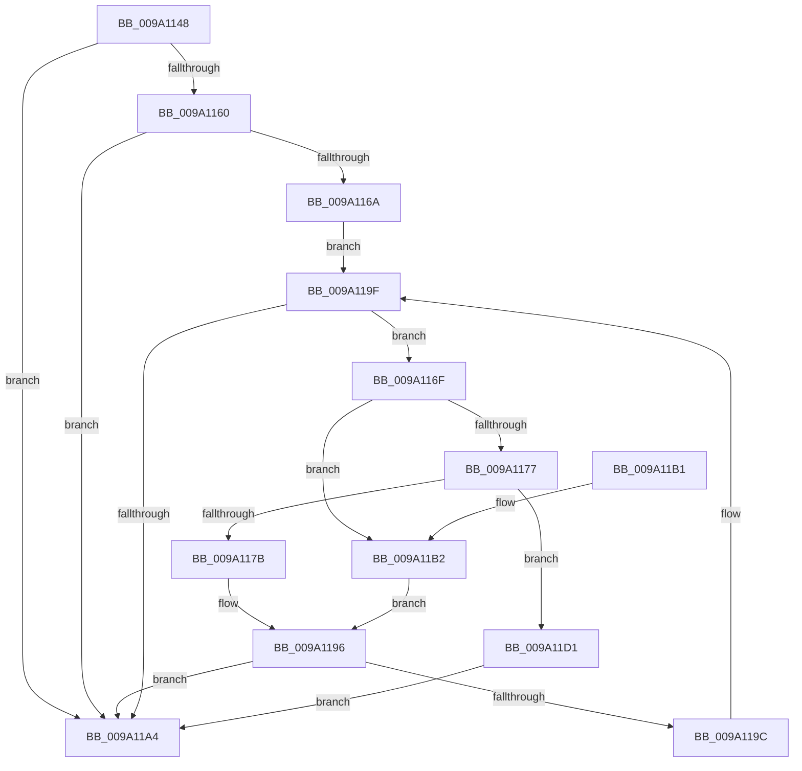

# sub_009A1148

- RVA: `0x009A1148`–`0x009A11D8` (길이 `144` bytes)
- VA: `0x00000001409A1148`
- 실행 섹션: `PAGE`
- PDB 이름 있음: `아니요`; PDB Function 태그: `아니요`
- unwind 정보 RVA: `0x00063C24`
- 디코드: `47`개 명령, `144/144` bytes 표시
- 미해석 바이트: `0` (있으면 어셈블리에 `.byte`로 보존)

> 이 문서는 커널 이미지의 기계어와 PDB 기호를 분석해 생성했습니다. 4번과 5번은 함수 원형과 자료형을 바이너리 사용 방식에서 추정한 C 해석이며 원본 소스 복구 결과는 아닙니다.

## 1. Dependencies

- 직접 호출 지점: **2**; 고유 호출 대상: **2**
- 직접 호출자로 확인된 함수: **1**
- RIP 상대 이미지 참조: **0**

### Outgoing calls
- `0x009A1191` → [sub_009A11E0](Unknown_function_009A11E0.md) (function, `0x009A11E0`)
- `0x009A11CA` → [sub_009A262C](Unknown_function_009A262C.md) (function, `0x009A262C`)

### Direct callers
- [sub_009A02CC](Unknown_function_009A02CC.md) at `0x009A0369`

### Static image references
- 디코드된 RIP-relative 메모리 참조가 없습니다.

## 2. Other-region calls and transfers

- 다른 실행 섹션으로 향하는 call: **0**
- 별도 외부 분기/꼬리 이동을 확인하지 못했습니다.

## 3. Assembly (complete function range)

```asm
009A1148  48 89 5C 24 08                  mov qword ptr [rsp + 8], rbx
009A114D  57                              push rdi
009A114E  48 83 EC 20                     sub rsp, 0x20
009A1152  48 8B 41 40                     mov rax, qword ptr [rcx + 0x40]
009A1156  33 D2                           xor edx, edx
009A1158  48 8B D9                        mov rbx, rcx
009A115B  48 85 C0                        test rax, rax
009A115E  74 44                           je 0x1409a11a4
009A1160  48 83 E8 01                     sub rax, 1
009A1164  48 89 41 40                     mov qword ptr [rcx + 0x40], rax
009A1168  75 3A                           jne 0x1409a11a4
009A116A  8B 79 48                        mov edi, dword ptr [rcx + 0x48]
009A116D  EB 30                           jmp 0x1409a119f
009A116F  8B 43 30                        mov eax, dword ptr [rbx + 0x30]
009A1172  83 F8 01                        cmp eax, 1
009A1175  74 3B                           je 0x1409a11b2
009A1177  85 C0                           test eax, eax
009A1179  75 56                           jne 0x1409a11d1
009A117B  48 63 C7                        movsxd rax, edi
009A117E  48 8D 0C 40                     lea rcx, [rax + rax*2]
009A1182  48 8B 43 38                     mov rax, qword ptr [rbx + 0x38]
009A1186  48 8D 49 3D                     lea rcx, [rcx + 0x3d]
009A118A  48 8D 14 88                     lea rdx, [rax + rcx*4]
009A118E  48 8B CB                        mov rcx, rbx
009A1191  E8 4A 00 00 00                  call 0x1409a11e0
009A1196  8B D0                           mov edx, eax
009A1198  85 C0                           test eax, eax
009A119A  78 08                           js 0x1409a11a4
009A119C  FF 4B 48                        dec dword ptr [rbx + 0x48]
009A119F  83 EF 01                        sub edi, 1
009A11A2  79 CB                           jns 0x1409a116f
009A11A4  48 8B 5C 24 30                  mov rbx, qword ptr [rsp + 0x30]
009A11A9  8B C2                           mov eax, edx
009A11AB  48 83 C4 20                     add rsp, 0x20
009A11AF  5F                              pop rdi
009A11B0  C3                              ret
009A11B1  CC                              int3
009A11B2  48 8B 53 38                     mov rdx, qword ptr [rbx + 0x38]
009A11B6  48 81 C2 F8 00 00 00            add rdx, 0xf8
009A11BD  48 63 CF                        movsxd rcx, edi
009A11C0  48 C1 E1 04                     shl rcx, 4
009A11C4  48 03 D1                        add rdx, rcx
009A11C7  48 8B CB                        mov rcx, rbx
009A11CA  E8 5D 14 00 00                  call 0x1409a262c
009A11CF  EB C5                           jmp 0x1409a1196
009A11D1  BA 0D 00 00 C0                  mov edx, 0xc000000d
009A11D6  EB CC                           jmp 0x1409a11a4
```

## 4. C-style interpretation (structured pseudocode)

```c
__int64 __fastcall sub_009A1148(__int64 a1, int a2)
{
    __int64 result;
    __int64 v_rdi;
    __int64 v_rsp;
    unsigned __int64 v_stack_p8;

    v_stack_p8 = v_rbx;
    v_rsp = (v_rsp) - (32);
    a2 = 0;
    if (*(unsigned __int64 *)(a1 + 64) == 0) goto loc_009A11A4;
    result = (*(unsigned __int64 *)(a1 + 64)) - (1);
    *(unsigned __int64 *)(a1 + 64) = result;
    if (condition_is_not_equal) goto loc_009A11A4;
    goto loc_009A119F;
loc_009A116F:
    if (((unsigned int)((unsigned int)(*(unsigned int *)(a1 + 48)))) == 1) goto loc_009A11B2;
    if ((unsigned int)((unsigned int)(*(unsigned int *)(a1 + 48))) != 0) goto loc_009A11D1;
    result = sub_009A11E0(a1, *(unsigned __int64 *)(a1 + 56) + (int)((unsigned int)((unsigned int)(*(unsigned int *)(a1 + 72)))) + (int)((unsigned int)((unsigned int)(*(unsigned int *)(a1 + 72)))) * 2 + 61 * 4, a3, a4);
loc_009A1196:
    if (sign_flag) goto loc_009A11A4;
loc_009A119F:
    v_rdi = (unsigned int)(((unsigned int)(*(unsigned int *)(a1 + 72))) - (1));
    if (!sign_flag) goto loc_009A116F;
loc_009A11A4:
    v_rsp = (v_rsp) + (32);
    return (unsigned int)((unsigned int)((unsigned int)((unsigned int)(result))));
loc_009A11B2:
    a2 = (*(unsigned __int64 *)(v_stack_p8 + 56)) + (248);
    a1 = ((int)((unsigned int)(v_rdi))) << (4);
    a2 = (a2) + (a1);
    result = sub_009A262C(v_stack_p8, a2, a3, a4);
    goto loc_009A1196;
loc_009A11D1:
    goto loc_009A11A4;
}
```

## 5. (Beta) C Style

```c
int64_t sub_009A1148(void *Arg1, int32_t Arg2)
{
    uint8_t *arg1 = (uint8_t *)Arg1;

    int64_t result;
    int64_t local_rdi;
    int64_t local_rsp;
    uint64_t v_stack_p8;

    v_stack_p8 = local_rbx;
    local_rsp = (local_rsp) - (32);
    Arg2 = 0;
    if (*(uint64_t *)(arg1 + 0x40) == 0) goto loc_009A11A4;
    result = (*(uint64_t *)(arg1 + 0x40)) - (1);
    *(uint64_t *)(arg1 + 0x40) = result;
    if (condition_is_not_equal) goto loc_009A11A4;
    goto loc_009A119F;
loc_009A116F:
    if (((uint32_t)((uint32_t)(*(uint32_t *)(arg1 + 0x30)))) == 1) goto loc_009A11B2;
    if ((uint32_t)((uint32_t)(*(uint32_t *)(arg1 + 0x30))) != 0) goto loc_009A11D1;
    result = sub_009A11E0(Arg1, *(uint64_t *)(arg1 + 0x38) + (int32_t)((uint32_t)((uint32_t)(*(uint32_t *)(arg1 + 0x48)))) + (int32_t)((uint32_t)((uint32_t)(*(uint32_t *)(arg1 + 0x48)))) * 2 + 61 * 4, a3, a4);
loc_009A1196:
    if (sign_flag) goto loc_009A11A4;
loc_009A119F:
    local_rdi = (uint32_t)(((uint32_t)(*(uint32_t *)(arg1 + 0x48))) - (1));
    if (!sign_flag) goto loc_009A116F;
loc_009A11A4:
    local_rsp = (local_rsp) + (32);
    return (uint32_t)((uint32_t)((uint32_t)((uint32_t)(result))));
loc_009A11B2:
    Arg2 = (*(uint64_t *)(v_stack_p8 + 0x38)) + (248);
    Arg1 = ((int32_t)((uint32_t)(local_rdi))) << (4);
    Arg2 = (Arg2) + (Arg1);
    result = sub_009A262C(v_stack_p8, Arg2, a3, a4);
    goto loc_009A1196;
loc_009A11D1:
    goto loc_009A11A4;
}
```

### 관측된 메모리 오프셋

구조체 형식이 확인되지 않은 접근은 인자 기준의 오프셋으로만 기록했습니다.

| 기준 인자 | 오프셋 표현 | 폭 (bit) | 접근 |
|---|---:|---:|---|
| `Arg1` | `+ 0x30` | `32` | `R` |
| `Arg1` | `+ 0x38` | `64` | `R` |
| `Arg1` | `+ 0x40` | `64` | `R` |
| `Arg1` | `+ 0x40` | `64` | `W` |
| `Arg1` | `+ 0x48` | `32` | `R` |
| `Arg1` | `+ 0x48` | `32` | `R/W` |

## 6. Execution-region graph

[열기: 2D/3D 그래프와 함수 탐색 컨트롤 패널](../../../control-panel.html?section=page&rva=0x009A1148&view=graph)

- 2D 그래프는 위에서 아래로 흐르고, 3D 그래프는 빈 공간을 드래그해 회전합니다. Shift+드래그는 이동, 휠은 확대·축소, 함수 노드 선택은 대상 보고서 이동입니다.

### Static fallback


