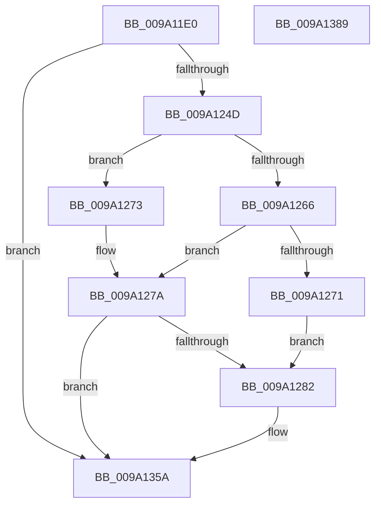

# sub_009A11E0

- RVA: `0x009A11E0`–`0x009A138A` (길이 `426` bytes)
- VA: `0x00000001409A11E0`
- 실행 섹션: `PAGE`
- PDB 이름 있음: `아니요`; PDB Function 태그: `아니요`
- unwind 정보 RVA: `0x0009B4AC`
- 디코드: `108`개 명령, `426/426` bytes 표시
- 미해석 바이트: `0` (있으면 어셈블리에 `.byte`로 보존)

> 이 문서는 커널 이미지의 기계어와 PDB 기호를 분석해 생성했습니다. 4번과 5번은 함수 원형과 자료형을 바이너리 사용 방식에서 추정한 C 해석이며 원본 소스 복구 결과는 아닙니다.

## 1. Dependencies

- 직접 호출 지점: **6**; 고유 호출 대상: **6**
- 직접 호출자로 확인된 함수: **1**
- RIP 상대 이미지 참조: **2**

### Outgoing calls
- `0x009A123E` → [sub_009A13B8](Unknown_function_009A13B8.md) (function, `0x009A13B8`)
- `0x009A1266` → [WbMakeUserExecutablePagesKernelWritable](WbMakeUserExecutablePagesKernelWritable_function_009A14F4.md) (function, `0x009A14F4`)
- `0x009A1273` → [WbMakeUserDataPagesKernelWritable](WbMakeUserDataPagesKernelWritable_function_009A15FC.md) (function, `0x009A15FC`)
- `0x009A1340` → [sub_0040C2C0](../../text/40/Unknown_function_0040C2C0.md) (function, `0x0040C2C0`)
- `0x009A135F` → [sub_009A1390](Unknown_function_009A1390.md) (function, `0x009A1390`)
- `0x009A136D` → [_security_check_cookie](../../text/6A/_security_check_cookie_function_006AC640.md) (function, `0x006AC640`)

### Direct callers
- [sub_009A1148](Unknown_function_009A1148.md) at `0x009A1191`

### Static image references
- `0x009A11F8` → RVA `0x00E0A740` (`.data`; read)
- `0x009A128F` → RVA `0x000029F0` (`.rdata`; read)

## 2. Other-region calls and transfers

- 다른 실행 섹션으로 향하는 call: **2**
  - `0x009A1340` → [sub_0040C2C0](../../text/40/Unknown_function_0040C2C0.md) (`PAGE` → `.text`)
  - `0x009A136D` → [_security_check_cookie](../../text/6A/_security_check_cookie_function_006AC640.md) (`PAGE` → `.text`)
- 별도 외부 분기/꼬리 이동을 확인하지 못했습니다.

## 3. Assembly (complete function range)

```asm
009A11E0  48 89 5C 24 18                  mov qword ptr [rsp + 0x18], rbx
009A11E5  55                              push rbp
009A11E6  56                              push rsi
009A11E7  57                              push rdi
009A11E8  41 54                           push r12
009A11EA  41 56                           push r14
009A11EC  48 8D 6C 24 E0                  lea rbp, [rsp - 0x20]
009A11F1  48 81 EC 20 01 00 00            sub rsp, 0x120
009A11F8  48 8B 05 41 95 46 00            mov rax, qword ptr [rip + 0x469541]
009A11FF  48 33 C4                        xor rax, rsp
009A1202  48 89 45 10                     mov qword ptr [rbp + 0x10], rax
009A1206  8B 7A 04                        mov edi, dword ptr [rdx + 4]
009A1209  48 8B F2                        mov rsi, rdx
009A120C  44 8B 02                        mov r8d, dword ptr [rdx]
009A120F  41 BC FF FF FF 0F               mov r12d, 0xfffffff
009A1215  8B 52 08                        mov edx, dword ptr [rdx + 8]
009A1218  4C 8B F1                        mov r14, rcx
009A121B  48 83 64 24 48 00               and qword ptr [rsp + 0x48], 0
009A1221  49 23 FC                        and rdi, r12
009A1224  48 03 79 20                     add rdi, qword ptr [rcx + 0x20]
009A1228  41 23 D4                        and edx, r12d
009A122B  48 83 64 24 50 00               and qword ptr [rsp + 0x50], 0
009A1231  48 8B CF                        mov rcx, rdi
009A1234  41 D1 E8                        shr r8d, 1
009A1237  41 F7 D0                        not r8d
009A123A  41 83 E0 01                     and r8d, 1
009A123E  E8 75 01 00 00                  call 0x1409a13b8
009A1243  8B D8                           mov ebx, eax
009A1245  85 C0                           test eax, eax
009A1247  0F 88 0D 01 00 00               js 0x1409a135a
009A124D  8B 56 08                        mov edx, dword ptr [rsi + 8]
009A1250  4C 8D 4C 24 48                  lea r9, [rsp + 0x48]
009A1255  8B 06                           mov eax, dword ptr [rsi]
009A1257  4C 8D 44 24 50                  lea r8, [rsp + 0x50]
009A125C  41 23 D4                        and edx, r12d
009A125F  48 8B CF                        mov rcx, rdi
009A1262  A8 02                           test al, 2
009A1264  75 0D                           jne 0x1409a1273
009A1266  E8 89 02 00 00                  call 0x1409a14f4
009A126B  8B D8                           mov ebx, eax
009A126D  85 C0                           test eax, eax
009A126F  78 09                           js 0x1409a127a
009A1271  EB 0F                           jmp 0x1409a1282
009A1273  E8 84 03 00 00                  call 0x1409a15fc
009A1278  8B D8                           mov ebx, eax
009A127A  85 DB                           test ebx, ebx
009A127C  0F 88 D8 00 00 00               js 0x1409a135a
009A1282  4D 8B 56 38                     mov r10, qword ptr [r14 + 0x38]
009A1286  48 8D 4C 24 68                  lea rcx, [rsp + 0x68]
009A128B  44 8B 46 04                     mov r8d, dword ptr [rsi + 4]
009A128F  48 8D 05 5A 17 66 FF            lea rax, [rip - 0x99e8a6]
009A1296  44 8B 4E 08                     mov r9d, dword ptr [rsi + 8]
009A129A  BA 80 00 00 00                  mov edx, 0x80
009A129F  48 89 44 24 60                  mov qword ptr [rsp + 0x60], rax
009A12A4  45 23 C4                        and r8d, r12d
009A12A7  41 0F 10 42 50                  movups xmm0, xmmword ptr [r10 + 0x50]
009A12AC  48 8D 44 24 40                  lea rax, [rsp + 0x40]
009A12B1  45 23 CC                        and r9d, r12d
009A12B4  41 0F 10 4A 60                  movups xmm1, xmmword ptr [r10 + 0x60]
009A12B9  48 89 44 24 30                  mov qword ptr [rsp + 0x30], rax
009A12BE  49 8B 42 48                     mov rax, qword ptr [r10 + 0x48]
009A12C2  0F 11 01                        movups xmmword ptr [rcx], xmm0
009A12C5  44 89 44 24 28                  mov dword ptr [rsp + 0x28], r8d
009A12CA  41 0F 10 42 70                  movups xmm0, xmmword ptr [r10 + 0x70]
009A12CF  4C 8B 44 24 48                  mov r8, qword ptr [rsp + 0x48]
009A12D4  0F 11 49 10                     movups xmmword ptr [rcx + 0x10], xmm1
009A12D8  C6 44 24 40 00                  mov byte ptr [rsp + 0x40], 0
009A12DD  41 0F 10 8A 80 00 00 00         movups xmm1, xmmword ptr [r10 + 0x80]
009A12E5  48 89 44 24 20                  mov qword ptr [rsp + 0x20], rax
009A12EA  0F 11 41 20                     movups xmmword ptr [rcx + 0x20], xmm0
009A12EE  41 0F 10 82 90 00 00 00         movups xmm0, xmmword ptr [r10 + 0x90]
009A12F6  0F 11 49 30                     movups xmmword ptr [rcx + 0x30], xmm1
009A12FA  41 0F 10 8A A0 00 00 00         movups xmm1, xmmword ptr [r10 + 0xa0]
009A1302  0F 11 41 40                     movups xmmword ptr [rcx + 0x40], xmm0
009A1306  41 0F 10 82 B0 00 00 00         movups xmm0, xmmword ptr [r10 + 0xb0]
009A130E  0F 11 49 50                     movups xmmword ptr [rcx + 0x50], xmm1
009A1312  41 0F 10 4C 12 50               movups xmm1, xmmword ptr [r10 + rdx + 0x50]
009A1318  0F 11 41 60                     movups xmmword ptr [rcx + 0x60], xmm0
009A131C  41 0F 10 82 C0 00 00 00         movups xmm0, xmmword ptr [r10 + 0xc0]
009A1324  0F 11 44 11 F0                  movups xmmword ptr [rcx + rdx - 0x10], xmm0
009A1329  41 0F 10 44 12 60               movups xmm0, xmmword ptr [r10 + rdx + 0x60]
009A132F  0F 11 0C 11                     movups xmmword ptr [rcx + rdx], xmm1
009A1333  0F 11 44 11 10                  movups xmmword ptr [rcx + rdx + 0x10], xmm0
009A1338  48 8B D7                        mov rdx, rdi
009A133B  48 8D 4C 24 60                  lea rcx, [rsp + 0x60]
009A1340  E8 7B AF A6 FF                  call 0x14040c2c0
009A1345  8B 06                           mov eax, dword ptr [rsi]
009A1347  33 DB                           xor ebx, ebx
009A1349  0F B6 4C 24 40                  movzx ecx, byte ptr [rsp + 0x40]
009A134E  25 03 FC FF FF                  and eax, 0xfffffc03
009A1353  C1 E1 02                        shl ecx, 2
009A1356  0B C8                           or ecx, eax
009A1358  89 0E                           mov dword ptr [rsi], ecx
009A135A  48 8B 4C 24 50                  mov rcx, qword ptr [rsp + 0x50]
009A135F  E8 2C 00 00 00                  call 0x1409a1390
009A1364  8B C3                           mov eax, ebx
009A1366  48 8B 4D 10                     mov rcx, qword ptr [rbp + 0x10]
009A136A  48 33 CC                        xor rcx, rsp
009A136D  E8 CE B2 D0 FF                  call 0x1406ac640
009A1372  48 8B 9C 24 60 01 00 00         mov rbx, qword ptr [rsp + 0x160]
009A137A  48 81 C4 20 01 00 00            add rsp, 0x120
009A1381  41 5E                           pop r14
009A1383  41 5C                           pop r12
009A1385  5F                              pop rdi
009A1386  5E                              pop rsi
009A1387  5D                              pop rbp
009A1388  C3                              ret
009A1389  CC                              int3
```

## 4. C-style interpretation (structured pseudocode)

```c
__int64 __fastcall sub_009A11E0(__int64 a1, __int64 a2)
{
    __int64 result;
    __int64 v_r10;
    __int64 v_rbx;
    __int64 v_rdi;
    __int64 v_rsp;
    unsigned __int64 v_stack_m100;
    unsigned __int64 v_stack_m108;
    unsigned __int64 v_stack_m118;
    unsigned int v_stack_m120;
    unsigned __int64 v_stack_m128;
    unsigned __int64 v_stack_m38;
    unsigned __int64 v_stack_m48;
    unsigned __int64 v_stack_mE0;
    unsigned __int64 v_stack_mE8;
    unsigned __int64 v_stack_mF8;
    unsigned __int64 v_stack_p18;

    v_stack_p18 = v_rbx;
    v_rsp = (v_rsp) - (288);
    result = (*(unsigned __int64 *)(v_rip + 4625729)) ^ (v_rsp);
    v_stack_m38 = result;
    v_rdi = ((unsigned int)(*(unsigned int *)(a2 + 4))) & ((unsigned int)(0xFFFFFFFULL));
    v_rdi = (v_rdi) + (*(unsigned __int64 *)(a1 + 32));
    a2 = (unsigned int)(((unsigned int)(*(unsigned int *)(a2 + 8))) & ((unsigned int)((unsigned int)(0xFFFFFFFULL))));
    a3 = (unsigned int)(((unsigned int)(*(unsigned int *)(a2))) >> (1));
    a3 = (unsigned int)(~(a3));
    a3 = (unsigned int)((a3) & (1));
    result = sub_009A13B8(v_rdi, a2, a3, a4);
    if (sign_flag) goto loc_009A135A;
    a2 = (unsigned int)(((unsigned int)(*(unsigned int *)(a2 + 8))) & ((unsigned int)((unsigned int)(0xFFFFFFFULL))));
    if ((((unsigned __int8)((unsigned int)(*(unsigned int *)(a2)))) & (2)) != 0) goto loc_009A1273;
    result = WbMakeUserExecutablePagesKernelWritable(v_rdi, a2, v_stack_mF8, v_stack_m100);
    if (sign_flag) goto loc_009A127A;
    goto loc_009A1282;
loc_009A1273:
    result = WbMakeUserDataPagesKernelWritable(v_rdi, a2, v_stack_mF8, v_stack_m100);
loc_009A127A:
    v_rbx = (unsigned int)((unsigned int)(result));
    if (!(sign_flag)) {
        v_r10 = *(unsigned __int64 *)(a1 + 56);
        a1 = v_stack_mE0;
        a3 = *(unsigned int *)(a2 + 4);
        result = v_rip - 10086566;
        a4 = *(unsigned int *)(a2 + 8);
        a2 = 128;
        v_stack_mE8 = result;
        a3 = (unsigned int)((a3) & ((unsigned int)((unsigned int)(0xFFFFFFFULL))));
        result = v_stack_m108;
        a4 = (unsigned int)((a4) & ((unsigned int)((unsigned int)(0xFFFFFFFULL))));
        v_stack_m118 = result;
        result = *(unsigned __int64 *)(v_r10 + 72);
        *(unsigned __int64 *)(a1) = v_xmm0;
        v_stack_m120 = (unsigned int)(a3);
        a3 = v_stack_m100;
        *(unsigned __int64 *)(a1 + 16) = v_xmm1;
        v_stack_m108 = 0;
        v_stack_m128 = result;
        *(unsigned __int64 *)(a1 + 32) = v_xmm0;
        *(unsigned __int64 *)(a1 + 48) = v_xmm1;
        *(unsigned __int64 *)(a1 + 64) = v_xmm0;
        *(unsigned __int64 *)(a1 + 80) = v_xmm1;
        *(unsigned __int64 *)(a1 + 96) = v_xmm0;
        *(unsigned __int64 *)(a1 + a2 * 1 - 16) = v_xmm0;
        *(unsigned __int64 *)(a1 + a2 * 1) = v_xmm1;
        *(unsigned __int64 *)(a1 + a2 * 1 + 16) = v_xmm0;
        a2 = v_rdi;
        a1 = v_stack_mE8;
        result = sub_0040C2C0(a1, a2, a3, a4);
        result = *(unsigned int *)(a2);
        v_rbx = 0;
        a1 = v_stack_m108;
        result = (unsigned int)((result) & (0xFFFFFC03ULL));
        a1 = (unsigned int)((a1) << (2));
        a1 = (unsigned int)((a1) | ((unsigned int)(result)));
        *(unsigned int *)(a2) = (unsigned int)(a1);
    }
    result = sub_009A1390(v_stack_mF8, a2, a3, a4);
    a1 = (v_stack_m38) ^ (v_rsp);
    result = _security_check_cookie(a1, a2, a3, a4);
    v_rsp = (v_rsp) + (288);
    return result;
}
```

## 5. (Beta) C Style

```c
int64_t sub_009A11E0(void *Arg1, void *Arg2)
{
    uint8_t *arg1 = (uint8_t *)Arg1;
    uint8_t *arg2 = (uint8_t *)Arg2;

    int64_t result;
    int64_t local_r10;
    int64_t local_rbx;
    int64_t local_rdi;
    int64_t local_rsp;
    uint64_t v_stack_m100;
    uint64_t v_stack_m108;
    uint64_t v_stack_m118;
    uint32_t v_stack_m120;
    uint64_t v_stack_m128;
    uint64_t v_stack_m38;
    uint64_t v_stack_m48;
    uint64_t v_stack_mE0;
    uint64_t v_stack_mE8;
    uint64_t v_stack_mF8;
    uint64_t v_stack_p18;

    v_stack_p18 = local_rbx;
    local_rsp = (local_rsp) - (288);
    result = (*(uint64_t *)(v_rip + 0x469541)) ^ (local_rsp);
    v_stack_m38 = result;
    local_rdi = ((uint32_t)(*(uint32_t *)(arg2 + 0x4))) & ((uint32_t)(0xFFFFFFFULL));
    local_rdi = (local_rdi) + (*(uint64_t *)(arg1 + 0x20));
    Arg2 = (uint32_t)(((uint32_t)(*(uint32_t *)(arg2 + 0x8))) & ((uint32_t)((uint32_t)(0xFFFFFFFULL))));
    a3 = (uint32_t)(((uint32_t)(*(uint32_t *)(arg2))) >> (1));
    a3 = (uint32_t)(~(a3));
    a3 = (uint32_t)((a3) & (1));
    result = sub_009A13B8(local_rdi, Arg2, a3, a4);
    if (sign_flag) goto loc_009A135A;
    Arg2 = (uint32_t)(((uint32_t)(*(uint32_t *)(arg2 + 0x8))) & ((uint32_t)((uint32_t)(0xFFFFFFFULL))));
    if ((((uint8_t)((uint32_t)(*(uint32_t *)(arg2)))) & (2)) != 0) goto loc_009A1273;
    result = WbMakeUserExecutablePagesKernelWritable(local_rdi, Arg2, v_stack_mF8, v_stack_m100);
    if (sign_flag) goto loc_009A127A;
    goto loc_009A1282;
loc_009A1273:
    result = WbMakeUserDataPagesKernelWritable(local_rdi, Arg2, v_stack_mF8, v_stack_m100);
loc_009A127A:
    local_rbx = (uint32_t)((uint32_t)(result));
    if (!(sign_flag)) {
        local_r10 = *(uint64_t *)(arg1 + 0x38);
        Arg1 = v_stack_mE0;
        a3 = *(uint32_t *)(arg2 + 0x4);
        result = v_rip - 10086566;
        a4 = *(uint32_t *)(arg2 + 0x8);
        Arg2 = 128;
        v_stack_mE8 = result;
        a3 = (uint32_t)((a3) & ((uint32_t)((uint32_t)(0xFFFFFFFULL))));
        result = v_stack_m108;
        a4 = (uint32_t)((a4) & ((uint32_t)((uint32_t)(0xFFFFFFFULL))));
        v_stack_m118 = result;
        result = *(uint64_t *)(local_r10 + 0x48);
        *(uint64_t *)(arg1) = v_xmm0;
        v_stack_m120 = (uint32_t)(a3);
        a3 = v_stack_m100;
        *(uint64_t *)(arg1 + 0x10) = v_xmm1;
        v_stack_m108 = 0;
        v_stack_m128 = result;
        *(uint64_t *)(arg1 + 0x20) = v_xmm0;
        *(uint64_t *)(arg1 + 0x30) = v_xmm1;
        *(uint64_t *)(arg1 + 0x40) = v_xmm0;
        *(uint64_t *)(arg1 + 0x50) = v_xmm1;
        *(uint64_t *)(arg1 + 0x60) = v_xmm0;
        *(uint64_t *)(arg1 + arg2 * 1 - 0x10) = v_xmm0;
        *(uint64_t *)(arg1 + arg2 * 1) = v_xmm1;
        *(uint64_t *)(arg1 + arg2 * 1 + 0x10) = v_xmm0;
        Arg2 = local_rdi;
        Arg1 = v_stack_mE8;
        result = sub_0040C2C0(Arg1, Arg2, a3, a4);
        result = *(uint32_t *)(arg2);
        local_rbx = 0;
        Arg1 = v_stack_m108;
        result = (uint32_t)((result) & (0xFFFFFC03ULL));
        Arg1 = (uint32_t)((Arg1) << (2));
        Arg1 = (uint32_t)((Arg1) | ((uint32_t)(result)));
        *(uint32_t *)(arg2) = (uint32_t)(Arg1);
    }
    result = sub_009A1390(v_stack_mF8, Arg2, a3, a4);
    Arg1 = (v_stack_m38) ^ (local_rsp);
    result = _security_check_cookie(Arg1, Arg2, a3, a4);
    local_rsp = (local_rsp) + (288);
    return result;
}
```

### 관측된 메모리 오프셋

구조체 형식이 확인되지 않은 접근은 인자 기준의 오프셋으로만 기록했습니다.

| 기준 인자 | 오프셋 표현 | 폭 (bit) | 접근 |
|---|---:|---:|---|
| `Arg1` | `+ 0x20` | `64` | `R` |
| `Arg1` | `+ 0x38` | `64` | `R` |
| `Arg2` | `+ 0x0` | `32` | `R` |
| `Arg2` | `+ 0x0` | `32` | `W` |
| `Arg2` | `+ 0x4` | `32` | `R` |
| `Arg2` | `+ 0x8` | `32` | `R` |

## 6. Execution-region graph

[열기: 2D/3D 그래프와 함수 탐색 컨트롤 패널](../../../control-panel.html?section=page&rva=0x009A11E0&view=graph)

- 2D 그래프는 위에서 아래로 흐르고, 3D 그래프는 빈 공간을 드래그해 회전합니다. Shift+드래그는 이동, 휠은 확대·축소, 함수 노드 선택은 대상 보고서 이동입니다.

### Static fallback


