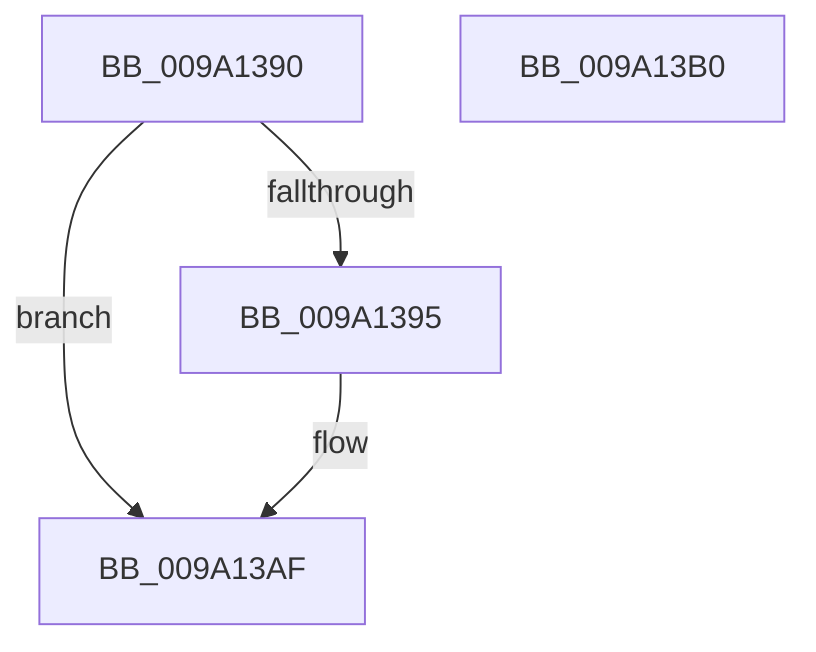

# sub_009A1390

- RVA: `0x009A1390`–`0x009A13B1` (길이 `33` bytes)
- VA: `0x00000001409A1390`
- 실행 섹션: `PAGE`
- PDB 이름 있음: `아니요`; PDB Function 태그: `아니요`
- unwind 정보 RVA: `0x000805BC`
- 디코드: `12`개 명령, `33/33` bytes 표시
- 미해석 바이트: `0` (있으면 어셈블리에 `.byte`로 보존)

> 이 문서는 커널 이미지의 기계어와 PDB 기호를 분석해 생성했습니다. 4번과 5번은 함수 원형과 자료형을 바이너리 사용 방식에서 추정한 C 해석이며 원본 소스 복구 결과는 아닙니다.

## 1. Dependencies

- 직접 호출 지점: **2**; 고유 호출 대상: **2**
- 직접 호출자로 확인된 함수: **5**
- RIP 상대 이미지 참조: **0**

### Outgoing calls
- `0x009A139D` → [MmUnlockPages](../../text/29/MmUnlockPages_function_0029EEE0.md) (function, `0x0029EEE0`)
- `0x009A13A5` → [IoFreeMdl](../../text/29/IoFreeMdl_function_0029EA80.md) (function, `0x0029EA80`)

### Direct callers
- [sub_00811EE0](../81/Unknown_function_00811EE0.md) at `0x008120E1`
- [sub_009A0BF0](Unknown_function_009A0BF0.md) at `0x009A0C25`
- [sub_009A0EC4](Unknown_function_009A0EC4.md) at `0x009A10F8`
- [sub_009A11E0](Unknown_function_009A11E0.md) at `0x009A135F`
- [sub_009A262C](Unknown_function_009A262C.md) at `0x009A275B`

### Static image references
- 디코드된 RIP-relative 메모리 참조가 없습니다.

## 2. Other-region calls and transfers

- 다른 실행 섹션으로 향하는 call: **2**
  - `0x009A139D` → [MmUnlockPages](../../text/29/MmUnlockPages_function_0029EEE0.md) (`PAGE` → `.text`)
  - `0x009A13A5` → [IoFreeMdl](../../text/29/IoFreeMdl_function_0029EA80.md) (`PAGE` → `.text`)
- 별도 외부 분기/꼬리 이동을 확인하지 못했습니다.

## 3. Assembly (complete function range)

```asm
009A1390  48 85 C9                        test rcx, rcx
009A1393  74 1A                           je 0x1409a13af
009A1395  53                              push rbx
009A1396  48 83 EC 20                     sub rsp, 0x20
009A139A  48 8B D9                        mov rbx, rcx
009A139D  E8 3E DB 8F FF                  call 0x14029eee0
009A13A2  48 8B CB                        mov rcx, rbx
009A13A5  E8 D6 D6 8F FF                  call 0x14029ea80
009A13AA  48 83 C4 20                     add rsp, 0x20
009A13AE  5B                              pop rbx
009A13AF  C3                              ret
009A13B0  CC                              int3
```

## 4. C-style interpretation (structured pseudocode)

```c
__int64 __fastcall sub_009A1390(__int64 a1)
{
    __int64 result;
    __int64 v_rbx;
    __int64 v_rsp;

    if (a1 != 0) {
        v_rsp = (v_rsp) - (32);
        v_rbx = a1;
        result = MmUnlockPages(a1, a2, a3, a4);
        a1 = v_rbx;
        result = IoFreeMdl(a1, a2, a3, a4);
        v_rsp = (v_rsp) + (32);
    }
    return result;
}
```

## 5. (Beta) C Style

```c
int64_t sub_009A1390(int64_t Arg1)
{
    int64_t result;
    int64_t local_rbx;
    int64_t local_rsp;

    if (Arg1 != 0) {
        local_rsp = (local_rsp) - (32);
        local_rbx = Arg1;
        result = MmUnlockPages(Arg1, a2, a3, a4);
        Arg1 = local_rbx;
        result = IoFreeMdl(Arg1, a2, a3, a4);
        local_rsp = (local_rsp) + (32);
    }
    return result;
}
```

## 6. Execution-region graph

[열기: 2D/3D 그래프와 함수 탐색 컨트롤 패널](../../../control-panel.html?section=page&rva=0x009A1390&view=graph)

- 2D 그래프는 위에서 아래로 흐르고, 3D 그래프는 빈 공간을 드래그해 회전합니다. Shift+드래그는 이동, 휠은 확대·축소, 함수 노드 선택은 대상 보고서 이동입니다.

### Static fallback


