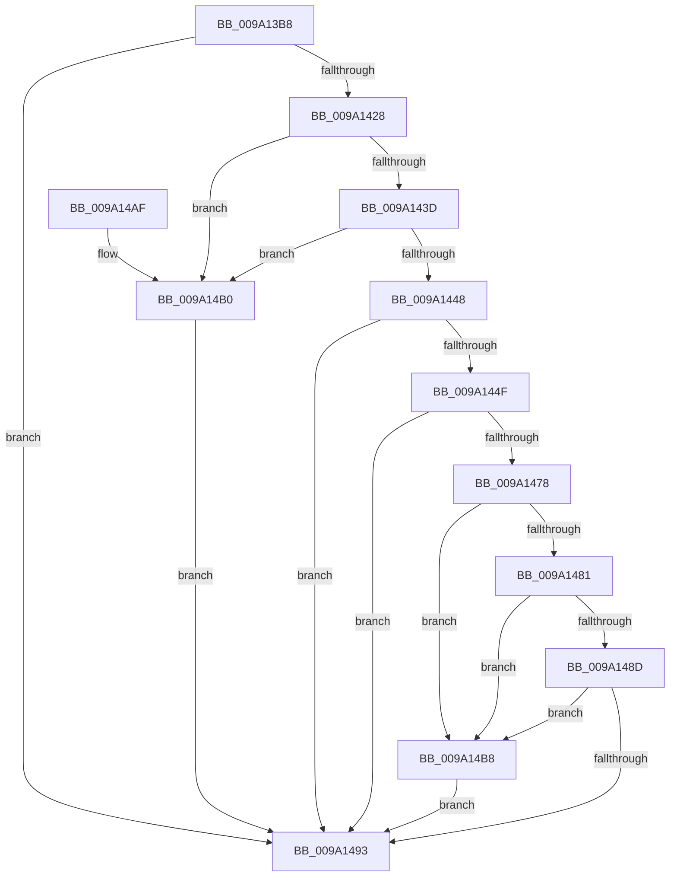

# sub_009A13B8

- RVA: `0x009A13B8`–`0x009A14C0` (길이 `264` bytes)
- VA: `0x00000001409A13B8`
- 실행 섹션: `PAGE`
- PDB 이름 있음: `아니요`; PDB Function 태그: `아니요`
- unwind 정보 RVA: `0x0009B4D0`
- 디코드: `75`개 명령, `264/264` bytes 표시
- 미해석 바이트: `0` (있으면 어셈블리에 `.byte`로 보존)

> 이 문서는 커널 이미지의 기계어와 PDB 기호를 분석해 생성했습니다. 4번과 5번은 함수 원형과 자료형을 바이너리 사용 방식에서 추정한 C 해석이며 원본 소스 복구 결과는 아닙니다.

## 1. Dependencies

- 직접 호출 지점: **3**; 고유 호출 대상: **2**
- 직접 호출자로 확인된 함수: **6**
- RIP 상대 이미지 참조: **1**

### Outgoing calls
- `0x009A141C` → [ZwQueryVirtualMemory](../../text/6A/ZwQueryVirtualMemory_function_006AD530.md) (function, `0x006AD530`)
- `0x009A143F` → [guard_dispatch_icall](../../text/6B/guard_dispatch_icall_function_006BAAD0.md) (function, `0x006BAAD0`)
- `0x009A146C` → [ZwQueryVirtualMemory](../../text/6A/ZwQueryVirtualMemory_function_006AD530.md) (function, `0x006AD530`)

### Direct callers
- [sub_00811EE0](../81/Unknown_function_00811EE0.md) at `0x00811F4B`
- [WbCreateHeapExecutedBlock](../8D/WbCreateHeapExecutedBlock_function_008D4BE8.md) at `0x008D4D54`
- [WbCreateHeapExecutedBlock](../8D/WbCreateHeapExecutedBlock_function_008D4BE8.md) at `0x008D4F5D`
- [WbCreateHeapExecutedBlock](../8D/WbCreateHeapExecutedBlock_function_008D4BE8.md) at `0x008D50E4`
- [sub_0099FE78](../99/Unknown_function_0099FE78.md) at `0x0099FF75`
- [sub_009A0EC4](Unknown_function_009A0EC4.md) at `0x009A0F33`
- [sub_009A11E0](Unknown_function_009A11E0.md) at `0x009A123E`
- [sub_009A262C](Unknown_function_009A262C.md) at `0x009A2674`

### Static image references
- `0x009A142B` → RVA `0x00F04E80` (`.data`; read)

## 2. Other-region calls and transfers

- 다른 실행 섹션으로 향하는 call: **3**
  - `0x009A141C` → [ZwQueryVirtualMemory](../../text/6A/ZwQueryVirtualMemory_function_006AD530.md) (`PAGE` → `.text`)
  - `0x009A143F` → [guard_dispatch_icall](../../text/6B/guard_dispatch_icall_function_006BAAD0.md) (`PAGE` → `.text`)
  - `0x009A146C` → [ZwQueryVirtualMemory](../../text/6A/ZwQueryVirtualMemory_function_006AD530.md) (`PAGE` → `.text`)
- 별도 외부 분기/꼬리 이동을 확인하지 못했습니다.

## 3. Assembly (complete function range)

```asm
009A13B8  4C 8B DC                        mov r11, rsp
009A13BB  49 89 5B 08                     mov qword ptr [r11 + 8], rbx
009A13BF  49 89 73 10                     mov qword ptr [r11 + 0x10], rsi
009A13C3  49 89 7B 18                     mov qword ptr [r11 + 0x18], rdi
009A13C7  55                              push rbp
009A13C8  48 8B EC                        mov rbp, rsp
009A13CB  48 81 EC 80 00 00 00            sub rsp, 0x80
009A13D2  33 C0                           xor eax, eax
009A13D4  8B F2                           mov esi, edx
009A13D6  48 21 45 B0                     and qword ptr [rbp - 0x50], rax
009A13DA  4C 8D 4D B8                     lea r9, [rbp - 0x48]
009A13DE  48 21 45 28                     and qword ptr [rbp + 0x28], rax
009A13E2  0F 57 C0                        xorps xmm0, xmm0
009A13E5  48 89 45 C8                     mov qword ptr [rbp - 0x38], rax
009A13E9  41 8B F8                        mov edi, r8d
009A13EC  48 8D 45 28                     lea rax, [rbp + 0x28]
009A13F0  48 8B D9                        mov rbx, rcx
009A13F3  48 8B D1                        mov rdx, rcx
009A13F6  49 89 43 A0                     mov qword ptr [r11 - 0x60], rax
009A13FA  41 B8 06 00 00 00               mov r8d, 6
009A1400  49 C7 43 98 18 00 00 00         mov qword ptr [r11 - 0x68], 0x18
009A1408  48 83 C9 FF                     or rcx, 0xffffffffffffffff
009A140C  0F 11 45 D0                     movups xmmword ptr [rbp - 0x30], xmm0
009A1410  0F 11 45 E0                     movups xmmword ptr [rbp - 0x20], xmm0
009A1414  0F 11 45 F0                     movups xmmword ptr [rbp - 0x10], xmm0
009A1418  0F 11 45 B8                     movups xmmword ptr [rbp - 0x48], xmm0
009A141C  E8 0F C1 D0 FF                  call 0x1406ad530
009A1421  44 8B C0                        mov r8d, eax
009A1424  85 C0                           test eax, eax
009A1426  78 6B                           js 0x1409a1493
009A1428  8B 4D C8                        mov ecx, dword ptr [rbp - 0x38]
009A142B  48 8B 05 4E 3A 56 00            mov rax, qword ptr [rip + 0x563a4e]
009A1432  C1 E9 02                        shr ecx, 2
009A1435  80 E1 0F                        and cl, 0xf
009A1438  48 85 C0                        test rax, rax
009A143B  74 73                           je 0x1409a14b0
009A143D  B2 0C                           mov dl, 0xc
009A143F  E8 8C 96 D1 FF                  call 0x1406baad0
009A1444  85 C0                           test eax, eax
009A1446  74 68                           je 0x1409a14b0
009A1448  45 33 C0                        xor r8d, r8d
009A144B  85 FF                           test edi, edi
009A144D  74 44                           je 0x1409a1493
009A144F  48 8D 45 B0                     lea rax, [rbp - 0x50]
009A1453  48 8B D3                        mov rdx, rbx
009A1456  48 89 44 24 28                  mov qword ptr [rsp + 0x28], rax
009A145B  4C 8D 4D D0                     lea r9, [rbp - 0x30]
009A145F  48 83 C9 FF                     or rcx, 0xffffffffffffffff
009A1463  48 C7 44 24 20 30 00 00 00      mov qword ptr [rsp + 0x20], 0x30
009A146C  E8 BF C0 D0 FF                  call 0x1406ad530
009A1471  44 8B C0                        mov r8d, eax
009A1474  85 C0                           test eax, eax
009A1476  78 1B                           js 0x1409a1493
009A1478  48 8B 4D D0                     mov rcx, qword ptr [rbp - 0x30]
009A147C  48 3B D9                        cmp rbx, rcx
009A147F  72 37                           jb 0x1409a14b8
009A1481  48 03 4D E8                     add rcx, qword ptr [rbp - 0x18]
009A1485  48 03 F3                        add rsi, rbx
009A1488  48 3B F1                        cmp rsi, rcx
009A148B  77 2B                           ja 0x1409a14b8
009A148D  83 7D F4 20                     cmp dword ptr [rbp - 0xc], 0x20
009A1491  75 25                           jne 0x1409a14b8
009A1493  4C 8D 9C 24 80 00 00 00         lea r11, [rsp + 0x80]
009A149B  41 8B C0                        mov eax, r8d
009A149E  49 8B 5B 10                     mov rbx, qword ptr [r11 + 0x10]
009A14A2  49 8B 73 18                     mov rsi, qword ptr [r11 + 0x18]
009A14A6  49 8B 7B 20                     mov rdi, qword ptr [r11 + 0x20]
009A14AA  49 8B E3                        mov rsp, r11
009A14AD  5D                              pop rbp
009A14AE  C3                              ret
009A14AF  CC                              int3
009A14B0  41 B8 28 04 00 C0               mov r8d, 0xc0000428
009A14B6  EB DB                           jmp 0x1409a1493
009A14B8  41 B8 0D 00 00 C0               mov r8d, 0xc000000d
009A14BE  EB D3                           jmp 0x1409a1493
```

## 4. C-style interpretation (structured pseudocode)

```c
__int64 __fastcall sub_009A13B8(__int64 a1, int a2, int a3)
{
    __int64 result;
    __int64 v_rsi;
    __int64 v_rsp;
    unsigned int v_stack_m14;
    unsigned __int64 v_stack_m18;
    unsigned __int64 v_stack_m20;
    unsigned __int64 v_stack_m28;
    unsigned __int64 v_stack_m38;
    unsigned __int64 v_stack_m40;
    unsigned __int64 v_stack_m50;
    unsigned __int64 v_stack_m58;
    unsigned __int64 v_stack_m60;
    unsigned __int64 v_stack_m68;
    unsigned __int64 v_stack_m8;
    unsigned __int64 v_stack_p20;

    *(unsigned __int64 *)(v_rsp + 8) = v_rbx;
    *(unsigned __int64 *)(v_rsp + 16) = v_rsi;
    *(unsigned __int64 *)(v_rsp + 24) = v_rdi;
    v_rsp = (v_rsp) - (128);
    result = 0;
    v_stack_m40 = 0;
    *(unsigned __int64 *)(v_rsp - 96) = v_stack_p20;
    *(unsigned __int64 *)(v_rsp - 104) = 24;
    a1 = (a1) | (-1);
    v_stack_m38 = v_xmm0;
    v_stack_m28 = v_xmm0;
    v_stack_m18 = v_xmm0;
    v_stack_m50 = v_xmm0;
    result = ZwQueryVirtualMemory(a1, a1, 6, v_stack_m50);
    if (sign_flag) goto loc_009A1493;
    a1 = (unsigned int)(((unsigned int)(v_stack_m40)) >> (2));
    a1 = (unsigned __int8)((a1) & (15));
    if (*(unsigned __int64 *)(v_rip + 5651022) == 0) goto loc_009A14B0;
    result = guard_dispatch_icall(a1, 12, (unsigned int)((unsigned int)(result)), v_stack_m50);
    if ((unsigned int)(result) == 0) goto loc_009A14B0;
    a3 = 0;
    if ((unsigned int)((unsigned int)(a3)) == 0) goto loc_009A1493;
    v_stack_m60 = v_stack_m58;
    a1 = (a1) | (-1);
    v_stack_m68 = 48;
    result = ZwQueryVirtualMemory(a1, a1, a3, v_stack_m38);
    if (sign_flag) goto loc_009A1493;
    if (a1 < v_stack_m38) goto loc_009A14B8;
    a1 = (v_stack_m38) + (v_stack_m20);
    v_rsi = ((unsigned int)(a2)) + (a1);
    if (v_rsi > a1) goto loc_009A14B8;
    if (v_stack_m14 != 32) goto loc_009A14B8;
loc_009A1493:
    return (unsigned int)((unsigned int)((unsigned int)((unsigned int)(result))));
loc_009A14B0:
    goto loc_009A1493;
loc_009A14B8:
    goto loc_009A1493;
}
```

## 5. (Beta) C Style

```c
int64_t sub_009A13B8(int64_t Arg1, int32_t Arg2, int32_t Arg3)
{
    int64_t result;
    int64_t local_rsi;
    int64_t local_rsp;
    uint32_t v_stack_m14;
    uint64_t v_stack_m18;
    uint64_t v_stack_m20;
    uint64_t v_stack_m28;
    uint64_t v_stack_m38;
    uint64_t v_stack_m40;
    uint64_t v_stack_m50;
    uint64_t v_stack_m58;
    uint64_t v_stack_m60;
    uint64_t v_stack_m68;
    uint64_t v_stack_m8;
    uint64_t v_stack_p20;

    *(uint64_t *)(local_rsp + 0x8) = local_rbx;
    *(uint64_t *)(local_rsp + 0x10) = local_rsi;
    *(uint64_t *)(local_rsp + 0x18) = local_rdi;
    local_rsp = (local_rsp) - (128);
    result = 0;
    v_stack_m40 = 0;
    *(uint64_t *)(local_rsp - 0x60) = v_stack_p20;
    *(uint64_t *)(local_rsp - 0x68) = 24;
    Arg1 = (Arg1) | (-1);
    v_stack_m38 = v_xmm0;
    v_stack_m28 = v_xmm0;
    v_stack_m18 = v_xmm0;
    v_stack_m50 = v_xmm0;
    result = ZwQueryVirtualMemory(Arg1, Arg1, 6, v_stack_m50);
    if (sign_flag) goto loc_009A1493;
    Arg1 = (uint32_t)(((uint32_t)(v_stack_m40)) >> (2));
    Arg1 = (uint8_t)((Arg1) & (15));
    if (*(uint64_t *)(v_rip + 0x563A4E) == 0) goto loc_009A14B0;
    result = guard_dispatch_icall(Arg1, 12, (uint32_t)((uint32_t)(result)), v_stack_m50);
    if ((uint32_t)(result) == 0) goto loc_009A14B0;
    Arg3 = 0;
    if ((uint32_t)((uint32_t)(Arg3)) == 0) goto loc_009A1493;
    v_stack_m60 = v_stack_m58;
    Arg1 = (Arg1) | (-1);
    v_stack_m68 = 48;
    result = ZwQueryVirtualMemory(Arg1, Arg1, Arg3, v_stack_m38);
    if (sign_flag) goto loc_009A1493;
    if (Arg1 < v_stack_m38) goto loc_009A14B8;
    Arg1 = (v_stack_m38) + (v_stack_m20);
    local_rsi = ((uint32_t)(Arg2)) + (Arg1);
    if (local_rsi > Arg1) goto loc_009A14B8;
    if (v_stack_m14 != 32) goto loc_009A14B8;
loc_009A1493:
    return (uint32_t)((uint32_t)((uint32_t)((uint32_t)(result))));
loc_009A14B0:
    goto loc_009A1493;
loc_009A14B8:
    goto loc_009A1493;
}
```

## 6. Execution-region graph

[열기: 2D/3D 그래프와 함수 탐색 컨트롤 패널](../../../control-panel.html?section=page&rva=0x009A13B8&view=graph)

- 2D 그래프는 위에서 아래로 흐르고, 3D 그래프는 빈 공간을 드래그해 회전합니다. Shift+드래그는 이동, 휠은 확대·축소, 함수 노드 선택은 대상 보고서 이동입니다.

### Static fallback


