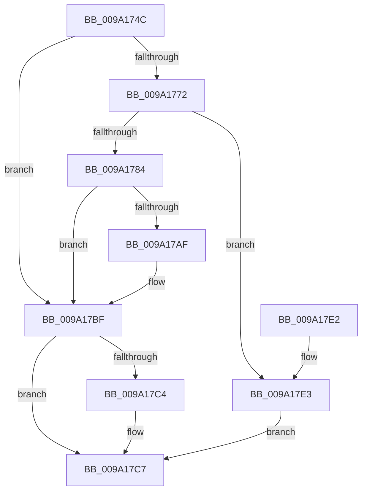

# sub_009A174C

- RVA: `0x009A174C`–`0x009A17EA` (길이 `158` bytes)
- VA: `0x00000001409A174C`
- 실행 섹션: `PAGE`
- PDB 이름 있음: `아니요`; PDB Function 태그: `아니요`
- unwind 정보 RVA: `0x00075210`
- 디코드: `53`개 명령, `158/158` bytes 표시
- 미해석 바이트: `0` (있으면 어셈블리에 `.byte`로 보존)

> 이 문서는 커널 이미지의 기계어와 PDB 기호를 분석해 생성했습니다. 4번과 5번은 함수 원형과 자료형을 바이너리 사용 방식에서 추정한 C 해석이며 원본 소스 복구 결과는 아닙니다.

## 1. Dependencies

- 직접 호출 지점: **3**; 고유 호출 대상: **2**
- 직접 호출자로 확인된 함수: **1**
- RIP 상대 이미지 참조: **0**

### Outgoing calls
- `0x009A1789` → [ExGenRandom](../../text/41/ExGenRandom_function_0041B010.md) (function, `0x0041B010`)
- `0x009A17A5` → [sub_009A17F0](Unknown_function_009A17F0.md) (function, `0x009A17F0`)
- `0x009A17BA` → [sub_009A17F0](Unknown_function_009A17F0.md) (function, `0x009A17F0`)

### Direct callers
- [sub_009A09B8](Unknown_function_009A09B8.md) at `0x009A0A7A`
- [sub_009A09B8](Unknown_function_009A09B8.md) at `0x009A0B39`

### Static image references
- 디코드된 RIP-relative 메모리 참조가 없습니다.

## 2. Other-region calls and transfers

- 다른 실행 섹션으로 향하는 call: **1**
  - `0x009A1789` → [ExGenRandom](../../text/41/ExGenRandom_function_0041B010.md) (`PAGE` → `.text`)
- 별도 외부 분기/꼬리 이동을 확인하지 못했습니다.

## 3. Assembly (complete function range)

```asm
009A174C  48 89 5C 24 08                  mov qword ptr [rsp + 8], rbx
009A1751  48 89 6C 24 10                  mov qword ptr [rsp + 0x10], rbp
009A1756  48 89 74 24 18                  mov qword ptr [rsp + 0x18], rsi
009A175B  57                              push rdi
009A175C  41 56                           push r14
009A175E  41 57                           push r15
009A1760  48 83 EC 20                     sub rsp, 0x20
009A1764  33 C0                           xor eax, eax
009A1766  33 DB                           xor ebx, ebx
009A1768  49 8B F0                        mov rsi, r8
009A176B  4C 8B F1                        mov r14, rcx
009A176E  85 D2                           test edx, edx
009A1770  74 4D                           je 0x1409a17bf
009A1772  8D 7A 3F                        lea edi, [rdx + 0x3f]
009A1775  BD 00 04 00 00                  mov ebp, 0x400
009A177A  C1 EF 06                        shr edi, 6
009A177D  8D 47 01                        lea eax, [rdi + 1]
009A1780  3B C5                           cmp eax, ebp
009A1782  77 5F                           ja 0x1409a17e3
009A1784  8D 4B 01                        lea ecx, [rbx + 1]
009A1787  2B E8                           sub ebp, eax
009A1789  E8 82 98 A7 FF                  call 0x14041b010
009A178E  0F BA F0 1F                     btr eax, 0x1f
009A1792  8D 4D 01                        lea ecx, [rbp + 1]
009A1795  33 D2                           xor edx, edx
009A1797  44 8B CF                        mov r9d, edi
009A179A  F7 F1                           div ecx
009A179C  44 8B C5                        mov r8d, ebp
009A179F  49 8B CE                        mov rcx, r14
009A17A2  44 8B FA                        mov r15d, edx
009A17A5  E8 46 00 00 00                  call 0x1409a17f0
009A17AA  48 85 C0                        test rax, rax
009A17AD  75 10                           jne 0x1409a17bf
009A17AF  44 8B CF                        mov r9d, edi
009A17B2  45 8B C7                        mov r8d, r15d
009A17B5  33 D2                           xor edx, edx
009A17B7  49 8B CE                        mov rcx, r14
009A17BA  E8 31 00 00 00                  call 0x1409a17f0
009A17BF  48 85 F6                        test rsi, rsi
009A17C2  74 03                           je 0x1409a17c7
009A17C4  48 89 06                        mov qword ptr [rsi], rax
009A17C7  48 8B 6C 24 48                  mov rbp, qword ptr [rsp + 0x48]
009A17CC  8B C3                           mov eax, ebx
009A17CE  48 8B 5C 24 40                  mov rbx, qword ptr [rsp + 0x40]
009A17D3  48 8B 74 24 50                  mov rsi, qword ptr [rsp + 0x50]
009A17D8  48 83 C4 20                     add rsp, 0x20
009A17DC  41 5F                           pop r15
009A17DE  41 5E                           pop r14
009A17E0  5F                              pop rdi
009A17E1  C3                              ret
009A17E2  CC                              int3
009A17E3  BB 95 00 00 C0                  mov ebx, 0xc0000095
009A17E8  EB DD                           jmp 0x1409a17c7
```

## 4. C-style interpretation (structured pseudocode)

```c
__int64 __fastcall sub_009A174C(__int64 a1, __int64 a2, __int64 a3)
{
    __int64 result;
    __int64 v_rbp;
    __int64 v_rbx;
    __int64 v_rdi;
    __int64 v_rsp;
    unsigned __int64 v_stack_p10;
    unsigned __int64 v_stack_p18;
    unsigned __int64 v_stack_p8;

    v_stack_p8 = v_rbx;
    v_stack_p10 = v_rbp;
    v_stack_p18 = v_rsi;
    v_rsp = (v_rsp) - (32);
    result = 0;
    v_rbx = 0;
    if ((unsigned int)(a2) == 0) goto loc_009A17BF;
    v_rdi = (unsigned int)((a2 + 63) >> (6));
    if (((unsigned int)(v_rdi + 1)) > ((unsigned int)((unsigned int)(0x400ULL)))) goto loc_009A17E3;
    v_rbp = (unsigned int)(((unsigned int)(0x400ULL)) - ((unsigned int)(v_rdi + 1)));
    result = ExGenRandom(v_rbx + 1, a2, a3, a4);
    a2 = 0;
    result = sub_009A17F0(a1, a2, (unsigned int)((unsigned int)(v_rbp)), (unsigned int)((unsigned int)(v_rdi)));
    if (result == 0) {
        a4 = (unsigned int)(v_rdi);
        a3 = 0;
        a2 = 0;
        a1 = a1;
        result = sub_009A17F0(a1, a2, a3, a4);
    }
    if (a3 != 0) {
        *(unsigned __int64 *)(a3) = result;
    }
    v_rsp = (v_rsp) + (32);
    return 0;
loc_009A17E3:
    goto loc_009A17C7;
}
```

## 5. (Beta) C Style

```c
int64_t sub_009A174C(int64_t Arg1, int64_t Arg2, int64_t Arg3)
{
    int64_t result;
    int64_t local_rbp;
    int64_t local_rbx;
    int64_t local_rdi;
    int64_t local_rsp;
    uint64_t v_stack_p10;
    uint64_t v_stack_p18;
    uint64_t v_stack_p8;

    v_stack_p8 = local_rbx;
    v_stack_p10 = local_rbp;
    v_stack_p18 = local_rsi;
    local_rsp = (local_rsp) - (32);
    result = 0;
    local_rbx = 0;
    if ((uint32_t)(Arg2) == 0) goto loc_009A17BF;
    local_rdi = (uint32_t)((Arg2 + 63) >> (6));
    if (((uint32_t)(local_rdi + 1)) > ((uint32_t)((uint32_t)(0x400ULL)))) goto loc_009A17E3;
    local_rbp = (uint32_t)(((uint32_t)(0x400ULL)) - ((uint32_t)(local_rdi + 1)));
    result = ExGenRandom(local_rbx + 1, Arg2, Arg3, a4);
    Arg2 = 0;
    result = sub_009A17F0(Arg1, Arg2, (uint32_t)((uint32_t)(local_rbp)), (uint32_t)((uint32_t)(local_rdi)));
    if (result == 0) {
        a4 = (uint32_t)(local_rdi);
        Arg3 = 0;
        Arg2 = 0;
        Arg1 = Arg1;
        result = sub_009A17F0(Arg1, Arg2, Arg3, a4);
    }
    if (Arg3 != 0) {
        *(uint64_t *)(Arg3) = result;
    }
    local_rsp = (local_rsp) + (32);
    return 0;
loc_009A17E3:
    goto loc_009A17C7;
}
```

## 6. Execution-region graph

[열기: 2D/3D 그래프와 함수 탐색 컨트롤 패널](../../../control-panel.html?section=page&rva=0x009A174C&view=graph)

- 2D 그래프는 위에서 아래로 흐르고, 3D 그래프는 빈 공간을 드래그해 회전합니다. Shift+드래그는 이동, 휠은 확대·축소, 함수 노드 선택은 대상 보고서 이동입니다.

### Static fallback


