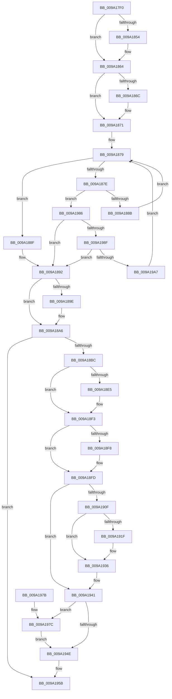

# sub_009A17F0

- RVA: `0x009A17F0`–`0x009A19AF` (길이 `447` bytes)
- VA: `0x00000001409A17F0`
- 실행 섹션: `PAGE`
- PDB 이름 있음: `아니요`; PDB Function 태그: `아니요`
- unwind 정보 RVA: `0x0009B588`
- 디코드: `127`개 명령, `447/447` bytes 표시
- 미해석 바이트: `0` (있으면 어셈블리에 `.byte`로 보존)

> 이 문서는 커널 이미지의 기계어와 PDB 기호를 분석해 생성했습니다. 4번과 5번은 함수 원형과 자료형을 바이너리 사용 방식에서 추정한 C 해석이며 원본 소스 복구 결과는 아닙니다.

## 1. Dependencies

- 직접 호출 지점: **13**; 고유 호출 대상: **9**
- 직접 호출자로 확인된 함수: **1**
- RIP 상대 이미지 참조: **0**

### Outgoing calls
- `0x009A1840` → [KeAbPreAcquire](../../text/21/KeAbPreAcquire_function_00210230.md) (function, `0x00210230`)
- `0x009A185F` → [ExfAcquirePushLockSharedEx](../../text/21/ExfAcquirePushLockSharedEx_function_0021044C.md) (function, `0x0021044C`)
- `0x009A18A1` → [ExfReleasePushLockShared](../../text/26/ExfReleasePushLockShared_function_00263440.md) (function, `0x00263440`)
- `0x009A18A9` → [KeAbPostRelease](../../text/2E/KeAbPostRelease_function_002E1600.md) (function, `0x002E1600`)
- `0x009A18AE` → [KeLeaveGuardedRegion](../../text/2E/KeLeaveGuardedRegion_function_002E2C40.md) (function, `0x002E2C40`)
- `0x009A18D5` → [KeAbPreAcquire](../../text/21/KeAbPreAcquire_function_00210230.md) (function, `0x00210230`)
- `0x009A18EE` → [ExfAcquirePushLockExclusiveEx](../../text/20/ExfAcquirePushLockExclusiveEx_function_0020FC90.md) (function, `0x0020FC90`)
- `0x009A1905` → [sub_009A19B8](Unknown_function_009A19B8.md) (function, `0x009A19B8`)
- `0x009A1931` → [memset](../../text/6C/memset_function_006C6C40.md) (function, `0x006C6C40`)
- `0x009A1951` → [KeAbPostRelease](../../text/2E/KeAbPostRelease_function_002E1600.md) (function, `0x002E1600`)
- `0x009A1956` → [KeLeaveGuardedRegion](../../text/2E/KeLeaveGuardedRegion_function_002E2C40.md) (function, `0x002E2C40`)
- `0x009A197F` → [ExfTryToWakePushLock](../../text/26/ExfTryToWakePushLock_function_00265DD0.md) (function, `0x00265DD0`)
- `0x009A1999` → [sub_009A19B8](Unknown_function_009A19B8.md) (function, `0x009A19B8`)

### Direct callers
- [sub_009A174C](Unknown_function_009A174C.md) at `0x009A17A5`
- [sub_009A174C](Unknown_function_009A174C.md) at `0x009A17BA`

### Static image references
- 디코드된 RIP-relative 메모리 참조가 없습니다.

## 2. Other-region calls and transfers

- 다른 실행 섹션으로 향하는 call: **11**
  - `0x009A1840` → [KeAbPreAcquire](../../text/21/KeAbPreAcquire_function_00210230.md) (`PAGE` → `.text`)
  - `0x009A185F` → [ExfAcquirePushLockSharedEx](../../text/21/ExfAcquirePushLockSharedEx_function_0021044C.md) (`PAGE` → `.text`)
  - `0x009A18A1` → [ExfReleasePushLockShared](../../text/26/ExfReleasePushLockShared_function_00263440.md) (`PAGE` → `.text`)
  - `0x009A18A9` → [KeAbPostRelease](../../text/2E/KeAbPostRelease_function_002E1600.md) (`PAGE` → `.text`)
  - `0x009A18AE` → [KeLeaveGuardedRegion](../../text/2E/KeLeaveGuardedRegion_function_002E2C40.md) (`PAGE` → `.text`)
  - `0x009A18D5` → [KeAbPreAcquire](../../text/21/KeAbPreAcquire_function_00210230.md) (`PAGE` → `.text`)
  - `0x009A18EE` → [ExfAcquirePushLockExclusiveEx](../../text/20/ExfAcquirePushLockExclusiveEx_function_0020FC90.md) (`PAGE` → `.text`)
  - `0x009A1931` → [memset](../../text/6C/memset_function_006C6C40.md) (`PAGE` → `.text`)
  - `0x009A1951` → [KeAbPostRelease](../../text/2E/KeAbPostRelease_function_002E1600.md) (`PAGE` → `.text`)
  - `0x009A1956` → [KeLeaveGuardedRegion](../../text/2E/KeLeaveGuardedRegion_function_002E2C40.md) (`PAGE` → `.text`)
  - `0x009A197F` → [ExfTryToWakePushLock](../../text/26/ExfTryToWakePushLock_function_00265DD0.md) (`PAGE` → `.text`)
- 별도 외부 분기/꼬리 이동을 확인하지 못했습니다.

## 3. Assembly (complete function range)

```asm
009A17F0  48 89 5C 24 10                  mov qword ptr [rsp + 0x10], rbx
009A17F5  48 89 6C 24 18                  mov qword ptr [rsp + 0x18], rbp
009A17FA  48 89 74 24 20                  mov qword ptr [rsp + 0x20], rsi
009A17FF  57                              push rdi
009A1800  41 54                           push r12
009A1802  41 55                           push r13
009A1804  41 56                           push r14
009A1806  41 57                           push r15
009A1808  48 83 EC 20                     sub rsp, 0x20
009A180C  33 C0                           xor eax, eax
009A180E  48 8D B9 30 04 00 00            lea rdi, [rcx + 0x430]
009A1815  44 8B E0                        mov r12d, eax
009A1818  45 8B E8                        mov r13d, r8d
009A181B  65 48 8B 04 25 88 01 00 00      mov rax, qword ptr gs:[0x188]
009A1824  8B F2                           mov esi, edx
009A1826  48 8B E9                        mov rbp, rcx
009A1829  48 83 CB FF                     or rbx, 0xffffffffffffffff
009A182D  45 33 C0                        xor r8d, r8d
009A1830  33 D2                           xor edx, edx
009A1832  48 8B CF                        mov rcx, rdi
009A1835  45 8B F9                        mov r15d, r9d
009A1838  66 01 98 E6 01 00 00            add word ptr [rax + 0x1e6], bx
009A183F  90                              nop
009A1840  E8 EB E9 86 FF                  call 0x140210230
009A1845  4C 8B F0                        mov r14, rax
009A1848  8D 4B 12                        lea ecx, [rbx + 0x12]
009A184B  33 C0                           xor eax, eax
009A184D  F0 48 0F B1 0F                  lock cmpxchg qword ptr [rdi], rcx
009A1852  74 10                           je 0x1409a1864
009A1854  4C 8B CF                        mov r9, rdi
009A1857  4D 8B C6                        mov r8, r14
009A185A  33 D2                           xor edx, edx
009A185C  48 8B CF                        mov rcx, rdi
009A185F  E8 E8 EB 86 FF                  call 0x14021044c
009A1864  45 33 DB                        xor r11d, r11d
009A1867  4D 85 F6                        test r14, r14
009A186A  74 05                           je 0x1409a1871
009A186C  41 C6 46 0A 01                  mov byte ptr [r14 + 0xa], 1
009A1871  45 8D 55 01                     lea r10d, [r13 + 1]
009A1875  41 83 CD FF                     or r13d, 0xffffffff
009A1879  41 3B F2                        cmp esi, r10d
009A187C  73 11                           jae 0x1409a188f
009A187E  8B C6                           mov eax, esi
009A1880  44 38 5C 28 2C                  cmp byte ptr [rax + rbp + 0x2c], r11b
009A1885  0F 84 FB 00 00 00               je 0x1409a1986
009A188B  FF C6                           inc esi
009A188D  EB EA                           jmp 0x1409a1879
009A188F  41 8B F5                        mov esi, r13d
009A1892  B8 11 00 00 00                  mov eax, 0x11
009A1897  F0 4C 0F B1 1F                  lock cmpxchg qword ptr [rdi], r11
009A189C  74 08                           je 0x1409a18a6
009A189E  48 8B CF                        mov rcx, rdi
009A18A1  E8 9A 1B 8C FF                  call 0x140263440
009A18A6  48 8B CF                        mov rcx, rdi
009A18A9  E8 52 FD 93 FF                  call 0x1402e1600
009A18AE  E8 8D 13 94 FF                  call 0x1402e2c40
009A18B3  41 3B F5                        cmp esi, r13d
009A18B6  0F 84 9F 00 00 00               je 0x1409a195b
009A18BC  65 48 8B 04 25 88 01 00 00      mov rax, qword ptr gs:[0x188]
009A18C5  45 33 C0                        xor r8d, r8d
009A18C8  33 D2                           xor edx, edx
009A18CA  48 8B CF                        mov rcx, rdi
009A18CD  66 01 98 E6 01 00 00            add word ptr [rax + 0x1e6], bx
009A18D4  90                              nop
009A18D5  E8 56 E9 86 FF                  call 0x140210230
009A18DA  F0 48 0F BA 2F 00               lock bts qword ptr [rdi], 0
009A18E0  4C 8B F0                        mov r14, rax
009A18E3  73 0E                           jae 0x1409a18f3
009A18E5  4C 8B C7                        mov r8, rdi
009A18E8  48 8B D0                        mov rdx, rax
009A18EB  48 8B CF                        mov rcx, rdi
009A18EE  E8 9D E3 86 FF                  call 0x14020fc90
009A18F3  4D 85 F6                        test r14, r14
009A18F6  74 05                           je 0x1409a18fd
009A18F8  41 C6 46 0A 01                  mov byte ptr [r14 + 0xa], 1
009A18FD  45 8B C7                        mov r8d, r15d
009A1900  8B D6                           mov edx, esi
009A1902  48 8B CD                        mov rcx, rbp
009A1905  E8 AE 00 00 00                  call 0x1409a19b8
009A190A  41 3B C5                        cmp eax, r13d
009A190D  75 32                           jne 0x1409a1941
009A190F  44 8B E6                        mov r12d, esi
009A1912  41 C1 E4 06                     shl r12d, 6
009A1916  4C 03 65 20                     add r12, qword ptr [rbp + 0x20]
009A191A  45 85 FF                        test r15d, r15d
009A191D  74 17                           je 0x1409a1936
009A191F  8B CE                           mov ecx, esi
009A1921  45 8D 47 FF                     lea r8d, [r15 - 1]
009A1925  48 83 C1 2C                     add rcx, 0x2c
009A1929  BA 02 00 00 00                  mov edx, 2
009A192E  48 03 CD                        add rcx, rbp
009A1931  E8 0A 53 D2 FF                  call 0x1406c6c40
009A1936  41 8D 47 FF                     lea eax, [r15 - 1]
009A193A  03 C6                           add eax, esi
009A193C  C6 44 28 2C 01                  mov byte ptr [rax + rbp + 0x2c], 1
009A1941  F0 48 0F C1 1F                  lock xadd qword ptr [rdi], rbx
009A1946  80 E3 06                        and bl, 6
009A1949  80 FB 02                        cmp bl, 2
009A194C  74 2E                           je 0x1409a197c
009A194E  48 8B CF                        mov rcx, rdi
009A1951  E8 AA FC 93 FF                  call 0x1402e1600
009A1956  E8 E5 12 94 FF                  call 0x1402e2c40
009A195B  48 8B 5C 24 58                  mov rbx, qword ptr [rsp + 0x58]
009A1960  49 8B C4                        mov rax, r12
009A1963  48 8B 6C 24 60                  mov rbp, qword ptr [rsp + 0x60]
009A1968  48 8B 74 24 68                  mov rsi, qword ptr [rsp + 0x68]
009A196D  48 83 C4 20                     add rsp, 0x20
009A1971  41 5F                           pop r15
009A1973  41 5E                           pop r14
009A1975  41 5D                           pop r13
009A1977  41 5C                           pop r12
009A1979  5F                              pop rdi
009A197A  C3                              ret
009A197B  CC                              int3
009A197C  48 8B CF                        mov rcx, rdi
009A197F  E8 4C 44 8C FF                  call 0x140265dd0
009A1984  EB C8                           jmp 0x1409a194e
009A1986  41 3B F5                        cmp esi, r13d
009A1989  0F 84 03 FF FF FF               je 0x1409a1892
009A198F  45 8D 47 FF                     lea r8d, [r15 - 1]
009A1993  48 8B CD                        mov rcx, rbp
009A1996  8D 56 01                        lea edx, [rsi + 1]
009A1999  E8 1A 00 00 00                  call 0x1409a19b8
009A199E  41 3B C5                        cmp eax, r13d
009A19A1  0F 84 EB FE FF FF               je 0x1409a1892
009A19A7  8D 70 01                        lea esi, [rax + 1]
009A19AA  E9 CA FE FF FF                  jmp 0x1409a1879
```

## 4. C-style interpretation (structured pseudocode)

```c
__int64 __fastcall sub_009A17F0(__int64 a1, int a2, int a3, int a4)
{
    __int64 result;
    __int64 v_r11;
    __int64 v_r12;
    __int64 v_r13;
    __int64 v_rbx;
    __int64 v_rsi;
    __int64 v_rsp;
    unsigned __int64 v_stack_p10;
    unsigned __int64 v_stack_p18;
    unsigned __int64 v_stack_p20;

    v_stack_p10 = v_rbx;
    v_stack_p18 = v_rbp;
    v_stack_p20 = v_rsi;
    v_rsp = (v_rsp) - (32);
    result = 0;
    v_rbx = (v_rbx) | (-1);
    a3 = 0;
    a2 = 0;
    result = KeAbPreAcquire(a1 + 1072, a2, a3, a4);
    result = 0;
    if (!(condition_is_equal)) {
        a4 = a1 + 1072;
        a3 = 0;
        a2 = 0;
        a1 = a1 + 1072;
        result = ExfAcquirePushLockSharedEx(a1, a2, a3, a4);
    }
    v_r11 = 0;
    if (result != 0) {
        *(unsigned __int8 *)(result + 10) = 1;
    }
    v_r13 = (unsigned int)(((unsigned int)(a3)) | (0xFFFFFFFFULL));
loc_009A1879:
    if (((unsigned int)((unsigned int)(a2))) >= ((unsigned int)((unsigned int)(a3) + 1))) goto loc_009A188F;
    if ((*(unsigned __int8 *)((unsigned int)((unsigned int)((unsigned int)(a2))) + a1 * 1 + 44)) == 0) goto loc_009A1986;
    v_rsi = (unsigned int)(((unsigned int)(a2)) + 1);
    goto loc_009A1879;
loc_009A188F:
loc_009A1892:
    result = 17;
    if ((*(unsigned __int8 *)((unsigned int)((unsigned int)((unsigned int)(a2))) + a1 * 1 + 44)) != 0) {
        a1 = a1 + 1072;
        result = ExfReleasePushLockShared(a1, a2, a3, a4);
    }
    result = KeAbPostRelease(a1 + 1072, a2, a3, a4);
    result = KeLeaveGuardedRegion(a1 + 1072, a2, a3, a4);
    if (((unsigned int)((unsigned int)((unsigned int)(v_r13)))) == ((unsigned int)(v_r13))) goto loc_009A195B;
    a3 = 0;
    a2 = 0;
    result = KeAbPreAcquire(a1 + 1072, a2, a3, a4);
    if (!(condition_is_above_or_equal)) {
        a3 = a1 + 1072;
        a2 = result;
        a1 = a1 + 1072;
        result = ExfAcquirePushLockExclusiveEx(a1, a2, a3, a4);
    }
    if (result != 0) {
        *(unsigned __int8 *)(result + 10) = 1;
    }
    result = sub_009A19B8(a1, (unsigned int)((unsigned int)((unsigned int)((unsigned int)(v_r13)))), (unsigned int)((unsigned int)((unsigned int)(a4))), a4);
    if (((unsigned int)(result)) != ((unsigned int)(v_r13))) goto loc_009A1941;
    v_r12 = (unsigned int)(((unsigned int)((unsigned int)((unsigned int)((unsigned int)(v_r13))))) << (6));
    v_r12 = (v_r12) + (*(unsigned __int64 *)(a1 + 32));
    if ((unsigned int)((unsigned int)(a4)) != 0) {
        a1 = (unsigned int)((unsigned int)((unsigned int)(v_r13)));
        a3 = (unsigned int)(a4) - 1;
        a1 = (a1) + (44);
        a2 = 2;
        a1 = (a1) + (a1);
        result = memset(a1, a2, a3, a4);
    }
    result = (unsigned int)(((unsigned int)(a4) - 1) + ((unsigned int)((unsigned int)((unsigned int)(v_r13)))));
    *(unsigned __int8 *)(result + a1 * 1 + 44) = 1;
loc_009A1941:
    v_rbx = (unsigned __int8)((v_rbx) & (6));
    if (((unsigned __int8)(v_rbx)) == 2) goto loc_009A197C;
loc_009A194E:
    result = KeAbPostRelease(a1 + 1072, a2, a3, a4);
    result = KeLeaveGuardedRegion(a1 + 1072, a2, a3, a4);
loc_009A195B:
    v_rsp = (v_rsp) + (32);
    return v_r12;
loc_009A197C:
    result = ExfTryToWakePushLock(a1 + 1072, a2, a3, a4);
    goto loc_009A194E;
loc_009A1986:
    if (((unsigned int)(v_stack_p20)) == ((unsigned int)(v_r13))) goto loc_009A1892;
    result = sub_009A19B8(v_stack_p18, v_stack_p20 + 1, (unsigned int)(a4) - 1, a4);
    if (((unsigned int)(result)) == ((unsigned int)(v_r13))) goto loc_009A1892;
    goto loc_009A1879;
}
```

## 5. (Beta) C Style

```c
int64_t sub_009A17F0(void *Arg1, int32_t Arg2, void *Arg3, void *Arg4)
{
    uint8_t *arg1 = (uint8_t *)Arg1;
    uint8_t *arg3 = (uint8_t *)Arg3;
    uint8_t *arg4 = (uint8_t *)Arg4;

    int64_t result;
    int64_t local_r11;
    int64_t local_r12;
    int64_t local_r13;
    int64_t local_rbx;
    int64_t local_rsi;
    int64_t local_rsp;
    uint64_t v_stack_p10;
    uint64_t v_stack_p18;
    uint64_t v_stack_p20;

    v_stack_p10 = local_rbx;
    v_stack_p18 = local_rbp;
    v_stack_p20 = local_rsi;
    local_rsp = (local_rsp) - (32);
    result = 0;
    local_rbx = (local_rbx) | (-1);
    Arg3 = 0;
    Arg2 = 0;
    result = KeAbPreAcquire(Arg1 + 1072, Arg2, Arg3, Arg4);
    result = 0;
    if (!(condition_is_equal)) {
        Arg4 = Arg1 + 1072;
        Arg3 = 0;
        Arg2 = 0;
        Arg1 = Arg1 + 1072;
        result = ExfAcquirePushLockSharedEx(Arg1, Arg2, Arg3, Arg4);
    }
    local_r11 = 0;
    if (result != 0) {
        *(uint8_t *)(result + 0xA) = 1;
    }
    local_r13 = (uint32_t)(((uint32_t)(Arg3)) | (0xFFFFFFFFULL));
loc_009A1879:
    if (((uint32_t)((uint32_t)(Arg2))) >= ((uint32_t)((uint32_t)(Arg3) + 1))) goto loc_009A188F;
    if ((*(uint8_t *)((uint32_t)((uint32_t)((uint32_t)(Arg2))) + arg1 * 1 + 0x2C)) == 0) goto loc_009A1986;
    local_rsi = (uint32_t)(((uint32_t)(Arg2)) + 1);
    goto loc_009A1879;
loc_009A188F:
loc_009A1892:
    result = 17;
    if ((*(uint8_t *)((uint32_t)((uint32_t)((uint32_t)(Arg2))) + arg1 * 1 + 0x2C)) != 0) {
        Arg1 = Arg1 + 1072;
        result = ExfReleasePushLockShared(Arg1, Arg2, Arg3, Arg4);
    }
    result = KeAbPostRelease(Arg1 + 1072, Arg2, Arg3, Arg4);
    result = KeLeaveGuardedRegion(Arg1 + 1072, Arg2, Arg3, Arg4);
    if (((uint32_t)((uint32_t)((uint32_t)(local_r13)))) == ((uint32_t)(local_r13))) goto loc_009A195B;
    Arg3 = 0;
    Arg2 = 0;
    result = KeAbPreAcquire(Arg1 + 1072, Arg2, Arg3, Arg4);
    if (!(condition_is_above_or_equal)) {
        Arg3 = Arg1 + 1072;
        Arg2 = result;
        Arg1 = Arg1 + 1072;
        result = ExfAcquirePushLockExclusiveEx(Arg1, Arg2, Arg3, Arg4);
    }
    if (result != 0) {
        *(uint8_t *)(result + 0xA) = 1;
    }
    result = sub_009A19B8(Arg1, (uint32_t)((uint32_t)((uint32_t)((uint32_t)(local_r13)))), (uint32_t)((uint32_t)((uint32_t)(Arg4))), Arg4);
    if (((uint32_t)(result)) != ((uint32_t)(local_r13))) goto loc_009A1941;
    local_r12 = (uint32_t)(((uint32_t)((uint32_t)((uint32_t)((uint32_t)(local_r13))))) << (6));
    local_r12 = (local_r12) + (*(uint64_t *)(arg1 + 0x20));
    if ((uint32_t)((uint32_t)(Arg4)) != 0) {
        Arg1 = (uint32_t)((uint32_t)((uint32_t)(local_r13)));
        Arg3 = (uint32_t)(Arg4) - 1;
        Arg1 = (Arg1) + (44);
        Arg2 = 2;
        Arg1 = (Arg1) + (Arg1);
        result = memset(Arg1, Arg2, Arg3, Arg4);
    }
    result = (uint32_t)(((uint32_t)(Arg4) - 1) + ((uint32_t)((uint32_t)((uint32_t)(local_r13)))));
    *(uint8_t *)(result + arg1 * 1 + 0x2C) = 1;
loc_009A1941:
    local_rbx = (uint8_t)((local_rbx) & (6));
    if (((uint8_t)(local_rbx)) == 2) goto loc_009A197C;
loc_009A194E:
    result = KeAbPostRelease(Arg1 + 1072, Arg2, Arg3, Arg4);
    result = KeLeaveGuardedRegion(Arg1 + 1072, Arg2, Arg3, Arg4);
loc_009A195B:
    local_rsp = (local_rsp) + (32);
    return local_r12;
loc_009A197C:
    result = ExfTryToWakePushLock(Arg1 + 1072, Arg2, Arg3, Arg4);
    goto loc_009A194E;
loc_009A1986:
    if (((uint32_t)(v_stack_p20)) == ((uint32_t)(local_r13))) goto loc_009A1892;
    result = sub_009A19B8(v_stack_p18, v_stack_p20 + 1, (uint32_t)(Arg4) - 1, Arg4);
    if (((uint32_t)(result)) == ((uint32_t)(local_r13))) goto loc_009A1892;
    goto loc_009A1879;
}
```

### 관측된 메모리 오프셋

구조체 형식이 확인되지 않은 접근은 인자 기준의 오프셋으로만 기록했습니다.

| 기준 인자 | 오프셋 표현 | 폭 (bit) | 접근 |
|---|---:|---:|---|
| `Arg1` | `+ 0x0` | `64` | `R` |
| `Arg1` | `+ 0x0` | `64` | `R/W` |
| `Arg1` | `+ 0x20` | `64` | `R` |
| `Arg1` | `+ 0x430` | `64` | `R` |
| `Arg3` | `+ 0x1` | `32` | `R` |
| `Arg4` | `- 0x1` | `32` | `R` |

## 6. Execution-region graph

[열기: 2D/3D 그래프와 함수 탐색 컨트롤 패널](../../../control-panel.html?section=page&rva=0x009A17F0&view=graph)

- 2D 그래프는 위에서 아래로 흐르고, 3D 그래프는 빈 공간을 드래그해 회전합니다. Shift+드래그는 이동, 휠은 확대·축소, 함수 노드 선택은 대상 보고서 이동입니다.

### Static fallback


