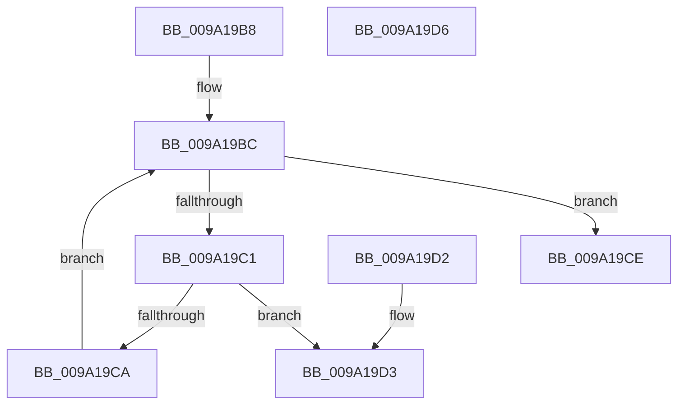

# sub_009A19B8

- RVA: `0x009A19B8`–`0x009A19D7` (길이 `31` bytes)
- VA: `0x00000001409A19B8`
- 실행 섹션: `PAGE`
- PDB 이름 있음: `아니요`; PDB Function 태그: `아니요`
- unwind 정보 RVA: `0x000DB714`
- 디코드: `14`개 명령, `31/31` bytes 표시
- 미해석 바이트: `0` (있으면 어셈블리에 `.byte`로 보존)

> 이 문서는 커널 이미지의 기계어와 PDB 기호를 분석해 생성했습니다. 4번과 5번은 함수 원형과 자료형을 바이너리 사용 방식에서 추정한 C 해석이며 원본 소스 복구 결과는 아닙니다.

## 1. Dependencies

- 직접 호출 지점: **0**; 고유 호출 대상: **0**
- 직접 호출자로 확인된 함수: **1**
- RIP 상대 이미지 참조: **0**

### Outgoing calls
- 직접 디코드된 call 명령이 없습니다.

### Direct callers
- [sub_009A17F0](Unknown_function_009A17F0.md) at `0x009A1905`
- [sub_009A17F0](Unknown_function_009A17F0.md) at `0x009A1999`

### Static image references
- 디코드된 RIP-relative 메모리 참조가 없습니다.

## 2. Other-region calls and transfers

- 다른 실행 섹션으로 향하는 call: **0**
- 별도 외부 분기/꼬리 이동을 확인하지 못했습니다.

## 3. Assembly (complete function range)

```asm
009A19B8  46 8D 0C 02                     lea r9d, [rdx + r8]
009A19BC  41 3B D1                        cmp edx, r9d
009A19BF  73 0D                           jae 0x1409a19ce
009A19C1  8B C2                           mov eax, edx
009A19C3  80 7C 08 2C 00                  cmp byte ptr [rax + rcx + 0x2c], 0
009A19C8  75 09                           jne 0x1409a19d3
009A19CA  FF C2                           inc edx
009A19CC  EB EE                           jmp 0x1409a19bc
009A19CE  83 C8 FF                        or eax, 0xffffffff
009A19D1  C3                              ret
009A19D2  CC                              int3
009A19D3  8B C2                           mov eax, edx
009A19D5  C3                              ret
009A19D6  CC                              int3
```

## 4. C-style interpretation (structured pseudocode)

```c
__int64 __fastcall sub_009A19B8(__int64 a1, __int64 a2, __int64 a3)
{
    __int64 result;

loc_009A19BC:
    if (((unsigned int)(a2)) >= ((unsigned int)(a2 + a3 * 1))) goto loc_009A19CE;
    if ((*(unsigned __int8 *)((unsigned int)((unsigned int)(a2)) + a1 * 1 + 44)) != 0) goto loc_009A19D3;
    a2 = (unsigned int)((a2) + 1);
    goto loc_009A19BC;
loc_009A19CE:
    result = (unsigned int)(((unsigned int)((unsigned int)(a2))) | (0xFFFFFFFFULL));
    return result;
loc_009A19D3:
    return (unsigned int)((unsigned int)(a2));
}
```

## 5. (Beta) C Style

```c
int64_t sub_009A19B8(int64_t Arg1, void *Arg2, int64_t Arg3)
{
    uint8_t *arg2 = (uint8_t *)Arg2;

    int64_t result;

loc_009A19BC:
    if (((uint32_t)(Arg2)) >= ((uint32_t)(Arg2 + Arg3 * 1))) goto loc_009A19CE;
    if ((*(uint8_t *)((uint32_t)((uint32_t)(arg2)) + Arg1 * 1 + 0x2C)) != 0) goto loc_009A19D3;
    Arg2 = (uint32_t)((Arg2) + 1);
    goto loc_009A19BC;
loc_009A19CE:
    result = (uint32_t)(((uint32_t)((uint32_t)(Arg2))) | (0xFFFFFFFFULL));
    return result;
loc_009A19D3:
    return (uint32_t)((uint32_t)(Arg2));
}
```

### 관측된 메모리 오프셋

구조체 형식이 확인되지 않은 접근은 인자 기준의 오프셋으로만 기록했습니다.

| 기준 인자 | 오프셋 표현 | 폭 (bit) | 접근 |
|---|---:|---:|---|
| `Arg2` | `+ 0x0 + r8*1` | `32` | `R` |

## 6. Execution-region graph

[열기: 2D/3D 그래프와 함수 탐색 컨트롤 패널](../../../control-panel.html?section=page&rva=0x009A19B8&view=graph)

- 2D 그래프는 위에서 아래로 흐르고, 3D 그래프는 빈 공간을 드래그해 회전합니다. Shift+드래그는 이동, 휠은 확대·축소, 함수 노드 선택은 대상 보고서 이동입니다.

### Static fallback


