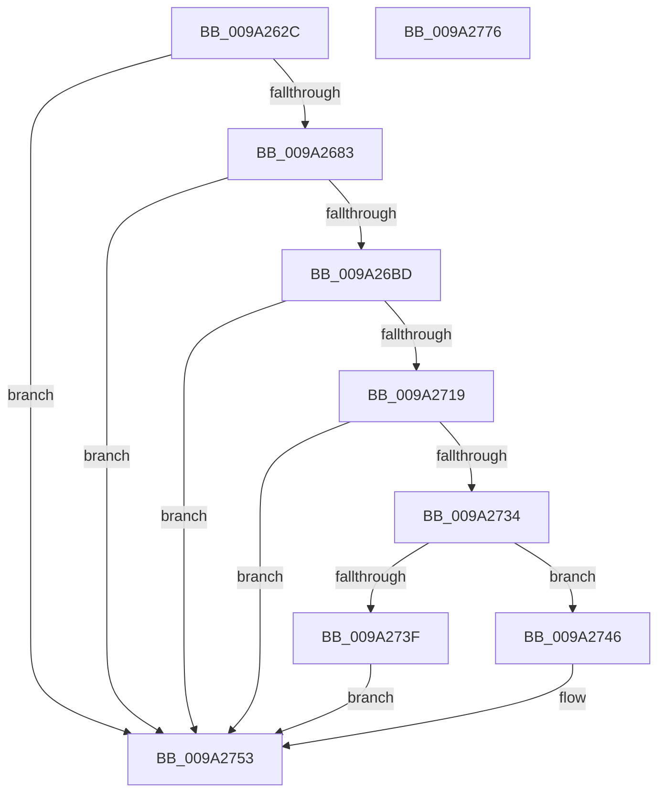

# sub_009A262C

- RVA: `0x009A262C`–`0x009A2777` (길이 `331` bytes)
- VA: `0x00000001409A262C`
- 실행 섹션: `PAGE`
- PDB 이름 있음: `아니요`; PDB Function 태그: `아니요`
- unwind 정보 RVA: `0x0009B6A8`
- 디코드: `91`개 명령, `331/331` bytes 표시
- 미해석 바이트: `0` (있으면 어셈블리에 `.byte`로 보존)

> 이 문서는 커널 이미지의 기계어와 PDB 기호를 분석해 생성했습니다. 4번과 5번은 함수 원형과 자료형을 바이너리 사용 방식에서 추정한 C 해석이며 원본 소스 복구 결과는 아닙니다.

## 1. Dependencies

- 직접 호출 지점: **4**; 고유 호출 대상: **4**
- 직접 호출자로 확인된 함수: **1**
- RIP 상대 이미지 참조: **0**

### Outgoing calls
- `0x009A2674` → [sub_009A13B8](Unknown_function_009A13B8.md) (function, `0x009A13B8`)
- `0x009A26AE` → [sub_009A14C8](Unknown_function_009A14C8.md) (function, `0x009A14C8`)
- `0x009A270E` → [sub_00A34F4C](../A3/Unknown_function_00A34F4C.md) (function, `0x00A34F4C`)
- `0x009A275B` → [sub_009A1390](Unknown_function_009A1390.md) (function, `0x009A1390`)

### Direct callers
- [sub_009A1148](Unknown_function_009A1148.md) at `0x009A11CA`

### Static image references
- 디코드된 RIP-relative 메모리 참조가 없습니다.

## 2. Other-region calls and transfers

- 다른 실행 섹션으로 향하는 call: **0**
- 별도 외부 분기/꼬리 이동을 확인하지 못했습니다.

## 3. Assembly (complete function range)

```asm
009A262C  48 8B C4                        mov rax, rsp
009A262F  48 89 58 20                     mov qword ptr [rax + 0x20], rbx
009A2633  55                              push rbp
009A2634  56                              push rsi
009A2635  57                              push rdi
009A2636  41 56                           push r14
009A2638  41 57                           push r15
009A263A  48 83 EC 50                     sub rsp, 0x50
009A263E  8B 72 04                        mov esi, dword ptr [rdx + 4]
009A2641  48 8B DA                        mov rbx, rdx
009A2644  44 8B 02                        mov r8d, dword ptr [rdx]
009A2647  41 BF FF FF FF 0F               mov r15d, 0xfffffff
009A264D  8B 52 08                        mov edx, dword ptr [rdx + 8]
009A2650  48 8B E9                        mov rbp, rcx
009A2653  48 83 60 10 00                  and qword ptr [rax + 0x10], 0
009A2658  49 23 F7                        and rsi, r15
009A265B  48 03 71 20                     add rsi, qword ptr [rcx + 0x20]
009A265F  41 23 D7                        and edx, r15d
009A2662  48 83 60 18 00                  and qword ptr [rax + 0x18], 0
009A2667  48 8B CE                        mov rcx, rsi
009A266A  41 D1 E8                        shr r8d, 1
009A266D  41 F7 D0                        not r8d
009A2670  41 83 E0 01                     and r8d, 1
009A2674  E8 3F ED FF FF                  call 0x1409a13b8
009A2679  8B F8                           mov edi, eax
009A267B  85 C0                           test eax, eax
009A267D  0F 88 D0 00 00 00               js 0x1409a2753
009A2683  44 8B 03                        mov r8d, dword ptr [rbx]
009A2686  48 8D 84 24 88 00 00 00         lea rax, [rsp + 0x88]
009A268E  8B 53 08                        mov edx, dword ptr [rbx + 8]
009A2691  4C 8D 8C 24 90 00 00 00         lea r9, [rsp + 0x90]
009A2699  41 D1 E8                        shr r8d, 1
009A269C  41 23 D7                        and edx, r15d
009A269F  41 F7 D0                        not r8d
009A26A2  48 89 44 24 20                  mov qword ptr [rsp + 0x20], rax
009A26A7  41 83 E0 01                     and r8d, 1
009A26AB  48 8B CE                        mov rcx, rsi
009A26AE  E8 15 EE FF FF                  call 0x1409a14c8
009A26B3  8B F8                           mov edi, eax
009A26B5  85 C0                           test eax, eax
009A26B7  0F 88 96 00 00 00               js 0x1409a2753
009A26BD  48 8B 45 38                     mov rax, qword ptr [rbp + 0x38]
009A26C1  48 8D 94 24 80 00 00 00         lea rdx, [rsp + 0x80]
009A26C9  44 8B 53 04                     mov r10d, dword ptr [rbx + 4]
009A26CD  B9 01 00 00 00                  mov ecx, 1
009A26D2  44 8B 4B 08                     mov r9d, dword ptr [rbx + 8]
009A26D6  45 23 D7                        and r10d, r15d
009A26D9  4C 8B B4 24 88 00 00 00         mov r14, qword ptr [rsp + 0x88]
009A26E1  45 23 CF                        and r9d, r15d
009A26E4  48 89 54 24 40                  mov qword ptr [rsp + 0x40], rdx
009A26E9  4C 8D 40 50                     lea r8, [rax + 0x50]
009A26ED  4C 89 44 24 30                  mov qword ptr [rsp + 0x30], r8
009A26F2  48 83 C0 48                     add rax, 0x48
009A26F6  44 89 54 24 28                  mov dword ptr [rsp + 0x28], r10d
009A26FB  4D 8B C6                        mov r8, r14
009A26FE  48 8B D6                        mov rdx, rsi
009A2701  48 89 44 24 20                  mov qword ptr [rsp + 0x20], rax
009A2706  C6 84 24 80 00 00 00 00         mov byte ptr [rsp + 0x80], 0
009A270E  E8 39 28 09 00                  call 0x140a34f4c
009A2713  8B F8                           mov edi, eax
009A2715  85 C0                           test eax, eax
009A2717  78 3A                           js 0x1409a2753
009A2719  8B 03                           mov eax, dword ptr [rbx]
009A271B  0F B6 8C 24 80 00 00 00         movzx ecx, byte ptr [rsp + 0x80]
009A2723  25 03 FC FF FF                  and eax, 0xfffffc03
009A2728  C1 E1 02                        shl ecx, 2
009A272B  0B C8                           or ecx, eax
009A272D  89 0B                           mov dword ptr [rbx], ecx
009A272F  F6 C1 02                        test cl, 2
009A2732  75 1F                           jne 0x1409a2753
009A2734  8B 43 08                        mov eax, dword ptr [rbx + 8]
009A2737  41 23 C7                        and eax, r15d
009A273A  83 F8 04                        cmp eax, 4
009A273D  73 07                           jae 0x1409a2746
009A273F  BF 0D 00 00 C0                  mov edi, 0xc000000d
009A2744  EB 0D                           jmp 0x1409a2753
009A2746  48 8B 45 38                     mov rax, qword ptr [rbp + 0x38]
009A274A  8B 88 F4 00 00 00               mov ecx, dword ptr [rax + 0xf4]
009A2750  41 89 0E                        mov dword ptr [r14], ecx
009A2753  48 8B 8C 24 90 00 00 00         mov rcx, qword ptr [rsp + 0x90]
009A275B  E8 30 EC FF FF                  call 0x1409a1390
009A2760  48 8B 9C 24 98 00 00 00         mov rbx, qword ptr [rsp + 0x98]
009A2768  8B C7                           mov eax, edi
009A276A  48 83 C4 50                     add rsp, 0x50
009A276E  41 5F                           pop r15
009A2770  41 5E                           pop r14
009A2772  5F                              pop rdi
009A2773  5E                              pop rsi
009A2774  5D                              pop rbp
009A2775  C3                              ret
009A2776  CC                              int3
```

## 4. C-style interpretation (structured pseudocode)

```c
__int64 __fastcall sub_009A262C(__int64 a1, __int64 a2)
{
    __int64 result;
    __int64 v_r10;
    __int64 v_rsi;
    __int64 v_rsp;
    unsigned __int64 v_stack_m38;
    unsigned __int64 v_stack_m48;
    unsigned int v_stack_m50;
    unsigned __int64 v_stack_m58;
    unsigned __int64 v_stack_p10;
    unsigned __int64 v_stack_p18;
    unsigned __int64 v_stack_p20;
    unsigned __int64 v_stack_p8;

    *(unsigned __int64 *)(v_rsp + 32) = v_rbx;
    v_rsp = (v_rsp) - (80);
    v_rsi = ((unsigned int)(*(unsigned int *)(a2 + 4))) & ((unsigned int)(0xFFFFFFFULL));
    v_rsi = (v_rsi) + (*(unsigned __int64 *)(a1 + 32));
    a2 = (unsigned int)(((unsigned int)(*(unsigned int *)(a2 + 8))) & ((unsigned int)((unsigned int)(0xFFFFFFFULL))));
    a3 = (unsigned int)(((unsigned int)(*(unsigned int *)(a2))) >> (1));
    a3 = (unsigned int)(~(a3));
    a3 = (unsigned int)((a3) & (1));
    result = sub_009A13B8(v_rsi, a2, a3, a4);
    if (sign_flag) goto loc_009A2753;
    a3 = (unsigned int)(((unsigned int)(*(unsigned int *)(a2))) >> (1));
    a2 = (unsigned int)(((unsigned int)(*(unsigned int *)(a2 + 8))) & ((unsigned int)((unsigned int)(0xFFFFFFFULL))));
    a3 = (unsigned int)(~(a3));
    v_stack_m58 = v_stack_p10;
    a3 = (unsigned int)((a3) & (1));
    result = sub_009A14C8(v_rsi, a2, a3, v_stack_p18);
    if (sign_flag) goto loc_009A2753;
    v_r10 = (unsigned int)(((unsigned int)(*(unsigned int *)(a2 + 4))) & ((unsigned int)((unsigned int)(0xFFFFFFFULL))));
    a4 = (unsigned int)(((unsigned int)(*(unsigned int *)(a2 + 8))) & ((unsigned int)((unsigned int)(0xFFFFFFFULL))));
    v_stack_m38 = v_stack_p8;
    v_stack_m48 = *(unsigned __int64 *)(a1 + 56) + 80;
    result = (*(unsigned __int64 *)(a1 + 56)) + (72);
    v_stack_m50 = (unsigned int)(v_r10);
    v_stack_m58 = result;
    v_stack_p8 = 0;
    result = sub_00A34F4C(1, v_rsi, v_stack_p10, a4);
    if (sign_flag) goto loc_009A2753;
    result = (unsigned int)(((unsigned int)(*(unsigned int *)(a2))) & (0xFFFFFC03ULL));
    a1 = (unsigned int)((v_stack_p8) << (2));
    a1 = (unsigned int)((a1) | ((unsigned int)(result)));
    *(unsigned int *)(a2) = (unsigned int)(a1);
    if ((((unsigned __int8)(a1)) & (2)) != 0) goto loc_009A2753;
    result = (unsigned int)(((unsigned int)(*(unsigned int *)(a2 + 8))) & ((unsigned int)((unsigned int)(0xFFFFFFFULL))));
    if (((unsigned int)(result)) >= 4) goto loc_009A2746;
    goto loc_009A2753;
loc_009A2746:
    *(unsigned int *)(v_stack_p10) = (unsigned int)((unsigned int)(*(unsigned int *)(*(unsigned __int64 *)(a1 + 56) + 244)));
loc_009A2753:
    result = sub_009A1390(v_stack_p18, v_rsi, v_stack_p10, a4);
    v_rsp = (v_rsp) + (80);
    return (unsigned int)((unsigned int)((unsigned int)(0xC000000DULL)));
}
```

## 5. (Beta) C Style

```c
int64_t sub_009A262C(void *Arg1, void *Arg2)
{
    uint8_t *arg1 = (uint8_t *)Arg1;
    uint8_t *arg2 = (uint8_t *)Arg2;

    int64_t result;
    int64_t local_r10;
    int64_t local_rsi;
    int64_t local_rsp;
    uint64_t v_stack_m38;
    uint64_t v_stack_m48;
    uint32_t v_stack_m50;
    uint64_t v_stack_m58;
    uint64_t v_stack_p10;
    uint64_t v_stack_p18;
    uint64_t v_stack_p20;
    uint64_t v_stack_p8;

    *(uint64_t *)(local_rsp + 0x20) = local_rbx;
    local_rsp = (local_rsp) - (80);
    local_rsi = ((uint32_t)(*(uint32_t *)(arg2 + 0x4))) & ((uint32_t)(0xFFFFFFFULL));
    local_rsi = (local_rsi) + (*(uint64_t *)(arg1 + 0x20));
    Arg2 = (uint32_t)(((uint32_t)(*(uint32_t *)(arg2 + 0x8))) & ((uint32_t)((uint32_t)(0xFFFFFFFULL))));
    a3 = (uint32_t)(((uint32_t)(*(uint32_t *)(arg2))) >> (1));
    a3 = (uint32_t)(~(a3));
    a3 = (uint32_t)((a3) & (1));
    result = sub_009A13B8(local_rsi, Arg2, a3, a4);
    if (sign_flag) goto loc_009A2753;
    a3 = (uint32_t)(((uint32_t)(*(uint32_t *)(arg2))) >> (1));
    Arg2 = (uint32_t)(((uint32_t)(*(uint32_t *)(arg2 + 0x8))) & ((uint32_t)((uint32_t)(0xFFFFFFFULL))));
    a3 = (uint32_t)(~(a3));
    v_stack_m58 = v_stack_p10;
    a3 = (uint32_t)((a3) & (1));
    result = sub_009A14C8(local_rsi, Arg2, a3, v_stack_p18);
    if (sign_flag) goto loc_009A2753;
    local_r10 = (uint32_t)(((uint32_t)(*(uint32_t *)(arg2 + 0x4))) & ((uint32_t)((uint32_t)(0xFFFFFFFULL))));
    a4 = (uint32_t)(((uint32_t)(*(uint32_t *)(arg2 + 0x8))) & ((uint32_t)((uint32_t)(0xFFFFFFFULL))));
    v_stack_m38 = v_stack_p8;
    v_stack_m48 = *(uint64_t *)(arg1 + 0x38) + 80;
    result = (*(uint64_t *)(arg1 + 0x38)) + (72);
    v_stack_m50 = (uint32_t)(local_r10);
    v_stack_m58 = result;
    v_stack_p8 = 0;
    result = sub_00A34F4C(1, local_rsi, v_stack_p10, a4);
    if (sign_flag) goto loc_009A2753;
    result = (uint32_t)(((uint32_t)(*(uint32_t *)(arg2))) & (0xFFFFFC03ULL));
    Arg1 = (uint32_t)((v_stack_p8) << (2));
    Arg1 = (uint32_t)((Arg1) | ((uint32_t)(result)));
    *(uint32_t *)(arg2) = (uint32_t)(Arg1);
    if ((((uint8_t)(Arg1)) & (2)) != 0) goto loc_009A2753;
    result = (uint32_t)(((uint32_t)(*(uint32_t *)(arg2 + 0x8))) & ((uint32_t)((uint32_t)(0xFFFFFFFULL))));
    if (((uint32_t)(result)) >= 4) goto loc_009A2746;
    goto loc_009A2753;
loc_009A2746:
    *(uint32_t *)(v_stack_p10) = (uint32_t)((uint32_t)(*(uint32_t *)(*(uint64_t *)(arg1 + 0x38) + 0xF4)));
loc_009A2753:
    result = sub_009A1390(v_stack_p18, local_rsi, v_stack_p10, a4);
    local_rsp = (local_rsp) + (80);
    return (uint32_t)((uint32_t)((uint32_t)(0xC000000DULL)));
}
```

### 관측된 메모리 오프셋

구조체 형식이 확인되지 않은 접근은 인자 기준의 오프셋으로만 기록했습니다.

| 기준 인자 | 오프셋 표현 | 폭 (bit) | 접근 |
|---|---:|---:|---|
| `Arg1` | `+ 0x20` | `64` | `R` |
| `Arg1` | `+ 0x38` | `64` | `R` |
| `Arg2` | `+ 0x0` | `32` | `R` |
| `Arg2` | `+ 0x0` | `32` | `W` |
| `Arg2` | `+ 0x4` | `32` | `R` |
| `Arg2` | `+ 0x8` | `32` | `R` |

## 6. Execution-region graph

[열기: 2D/3D 그래프와 함수 탐색 컨트롤 패널](../../../control-panel.html?section=page&rva=0x009A262C&view=graph)

- 2D 그래프는 위에서 아래로 흐르고, 3D 그래프는 빈 공간을 드래그해 회전합니다. Shift+드래그는 이동, 휠은 확대·축소, 함수 노드 선택은 대상 보고서 이동입니다.

### Static fallback


