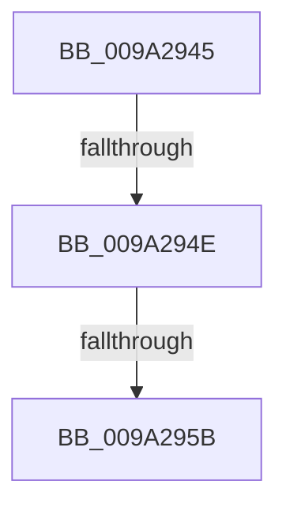

# sub_009A2945

- RVA: `0x009A2945`–`0x009A296F` (길이 `42` bytes)
- VA: `0x00000001409A2945`
- 실행 섹션: `PAGE`
- PDB 이름 있음: `아니요`; PDB Function 태그: `아니요`
- unwind 정보 RVA: `0x0009B770`
- 디코드: `15`개 명령, `42/42` bytes 표시
- 미해석 바이트: `0` (있으면 어셈블리에 `.byte`로 보존)

> 이 문서는 커널 이미지의 기계어와 PDB 기호를 분석해 생성했습니다. 4번과 5번은 함수 원형과 자료형을 바이너리 사용 방식에서 추정한 C 해석이며 원본 소스 복구 결과는 아닙니다.

## 1. Dependencies

- 직접 호출 지점: **0**; 고유 호출 대상: **0**
- 직접 호출자로 확인된 함수: **0**
- RIP 상대 이미지 참조: **0**

### Outgoing calls
- 직접 디코드된 call 명령이 없습니다.

### Direct callers
- 이 함수 시작 RVA로 연결되는 직접 call은 확인되지 않았습니다. 간접 호출은 완전히 역산할 수 없습니다.

### Static image references
- 디코드된 RIP-relative 메모리 참조가 없습니다.

## 2. Other-region calls and transfers

- 다른 실행 섹션으로 향하는 call: **0**
- call이 아닌 외부 분기/꼬리 이동: **2**
  - `0x009A294C` → [sub_009A2970](Unknown_function_009A2970.md) (`tail-transfer`)
  - `0x009A2959` → [sub_009A2983](Unknown_function_009A2983.md) (`tail-transfer`)

## 3. Assembly (complete function range)

```asm
009A2945  48 89 5C 24 70                  mov qword ptr [rsp + 0x70], rbx
009A294A  85 C2                           test edx, eax
009A294C  75 22                           jne 0x1409a2970
009A294E  32 DB                           xor bl, bl
009A2950  41 83 BC B5 A0 4B F0 00 00      cmp dword ptr [r13 + rsi*4 + 0xf04ba0], 0
009A2959  75 28                           jne 0x1409a2983
009A295B  0F B6 C3                        movzx eax, bl
009A295E  48 8B 5C 24 70                  mov rbx, qword ptr [rsp + 0x70]
009A2963  48 83 C4 40                     add rsp, 0x40
009A2967  41 5E                           pop r14
009A2969  41 5D                           pop r13
009A296B  5F                              pop rdi
009A296C  5E                              pop rsi
009A296D  5D                              pop rbp
009A296E  C3                              ret
```

## 4. C-style interpretation (structured pseudocode)

```c
__int64 __fastcall sub_009A2945(__int64 a1, int a2, __int64 a3, __int64 a4, __int64 a5, __int64 a6, __int64 a7, __int64 a8, __int64 a9, __int64 a10, __int64 a11, __int64 a12, __int64 a13, __int64 a14)
{
    __int64 v_rbx;
    __int64 v_rsp;
    unsigned __int64 v_stack_p70;

    v_stack_p70 = v_rbx;
    v_rbx = 0;
    v_rsp = (v_rsp) + (64);
    return 0;
}
```

## 5. (Beta) C Style

```c
int64_t sub_009A2945(int64_t Arg1, int32_t Arg2, int64_t Arg3, int64_t Arg4, uint64_t Arg5, uint64_t Arg6, uint64_t Arg7, uint64_t Arg8, uint64_t Arg9, uint64_t Arg10, uint64_t Arg11, uint64_t Arg12, uint64_t Arg13, int64_t Arg14)
{
    int64_t local_rbx;
    int64_t local_rsp;
    uint64_t v_stack_p70;

    v_stack_p70 = local_rbx;
    local_rbx = 0;
    local_rsp = (local_rsp) + (64);
    return 0;
}
```

## 6. Execution-region graph

[열기: 2D/3D 그래프와 함수 탐색 컨트롤 패널](../../../control-panel.html?section=page&rva=0x009A2945&view=graph)

- 2D 그래프는 위에서 아래로 흐르고, 3D 그래프는 빈 공간을 드래그해 회전합니다. Shift+드래그는 이동, 휠은 확대·축소, 함수 노드 선택은 대상 보고서 이동입니다.

### Static fallback


