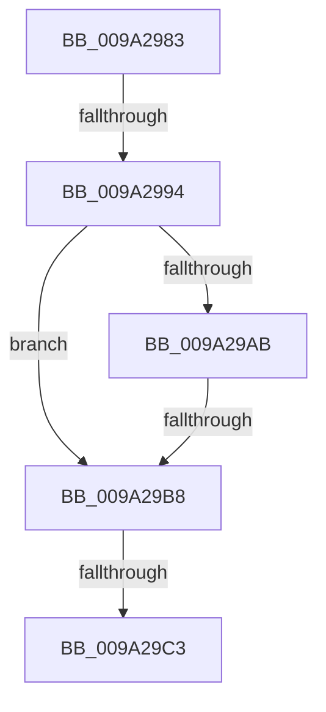

# sub_009A2983

- RVA: `0x009A2983`–`0x009A29C5` (길이 `66` bytes)
- VA: `0x00000001409A2983`
- 실행 섹션: `PAGE`
- PDB 이름 있음: `아니요`; PDB Function 태그: `아니요`
- unwind 정보 RVA: `0x0009B7C0`
- 디코드: `15`개 명령, `66/66` bytes 표시
- 미해석 바이트: `0` (있으면 어셈블리에 `.byte`로 보존)

> 이 문서는 커널 이미지의 기계어와 PDB 기호를 분석해 생성했습니다. 4번과 5번은 함수 원형과 자료형을 바이너리 사용 방식에서 추정한 C 해석이며 원본 소스 복구 결과는 아닙니다.

## 1. Dependencies

- 직접 호출 지점: **1**; 고유 호출 대상: **1**
- 직접 호출자로 확인된 함수: **0**
- RIP 상대 이미지 참조: **0**

### Outgoing calls
- `0x009A299E` → [SeCaptureSubjectContext](../86/SeCaptureSubjectContext_function_0086B820.md) (function, `0x0086B820`)

### Direct callers
- 이 함수 시작 RVA로 연결되는 직접 call은 확인되지 않았습니다. 간접 호출은 완전히 역산할 수 없습니다.

### Static image references
- 디코드된 RIP-relative 메모리 참조가 없습니다.

## 2. Other-region calls and transfers

- 다른 실행 섹션으로 향하는 call: **0**
- call이 아닌 외부 분기/꼬리 이동: **3**
  - `0x009A298E` → [sub_009A2A5D](Unknown_function_009A2A5D.md) (`tail-transfer`)
  - `0x009A29B2` → [sub_009A2A39](Unknown_function_009A2A39.md) (`tail-transfer`)
  - `0x009A29BD` → [sub_009A2A39 + 0xA](Unknown_function_009A2A39.md) (`tail-transfer`)

## 3. Assembly (complete function range)

```asm
009A2983  4C 89 BC 24 80 00 00 00         mov qword ptr [rsp + 0x80], r15
009A298B  4D 85 F6                        test r14, r14
009A298E  0F 85 C9 00 00 00               jne 0x1409a2a5d
009A2994  48 8D 4C 24 20                  lea rcx, [rsp + 0x20]
009A2999  4C 8D 7C 24 20                  lea r15, [rsp + 0x20]
009A299E  E8 7D 8E EC FF                  call 0x14086b820
009A29A3  4D 8B 07                        mov r8, qword ptr [r15]
009A29A6  4D 85 C0                        test r8, r8
009A29A9  75 0D                           jne 0x1409a29b8
009A29AB  4D 8B 47 10                     mov r8, qword ptr [r15 + 0x10]
009A29AF  4D 85 C0                        test r8, r8
009A29B2  0F 84 81 00 00 00               je 0x1409a2a39
009A29B8  41 80 78 77 02                  cmp byte ptr [r8 + 0x77], 2
009A29BD  0F 85 80 00 00 00               jne 0x1409a2a43
009A29C3  33 D2                           xor edx, edx
```

## 4. C-style interpretation (structured pseudocode)

```c
__int64 __fastcall sub_009A2983(__int64 a1, int a2)
{
    __int64 result;
    unsigned __int64 v_stack_p20;
    unsigned __int64 v_stack_p80;

    v_stack_p80 = v_r15;
    result = SeCaptureSubjectContext(v_stack_p20, a2, a3, a4);
    if (*(unsigned __int64 *)(v_stack_p20) != 0) goto loc_009A29B8;
loc_009A29B8:
    a2 = 0;
    return result;
}
```

## 5. (Beta) C Style

```c
int64_t sub_009A2983(int64_t Arg1, int32_t Arg2)
{
    int64_t result;
    uint64_t v_stack_p20;
    uint64_t v_stack_p80;

    v_stack_p80 = local_r15;
    result = SeCaptureSubjectContext(v_stack_p20, Arg2, a3, a4);
    if (*(uint64_t *)(v_stack_p20) != 0) goto loc_009A29B8;
loc_009A29B8:
    Arg2 = 0;
    return result;
}
```

## 6. Execution-region graph

[열기: 2D/3D 그래프와 함수 탐색 컨트롤 패널](../../../control-panel.html?section=page&rva=0x009A2983&view=graph)

- 2D 그래프는 위에서 아래로 흐르고, 3D 그래프는 빈 공간을 드래그해 회전합니다. Shift+드래그는 이동, 휠은 확대·축소, 함수 노드 선택은 대상 보고서 이동입니다.

### Static fallback


