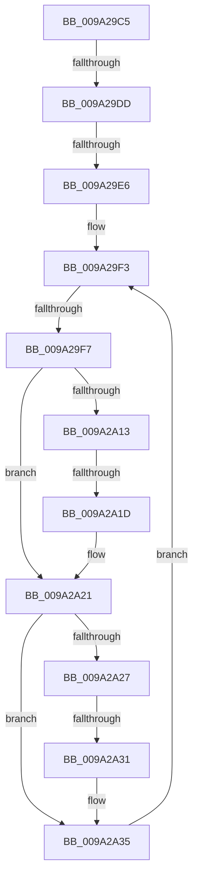

# sub_009A29C5

- RVA: `0x009A29C5`–`0x009A2A39` (길이 `116` bytes)
- VA: `0x00000001409A29C5`
- 실행 섹션: `PAGE`
- PDB 이름 있음: `아니요`; PDB Function 태그: `아니요`
- unwind 정보 RVA: `0x0009B7D8`
- 디코드: `31`개 명령, `116/116` bytes 표시
- 미해석 바이트: `0` (있으면 어셈블리에 `.byte`로 보존)

> 이 문서는 커널 이미지의 기계어와 PDB 기호를 분석해 생성했습니다. 4번과 5번은 함수 원형과 자료형을 바이너리 사용 방식에서 추정한 C 해석이며 원본 소스 복구 결과는 아닙니다.

## 1. Dependencies

- 직접 호출 지점: **0**; 고유 호출 대상: **0**
- 직접 호출자로 확인된 함수: **0**
- RIP 상대 이미지 참조: **0**

### Outgoing calls
- 직접 디코드된 call 명령이 없습니다.

### Direct callers
- 이 함수 시작 RVA로 연결되는 직접 call은 확인되지 않았습니다. 간접 호출은 완전히 역산할 수 없습니다.

### Static image references
- 디코드된 RIP-relative 메모리 참조가 없습니다.

## 2. Other-region calls and transfers

- 다른 실행 섹션으로 향하는 call: **0**
- call이 아닌 외부 분기/꼬리 이동: **5**
  - `0x009A29D7` → [sub_009A2A84](Unknown_function_009A2A84.md) (`tail-transfer`)
  - `0x009A29E0` → [sub_009A2A84 + 0x5](Unknown_function_009A2A84.md) (`tail-transfer`)
  - `0x009A29F5` → [sub_009A2A65](Unknown_function_009A2A65.md) (`tail-transfer`)
  - `0x009A2A17` → [sub_009A2A84 + 0x3D](Unknown_function_009A2A84.md) (`tail-transfer`)
  - `0x009A2A2B` → [sub_009A2A84 + 0x3D](Unknown_function_009A2A84.md) (`tail-transfer`)

## 3. Assembly (complete function range)

```asm
009A29C5  4C 89 64 24 78                  mov qword ptr [rsp + 0x78], r12
009A29CA  44 0F B7 E2                     movzx r12d, dx
009A29CE  44 0F B7 DA                     movzx r11d, dx
009A29D2  44 8B CA                        mov r9d, edx
009A29D5  85 F6                           test esi, esi
009A29D7  0F 85 A7 00 00 00               jne 0x1409a2a84
009A29DD  44 3B CE                        cmp r9d, esi
009A29E0  0F 82 A3 00 00 00               jb 0x1409a2a89
009A29E6  45 0F B7 94 6D 60 81 FD 00      movzx r10d, word ptr [r13 + rbp*2 + 0xfd8160]
009A29EF  41 8D 34 12                     lea esi, [r10 + rdx]
009A29F3  3B D6                           cmp edx, esi
009A29F5  73 6E                           jae 0x1409a2a65
009A29F7  8B C2                           mov eax, edx
009A29F9  8B CA                           mov ecx, edx
009A29FB  48 D1 E8                        shr rax, 1
009A29FE  83 E1 01                        and ecx, 1
009A2A01  C1 E1 02                        shl ecx, 2
009A2A04  46 0F B6 4C 00 58               movzx r9d, byte ptr [rax + r8 + 0x58]
009A2A0A  41 D3 E9                        shr r9d, cl
009A2A0D  41 F6 C1 01                     test r9b, 1
009A2A11  74 0E                           je 0x1409a2a21
009A2A13  40 F6 C7 02                     test dil, 2
009A2A17  0F 85 A4 00 00 00               jne 0x1409a2ac1
009A2A1D  66 41 FF C4                     inc r12w
009A2A21  41 F6 C1 04                     test r9b, 4
009A2A25  74 0E                           je 0x1409a2a35
009A2A27  40 F6 C7 20                     test dil, 0x20
009A2A2B  0F 85 90 00 00 00               jne 0x1409a2ac1
009A2A31  66 41 FF C3                     inc r11w
009A2A35  FF C2                           inc edx
009A2A37  EB BA                           jmp 0x1409a29f3
```

## 4. C-style interpretation (structured pseudocode)

```c
__int64 __fastcall sub_009A29C5(__int64 a1, __int64 a2, __int64 a3)
{
    __int64 result;
    __int64 v_r11;
    __int64 v_r12;
    unsigned __int64 v_stack_p78;

    v_stack_p78 = v_r12;
loc_009A29F3:
    result = ((unsigned int)((unsigned int)(a2))) >> (1);
    a1 = (unsigned int)(((unsigned int)((unsigned int)(a2))) & (1));
    a1 = (unsigned int)((a1) << (2));
    a4 = (unsigned int)((*(unsigned __int8 *)(result + a3 * 1 + 88)) >> ((unsigned __int8)(a1)));
    if ((((unsigned __int8)(a4)) & (1)) == 0) goto loc_009A2A21;
    v_r12 = (unsigned __int16)(((unsigned __int16)(a2)) + 1);
loc_009A2A21:
    if ((((unsigned __int8)(a4)) & (4)) == 0) goto loc_009A2A35;
    v_r11 = (unsigned __int16)(((unsigned __int16)(a2)) + 1);
loc_009A2A35:
    a2 = (unsigned int)((a2) + 1);
    goto loc_009A29F3;
}
```

## 5. (Beta) C Style

```c
int64_t sub_009A29C5(int64_t Arg1, int64_t Arg2, int64_t Arg3)
{
    int64_t result;
    int64_t local_r11;
    int64_t local_r12;
    uint64_t v_stack_p78;

    v_stack_p78 = local_r12;
loc_009A29F3:
    result = ((uint32_t)((uint32_t)(Arg2))) >> (1);
    Arg1 = (uint32_t)(((uint32_t)((uint32_t)(Arg2))) & (1));
    Arg1 = (uint32_t)((Arg1) << (2));
    a4 = (uint32_t)((*(uint8_t *)(result + Arg3 * 1 + 0x58)) >> ((uint8_t)(Arg1)));
    if ((((uint8_t)(a4)) & (1)) == 0) goto loc_009A2A21;
    local_r12 = (uint16_t)(((uint16_t)(Arg2)) + 1);
loc_009A2A21:
    if ((((uint8_t)(a4)) & (4)) == 0) goto loc_009A2A35;
    local_r11 = (uint16_t)(((uint16_t)(Arg2)) + 1);
loc_009A2A35:
    Arg2 = (uint32_t)((Arg2) + 1);
    goto loc_009A29F3;
}
```

## 6. Execution-region graph

[열기: 2D/3D 그래프와 함수 탐색 컨트롤 패널](../../../control-panel.html?section=page&rva=0x009A29C5&view=graph)

- 2D 그래프는 위에서 아래로 흐르고, 3D 그래프는 빈 공간을 드래그해 회전합니다. Shift+드래그는 이동, 휠은 확대·축소, 함수 노드 선택은 대상 보고서 이동입니다.

### Static fallback


