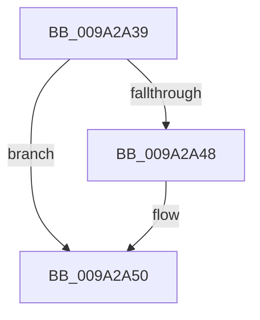

# sub_009A2A39

- RVA: `0x009A2A39`–`0x009A2A5D` (길이 `36` bytes)
- VA: `0x00000001409A2A39`
- 실행 섹션: `PAGE`
- PDB 이름 있음: `아니요`; PDB Function 태그: `아니요`
- unwind 정보 RVA: `0x0009B7EC`
- 디코드: `8`개 명령, `36/36` bytes 표시
- 미해석 바이트: `0` (있으면 어셈블리에 `.byte`로 보존)

> 이 문서는 커널 이미지의 기계어와 PDB 기호를 분석해 생성했습니다. 4번과 5번은 함수 원형과 자료형을 바이너리 사용 방식에서 추정한 C 해석이며 원본 소스 복구 결과는 아닙니다.

## 1. Dependencies

- 직접 호출 지점: **2**; 고유 호출 대상: **2**
- 직접 호출자로 확인된 함수: **0**
- RIP 상대 이미지 참조: **0**

### Outgoing calls
- `0x009A2A3E` → [SepAuditFailed](../86/SepAuditFailed_function_0086EE20.md) (function, `0x0086EE20`)
- `0x009A2A4B` → [SeReleaseSubjectContext](../86/SeReleaseSubjectContext_function_0086B710.md) (function, `0x0086B710`)

### Direct callers
- 이 함수 시작 RVA로 연결되는 직접 call은 확인되지 않았습니다. 간접 호출은 완전히 역산할 수 없습니다.

### Static image references
- 디코드된 RIP-relative 메모리 참조가 없습니다.

## 2. Other-region calls and transfers

- 다른 실행 섹션으로 향하는 call: **0**
- call이 아닌 외부 분기/꼬리 이동: **1**
  - `0x009A2A58` → [sub_009A2945 + 0x16](Unknown_function_009A2945.md) (`tail-transfer`)

## 3. Assembly (complete function range)

```asm
009A2A39  B9 7C 00 00 C0                  mov ecx, 0xc000007c
009A2A3E  E8 DD C3 EC FF                  call 0x14086ee20
009A2A43  4D 85 F6                        test r14, r14
009A2A46  75 08                           jne 0x1409a2a50
009A2A48  49 8B CF                        mov rcx, r15
009A2A4B  E8 C0 8C EC FF                  call 0x14086b710
009A2A50  4C 8B BC 24 80 00 00 00         mov r15, qword ptr [rsp + 0x80]
009A2A58  E9 FE FE FF FF                  jmp 0x1409a295b
```

## 4. C-style interpretation (structured pseudocode)

```c
__int64 __fastcall sub_009A2A39(__int64 a1, __int64 a2, __int64 a3, __int64 a4, __int64 a5, __int64 a6, __int64 a7, __int64 a8, __int64 a9, __int64 a10, __int64 a11, __int64 a12, __int64 a13, __int64 a14, __int64 a15, __int64 a16)
{
    __int64 result;

    result = SepAuditFailed((unsigned int)(0xC000007CULL), a2, a3, a4);
    if (v_r14 == 0) {
        a1 = v_r15;
        result = SeReleaseSubjectContext(a1, a2, a3, a4);
    }
}
```

## 5. (Beta) C Style

```c
int64_t sub_009A2A39(int64_t Arg1, int64_t Arg2, int64_t Arg3, int64_t Arg4, uint64_t Arg5, uint64_t Arg6, uint64_t Arg7, uint64_t Arg8, uint64_t Arg9, uint64_t Arg10, uint64_t Arg11, uint64_t Arg12, uint64_t Arg13, uint64_t Arg14, uint64_t Arg15, int64_t Arg16)
{
    int64_t result;

    result = SepAuditFailed((uint32_t)(0xC000007CULL), Arg2, Arg3, Arg4);
    if (local_r14 == 0) {
        Arg1 = local_r15;
        result = SeReleaseSubjectContext(Arg1, Arg2, Arg3, Arg4);
    }
}
```

## 6. Execution-region graph

[열기: 2D/3D 그래프와 함수 탐색 컨트롤 패널](../../../control-panel.html?section=page&rva=0x009A2A39&view=graph)

- 2D 그래프는 위에서 아래로 흐르고, 3D 그래프는 빈 공간을 드래그해 회전합니다. Shift+드래그는 이동, 휠은 확대·축소, 함수 노드 선택은 대상 보고서 이동입니다.

### Static fallback


