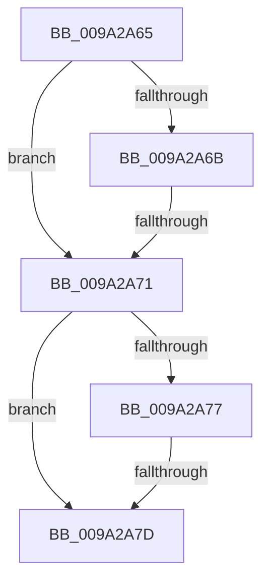

# sub_009A2A65

- RVA: `0x009A2A65`–`0x009A2A84` (길이 `31` bytes)
- VA: `0x00000001409A2A65`
- 실행 섹션: `PAGE`
- PDB 이름 있음: `아니요`; PDB Function 태그: `아니요`
- unwind 정보 RVA: `0x0009B814`
- 디코드: `10`개 명령, `31/31` bytes 표시
- 미해석 바이트: `0` (있으면 어셈블리에 `.byte`로 보존)

> 이 문서는 커널 이미지의 기계어와 PDB 기호를 분석해 생성했습니다. 4번과 5번은 함수 원형과 자료형을 바이너리 사용 방식에서 추정한 C 해석이며 원본 소스 복구 결과는 아닙니다.

## 1. Dependencies

- 직접 호출 지점: **0**; 고유 호출 대상: **0**
- 직접 호출자로 확인된 함수: **0**
- RIP 상대 이미지 참조: **0**

### Outgoing calls
- 직접 디코드된 call 명령이 없습니다.

### Direct callers
- 이 함수 시작 RVA로 연결되는 직접 call은 확인되지 않았습니다. 간접 호출은 완전히 역산할 수 없습니다.

### Static image references
- 디코드된 RIP-relative 메모리 참조가 없습니다.

## 2. Other-region calls and transfers

- 다른 실행 섹션으로 향하는 call: **0**
- call이 아닌 외부 분기/꼬리 이동: **3**
  - `0x009A2A6F` → [sub_009A2A84 + 0x3D](Unknown_function_009A2A84.md) (`tail-transfer`)
  - `0x009A2A7B` → [sub_009A2A84 + 0x3D](Unknown_function_009A2A84.md) (`tail-transfer`)
  - `0x009A2A82` → [sub_009A2A39 + 0xA](Unknown_function_009A2A39.md) (`tail-transfer`)

## 3. Assembly (complete function range)

```asm
009A2A65  40 F6 C7 01                     test dil, 1
009A2A69  74 06                           je 0x1409a2a71
009A2A6B  66 45 3B E2                     cmp r12w, r10w
009A2A6F  74 50                           je 0x1409a2ac1
009A2A71  40 F6 C7 10                     test dil, 0x10
009A2A75  74 06                           je 0x1409a2a7d
009A2A77  66 45 3B DA                     cmp r11w, r10w
009A2A7B  74 44                           je 0x1409a2ac1
009A2A7D  4C 8B 64 24 78                  mov r12, qword ptr [rsp + 0x78]
009A2A82  EB BF                           jmp 0x1409a2a43
```

## 4. C-style interpretation (structured pseudocode)

```c
void __fastcall sub_009A2A65(__int64 a1, __int64 a2, __int64 a3, __int64 a4, __int64 a5, __int64 a6, __int64 a7, __int64 a8, __int64 a9, __int64 a10, __int64 a11, __int64 a12, __int64 a13, __int64 a14, __int64 a15)
{
    if ((((unsigned __int8)(v_rdi)) & (1)) == 0) goto loc_009A2A71;
loc_009A2A71:
    if ((((unsigned __int8)(v_rdi)) & (16)) == 0) goto loc_009A2A7D;
loc_009A2A7D:
}
```

## 5. (Beta) C Style

```c
void sub_009A2A65(int64_t Arg1, int64_t Arg2, int64_t Arg3, int64_t Arg4, uint64_t Arg5, uint64_t Arg6, uint64_t Arg7, uint64_t Arg8, uint64_t Arg9, uint64_t Arg10, uint64_t Arg11, uint64_t Arg12, uint64_t Arg13, uint64_t Arg14, int64_t Arg15)
{
    if ((((uint8_t)(local_rdi)) & (1)) == 0) goto loc_009A2A71;
loc_009A2A71:
    if ((((uint8_t)(local_rdi)) & (16)) == 0) goto loc_009A2A7D;
loc_009A2A7D:
}
```

## 6. Execution-region graph

[열기: 2D/3D 그래프와 함수 탐색 컨트롤 패널](../../../control-panel.html?section=page&rva=0x009A2A65&view=graph)

- 2D 그래프는 위에서 아래로 흐르고, 3D 그래프는 빈 공간을 드래그해 회전합니다. Shift+드래그는 이동, 휠은 확대·축소, 함수 노드 선택은 대상 보고서 이동입니다.

### Static fallback


