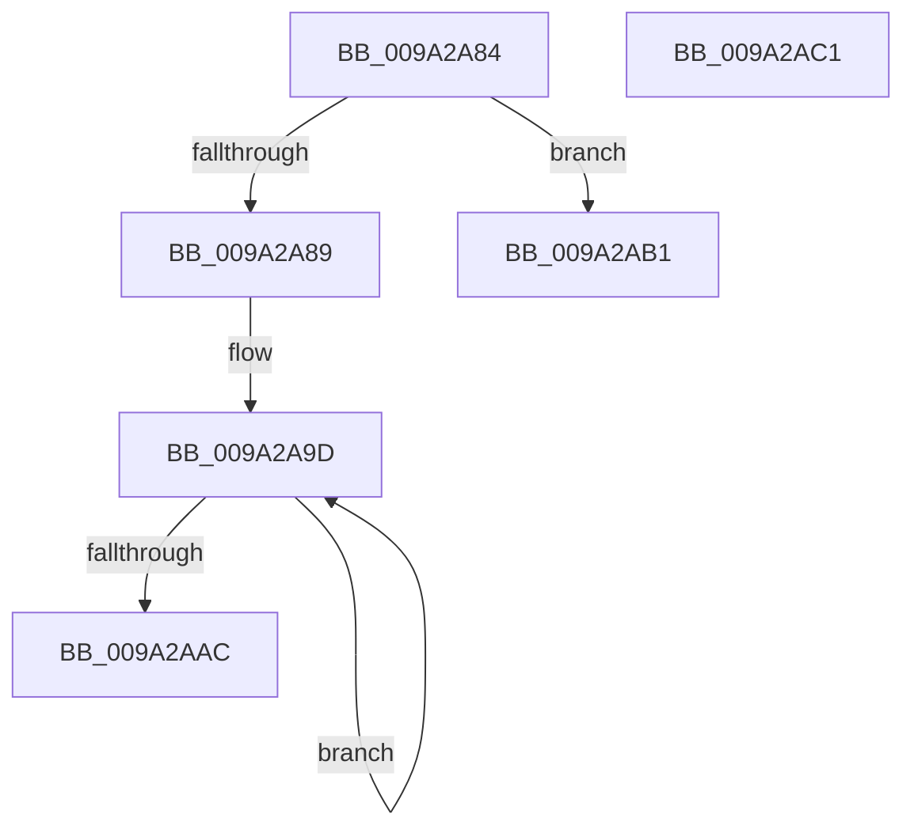

# sub_009A2A84

- RVA: `0x009A2A84`–`0x009A2AC5` (길이 `65` bytes)
- VA: `0x00000001409A2A84`
- 실행 섹션: `PAGE`
- PDB 이름 있음: `아니요`; PDB Function 태그: `아니요`
- unwind 정보 RVA: `0x0009B830`
- 디코드: `20`개 명령, `65/65` bytes 표시
- 미해석 바이트: `0` (있으면 어셈블리에 `.byte`로 보존)

> 이 문서는 커널 이미지의 기계어와 PDB 기호를 분석해 생성했습니다. 4번과 5번은 함수 원형과 자료형을 바이너리 사용 방식에서 추정한 C 해석이며 원본 소스 복구 결과는 아닙니다.

## 1. Dependencies

- 직접 호출 지점: **0**; 고유 호출 대상: **0**
- 직접 호출자로 확인된 함수: **0**
- RIP 상대 이미지 참조: **0**

### Outgoing calls
- 직접 디코드된 call 명령이 없습니다.

### Direct callers
- 이 함수 시작 RVA로 연결되는 직접 call은 확인되지 않았습니다. 간접 호출은 완전히 역산할 수 없습니다.

### Static image references
- 디코드된 RIP-relative 메모리 참조가 없습니다.

## 2. Other-region calls and transfers

- 다른 실행 섹션으로 향하는 call: **0**
- call이 아닌 외부 분기/꼬리 이동: **3**
  - `0x009A2AAC` → [sub_009A29C5 + 0x21](Unknown_function_009A29C5.md) (`tail-transfer`)
  - `0x009A2ABC` → [sub_00B2D1CC](../B2/Unknown_function_00B2D1CC.md) (`tail-transfer`)
  - `0x009A2AC3` → [sub_009A2A65 + 0x18](Unknown_function_009A2A65.md) (`tail-transfer`)

## 3. Assembly (complete function range)

```asm
009A2A84  83 FE 08                        cmp esi, 8
009A2A87  73 28                           jae 0x1409a2ab1
009A2A89  41 8B C1                        mov eax, r9d
009A2A8C  49 8D 8D 60 81 FD 00            lea rcx, [r13 + 0xfd8160]
009A2A93  41 2B F1                        sub esi, r9d
009A2A96  44 8B CE                        mov r9d, esi
009A2A99  48 8D 0C 41                     lea rcx, [rcx + rax*2]
009A2A9D  0F B7 01                        movzx eax, word ptr [rcx]
009A2AA0  48 8D 49 02                     lea rcx, [rcx + 2]
009A2AA4  03 D0                           add edx, eax
009A2AA6  49 83 E9 01                     sub r9, 1
009A2AAA  75 F1                           jne 0x1409a2a9d
009A2AAC  E9 35 FF FF FF                  jmp 0x1409a29e6
009A2AB1  8B D6                           mov edx, esi
009A2AB3  0F 57 DB                        xorps xmm3, xmm3
009A2AB6  83 E2 F8                        and edx, 0xfffffff8
009A2AB9  0F 57 D2                        xorps xmm2, xmm2
009A2ABC  E9 0B A7 18 00                  jmp 0x140b2d1cc
009A2AC1  B3 01                           mov bl, 1
009A2AC3  EB B8                           jmp 0x1409a2a7d
```

## 4. C-style interpretation (structured pseudocode)

```c
__int64 __fastcall sub_009A2A84(__int64 a1, int a2, __int64 a3, int a4)
{
    __int64 v_rsi;

    if (((unsigned int)(v_rsi)) >= 8) goto loc_009A2AB1;
    v_rsi = (unsigned int)((v_rsi) - (a4));
loc_009A2A9D:
    a2 = (unsigned int)((a2) + ((unsigned int)(*(unsigned __int16 *)(v_r13 + 16613728 + (unsigned int)(a4) * 2))));
    a4 = ((unsigned int)((unsigned int)(v_rsi))) - (1);
    if (condition_is_not_equal) goto loc_009A2A9D;
loc_009A2AB1:
    a2 = (unsigned int)(((unsigned int)((unsigned int)(v_rsi))) & (0xFFFFFFF8ULL));
}
```

## 5. (Beta) C Style

```c
int64_t sub_009A2A84(int64_t Arg1, int32_t Arg2, int64_t Arg3, int32_t Arg4)
{
    int64_t local_rsi;

    if (((uint32_t)(local_rsi)) >= 8) goto loc_009A2AB1;
    local_rsi = (uint32_t)((local_rsi) - (Arg4));
loc_009A2A9D:
    Arg2 = (uint32_t)((Arg2) + ((uint32_t)(*(uint16_t *)(local_r13 + 0xFD8160 + (uint32_t)(Arg4) * 2))));
    Arg4 = ((uint32_t)((uint32_t)(local_rsi))) - (1);
    if (condition_is_not_equal) goto loc_009A2A9D;
loc_009A2AB1:
    Arg2 = (uint32_t)(((uint32_t)((uint32_t)(local_rsi))) & (0xFFFFFFF8ULL));
}
```

## 6. Execution-region graph

[열기: 2D/3D 그래프와 함수 탐색 컨트롤 패널](../../../control-panel.html?section=page&rva=0x009A2A84&view=graph)

- 2D 그래프는 위에서 아래로 흐르고, 3D 그래프는 빈 공간을 드래그해 회전합니다. Shift+드래그는 이동, 휠은 확대·축소, 함수 노드 선택은 대상 보고서 이동입니다.

### Static fallback


