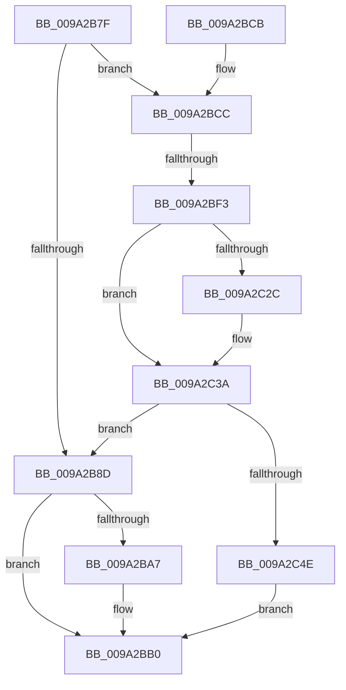

# sub_009A2B7F

- RVA: `0x009A2B7F`–`0x009A2C5D` (길이 `222` bytes)
- VA: `0x00000001409A2B7F`
- 실행 섹션: `PAGE`
- PDB 이름 있음: `아니요`; PDB Function 태그: `아니요`
- unwind 정보 RVA: `0x0009BEB0`
- 디코드: `58`개 명령, `222/222` bytes 표시
- 미해석 바이트: `0` (있으면 어셈블리에 `.byte`로 보존)

> 이 문서는 커널 이미지의 기계어와 PDB 기호를 분석해 생성했습니다. 4번과 5번은 함수 원형과 자료형을 바이너리 사용 방식에서 추정한 C 해석이며 원본 소스 복구 결과는 아닙니다.

## 1. Dependencies

- 직접 호출 지점: **4**; 고유 호출 대상: **4**
- 직접 호출자로 확인된 함수: **0**
- RIP 상대 이미지 참조: **0**

### Outgoing calls
- `0x009A2B92` → [PsReferencePrimaryTokenWithTag](../../text/20/PsReferencePrimaryTokenWithTag_function_0020FF80.md) (function, `0x0020FF80`)
- `0x009A2BE4` → [PspLockThreadSecurityShared](../../text/3C/PspLockThreadSecurityShared_function_003C4720.md) (function, `0x003C4720`)
- `0x009A2C03` → [ObfReferenceObjectWithTag](../../text/21/ObfReferenceObjectWithTag_function_00210710.md) (function, `0x00210710`)
- `0x009A2C40` → [PspUnlockThreadSecurityShared](../../text/3C/PspUnlockThreadSecurityShared_function_003C2E40.md) (function, `0x003C2E40`)

### Direct callers
- 이 함수 시작 RVA로 연결되는 직접 call은 확인되지 않았습니다. 간접 호출은 완전히 역산할 수 없습니다.

### Static image references
- 디코드된 RIP-relative 메모리 참조가 없습니다.

## 2. Other-region calls and transfers

- 다른 실행 섹션으로 향하는 call: **4**
  - `0x009A2B92` → [PsReferencePrimaryTokenWithTag](../../text/20/PsReferencePrimaryTokenWithTag_function_0020FF80.md) (`PAGE` → `.text`)
  - `0x009A2BE4` → [PspLockThreadSecurityShared](../../text/3C/PspLockThreadSecurityShared_function_003C4720.md) (`PAGE` → `.text`)
  - `0x009A2C03` → [ObfReferenceObjectWithTag](../../text/21/ObfReferenceObjectWithTag_function_00210710.md) (`PAGE` → `.text`)
  - `0x009A2C40` → [PspUnlockThreadSecurityShared](../../text/3C/PspUnlockThreadSecurityShared_function_003C2E40.md) (`PAGE` → `.text`)
- call이 아닌 외부 분기/꼬리 이동: **1**
  - `0x009A2BF1` → [sub_009A2C69](Unknown_function_009A2C69.md) (`tail-transfer`)

## 3. Assembly (complete function range)

```asm
009A2B7F  4C 89 64 24 58                  mov qword ptr [rsp + 0x58], r12
009A2B84  4C 89 6C 24 60                  mov qword ptr [rsp + 0x60], r13
009A2B89  A8 08                           test al, 8
009A2B8B  75 3F                           jne 0x1409a2bcc
009A2B8D  8B D5                           mov edx, ebp
009A2B8F  48 8B CE                        mov rcx, rsi
009A2B92  E8 E9 D3 86 FF                  call 0x14020ff80
009A2B97  41 C7 07 01 00 00 00            mov dword ptr [r15], 1
009A2B9E  41 C6 06 00                     mov byte ptr [r14], 0
009A2BA2  48 85 FF                        test rdi, rdi
009A2BA5  74 09                           je 0x1409a2bb0
009A2BA7  0F B6 8E FA 05 00 00            movzx ecx, byte ptr [rsi + 0x5fa]
009A2BAE  88 0F                           mov byte ptr [rdi], cl
009A2BB0  4C 8B 6C 24 60                  mov r13, qword ptr [rsp + 0x60]
009A2BB5  4C 8B 64 24 58                  mov r12, qword ptr [rsp + 0x58]
009A2BBA  48 8B 5C 24 68                  mov rbx, qword ptr [rsp + 0x68]
009A2BBF  48 83 C4 20                     add rsp, 0x20
009A2BC3  41 5F                           pop r15
009A2BC5  41 5E                           pop r14
009A2BC7  5F                              pop rdi
009A2BC8  5E                              pop rsi
009A2BC9  5D                              pop rbp
009A2BCA  C3                              ret
009A2BCB  CC                              int3
009A2BCC  65 4C 8B 2C 25 88 01 00 00      mov r13, qword ptr gs:[0x188]
009A2BD5  48 8B 81 20 02 00 00            mov rax, qword ptr [rcx + 0x220]
009A2BDC  49 8B D5                        mov rdx, r13
009A2BDF  48 89 44 24 50                  mov qword ptr [rsp + 0x50], rax
009A2BE4  E8 37 1B A2 FF                  call 0x1403c4720
009A2BE9  8B 83 A0 05 00 00               mov eax, dword ptr [rbx + 0x5a0]
009A2BEF  A8 08                           test al, 8
009A2BF1  74 76                           je 0x1409a2c69
009A2BF3  4C 8B A3 38 05 00 00            mov r12, qword ptr [rbx + 0x538]
009A2BFA  8B D5                           mov edx, ebp
009A2BFC  49 83 E4 F8                     and r12, 0xfffffffffffffff8
009A2C00  49 8B CC                        mov rcx, r12
009A2C03  E8 08 DB 86 FF                  call 0x140210710
009A2C08  8B 8B 38 05 00 00               mov ecx, dword ptr [rbx + 0x538]
009A2C0E  48 8B 44 24 70                  mov rax, qword ptr [rsp + 0x70]
009A2C13  83 E1 03                        and ecx, 3
009A2C16  89 08                           mov dword ptr [rax], ecx
009A2C18  0F B6 83 38 05 00 00            movzx eax, byte ptr [rbx + 0x538]
009A2C1F  C0 E8 02                        shr al, 2
009A2C22  24 01                           and al, 1
009A2C24  41 88 06                        mov byte ptr [r14], al
009A2C27  48 85 FF                        test rdi, rdi
009A2C2A  74 0E                           je 0x1409a2c3a
009A2C2C  48 8B 4C 24 50                  mov rcx, qword ptr [rsp + 0x50]
009A2C31  0F B6 89 FA 05 00 00            movzx ecx, byte ptr [rcx + 0x5fa]
009A2C38  88 0F                           mov byte ptr [rdi], cl
009A2C3A  49 8B D5                        mov rdx, r13
009A2C3D  48 8B CB                        mov rcx, rbx
009A2C40  E8 FB 01 A2 FF                  call 0x1403c2e40
009A2C45  4D 85 E4                        test r12, r12
009A2C48  0F 84 3F FF FF FF               je 0x1409a2b8d
009A2C4E  41 C7 07 02 00 00 00            mov dword ptr [r15], 2
009A2C55  49 8B C4                        mov rax, r12
009A2C58  E9 53 FF FF FF                  jmp 0x1409a2bb0
```

## 4. C-style interpretation (structured pseudocode)

```c
__int64 __fastcall sub_009A2B7F(__int64 a1, __int64 a2, __int64 a3, __int64 a4, __int64 a5, __int64 a6, __int64 a7, __int64 a8, __int64 a9, __int64 a10, __int64 a11, __int64 a12, __int64 a13, __int64 a14)
{
    __int64 result;
    __int64 v_r12;
    __int64 v_rsp;
    unsigned __int64 v_stack_p58;
    unsigned __int64 v_stack_p60;
    unsigned __int64 v_stack_p98;

    v_stack_p58 = v_r12;
    v_stack_p60 = v_r13;
    if ((((unsigned __int8)(result)) & (8)) != 0) goto loc_009A2BCC;
loc_009A2B8D:
    result = PsReferencePrimaryTokenWithTag(v_rsi, (unsigned int)((unsigned int)(v_rbp)), a3, a4);
    *(unsigned int *)(v_r15) = 1;
    *(unsigned __int8 *)(v_r14) = 0;
    if (v_rdi != 0) {
        a1 = *(unsigned __int8 *)(v_rsi + 1530);
        *(unsigned __int8 *)(v_rdi) = (unsigned __int8)(a1);
    }
    v_rsp = (v_rsp) + (32);
    return result;
loc_009A2BCC:
    v_stack_p98 = *(unsigned __int64 *)(a1 + 544);
    result = PspLockThreadSecurityShared(a1, *(unsigned __int64 *)(gs_base + (0 + 392)), a3, a4);
    v_r12 = (*(unsigned __int64 *)(a13 + 1336)) & (-8);
    result = ObfReferenceObjectWithTag(v_r12, (unsigned int)((unsigned int)(v_rbp)), a3, a4);
    a1 = (unsigned int)(((unsigned int)(*(unsigned int *)(a13 + 1336))) & (3));
    *(unsigned int *)(a14) = (unsigned int)(a1);
    result = (unsigned __int8)((*(unsigned __int8 *)(a13 + 1336)) >> (2));
    result = (unsigned __int8)((result) & (1));
    *(unsigned __int8 *)(v_r14) = (unsigned __int8)(result);
    if (v_rdi != 0) {
        a1 = a10;
        a1 = *(unsigned __int8 *)(a1 + 1530);
        *(unsigned __int8 *)(v_rdi) = (unsigned __int8)(a1);
    }
    result = PspUnlockThreadSecurityShared(a13, *(unsigned __int64 *)(gs_base + (0 + 392)), a3, a4);
    if (v_r12 == 0) goto loc_009A2B8D;
    *(unsigned int *)(v_r15) = 2;
    goto loc_009A2BB0;
}
```

## 5. (Beta) C Style

```c
int64_t sub_009A2B7F(void *Arg1, int64_t Arg2, int64_t Arg3, int64_t Arg4, uint64_t Arg5, uint64_t Arg6, uint64_t Arg7, uint64_t Arg8, uint64_t Arg9, void *Arg10, int64_t Arg11, int64_t Arg12, int64_t Arg13, void *Arg14)
{
    uint8_t *arg1 = (uint8_t *)Arg1;
    uint8_t *arg10 = (uint8_t *)Arg10;
    uint8_t *arg14 = (uint8_t *)Arg14;

    int64_t result;
    int64_t local_r12;
    int64_t local_rsp;
    uint64_t v_stack_p58;
    uint64_t v_stack_p60;
    uint64_t v_stack_p98;

    v_stack_p58 = local_r12;
    v_stack_p60 = local_r13;
    if ((((uint8_t)(result)) & (8)) != 0) goto loc_009A2BCC;
loc_009A2B8D:
    result = PsReferencePrimaryTokenWithTag(local_rsi, (uint32_t)((uint32_t)(local_rbp)), Arg3, Arg4);
    *(uint32_t *)(local_r15) = 1;
    *(uint8_t *)(local_r14) = 0;
    if (local_rdi != 0) {
        Arg1 = *(uint8_t *)(local_rsi + 0x5FA);
        *(uint8_t *)(local_rdi) = (uint8_t)(Arg1);
    }
    local_rsp = (local_rsp) + (32);
    return result;
loc_009A2BCC:
    v_stack_p98 = *(uint64_t *)(arg1 + 0x220);
    result = PspLockThreadSecurityShared(Arg1, *(uint64_t *)(gs_base + (0 + 0x188)), Arg3, Arg4);
    local_r12 = (*(uint64_t *)(Arg13 + 0x538)) & (-8);
    result = ObfReferenceObjectWithTag(local_r12, (uint32_t)((uint32_t)(local_rbp)), Arg3, Arg4);
    Arg1 = (uint32_t)(((uint32_t)(*(uint32_t *)(Arg13 + 0x538))) & (3));
    *(uint32_t *)(arg14) = (uint32_t)(Arg1);
    result = (uint8_t)((*(uint8_t *)(Arg13 + 0x538)) >> (2));
    result = (uint8_t)((result) & (1));
    *(uint8_t *)(local_r14) = (uint8_t)(result);
    if (local_rdi != 0) {
        Arg1 = Arg10;
        Arg1 = *(uint8_t *)(arg1 + 0x5FA);
        *(uint8_t *)(local_rdi) = (uint8_t)(Arg1);
    }
    result = PspUnlockThreadSecurityShared(Arg13, *(uint64_t *)(gs_base + (0 + 0x188)), Arg3, Arg4);
    if (local_r12 == 0) goto loc_009A2B8D;
    *(uint32_t *)(local_r15) = 2;
    goto loc_009A2BB0;
}
```

### 관측된 메모리 오프셋

구조체 형식이 확인되지 않은 접근은 인자 기준의 오프셋으로만 기록했습니다.

| 기준 인자 | 오프셋 표현 | 폭 (bit) | 접근 |
|---|---:|---:|---|
| `Arg1` | `+ 0x220` | `64` | `R` |
| `Arg10` | `+ 0x5FA` | `8` | `R` |
| `Arg14` | `+ 0x0` | `32` | `W` |

## 6. Execution-region graph

[열기: 2D/3D 그래프와 함수 탐색 컨트롤 패널](../../../control-panel.html?section=page&rva=0x009A2B7F&view=graph)

- 2D 그래프는 위에서 아래로 흐르고, 3D 그래프는 빈 공간을 드래그해 회전합니다. Shift+드래그는 이동, 휠은 확대·축소, 함수 노드 선택은 대상 보고서 이동입니다.

### Static fallback


