# sub_009A41D2

- RVA: `0x009A41D2`–`0x009A433E` (길이 `364` bytes)
- VA: `0x00000001409A41D2`
- 실행 섹션: `PAGE`
- PDB 이름 있음: `아니요`; PDB Function 태그: `아니요`
- unwind 정보 RVA: `0x0009C478`
- 디코드: `101`개 명령, `364/364` bytes 표시
- 미해석 바이트: `0` (있으면 어셈블리에 `.byte`로 보존)

> 이 문서는 커널 이미지의 기계어와 PDB 기호를 분석해 생성했습니다. 4번과 5번은 함수 원형과 자료형을 바이너리 사용 방식에서 추정한 C 해석이며 원본 소스 복구 결과는 아닙니다.

## 1. Dependencies

- 직접 호출 지점: **0**; 고유 호출 대상: **0**
- 직접 호출자로 확인된 함수: **0**
- RIP 상대 이미지 참조: **0**

### Outgoing calls
- 직접 디코드된 call 명령이 없습니다.

### Direct callers
- 이 함수 시작 RVA로 연결되는 직접 call은 확인되지 않았습니다. 간접 호출은 완전히 역산할 수 없습니다.

### Static image references
- 디코드된 RIP-relative 메모리 참조가 없습니다.

## 2. Other-region calls and transfers

- 다른 실행 섹션으로 향하는 call: **0**
- call이 아닌 외부 분기/꼬리 이동: **12**
  - `0x009A4207` → [sub_009A4388 + 0x67](Unknown_function_009A4388.md) (`tail-transfer`)
  - `0x009A422C` → [sub_009A433F + 0xA](Unknown_function_009A433F.md) (`tail-transfer`)
  - `0x009A4245` → [sub_009A4388 + 0x4B](Unknown_function_009A4388.md) (`tail-transfer`)
  - `0x009A4255` → [sub_009A4388 + 0x4B](Unknown_function_009A4388.md) (`tail-transfer`)
  - `0x009A4268` → [sub_009A4388 + 0x3C](Unknown_function_009A4388.md) (`tail-transfer`)
  - `0x009A4273` → [sub_009A4388 + 0x1D](Unknown_function_009A4388.md) (`tail-transfer`)
  - `0x009A427E` → [sub_009A433F](Unknown_function_009A433F.md) (`tail-transfer`)
  - `0x009A4286` → [sub_009A4388 + 0x16](Unknown_function_009A4388.md) (`tail-transfer`)
  - `0x009A4294` → [sub_009A4388 + 0x2D](Unknown_function_009A4388.md) (`tail-transfer`)
  - `0x009A429D` → [sub_009A4388 + 0x2D](Unknown_function_009A4388.md) (`tail-transfer`)
  - `0x009A42A6` → [sub_009A4388](Unknown_function_009A4388.md) (`tail-transfer`)
  - `0x009A42B0` → [sub_009A4388 + 0x52](Unknown_function_009A4388.md) (`tail-transfer`)

## 3. Assembly (complete function range)

```asm
009A41D2  4C 89 64 24 48                  mov qword ptr [rsp + 0x48], r12
009A41D7  4C 89 6C 24 08                  mov qword ptr [rsp + 8], r13
009A41DC  4C 89 3C 24                     mov qword ptr [rsp], r15
009A41E0  45 85 DB                        test r11d, r11d
009A41E3  0F 84 20 01 00 00               je 0x1409a4309
009A41E9  44 8B FD                        mov r15d, ebp
009A41EC  8B C5                           mov eax, ebp
009A41EE  41 83 E7 02                     and r15d, 2
009A41F2  41 0F 95 C4                     setne r12b
009A41F6  83 E0 04                        and eax, 4
009A41F9  89 44 24 40                     mov dword ptr [rsp + 0x40], eax
009A41FD  41 0F 95 C5                     setne r13b
009A4201  40 80 E5 01                     and bpl, 1
009A4205  85 D2                           test edx, edx
009A4207  0F 88 E2 01 00 00               js 0x1409a43ef
009A420D  85 C9                           test ecx, ecx
009A420F  75 0C                           jne 0x1409a421d
009A4211  41 88 68 4D                     mov byte ptr [r8 + 0x4d], bpl
009A4215  45 88 60 4E                     mov byte ptr [r8 + 0x4e], r12b
009A4219  45 88 68 4F                     mov byte ptr [r8 + 0x4f], r13b
009A421D  4D 85 C0                        test r8, r8
009A4220  74 10                           je 0x1409a4232
009A4222  49 8B 80 D0 00 00 00            mov rax, qword ptr [r8 + 0xd0]
009A4229  48 85 C0                        test rax, rax
009A422C  0F 85 17 01 00 00               jne 0x1409a4349
009A4232  32 C0                           xor al, al
009A4234  F6 C2 04                        test dl, 4
009A4237  75 24                           jne 0x1409a425d
009A4239  45 85 DB                        test r11d, r11d
009A423C  74 0D                           je 0x1409a424b
009A423E  41 8B 06                        mov eax, dword ptr [r14]
009A4241  41 39 46 10                     cmp dword ptr [r14 + 0x10], eax
009A4245  0F 82 88 01 00 00               jb 0x1409a43d3
009A424B  41 83 7E 04 00                  cmp dword ptr [r14 + 4], 0
009A4250  74 09                           je 0x1409a425b
009A4252  40 84 ED                        test bpl, bpl
009A4255  0F 84 78 01 00 00               je 0x1409a43d3
009A425B  32 C0                           xor al, al
009A425D  F6 C2 08                        test dl, 8
009A4260  75 19                           jne 0x1409a427b
009A4262  84 C0                           test al, al
009A4264  75 15                           jne 0x1409a427b
009A4266  85 DB                           test ebx, ebx
009A4268  0F 85 56 01 00 00               jne 0x1409a43c4
009A426E  41 83 7E 08 00                  cmp dword ptr [r14 + 8], 0
009A4273  0F 85 2C 01 00 00               jne 0x1409a43a5
009A4279  32 C0                           xor al, al
009A427B  F6 C2 10                        test dl, 0x10
009A427E  0F 85 BB 00 00 00               jne 0x1409a433f
009A4284  84 C0                           test al, al
009A4286  0F 85 12 01 00 00               jne 0x1409a439e
009A428C  48 8B 4C 24 60                  mov rcx, qword ptr [rsp + 0x60]
009A4291  48 85 C9                        test rcx, rcx
009A4294  0F 84 1B 01 00 00               je 0x1409a43b5
009A429A  F6 C2 40                        test dl, 0x40
009A429D  0F 85 12 01 00 00               jne 0x1409a43b5
009A42A3  45 85 D2                        test r10d, r10d
009A42A6  0F 85 DC 00 00 00               jne 0x1409a4388
009A42AC  83 79 04 00                     cmp dword ptr [rcx + 4], 0
009A42B0  0F 85 24 01 00 00               jne 0x1409a43da
009A42B6  F6 C2 01                        test dl, 1
009A42B9  74 68                           je 0x1409a4323
009A42BB  41 FF 06                        inc dword ptr [r14]
009A42BE  4C 8B 44 24 60                  mov r8, qword ptr [rsp + 0x60]
009A42C3  40 0F B6 C7                     movzx eax, dil
009A42C7  41 01 46 04                     add dword ptr [r14 + 4], eax
009A42CB  40 0F B6 C6                     movzx eax, sil
009A42CF  41 01 46 08                     add dword ptr [r14 + 8], eax
009A42D3  40 0F B6 C5                     movzx eax, bpl
009A42D7  41 01 46 10                     add dword ptr [r14 + 0x10], eax
009A42DB  41 0F B6 C4                     movzx eax, r12b
009A42DF  41 01 46 14                     add dword ptr [r14 + 0x14], eax
009A42E3  41 0F B6 C5                     movzx eax, r13b
009A42E7  41 01 46 18                     add dword ptr [r14 + 0x18], eax
009A42EB  41 0F B6 C9                     movzx ecx, r9b
009A42EF  41 01 4E 0C                     add dword ptr [r14 + 0xc], ecx
009A42F3  4D 85 C0                        test r8, r8
009A42F6  74 2B                           je 0x1409a4323
009A42F8  41 FF 00                        inc dword ptr [r8]
009A42FB  84 D2                           test dl, dl
009A42FD  78 04                           js 0x1409a4303
009A42FF  41 01 48 04                     add dword ptr [r8 + 4], ecx
009A4303  41 01 40 08                     add dword ptr [r8 + 8], eax
009A4307  EB 1A                           jmp 0x1409a4323
009A4309  85 DB                           test ebx, ebx
009A430B  0F 85 D8 FE FF FF               jne 0x1409a41e9
009A4311  45 85 D2                        test r10d, r10d
009A4314  0F 85 CF FE FF FF               jne 0x1409a41e9
009A431A  F6 C2 20                        test dl, 0x20
009A431D  0F 85 C6 FE FF FF               jne 0x1409a41e9
009A4323  33 C0                           xor eax, eax
009A4325  4C 8B 6C 24 08                  mov r13, qword ptr [rsp + 8]
009A432A  4C 8B 64 24 48                  mov r12, qword ptr [rsp + 0x48]
009A432F  4C 8B 3C 24                     mov r15, qword ptr [rsp]
009A4333  48 83 C4 10                     add rsp, 0x10
009A4337  41 5E                           pop r14
009A4339  5F                              pop rdi
009A433A  5E                              pop rsi
009A433B  5D                              pop rbp
009A433C  5B                              pop rbx
009A433D  C3                              ret
```

## 4. C-style interpretation (structured pseudocode)

```c
__int64 __fastcall sub_009A41D2(int a1, int a2, __int64 a3, unsigned __int8 a4, __int64 a5, __int64 a6, __int64 a7, __int64 a8, __int64 a9, __int64 a10, __int64 a11, __int64 a12)
{
    __int64 result;
    __int64 v_r12;
    __int64 v_r13;
    __int64 v_r15;
    __int64 v_rbp;
    __int64 v_rsp;
    unsigned __int64 v_stack_p0;
    unsigned int v_stack_p40;
    unsigned __int64 v_stack_p48;
    unsigned __int64 v_stack_p8;

    v_stack_p48 = v_r12;
    v_stack_p8 = v_r13;
    v_stack_p0 = v_r15;
    if ((unsigned int)(v_r11) == 0) goto loc_009A4309;
loc_009A41E9:
    v_r15 = (unsigned int)(((unsigned int)((unsigned int)(v_rbp))) & (2));
    v_r12 = (condition_is_not_equal) ? 1 : 0;
    result = (unsigned int)(((unsigned int)((unsigned int)(v_rbp))) & (4));
    v_stack_p40 = (unsigned int)(result);
    v_r13 = (condition_is_not_equal) ? 1 : 0;
    v_rbp = (unsigned __int8)((v_rbp) & (1));
    if (a1 == 0) {
        *(unsigned __int8 *)(a3 + 77) = (unsigned __int8)(v_rbp);
        *(unsigned __int8 *)(a3 + 78) = (unsigned __int8)(v_r12);
        *(unsigned __int8 *)(a3 + 79) = (unsigned __int8)(v_r13);
    }
    if (a3 == 0) goto loc_009A4232;
loc_009A4232:
    result = 0;
    if ((((unsigned __int8)(a2)) & (4)) != 0) goto loc_009A425D;
    if ((unsigned int)(v_r11) == 0) goto loc_009A424B;
loc_009A424B:
    if ((*(unsigned int *)(v_r14 + 4)) == 0) goto loc_009A425B;
loc_009A425B:
    result = 0;
loc_009A425D:
    if ((((unsigned __int8)(a2)) & (8)) != 0) goto loc_009A427B;
    if (0 != 0) goto loc_009A427B;
    result = 0;
loc_009A427B:
    if ((((unsigned __int8)(a2)) & (1)) == 0) goto loc_009A4323;
    if (a12 == 0) goto loc_009A4323;
    if (!(sign_flag)) {
    }
    goto loc_009A4323;
loc_009A4309:
    if ((unsigned int)(v_rbx) != 0) goto loc_009A41E9;
    if ((unsigned int)(v_r10) != 0) goto loc_009A41E9;
    if ((((unsigned __int8)(a2)) & (32)) != 0) goto loc_009A41E9;
loc_009A4323:
    result = 0;
    v_rsp = (v_rsp) + (16);
    return result;
}
```

## 5. (Beta) C Style

```c
int64_t sub_009A41D2(int32_t Arg1, int32_t Arg2, void *Arg3, uint8_t Arg4, uint64_t Arg5, uint64_t Arg6, uint64_t Arg7, uint64_t Arg8, int64_t Arg9, uint64_t Arg10, uint64_t Arg11, int64_t Arg12)
{
    uint8_t *arg3 = (uint8_t *)Arg3;

    int64_t result;
    int64_t local_r12;
    int64_t local_r13;
    int64_t local_r15;
    int64_t local_rbp;
    int64_t local_rsp;
    uint64_t v_stack_p0;
    uint32_t v_stack_p40;
    uint64_t v_stack_p48;
    uint64_t v_stack_p8;

    v_stack_p48 = local_r12;
    v_stack_p8 = local_r13;
    v_stack_p0 = local_r15;
    if ((uint32_t)(local_r11) == 0) goto loc_009A4309;
loc_009A41E9:
    local_r15 = (uint32_t)(((uint32_t)((uint32_t)(local_rbp))) & (2));
    local_r12 = (condition_is_not_equal) ? 1 : 0;
    result = (uint32_t)(((uint32_t)((uint32_t)(local_rbp))) & (4));
    v_stack_p40 = (uint32_t)(result);
    local_r13 = (condition_is_not_equal) ? 1 : 0;
    local_rbp = (uint8_t)((local_rbp) & (1));
    if (Arg1 == 0) {
        *(uint8_t *)(arg3 + 0x4D) = (uint8_t)(local_rbp);
        *(uint8_t *)(arg3 + 0x4E) = (uint8_t)(local_r12);
        *(uint8_t *)(arg3 + 0x4F) = (uint8_t)(local_r13);
    }
    if (Arg3 == NULL) goto loc_009A4232;
loc_009A4232:
    result = 0;
    if ((((uint8_t)(Arg2)) & (4)) != 0) goto loc_009A425D;
    if ((uint32_t)(local_r11) == 0) goto loc_009A424B;
loc_009A424B:
    if ((*(uint32_t *)(local_r14 + 0x4)) == 0) goto loc_009A425B;
loc_009A425B:
    result = 0;
loc_009A425D:
    if ((((uint8_t)(Arg2)) & (8)) != 0) goto loc_009A427B;
    if (0 != 0) goto loc_009A427B;
    result = 0;
loc_009A427B:
    if ((((uint8_t)(Arg2)) & (1)) == 0) goto loc_009A4323;
    if (Arg12 == 0) goto loc_009A4323;
    if (!(sign_flag)) {
    }
    goto loc_009A4323;
loc_009A4309:
    if ((uint32_t)(local_rbx) != 0) goto loc_009A41E9;
    if ((uint32_t)(local_r10) != 0) goto loc_009A41E9;
    if ((((uint8_t)(Arg2)) & (32)) != 0) goto loc_009A41E9;
loc_009A4323:
    result = 0;
    local_rsp = (local_rsp) + (16);
    return result;
}
```

### 관측된 메모리 오프셋

구조체 형식이 확인되지 않은 접근은 인자 기준의 오프셋으로만 기록했습니다.

| 기준 인자 | 오프셋 표현 | 폭 (bit) | 접근 |
|---|---:|---:|---|
| `Arg3` | `+ 0x4D` | `8` | `W` |
| `Arg3` | `+ 0x4E` | `8` | `W` |
| `Arg3` | `+ 0x4F` | `8` | `W` |

## 6. Execution-region graph

[열기: 2D/3D 그래프와 함수 탐색 컨트롤 패널](../../../control-panel.html?section=page&rva=0x009A41D2&view=graph)

- 2D 그래프는 위에서 아래로 흐르고, 3D 그래프는 빈 공간을 드래그해 회전합니다. Shift+드래그는 이동, 휠은 확대·축소, 함수 노드 선택은 대상 보고서 이동입니다.

### Static fallback

```mermaid
flowchart TD
  bb_009A41D2[BB_009A41D2]
  bb_009A41E9[BB_009A41E9]
  bb_009A420D[BB_009A420D]
  bb_009A4211[BB_009A4211]
  bb_009A421D[BB_009A421D]
  bb_009A4222[BB_009A4222]
  bb_009A4232[BB_009A4232]
  bb_009A4239[BB_009A4239]
  bb_009A423E[BB_009A423E]
  bb_009A424B[BB_009A424B]
  bb_009A4252[BB_009A4252]
  bb_009A425B[BB_009A425B]
  bb_009A425D[BB_009A425D]
  bb_009A4262[BB_009A4262]
  bb_009A4266[BB_009A4266]
  bb_009A426E[BB_009A426E]
  bb_009A4279[BB_009A4279]
  bb_009A427B[BB_009A427B]
  bb_009A4284[BB_009A4284]
  bb_009A428C[BB_009A428C]
  bb_009A429A[BB_009A429A]
  bb_009A42A3[BB_009A42A3]
  bb_009A42AC[BB_009A42AC]
  bb_009A42B6[BB_009A42B6]
  bb_009A42BB[BB_009A42BB]
  bb_009A42F8[BB_009A42F8]
  bb_009A42FF[BB_009A42FF]
  bb_009A4303[BB_009A4303]
  bb_009A4309[BB_009A4309]
  bb_009A4311[BB_009A4311]
  bb_009A431A[BB_009A431A]
  bb_009A4323[BB_009A4323]
  bb_009A41D2 -->|branch| bb_009A4309
  bb_009A41D2 -->|fallthrough| bb_009A41E9
  bb_009A41E9 -->|fallthrough| bb_009A420D
  bb_009A420D -->|branch| bb_009A421D
  bb_009A420D -->|fallthrough| bb_009A4211
  bb_009A4211 -->|flow| bb_009A421D
  bb_009A421D -->|branch| bb_009A4232
  bb_009A421D -->|fallthrough| bb_009A4222
  bb_009A4222 -->|fallthrough| bb_009A4232
  bb_009A4232 -->|branch| bb_009A425D
  bb_009A4232 -->|fallthrough| bb_009A4239
  bb_009A4239 -->|branch| bb_009A424B
  bb_009A4239 -->|fallthrough| bb_009A423E
  bb_009A423E -->|fallthrough| bb_009A424B
  bb_009A424B -->|branch| bb_009A425B
  bb_009A424B -->|fallthrough| bb_009A4252
  bb_009A4252 -->|fallthrough| bb_009A425B
  bb_009A425B -->|flow| bb_009A425D
  bb_009A425D -->|branch| bb_009A427B
  bb_009A425D -->|fallthrough| bb_009A4262
  bb_009A4262 -->|branch| bb_009A427B
  bb_009A4262 -->|fallthrough| bb_009A4266
  bb_009A4266 -->|fallthrough| bb_009A426E
  bb_009A426E -->|fallthrough| bb_009A4279
  bb_009A4279 -->|flow| bb_009A427B
  bb_009A427B -->|fallthrough| bb_009A4284
  bb_009A4284 -->|fallthrough| bb_009A428C
  bb_009A428C -->|fallthrough| bb_009A429A
  bb_009A429A -->|fallthrough| bb_009A42A3
  bb_009A42A3 -->|fallthrough| bb_009A42AC
  bb_009A42AC -->|fallthrough| bb_009A42B6
  bb_009A42B6 -->|branch| bb_009A4323
  bb_009A42B6 -->|fallthrough| bb_009A42BB
  bb_009A42BB -->|branch| bb_009A4323
  bb_009A42BB -->|fallthrough| bb_009A42F8
  bb_009A42F8 -->|branch| bb_009A4303
  bb_009A42F8 -->|fallthrough| bb_009A42FF
  bb_009A42FF -->|flow| bb_009A4303
  bb_009A4303 -->|branch| bb_009A4323
  bb_009A4309 -->|branch| bb_009A41E9
  bb_009A4309 -->|fallthrough| bb_009A4311
  bb_009A4311 -->|branch| bb_009A41E9
  bb_009A4311 -->|fallthrough| bb_009A431A
  bb_009A431A -->|branch| bb_009A41E9
  bb_009A431A -->|fallthrough| bb_009A4323
```


