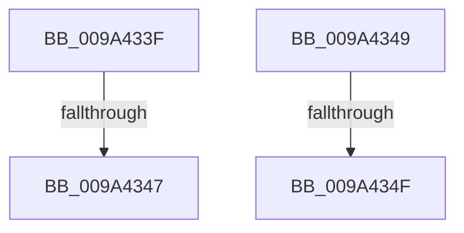

# sub_009A433F

- RVA: `0x009A433F`–`0x009A4354` (길이 `21` bytes)
- VA: `0x00000001409A433F`
- 실행 섹션: `PAGE`
- PDB 이름 있음: `아니요`; PDB Function 태그: `아니요`
- unwind 정보 RVA: `0x0009C4A8`
- 디코드: `7`개 명령, `21/21` bytes 표시
- 미해석 바이트: `0` (있으면 어셈블리에 `.byte`로 보존)

> 이 문서는 커널 이미지의 기계어와 PDB 기호를 분석해 생성했습니다. 4번과 5번은 함수 원형과 자료형을 바이너리 사용 방식에서 추정한 C 해석이며 원본 소스 복구 결과는 아닙니다.

## 1. Dependencies

- 직접 호출 지점: **0**; 고유 호출 대상: **0**
- 직접 호출자로 확인된 함수: **0**
- RIP 상대 이미지 참조: **0**

### Outgoing calls
- 직접 디코드된 call 명령이 없습니다.

### Direct callers
- 이 함수 시작 RVA로 연결되는 직접 call은 확인되지 않았습니다. 간접 호출은 완전히 역산할 수 없습니다.

### Static image references
- 디코드된 RIP-relative 메모리 참조가 없습니다.

## 2. Other-region calls and transfers

- 다른 실행 섹션으로 향하는 call: **0**
- call이 아닌 외부 분기/꼬리 이동: **4**
  - `0x009A4341` → [sub_009A41D2 + 0xE4](Unknown_function_009A41D2.md) (`tail-transfer`)
  - `0x009A4347` → [sub_009A4388 + 0x16](Unknown_function_009A4388.md) (`tail-transfer`)
  - `0x009A434D` → [sub_009A41D2 + 0x151](Unknown_function_009A41D2.md) (`tail-transfer`)
  - `0x009A434F` → [sub_009A41D2 + 0x60](Unknown_function_009A41D2.md) (`tail-transfer`)

## 3. Assembly (complete function range)

```asm
009A433F  84 C0                           test al, al
009A4341  0F 84 6F FF FF FF               je 0x1409a42b6
009A4347  EB 55                           jmp 0x1409a439e
009A4349  8B 00                           mov eax, dword ptr [rax]
009A434B  A8 01                           test al, 1
009A434D  75 D4                           jne 0x1409a4323
009A434F  E9 DE FE FF FF                  jmp 0x1409a4232
```

## 4. C-style interpretation (structured pseudocode)

```c
__int64 __fastcall sub_009A433F(void)
{
}
```

## 5. (Beta) C Style

```c
void sub_009A433F(void)
{
}
```

## 6. Execution-region graph

[열기: 2D/3D 그래프와 함수 탐색 컨트롤 패널](../../../control-panel.html?section=page&rva=0x009A433F&view=graph)

- 2D 그래프는 위에서 아래로 흐르고, 3D 그래프는 빈 공간을 드래그해 회전합니다. Shift+드래그는 이동, 휠은 확대·축소, 함수 노드 선택은 대상 보고서 이동입니다.

### Static fallback


