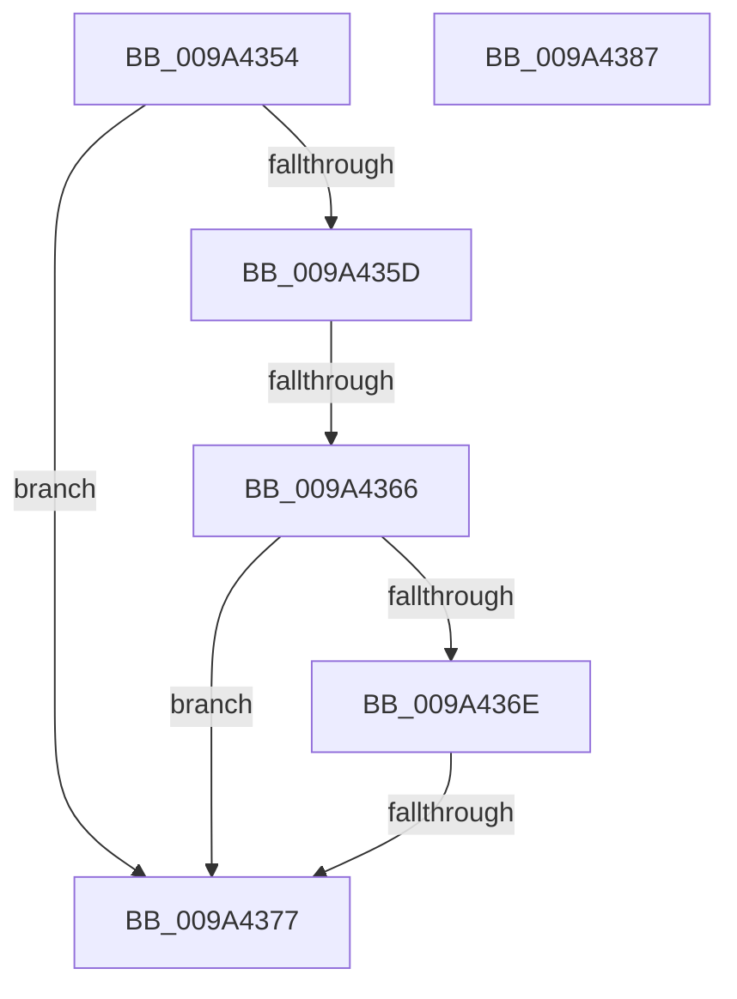

# sub_009A4354

- RVA: `0x009A4354`–`0x009A4388` (길이 `52` bytes)
- VA: `0x00000001409A4354`
- 실행 섹션: `PAGE`
- PDB 이름 있음: `아니요`; PDB Function 태그: `아니요`
- unwind 정보 RVA: `0x0009C4C4`
- 디코드: `19`개 명령, `52/52` bytes 표시
- 미해석 바이트: `0` (있으면 어셈블리에 `.byte`로 보존)

> 이 문서는 커널 이미지의 기계어와 PDB 기호를 분석해 생성했습니다. 4번과 5번은 함수 원형과 자료형을 바이너리 사용 방식에서 추정한 C 해석이며 원본 소스 복구 결과는 아닙니다.

## 1. Dependencies

- 직접 호출 지점: **0**; 고유 호출 대상: **0**
- 직접 호출자로 확인된 함수: **0**
- RIP 상대 이미지 참조: **0**

### Outgoing calls
- 직접 디코드된 call 명령이 없습니다.

### Direct callers
- 이 함수 시작 RVA로 연결되는 직접 call은 확인되지 않았습니다. 간접 호출은 완전히 역산할 수 없습니다.

### Static image references
- 디코드된 RIP-relative 메모리 참조가 없습니다.

## 2. Other-region calls and transfers

- 다른 실행 섹션으로 향하는 call: **0**
- call이 아닌 외부 분기/꼬리 이동: **2**
  - `0x009A4360` → [IoCheckLinkShareAccess + 0x3F](IoCheckLinkShareAccess_function_009A4180.md) (`tail-transfer`)
  - `0x009A4371` → [IoCheckLinkShareAccess + 0x3F](IoCheckLinkShareAccess_function_009A4180.md) (`tail-transfer`)

## 3. Assembly (complete function range)

```asm
009A4354  8B C2                           mov eax, edx
009A4356  83 E0 0C                        and eax, 0xc
009A4359  3C 0C                           cmp al, 0xc
009A435B  75 1A                           jne 0x1409a4377
009A435D  F6 C2 10                        test dl, 0x10
009A4360  0F 85 59 FE FF FF               jne 0x1409a41bf
009A4366  48 83 7C 24 60 00               cmp qword ptr [rsp + 0x60], 0
009A436C  74 09                           je 0x1409a4377
009A436E  F6 C2 40                        test dl, 0x40
009A4371  0F 84 48 FE FF FF               je 0x1409a41bf
009A4377  B8 0D 00 00 C0                  mov eax, 0xc000000d
009A437C  48 83 C4 10                     add rsp, 0x10
009A4380  41 5E                           pop r14
009A4382  5F                              pop rdi
009A4383  5E                              pop rsi
009A4384  5D                              pop rbp
009A4385  5B                              pop rbx
009A4386  C3                              ret
009A4387  CC                              int3
```

## 4. C-style interpretation (structured pseudocode)

```c
__int64 __fastcall sub_009A4354(__int64 a1, int a2, __int64 a3, __int64 a4, __int64 a5, __int64 a6, __int64 a7, __int64 a8, __int64 a9, __int64 a10, __int64 a11, __int64 a12)
{
    __int64 result;
    __int64 v_rsp;

    result = (unsigned int)(((unsigned int)(a2)) & (12));
    if (((unsigned __int8)(result)) != 12) goto loc_009A4377;
    if (a12 == 0) goto loc_009A4377;
loc_009A4377:
    v_rsp = (v_rsp) + (16);
    return (unsigned int)(0xC000000DULL);
}
```

## 5. (Beta) C Style

```c
int64_t sub_009A4354(int64_t Arg1, int32_t Arg2, int64_t Arg3, int64_t Arg4, uint64_t Arg5, uint64_t Arg6, uint64_t Arg7, uint64_t Arg8, uint64_t Arg9, uint64_t Arg10, uint64_t Arg11, int64_t Arg12)
{
    int64_t result;
    int64_t local_rsp;

    result = (uint32_t)(((uint32_t)(Arg2)) & (12));
    if (((uint8_t)(result)) != 12) goto loc_009A4377;
    if (Arg12 == 0) goto loc_009A4377;
loc_009A4377:
    local_rsp = (local_rsp) + (16);
    return (uint32_t)(0xC000000DULL);
}
```

## 6. Execution-region graph

[열기: 2D/3D 그래프와 함수 탐색 컨트롤 패널](../../../control-panel.html?section=page&rva=0x009A4354&view=graph)

- 2D 그래프는 위에서 아래로 흐르고, 3D 그래프는 빈 공간을 드래그해 회전합니다. Shift+드래그는 이동, 휠은 확대·축소, 함수 노드 선택은 대상 보고서 이동입니다.

### Static fallback


