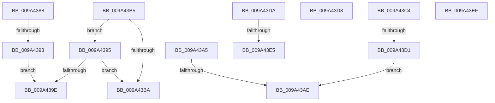

# sub_009A4388

- RVA: `0x009A4388`–`0x009A440B` (길이 `131` bytes)
- VA: `0x00000001409A4388`
- 실행 섹션: `PAGE`
- PDB 이름 있음: `아니요`; PDB Function 태그: `아니요`
- unwind 정보 RVA: `0x0009C4D8`
- 디코드: `33`개 명령, `131/131` bytes 표시
- 미해석 바이트: `0` (있으면 어셈블리에 `.byte`로 보존)

> 이 문서는 커널 이미지의 기계어와 PDB 기호를 분석해 생성했습니다. 4번과 5번은 함수 원형과 자료형을 바이너리 사용 방식에서 추정한 C 해석이며 원본 소스 복구 결과는 아닙니다.

## 1. Dependencies

- 직접 호출 지점: **0**; 고유 호출 대상: **0**
- 직접 호출자로 확인된 함수: **0**
- RIP 상대 이미지 참조: **0**

### Outgoing calls
- 직접 디코드된 call 명령이 없습니다.

### Direct callers
- 이 함수 시작 RVA로 연결되는 직접 call은 확인되지 않았습니다. 간접 호출은 완전히 역산할 수 없습니다.

### Static image references
- 디코드된 RIP-relative 메모리 참조가 없습니다.

## 2. Other-region calls and transfers

- 다른 실행 섹션으로 향하는 call: **0**
- call이 아닌 외부 분기/꼬리 이동: **10**
  - `0x009A438D` → [sub_009A41D2 + 0xDA](Unknown_function_009A41D2.md) (`tail-transfer`)
  - `0x009A43A3` → [sub_009A41D2 + 0x153](Unknown_function_009A41D2.md) (`tail-transfer`)
  - `0x009A43A8` → [sub_009A41D2 + 0xA7](Unknown_function_009A41D2.md) (`tail-transfer`)
  - `0x009A43B0` → [sub_009A41D2 + 0xA9](Unknown_function_009A41D2.md) (`tail-transfer`)
  - `0x009A43BF` → [sub_009A41D2 + 0xDE](Unknown_function_009A41D2.md) (`tail-transfer`)
  - `0x009A43CB` → [sub_009A41D2 + 0x9C](Unknown_function_009A41D2.md) (`tail-transfer`)
  - `0x009A43D5` → [sub_009A41D2 + 0x8B](Unknown_function_009A41D2.md) (`tail-transfer`)
  - `0x009A43DF` → [sub_009A41D2 + 0xE4](Unknown_function_009A41D2.md) (`tail-transfer`)
  - `0x009A43EA` → [sub_009A41D2 + 0x153](Unknown_function_009A41D2.md) (`tail-transfer`)
  - `0x009A4406` → [sub_009A41D2 + 0x3B](Unknown_function_009A41D2.md) (`tail-transfer`)

## 3. Assembly (complete function range)

```asm
009A4388  8B 01                           mov eax, dword ptr [rcx]
009A438A  39 41 08                        cmp dword ptr [rcx + 8], eax
009A438D  0F 83 19 FF FF FF               jae 0x1409a42ac
009A4393  EB 09                           jmp 0x1409a439e
009A4395  41 8B 06                        mov eax, dword ptr [r14]
009A4398  41 39 46 18                     cmp dword ptr [r14 + 0x18], eax
009A439C  73 1C                           jae 0x1409a43ba
009A439E  B8 43 00 00 C0                  mov eax, 0xc0000043
009A43A3  EB 80                           jmp 0x1409a4325
009A43A5  45 85 FF                        test r15d, r15d
009A43A8  0F 85 CB FE FF FF               jne 0x1409a4279
009A43AE  B0 01                           mov al, 1
009A43B0  E9 C6 FE FF FF                  jmp 0x1409a427b
009A43B5  45 85 D2                        test r10d, r10d
009A43B8  75 DB                           jne 0x1409a4395
009A43BA  41 83 7E 0C 00                  cmp dword ptr [r14 + 0xc], 0
009A43BF  E9 EC FE FF FF                  jmp 0x1409a42b0
009A43C4  41 8B 06                        mov eax, dword ptr [r14]
009A43C7  41 39 46 14                     cmp dword ptr [r14 + 0x14], eax
009A43CB  0F 83 9D FE FF FF               jae 0x1409a426e
009A43D1  EB DB                           jmp 0x1409a43ae
009A43D3  B0 01                           mov al, 1
009A43D5  E9 83 FE FF FF                  jmp 0x1409a425d
009A43DA  83 7C 24 40 00                  cmp dword ptr [rsp + 0x40], 0
009A43DF  0F 85 D1 FE FF FF               jne 0x1409a42b6
009A43E5  B8 43 00 00 C0                  mov eax, 0xc0000043
009A43EA  E9 36 FF FF FF                  jmp 0x1409a4325
009A43EF  40 84 ED                        test bpl, bpl
009A43F2  40 0F B6 C5                     movzx eax, bpl
009A43F6  C7 44 24 58 01 00 00 00         mov dword ptr [rsp + 0x58], 1
009A43FE  0F 44 44 24 58                  cmove eax, dword ptr [rsp + 0x58]
009A4403  0F B6 E8                        movzx ebp, al
009A4406  E9 02 FE FF FF                  jmp 0x1409a420d
```

## 4. C-style interpretation (structured pseudocode)

```c
__int64 __fastcall sub_009A4388(__int64 a1)
{
    unsigned int v_stack_p40;
    unsigned int v_stack_p58;

    goto loc_009A439E;
loc_009A439E:
}
```

## 5. (Beta) C Style

```c
int64_t sub_009A4388(void *Arg1)
{
    uint8_t *arg1 = (uint8_t *)Arg1;

    uint32_t v_stack_p40;
    uint32_t v_stack_p58;

    goto loc_009A439E;
loc_009A439E:
}
```

### 관측된 메모리 오프셋

구조체 형식이 확인되지 않은 접근은 인자 기준의 오프셋으로만 기록했습니다.

| 기준 인자 | 오프셋 표현 | 폭 (bit) | 접근 |
|---|---:|---:|---|
| `Arg1` | `+ 0x0` | `32` | `R` |
| `Arg1` | `+ 0x8` | `32` | `R` |

## 6. Execution-region graph

[열기: 2D/3D 그래프와 함수 탐색 컨트롤 패널](../../../control-panel.html?section=page&rva=0x009A4388&view=graph)

- 2D 그래프는 위에서 아래로 흐르고, 3D 그래프는 빈 공간을 드래그해 회전합니다. Shift+드래그는 이동, 휠은 확대·축소, 함수 노드 선택은 대상 보고서 이동입니다.

### Static fallback


