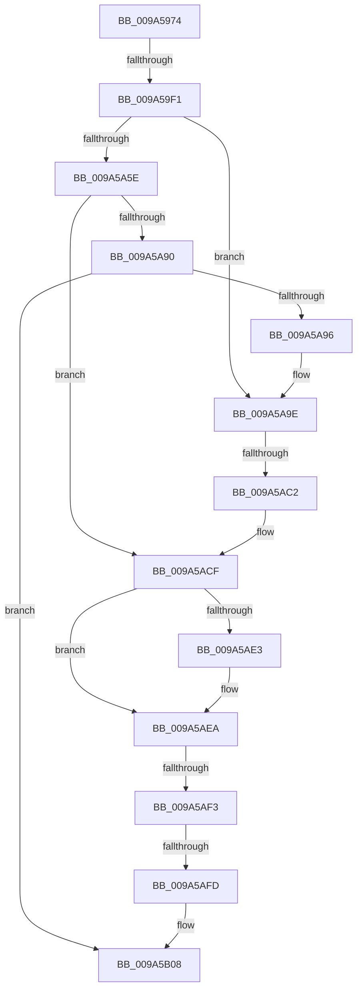

# sub_009A5974

- RVA: `0x009A5974`–`0x009A5B10` (길이 `412` bytes)
- VA: `0x00000001409A5974`
- 실행 섹션: `PAGE`
- PDB 이름 있음: `아니요`; PDB Function 태그: `아니요`
- unwind 정보 RVA: `0x0009C668`
- 디코드: `96`개 명령, `412/412` bytes 표시
- 미해석 바이트: `0` (있으면 어셈블리에 `.byte`로 보존)

> 이 문서는 커널 이미지의 기계어와 PDB 기호를 분석해 생성했습니다. 4번과 5번은 함수 원형과 자료형을 바이너리 사용 방식에서 추정한 C 해석이며 원본 소스 복구 결과는 아닙니다.

## 1. Dependencies

- 직접 호출 지점: **8**; 고유 호출 대상: **8**
- 직접 호출자로 확인된 함수: **0**
- RIP 상대 이미지 참조: **1**

### Outgoing calls
- `0x009A597F` → [IopIncrementDeviceObjectRefCount](../../text/41/IopIncrementDeviceObjectRefCount_function_0041B1D0.md) (function, `0x0041B1D0`)
- `0x009A59DF` → [ObCreateObjectEx](../89/ObCreateObjectEx_function_0089B1E0.md) (function, `0x0089B1E0`)
- `0x009A59FB` → [memset](../../text/6C/memset_function_006C6C40.md) (function, `0x006C6C40`)
- `0x009A5A38` → [KeInitializeEvent](../../text/40/KeInitializeEvent_function_0040DD10.md) (function, `0x0040DD10`)
- `0x009A5A84` → [ObInsertObjectEx](../8B/ObInsertObjectEx_function_008B97A0.md) (function, `0x008B97A0`)
- `0x009A5A98` → [RtlRaiseStatus](../../text/2F/RtlRaiseStatus_function_002F6A50.md) (function, `0x002F6A50`)
- `0x009A5AC2` → [ExpInterlockedPushEntrySList](../../text/6B/ExpInterlockedPushEntrySList_function_006BA5B0.md) (function, `0x006BA5B0`)
- `0x009A5AE5` → [IopIncrementVpbRefCount](../../text/27/IopIncrementVpbRefCount_function_00272820.md) (function, `0x00272820`)

### Direct callers
- 이 함수 시작 RVA로 연결되는 직접 call은 확인되지 않았습니다. 간접 호출은 완전히 역산할 수 없습니다.

### Static image references
- `0x009A5984` → RVA `0x00FC6AE0` (`ALMOSTRO`; read)

## 2. Other-region calls and transfers

- 다른 실행 섹션으로 향하는 call: **6**
  - `0x009A597F` → [IopIncrementDeviceObjectRefCount](../../text/41/IopIncrementDeviceObjectRefCount_function_0041B1D0.md) (`PAGE` → `.text`)
  - `0x009A59FB` → [memset](../../text/6C/memset_function_006C6C40.md) (`PAGE` → `.text`)
  - `0x009A5A38` → [KeInitializeEvent](../../text/40/KeInitializeEvent_function_0040DD10.md) (`PAGE` → `.text`)
  - `0x009A5A98` → [RtlRaiseStatus](../../text/2F/RtlRaiseStatus_function_002F6A50.md) (`PAGE` → `.text`)
  - `0x009A5AC2` → [ExpInterlockedPushEntrySList](../../text/6B/ExpInterlockedPushEntrySList_function_006BA5B0.md) (`PAGE` → `.text`)
  - `0x009A5AE5` → [IopIncrementVpbRefCount](../../text/27/IopIncrementVpbRefCount_function_00272820.md) (`PAGE` → `.text`)
- call이 아닌 외부 분기/꼬리 이동: **4**
  - `0x009A59EB` → [sub_009A5B88](Unknown_function_009A5B88.md) (`tail-transfer`)
  - `0x009A5AC0` → [sub_009A5B41](Unknown_function_009A5B41.md) (`tail-transfer`)
  - `0x009A5AED` → [sub_009A5B88 + 0x1E](Unknown_function_009A5B88.md) (`tail-transfer`)
  - `0x009A5AF7` → [sub_009A5BCF + 0x1F](Unknown_function_009A5BCF.md) (`tail-transfer`)

## 3. Assembly (complete function range)

```asm
009A5974  4C 89 BC 24 C8 00 00 00         mov qword ptr [rsp + 0xc8], r15
009A597C  48 8B CE                        mov rcx, rsi
009A597F  E8 4C 58 A7 FF                  call 0x14041b1d0
009A5984  48 8B 15 55 11 62 00            mov rdx, qword ptr [rip + 0x621155]
009A598B  48 8D 45 60                     lea rax, [rbp + 0x60]
009A598F  48 89 44 24 48                  mov qword ptr [rsp + 0x48], rax
009A5994  4C 8D 45 D0                     lea r8, [rbp - 0x30]
009A5998  48 8D 45 40                     lea rax, [rbp + 0x40]
009A599C  66 44 89 6D 60                  mov word ptr [rbp + 0x60], r13w
009A59A1  48 89 44 24 40                  mov qword ptr [rsp + 0x40], rax
009A59A6  0F 57 C0                        xorps xmm0, xmm0
009A59A9  B8 D8 00 00 00                  mov eax, 0xd8
009A59AE  44 89 6C 24 38                  mov dword ptr [rsp + 0x38], r13d
009A59B3  89 44 24 30                     mov dword ptr [rsp + 0x30], eax
009A59B7  45 33 C9                        xor r9d, r9d
009A59BA  33 C9                           xor ecx, ecx
009A59BC  89 44 24 28                     mov dword ptr [rsp + 0x28], eax
009A59C0  C7 45 D0 30 00 00 00            mov dword ptr [rbp - 0x30], 0x30
009A59C7  4C 89 6D D8                     mov qword ptr [rbp - 0x28], r13
009A59CB  C7 45 E8 00 02 00 00            mov dword ptr [rbp - 0x18], 0x200
009A59D2  4C 89 6D E0                     mov qword ptr [rbp - 0x20], r13
009A59D6  F3 0F 7F 45 F0                  movdqu xmmword ptr [rbp - 0x10], xmm0
009A59DB  C6 45 60 01                     mov byte ptr [rbp + 0x60], 1
009A59DF  E8 FC 57 EF FF                  call 0x14089b1e0
009A59E4  33 D2                           xor edx, edx
009A59E6  44 8B F8                        mov r15d, eax
009A59E9  85 C0                           test eax, eax
009A59EB  0F 88 97 01 00 00               js 0x1409a5b88
009A59F1  48 8B 4D 40                     mov rcx, qword ptr [rbp + 0x40]
009A59F5  41 B8 D8 00 00 00               mov r8d, 0xd8
009A59FB  E8 40 12 D2 FF                  call 0x1406c6c40
009A5A00  48 8B 45 40                     mov rax, qword ptr [rbp + 0x40]
009A5A04  45 33 C0                        xor r8d, r8d
009A5A07  66 C7 00 05 00                  mov word ptr [rax], 5
009A5A0C  41 8D 50 01                     lea edx, [r8 + 1]
009A5A10  48 8B 45 40                     mov rax, qword ptr [rbp + 0x40]
009A5A14  66 C7 40 02 D8 00               mov word ptr [rax + 2], 0xd8
009A5A1A  48 8B 45 40                     mov rax, qword ptr [rbp + 0x40]
009A5A1E  48 89 70 08                     mov qword ptr [rax + 8], rsi
009A5A22  48 8B 45 40                     mov rax, qword ptr [rbp + 0x40]
009A5A26  C7 40 50 00 01 00 00            mov dword ptr [rax + 0x50], 0x100
009A5A2D  48 8B 4D 40                     mov rcx, qword ptr [rbp + 0x40]
009A5A31  48 81 C1 98 00 00 00            add rcx, 0x98
009A5A38  E8 D3 82 A6 FF                  call 0x14040dd10
009A5A3D  48 8B 45 40                     mov rax, qword ptr [rbp + 0x40]
009A5A41  4C 89 A8 B8 00 00 00            mov qword ptr [rax + 0xb8], r13
009A5A48  48 8B 45 40                     mov rax, qword ptr [rbp + 0x40]
009A5A4C  48 05 C0 00 00 00               add rax, 0xc0
009A5A52  48 89 40 08                     mov qword ptr [rax + 8], rax
009A5A56  48 89 00                        mov qword ptr [rax], rax
009A5A59  66 85 DB                        test bx, bx
009A5A5C  75 40                           jne 0x1409a5a9e
009A5A5E  48 8B 4D 40                     mov rcx, qword ptr [rbp + 0x40]
009A5A62  48 8D 45 58                     lea rax, [rbp + 0x58]
009A5A66  48 89 44 24 30                  mov qword ptr [rsp + 0x30], rax
009A5A6B  41 B9 01 00 00 00               mov r9d, 1
009A5A71  48 8D 45 40                     lea rax, [rbp + 0x40]
009A5A75  33 D2                           xor edx, edx
009A5A77  48 89 44 24 28                  mov qword ptr [rsp + 0x28], rax
009A5A7C  45 8B C1                        mov r8d, r9d
009A5A7F  44 89 6C 24 20                  mov dword ptr [rsp + 0x20], r13d
009A5A84  E8 17 3D F1 FF                  call 0x1408b97a0
009A5A89  44 8B F8                        mov r15d, eax
009A5A8C  85 C0                           test eax, eax
009A5A8E  79 3F                           jns 0x1409a5acf
009A5A90  F6 47 02 01                     test byte ptr [rdi + 2], 1
009A5A94  74 72                           je 0x1409a5b08
009A5A96  8B C8                           mov ecx, eax
009A5A98  E8 B3 0F 95 FF                  call 0x1402f6a50
009A5A9D  CC                              int3
009A5A9E  65 4C 8B 04 25 20 00 00 00      mov r8, qword ptr gs:[0x20]
009A5AA7  48 8B 45 40                     mov rax, qword ptr [rbp + 0x40]
009A5AAB  49 8B 88 40 08 00 00            mov rcx, qword ptr [r8 + 0x840]
009A5AB2  48 8B 50 F0                     mov rdx, qword ptr [rax - 0x10]
009A5AB6  FF 41 1C                        inc dword ptr [rcx + 0x1c]
009A5AB9  0F B7 41 10                     movzx eax, word ptr [rcx + 0x10]
009A5ABD  66 39 01                        cmp word ptr [rcx], ax
009A5AC0  73 7F                           jae 0x1409a5b41
009A5AC2  E8 E9 4A D1 FF                  call 0x1406ba5b0
009A5AC7  48 8B 45 40                     mov rax, qword ptr [rbp + 0x40]
009A5ACB  4C 89 68 F0                     mov qword ptr [rax - 0x10], r13
009A5ACF  48 8B 45 40                     mov rax, qword ptr [rbp + 0x40]
009A5AD3  81 48 50 00 00 04 00            or dword ptr [rax + 0x50], 0x40000
009A5ADA  48 8B 4E 38                     mov rcx, qword ptr [rsi + 0x38]
009A5ADE  48 85 C9                        test rcx, rcx
009A5AE1  74 07                           je 0x1409a5aea
009A5AE3  B2 01                           mov dl, 1
009A5AE5  E8 36 CD 8C FF                  call 0x140272820
009A5AEA  66 85 DB                        test bx, bx
009A5AED  0F 84 B3 00 00 00               je 0x1409a5ba6
009A5AF3  4C 39 6F 08                     cmp qword ptr [rdi + 8], r13
009A5AF7  0F 85 F1 00 00 00               jne 0x1409a5bee
009A5AFD  48 8B 45 40                     mov rax, qword ptr [rbp + 0x40]
009A5B01  49 89 04 24                     mov qword ptr [r12], rax
009A5B05  41 8B C7                        mov eax, r15d
009A5B08  4C 8B BC 24 C8 00 00 00         mov r15, qword ptr [rsp + 0xc8]
```

## 4. C-style interpretation (structured pseudocode)

```c
__int64 __fastcall sub_009A5974(__int64 a1, __int64 a2, __int64 a3, int a4, __int64 a5, __int64 a6, __int64 a7, __int64 a8, __int64 a9, __int64 a10, __int64 a11, __int64 a12, __int64 a13, __int64 a14, __int64 a15, __int64 a16, __int64 a17, __int64 a18, __int64 a19, __int64 a20, __int64 a21, __int64 a22, __int64 a23, __int64 a24, __int64 a25)
{
    __int64 result;
    unsigned int v_stack_p20;
    unsigned int v_stack_p28;
    unsigned int v_stack_p30;
    unsigned int v_stack_p38;
    unsigned __int64 v_stack_p40;
    unsigned __int64 v_stack_p48;
    unsigned __int64 v_stack_pC8;

    v_stack_pC8 = v_r15;
    result = IopIncrementDeviceObjectRefCount(v_rsi, a2, a3, a4);
    v_stack_p48 = v_rbp + 96;
    *(unsigned __int16 *)(v_rbp + 96) = (unsigned __int16)(v_r13);
    v_stack_p40 = v_rbp + 64;
    v_stack_p38 = (unsigned int)(v_r13);
    v_stack_p30 = 216;
    a4 = 0;
    a1 = 0;
    v_stack_p28 = 216;
    *(unsigned int *)(v_rbp - 48) = 48;
    *(unsigned __int64 *)(v_rbp - 40) = v_r13;
    *(unsigned int *)(v_rbp - 24) = 512;
    *(unsigned __int64 *)(v_rbp - 32) = v_r13;
    *(unsigned __int64 *)(v_rbp - 16) = v_xmm0;
    *(unsigned __int8 *)(v_rbp + 96) = 1;
    result = ObCreateObjectEx(a1, *(unsigned __int64 *)(v_rip + 6426965), v_rbp - 48, a4);
    a2 = 0;
    result = memset(*(unsigned __int64 *)(v_rbp + 64), a2, 216, a4);
    a3 = 0;
    *(unsigned __int16 *)(*(unsigned __int64 *)(v_rbp + 64)) = 5;
    *(unsigned __int16 *)(*(unsigned __int64 *)(v_rbp + 64) + 2) = 216;
    *(unsigned __int64 *)(*(unsigned __int64 *)(v_rbp + 64) + 8) = v_rsi;
    *(unsigned int *)(*(unsigned __int64 *)(v_rbp + 64) + 80) = 256;
    a1 = (*(unsigned __int64 *)(v_rbp + 64)) + (152);
    result = KeInitializeEvent(a1, a3 + 1, a3, a4);
    *(unsigned __int64 *)(*(unsigned __int64 *)(v_rbp + 64) + 184) = v_r13;
    result = (*(unsigned __int64 *)(v_rbp + 64)) + (192);
    *(unsigned __int64 *)(result + 8) = result;
    *(unsigned __int64 *)(result) = result;
    if ((unsigned __int16)(v_rbx) != 0) goto loc_009A5A9E;
    v_stack_p30 = v_rbp + 88;
    a2 = 0;
    v_stack_p28 = v_rbp + 64;
    v_stack_p20 = (unsigned int)(v_r13);
    result = ObInsertObjectEx(*(unsigned __int64 *)(v_rbp + 64), a2, 1, 1);
    if (!sign_flag) goto loc_009A5ACF;
    if (((*(unsigned __int8 *)(v_rdi + 2)) & (1)) == 0) goto loc_009A5B08;
    result = RtlRaiseStatus((unsigned int)((unsigned int)(result)), a2, 1, 1);
loc_009A5A9E:
    result = ExpInterlockedPushEntrySList(*(unsigned __int64 *)(*(unsigned __int64 *)(gs_base + (0 + 32)) + 2112), *(unsigned __int64 *)(*(unsigned __int64 *)(v_rbp + 64) - 16), *(unsigned __int64 *)(gs_base + (0 + 32)), 1);
    *(unsigned __int64 *)(*(unsigned __int64 *)(v_rbp + 64) - 16) = v_r13;
loc_009A5ACF:
    result = *(unsigned __int64 *)(v_rbp + 64);
    if (*(unsigned __int64 *)(v_rsi + 56) != 0) {
        a2 = 1;
        result = IopIncrementVpbRefCount(*(unsigned __int64 *)(v_rsi + 56), a2, *(unsigned __int64 *)(gs_base + (0 + 32)), 1);
    }
    *(unsigned __int64 *)(v_r12) = *(unsigned __int64 *)(v_rbp + 64);
loc_009A5B08:
    return (unsigned int)((unsigned int)((unsigned int)((unsigned int)(result))));
}
```

## 5. (Beta) C Style

```c
int64_t sub_009A5974(int64_t Arg1, int64_t Arg2, int64_t Arg3, int32_t Arg4, uint64_t Arg5, uint64_t Arg6, uint64_t Arg7, uint64_t Arg8, uint64_t Arg9, uint64_t Arg10, uint64_t Arg11, uint64_t Arg12, uint64_t Arg13, uint64_t Arg14, uint64_t Arg15, uint64_t Arg16, uint64_t Arg17, uint64_t Arg18, uint64_t Arg19, uint64_t Arg20, uint64_t Arg21, uint64_t Arg22, uint64_t Arg23, uint64_t Arg24, int64_t Arg25)
{
    int64_t result;
    uint32_t v_stack_p20;
    uint32_t v_stack_p28;
    uint32_t v_stack_p30;
    uint32_t v_stack_p38;
    uint64_t v_stack_p40;
    uint64_t v_stack_p48;
    uint64_t v_stack_pC8;

    v_stack_pC8 = local_r15;
    result = IopIncrementDeviceObjectRefCount(local_rsi, Arg2, Arg3, Arg4);
    v_stack_p48 = local_rbp + 96;
    *(uint16_t *)(local_rbp + 0x60) = (uint16_t)(local_r13);
    v_stack_p40 = local_rbp + 64;
    v_stack_p38 = (uint32_t)(local_r13);
    v_stack_p30 = 216;
    Arg4 = 0;
    Arg1 = 0;
    v_stack_p28 = 216;
    *(uint32_t *)(local_rbp - 0x30) = 48;
    *(uint64_t *)(local_rbp - 0x28) = local_r13;
    *(uint32_t *)(local_rbp - 0x18) = 512;
    *(uint64_t *)(local_rbp - 0x20) = local_r13;
    *(uint64_t *)(local_rbp - 0x10) = v_xmm0;
    *(uint8_t *)(local_rbp + 0x60) = 1;
    result = ObCreateObjectEx(Arg1, *(uint64_t *)(v_rip + 0x621155), local_rbp - 48, Arg4);
    Arg2 = 0;
    result = memset(*(uint64_t *)(local_rbp + 0x40), Arg2, 216, Arg4);
    Arg3 = 0;
    *(uint16_t *)(*(uint64_t *)(local_rbp + 0x40)) = 5;
    *(uint16_t *)(*(uint64_t *)(local_rbp + 0x40) + 0x2) = 216;
    *(uint64_t *)(*(uint64_t *)(local_rbp + 0x40) + 0x8) = local_rsi;
    *(uint32_t *)(*(uint64_t *)(local_rbp + 0x40) + 0x50) = 256;
    Arg1 = (*(uint64_t *)(local_rbp + 0x40)) + (152);
    result = KeInitializeEvent(Arg1, Arg3 + 1, Arg3, Arg4);
    *(uint64_t *)(*(uint64_t *)(local_rbp + 0x40) + 0xB8) = local_r13;
    result = (*(uint64_t *)(local_rbp + 0x40)) + (192);
    *(uint64_t *)(result + 0x8) = result;
    *(uint64_t *)(result) = result;
    if ((uint16_t)(local_rbx) != 0) goto loc_009A5A9E;
    v_stack_p30 = local_rbp + 88;
    Arg2 = 0;
    v_stack_p28 = local_rbp + 64;
    v_stack_p20 = (uint32_t)(local_r13);
    result = ObInsertObjectEx(*(uint64_t *)(local_rbp + 0x40), Arg2, 1, 1);
    if (!sign_flag) goto loc_009A5ACF;
    if (((*(uint8_t *)(local_rdi + 0x2)) & (1)) == 0) goto loc_009A5B08;
    result = RtlRaiseStatus((uint32_t)((uint32_t)(result)), Arg2, 1, 1);
loc_009A5A9E:
    result = ExpInterlockedPushEntrySList(*(uint64_t *)(*(uint64_t *)(gs_base + (0 + 0x20)) + 0x840), *(uint64_t *)(*(uint64_t *)(local_rbp + 0x40) - 0x10), *(uint64_t *)(gs_base + (0 + 0x20)), 1);
    *(uint64_t *)(*(uint64_t *)(local_rbp + 0x40) - 0x10) = local_r13;
loc_009A5ACF:
    result = *(uint64_t *)(local_rbp + 0x40);
    if (*(uint64_t *)(local_rsi + 0x38) != 0) {
        Arg2 = 1;
        result = IopIncrementVpbRefCount(*(uint64_t *)(local_rsi + 0x38), Arg2, *(uint64_t *)(gs_base + (0 + 0x20)), 1);
    }
    *(uint64_t *)(local_r12) = *(uint64_t *)(local_rbp + 0x40);
loc_009A5B08:
    return (uint32_t)((uint32_t)((uint32_t)((uint32_t)(result))));
}
```

## 6. Execution-region graph

[열기: 2D/3D 그래프와 함수 탐색 컨트롤 패널](../../../control-panel.html?section=page&rva=0x009A5974&view=graph)

- 2D 그래프는 위에서 아래로 흐르고, 3D 그래프는 빈 공간을 드래그해 회전합니다. Shift+드래그는 이동, 휠은 확대·축소, 함수 노드 선택은 대상 보고서 이동입니다.

### Static fallback


