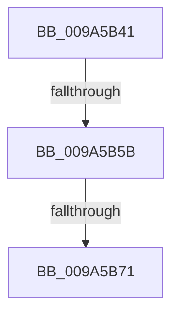

# sub_009A5B41

- RVA: `0x009A5B41`–`0x009A5B7B` (길이 `58` bytes)
- VA: `0x00000001409A5B41`
- 실행 섹션: `PAGE`
- PDB 이름 있음: `아니요`; PDB Function 태그: `아니요`
- unwind 정보 RVA: `0x0009C690`
- 디코드: `14`개 명령, `58/58` bytes 표시
- 미해석 바이트: `0` (있으면 어셈블리에 `.byte`로 보존)

> 이 문서는 커널 이미지의 기계어와 PDB 기호를 분석해 생성했습니다. 4번과 5번은 함수 원형과 자료형을 바이너리 사용 방식에서 추정한 C 해석이며 원본 소스 복구 결과는 아닙니다.

## 1. Dependencies

- 직접 호출 지점: **1**; 고유 호출 대상: **1**
- 직접 호출자로 확인된 함수: **0**
- RIP 상대 이미지 참조: **1**

### Outgoing calls
- `0x009A5B71` → [ExFreePool](../../poolcode/B8/ExFreePool_function_00B82850.md) (function, `0x00B82850`)

### Direct callers
- 이 함수 시작 RVA로 연결되는 직접 call은 확인되지 않았습니다. 간접 호출은 완전히 역산할 수 없습니다.

### Static image references
- `0x009A5B62` → RVA `0x00B82850` (`ExFreePool`; read)

## 2. Other-region calls and transfers

- 다른 실행 섹션으로 향하는 call: **1**
  - `0x009A5B71` → [ExFreePool](../../poolcode/B8/ExFreePool_function_00B82850.md) (`PAGE` → `POOLCODE`)
- call이 아닌 외부 분기/꼬리 이동: **3**
  - `0x009A5B55` → [sub_009A5974 + 0x14E](Unknown_function_009A5974.md) (`tail-transfer`)
  - `0x009A5B6F` → [sub_009A5BCF](Unknown_function_009A5BCF.md) (`tail-transfer`)
  - `0x009A5B76` → [sub_009A5974 + 0x153](Unknown_function_009A5974.md) (`tail-transfer`)

## 3. Assembly (complete function range)

```asm
009A5B41  FF 41 20                        inc dword ptr [rcx + 0x20]
009A5B44  49 8B 88 48 08 00 00            mov rcx, qword ptr [r8 + 0x848]
009A5B4B  FF 41 1C                        inc dword ptr [rcx + 0x1c]
009A5B4E  0F B7 41 10                     movzx eax, word ptr [rcx + 0x10]
009A5B52  66 39 01                        cmp word ptr [rcx], ax
009A5B55  0F 82 67 FF FF FF               jb 0x1409a5ac2
009A5B5B  FF 41 20                        inc dword ptr [rcx + 0x20]
009A5B5E  48 8B 41 38                     mov rax, qword ptr [rcx + 0x38]
009A5B62  48 8D 0D E7 CC 1D 00            lea rcx, [rip + 0x1dcce7]
009A5B69  48 3B C1                        cmp rax, rcx
009A5B6C  48 8B CA                        mov rcx, rdx
009A5B6F  75 5E                           jne 0x1409a5bcf
009A5B71  E8 DA CC 1D 00                  call 0x140b82850
009A5B76  E9 4C FF FF FF                  jmp 0x1409a5ac7
```

## 4. C-style interpretation (structured pseudocode)

```c
__int64 __fastcall sub_009A5B41(__int64 a1, __int64 a2, __int64 a3)
{
    __int64 result;

    result = ExFreePool(a2, a2, a3, a4);
}
```

## 5. (Beta) C Style

```c
int64_t sub_009A5B41(void *Arg1, int64_t Arg2, void *Arg3)
{
    uint8_t *arg1 = (uint8_t *)Arg1;
    uint8_t *arg3 = (uint8_t *)Arg3;

    int64_t result;

    result = ExFreePool(Arg2, Arg2, Arg3, a4);
}
```

### 관측된 메모리 오프셋

구조체 형식이 확인되지 않은 접근은 인자 기준의 오프셋으로만 기록했습니다.

| 기준 인자 | 오프셋 표현 | 폭 (bit) | 접근 |
|---|---:|---:|---|
| `Arg1` | `+ 0x20` | `32` | `R/W` |
| `Arg3` | `+ 0x848` | `64` | `R` |

## 6. Execution-region graph

[열기: 2D/3D 그래프와 함수 탐색 컨트롤 패널](../../../control-panel.html?section=page&rva=0x009A5B41&view=graph)

- 2D 그래프는 위에서 아래로 흐르고, 3D 그래프는 빈 공간을 드래그해 회전합니다. Shift+드래그는 이동, 휠은 확대·축소, 함수 노드 선택은 대상 보고서 이동입니다.

### Static fallback


