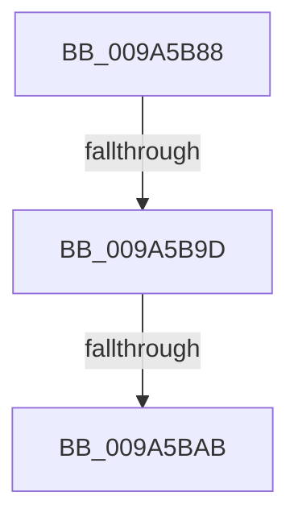

# sub_009A5B88

- RVA: `0x009A5B88`–`0x009A5BBB` (길이 `51` bytes)
- VA: `0x00000001409A5B88`
- 실행 섹션: `PAGE`
- PDB 이름 있음: `아니요`; PDB Function 태그: `아니요`
- unwind 정보 RVA: `0x0009C6B4`
- 디코드: `14`개 명령, `51/51` bytes 표시
- 미해석 바이트: `0` (있으면 어셈블리에 `.byte`로 보존)

> 이 문서는 커널 이미지의 기계어와 PDB 기호를 분석해 생성했습니다. 4번과 5번은 함수 원형과 자료형을 바이너리 사용 방식에서 추정한 C 해석이며 원본 소스 복구 결과는 아닙니다.

## 1. Dependencies

- 직접 호출 지점: **3**; 고유 호출 대상: **3**
- 직접 호출자로 확인된 함수: **0**
- RIP 상대 이미지 참조: **0**

### Outgoing calls
- `0x009A5B8E` → [IopDecrementDeviceObjectRef](../../text/27/IopDecrementDeviceObjectRef_function_00270970.md) (function, `0x00270970`)
- `0x009A5BA0` → [RtlRaiseStatus](../../text/2F/RtlRaiseStatus_function_002F6A50.md) (function, `0x002F6A50`)
- `0x009A5BB1` → [ObCloseHandle](../8A/ObCloseHandle_function_008A1870.md) (function, `0x008A1870`)

### Direct callers
- 이 함수 시작 RVA로 연결되는 직접 call은 확인되지 않았습니다. 간접 호출은 완전히 역산할 수 없습니다.

### Static image references
- 디코드된 RIP-relative 메모리 참조가 없습니다.

## 2. Other-region calls and transfers

- 다른 실행 섹션으로 향하는 call: **2**
  - `0x009A5B8E` → [IopDecrementDeviceObjectRef](../../text/27/IopDecrementDeviceObjectRef_function_00270970.md) (`PAGE` → `.text`)
  - `0x009A5BA0` → [RtlRaiseStatus](../../text/2F/RtlRaiseStatus_function_002F6A50.md) (`PAGE` → `.text`)
- call이 아닌 외부 분기/꼬리 이동: **3**
  - `0x009A5B97` → [sub_009A5974 + 0x191](Unknown_function_009A5974.md) (`tail-transfer`)
  - `0x009A5BA9` → [sub_009A5BCF + 0xA](Unknown_function_009A5BCF.md) (`tail-transfer`)
  - `0x009A5BB6` → [sub_009A5974 + 0x17F](Unknown_function_009A5974.md) (`tail-transfer`)

## 3. Assembly (complete function range)

```asm
009A5B88  45 33 C0                        xor r8d, r8d
009A5B8B  48 8B CE                        mov rcx, rsi
009A5B8E  E8 DD AD 8C FF                  call 0x140270970
009A5B93  F6 47 02 01                     test byte ptr [rdi + 2], 1
009A5B97  0F 84 68 FF FF FF               je 0x1409a5b05
009A5B9D  41 8B CF                        mov ecx, r15d
009A5BA0  E8 AB 0E 95 FF                  call 0x1402f6a50
009A5BA5  CC                              int3
009A5BA6  4D 85 F6                        test r14, r14
009A5BA9  75 2E                           jne 0x1409a5bd9
009A5BAB  48 8B 4D 58                     mov rcx, qword ptr [rbp + 0x58]
009A5BAF  33 D2                           xor edx, edx
009A5BB1  E8 BA BC EF FF                  call 0x1408a1870
009A5BB6  E9 38 FF FF FF                  jmp 0x1409a5af3
```

## 4. C-style interpretation (structured pseudocode)

```c
__int64 __fastcall sub_009A5B88(__int64 a1, int a2, int a3)
{
    __int64 result;

    a3 = 0;
    result = IopDecrementDeviceObjectRef(v_rsi, a2, a3, a4);
    result = RtlRaiseStatus((unsigned int)((unsigned int)(v_r15)), a2, a3, a4);
    a2 = 0;
    result = ObCloseHandle(*(unsigned __int64 *)(v_rbp + 88), a2, a3, a4);
}
```

## 5. (Beta) C Style

```c
int64_t sub_009A5B88(int64_t Arg1, int32_t Arg2, int32_t Arg3)
{
    int64_t result;

    Arg3 = 0;
    result = IopDecrementDeviceObjectRef(local_rsi, Arg2, Arg3, a4);
    result = RtlRaiseStatus((uint32_t)((uint32_t)(local_r15)), Arg2, Arg3, a4);
    Arg2 = 0;
    result = ObCloseHandle(*(uint64_t *)(local_rbp + 0x58), Arg2, Arg3, a4);
}
```

## 6. Execution-region graph

[열기: 2D/3D 그래프와 함수 탐색 컨트롤 패널](../../../control-panel.html?section=page&rva=0x009A5B88&view=graph)

- 2D 그래프는 위에서 아래로 흐르고, 3D 그래프는 빈 공간을 드래그해 회전합니다. Shift+드래그는 이동, 휠은 확대·축소, 함수 노드 선택은 대상 보고서 이동입니다.

### Static fallback


