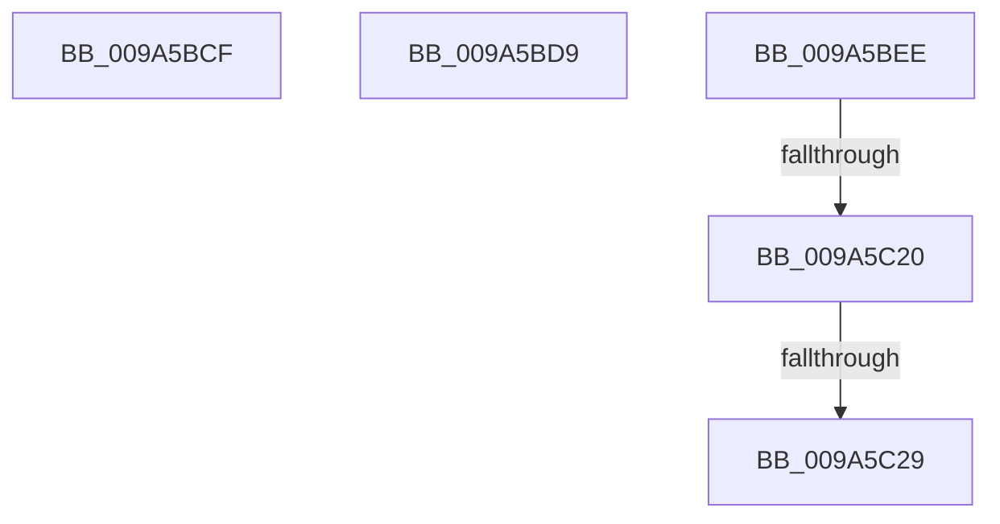

# sub_009A5BCF

- RVA: `0x009A5BCF`–`0x009A5C3B` (길이 `108` bytes)
- VA: `0x00000001409A5BCF`
- 실행 섹션: `PAGE`
- PDB 이름 있음: `아니요`; PDB Function 태그: `아니요`
- unwind 정보 RVA: `0x0009C6D8`
- 디코드: `26`개 명령, `108/108` bytes 표시
- 미해석 바이트: `0` (있으면 어셈블리에 `.byte`로 보존)

> 이 문서는 커널 이미지의 기계어와 PDB 기호를 분석해 생성했습니다. 4번과 5번은 함수 원형과 자료형을 바이너리 사용 방식에서 추정한 C 해석이며 원본 소스 복구 결과는 아닙니다.

## 1. Dependencies

- 직접 호출 지점: **4**; 고유 호출 대상: **4**
- 직접 호출자로 확인된 함수: **0**
- RIP 상대 이미지 참조: **0**

### Outgoing calls
- `0x009A5BCF` → [guard_dispatch_icall](../../text/6B/guard_dispatch_icall_function_006BAAD0.md) (function, `0x006BAAD0`)
- `0x009A5BE4` → [ObfDereferenceObject](../../text/2F/ObfDereferenceObject_function_002F9350.md) (function, `0x002F9350`)
- `0x009A5C10` → [IopGetSetSpecificExtension](../../text/42/IopGetSetSpecificExtension_function_0042EE80.md) (function, `0x0042EE80`)
- `0x009A5C2E` → [ObCloseHandle](../8A/ObCloseHandle_function_008A1870.md) (function, `0x008A1870`)

### Direct callers
- 이 함수 시작 RVA로 연결되는 직접 call은 확인되지 않았습니다. 간접 호출은 완전히 역산할 수 없습니다.

### Static image references
- 디코드된 RIP-relative 메모리 참조가 없습니다.

## 2. Other-region calls and transfers

- 다른 실행 섹션으로 향하는 call: **3**
  - `0x009A5BCF` → [guard_dispatch_icall](../../text/6B/guard_dispatch_icall_function_006BAAD0.md) (`PAGE` → `.text`)
  - `0x009A5BE4` → [ObfDereferenceObject](../../text/2F/ObfDereferenceObject_function_002F9350.md) (`PAGE` → `.text`)
  - `0x009A5C10` → [IopGetSetSpecificExtension](../../text/42/IopGetSetSpecificExtension_function_0042EE80.md) (`PAGE` → `.text`)
- call이 아닌 외부 분기/꼬리 이동: **5**
  - `0x009A5BD4` → [sub_009A5974 + 0x153](Unknown_function_009A5974.md) (`tail-transfer`)
  - `0x009A5BE9` → [sub_009A5974 + 0x17F](Unknown_function_009A5974.md) (`tail-transfer`)
  - `0x009A5C1A` → [sub_00B2D5E6 + 0x1C](../B2/Unknown_function_00B2D5E6.md) (`tail-transfer`)
  - `0x009A5C23` → [sub_00B2D5E6](../B2/Unknown_function_00B2D5E6.md) (`tail-transfer`)
  - `0x009A5C36` → [sub_00B2D5E6 + 0x9](../B2/Unknown_function_00B2D5E6.md) (`tail-transfer`)

## 3. Assembly (complete function range)

```asm
009A5BCF  E8 FC 4E D1 FF                  call 0x1406baad0
009A5BD4  E9 EE FE FF FF                  jmp 0x1409a5ac7
009A5BD9  48 8B 45 58                     mov rax, qword ptr [rbp + 0x58]
009A5BDD  48 8B 4D 40                     mov rcx, qword ptr [rbp + 0x40]
009A5BE1  49 89 06                        mov qword ptr [r14], rax
009A5BE4  E8 67 37 95 FF                  call 0x1402f9350
009A5BE9  E9 05 FF FF FF                  jmp 0x1409a5af3
009A5BEE  48 8B 4D 40                     mov rcx, qword ptr [rbp + 0x40]
009A5BF2  48 8D 45 60                     lea rax, [rbp + 0x60]
009A5BF6  BA 01 00 00 00                  mov edx, 1
009A5BFB  4C 89 6C 24 28                  mov qword ptr [rsp + 0x28], r13
009A5C00  41 B1 01                        mov r9b, 1
009A5C03  4C 89 6D 60                     mov qword ptr [rbp + 0x60], r13
009A5C07  48 89 44 24 20                  mov qword ptr [rsp + 0x20], rax
009A5C0C  44 8D 42 1F                     lea r8d, [rdx + 0x1f]
009A5C10  E8 6B 92 A8 FF                  call 0x14042ee80
009A5C15  44 8B F8                        mov r15d, eax
009A5C18  85 C0                           test eax, eax
009A5C1A  0F 89 E2 79 18 00               jns 0x140b2d602
009A5C20  4D 85 F6                        test r14, r14
009A5C23  0F 84 BD 79 18 00               je 0x140b2d5e6
009A5C29  49 8B 0E                        mov rcx, qword ptr [r14]
009A5C2C  33 D2                           xor edx, edx
009A5C2E  E8 3D BC EF FF                  call 0x1408a1870
009A5C33  4D 89 2E                        mov qword ptr [r14], r13
009A5C36  E9 B4 79 18 00                  jmp 0x140b2d5ef
```

## 4. C-style interpretation (structured pseudocode)

```c
__int64 __fastcall sub_009A5BCF(void)
{
    __int64 result;
    unsigned __int64 v_stack_p20;
    unsigned __int64 v_stack_p28;

    result = guard_dispatch_icall(a1, a2, a3, a4);
}
```

## 5. (Beta) C Style

```c
void sub_009A5BCF(void)
{
    int64_t result;
    uint64_t v_stack_p20;
    uint64_t v_stack_p28;

    result = guard_dispatch_icall(a1, a2, a3, a4);
}
```

## 6. Execution-region graph

[열기: 2D/3D 그래프와 함수 탐색 컨트롤 패널](../../../control-panel.html?section=page&rva=0x009A5BCF&view=graph)

- 2D 그래프는 위에서 아래로 흐르고, 3D 그래프는 빈 공간을 드래그해 회전합니다. Shift+드래그는 이동, 휠은 확대·축소, 함수 노드 선택은 대상 보고서 이동입니다.

### Static fallback


