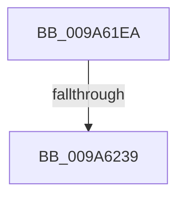

# sub_009A61EA

- RVA: `0x009A61EA`–`0x009A623D` (길이 `83` bytes)
- VA: `0x00000001409A61EA`
- 실행 섹션: `PAGE`
- PDB 이름 있음: `아니요`; PDB Function 태그: `아니요`
- unwind 정보 RVA: `0x0009C784`
- 디코드: `19`개 명령, `83/83` bytes 표시
- 미해석 바이트: `0` (있으면 어셈블리에 `.byte`로 보존)

> 이 문서는 커널 이미지의 기계어와 PDB 기호를 분석해 생성했습니다. 4번과 5번은 함수 원형과 자료형을 바이너리 사용 방식에서 추정한 C 해석이며 원본 소스 복구 결과는 아닙니다.

## 1. Dependencies

- 직접 호출 지점: **0**; 고유 호출 대상: **0**
- 직접 호출자로 확인된 함수: **0**
- RIP 상대 이미지 참조: **0**

### Outgoing calls
- 직접 디코드된 call 명령이 없습니다.

### Direct callers
- 이 함수 시작 RVA로 연결되는 직접 call은 확인되지 않았습니다. 간접 호출은 완전히 역산할 수 없습니다.

### Static image references
- 디코드된 RIP-relative 메모리 참조가 없습니다.

## 2. Other-region calls and transfers

- 다른 실행 섹션으로 향하는 call: **0**
- call이 아닌 외부 분기/꼬리 이동: **1**
  - `0x009A6233` → [sub_009A6705](Unknown_function_009A6705.md) (`tail-transfer`)

## 3. Assembly (complete function range)

```asm
009A61EA  49 89 5B 20                     mov qword ptr [r11 + 0x20], rbx
009A61EE  49 89 73 D8                     mov qword ptr [r11 - 0x28], rsi
009A61F2  49 8B F8                        mov rdi, r8
009A61F5  4D 89 7B C8                     mov qword ptr [r11 - 0x38], r15
009A61F9  48 8D B1 80 00 00 00            lea rsi, [rcx + 0x80]
009A6200  48 89 45 A0                     mov qword ptr [rbp - 0x60], rax
009A6204  4C 8B F1                        mov r14, rcx
009A6207  48 89 45 A8                     mov qword ptr [rbp - 0x58], rax
009A620B  44 8B E8                        mov r13d, eax
009A620E  48 89 45 90                     mov qword ptr [rbp - 0x70], rax
009A6212  48 89 45 98                     mov qword ptr [rbp - 0x68], rax
009A6216  88 44 24 70                     mov byte ptr [rsp + 0x70], al
009A621A  65 4C 8B 3C 25 88 01 00 00      mov r15, qword ptr gs:[0x188]
009A6223  F6 41 59 10                     test byte ptr [rcx + 0x59], 0x10
009A6227  4C 89 44 24 78                  mov qword ptr [rsp + 0x78], r8
009A622C  48 89 55 88                     mov qword ptr [rbp - 0x78], rdx
009A6230  89 45 80                        mov dword ptr [rbp - 0x80], eax
009A6233  0F 85 CC 04 00 00               jne 0x1409a6705
009A6239  49 8B 46 78                     mov rax, qword ptr [r14 + 0x78]
```

## 4. C-style interpretation (structured pseudocode)

```c
__int64 __fastcall sub_009A61EA(__int64 a1, __int64 a2, __int64 a3)
{
    unsigned __int8 v_stack_p70;
    unsigned __int64 v_stack_p78;

    *(unsigned __int64 *)(v_r11 + 32) = v_rbx;
    *(unsigned __int64 *)(v_r11 - 40) = v_rsi;
    *(unsigned __int64 *)(v_r11 - 56) = v_r15;
    *(unsigned __int64 *)(v_rbp - 96) = result;
    *(unsigned __int64 *)(v_rbp - 88) = result;
    *(unsigned __int64 *)(v_rbp - 112) = result;
    *(unsigned __int64 *)(v_rbp - 104) = result;
    v_stack_p70 = (unsigned __int8)(result);
    v_stack_p78 = a3;
    *(unsigned __int64 *)(v_rbp - 120) = a2;
    *(unsigned int *)(v_rbp - 128) = (unsigned int)(result);
    return *(unsigned __int64 *)(a1 + 120);
}
```

## 5. (Beta) C Style

```c
int64_t sub_009A61EA(void *Arg1, int64_t Arg2, int64_t Arg3)
{
    uint8_t *arg1 = (uint8_t *)Arg1;

    uint8_t v_stack_p70;
    uint64_t v_stack_p78;

    *(uint64_t *)(local_r11 + 0x20) = local_rbx;
    *(uint64_t *)(local_r11 - 0x28) = local_rsi;
    *(uint64_t *)(local_r11 - 0x38) = local_r15;
    *(uint64_t *)(local_rbp - 0x60) = result;
    *(uint64_t *)(local_rbp - 0x58) = result;
    *(uint64_t *)(local_rbp - 0x70) = result;
    *(uint64_t *)(local_rbp - 0x68) = result;
    v_stack_p70 = (uint8_t)(result);
    v_stack_p78 = Arg3;
    *(uint64_t *)(local_rbp - 0x78) = Arg2;
    *(uint32_t *)(local_rbp - 0x80) = (uint32_t)(result);
    return *(uint64_t *)(arg1 + 0x78);
}
```

### 관측된 메모리 오프셋

구조체 형식이 확인되지 않은 접근은 인자 기준의 오프셋으로만 기록했습니다.

| 기준 인자 | 오프셋 표현 | 폭 (bit) | 접근 |
|---|---:|---:|---|
| `Arg1` | `+ 0x59` | `8` | `R` |
| `Arg1` | `+ 0x78` | `64` | `R` |
| `Arg1` | `+ 0x80` | `64` | `R` |

## 6. Execution-region graph

[열기: 2D/3D 그래프와 함수 탐색 컨트롤 패널](../../../control-panel.html?section=page&rva=0x009A61EA&view=graph)

- 2D 그래프는 위에서 아래로 흐르고, 3D 그래프는 빈 공간을 드래그해 회전합니다. Shift+드래그는 이동, 휠은 확대·축소, 함수 노드 선택은 대상 보고서 이동입니다.

### Static fallback


