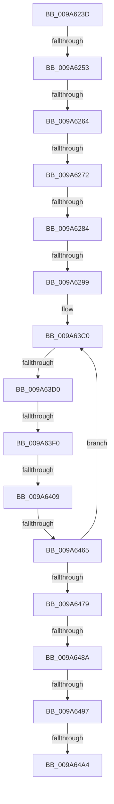

# sub_009A623D

- RVA: `0x009A623D`–`0x009A64C2` (길이 `645` bytes)
- VA: `0x00000001409A623D`
- 실행 섹션: `PAGE`
- PDB 이름 있음: `아니요`; PDB Function 태그: `아니요`
- unwind 정보 RVA: `0x0009C7A0`
- 디코드: `122`개 명령, `645/645` bytes 표시
- 미해석 바이트: `0` (있으면 어셈블리에 `.byte`로 보존)

> 이 문서는 커널 이미지의 기계어와 PDB 기호를 분석해 생성했습니다. 4번과 5번은 함수 원형과 자료형을 바이너리 사용 방식에서 추정한 C 해석이며 원본 소스 복구 결과는 아닙니다.

## 1. Dependencies

- 직접 호출 지점: **7**; 고유 호출 대상: **7**
- 직접 호출자로 확인된 함수: **0**
- RIP 상대 이미지 참조: **2**

### Outgoing calls
- `0x009A628C` → [RtlpGetStackLimits](../../text/2F/RtlpGetStackLimits_function_002F5F50.md) (function, `0x002F5F50`)
- `0x009A62A3` → [memset](../../text/6C/memset_function_006C6C40.md) (function, `0x006C6C40`)
- `0x009A62C4` → [RtlpCaptureContext](../../text/4F/RtlpCaptureContext_function_004FE550.md) (function, `0x004FE550`)
- `0x009A63E3` → [RtlpIsFrameInBoundsEx](../../text/41/RtlpIsFrameInBoundsEx_function_00415510.md) (function, `0x00415510`)
- `0x009A63F7` → [RtlpLookupFunctionEntryForStackWalks](../../text/2F/RtlpLookupFunctionEntryForStackWalks_function_002F4ED0.md) (function, `0x002F4ED0`)
- `0x009A6458` → [RtlVirtualUnwind2](../../text/2F/RtlVirtualUnwind2_function_002F3E20.md) (function, `0x002F3E20`)
- `0x009A64AE` → [PspGetContext](PspGetContext_function_009A6870.md) (function, `0x009A6870`)

### Direct callers
- 이 함수 시작 RVA로 연결되는 직접 call은 확인되지 않았습니다. 간접 호출은 완전히 역산할 수 없습니다.

### Static image references
- `0x009A62A8` → RVA `0x01200030` (`CFGRO`; read)
- `0x009A62B3` → RVA `0x01200040` (`CFGRO`; read)

## 2. Other-region calls and transfers

- 다른 실행 섹션으로 향하는 call: **6**
  - `0x009A628C` → [RtlpGetStackLimits](../../text/2F/RtlpGetStackLimits_function_002F5F50.md) (`PAGE` → `.text`)
  - `0x009A62A3` → [memset](../../text/6C/memset_function_006C6C40.md) (`PAGE` → `.text`)
  - `0x009A62C4` → [RtlpCaptureContext](../../text/4F/RtlpCaptureContext_function_004FE550.md) (`PAGE` → `.text`)
  - `0x009A63E3` → [RtlpIsFrameInBoundsEx](../../text/41/RtlpIsFrameInBoundsEx_function_00415510.md) (`PAGE` → `.text`)
  - `0x009A63F7` → [RtlpLookupFunctionEntryForStackWalks](../../text/2F/RtlpLookupFunctionEntryForStackWalks_function_002F4ED0.md) (`PAGE` → `.text`)
  - `0x009A6458` → [RtlVirtualUnwind2](../../text/2F/RtlVirtualUnwind2_function_002F3E20.md) (`PAGE` → `.text`)
- call이 아닌 외부 분기/꼬리 이동: **12**
  - `0x009A624D` → [sub_009A6724 + 0x5F](Unknown_function_009A6724.md) (`tail-transfer`)
  - `0x009A625E` → [sub_009A6724 + 0x82](Unknown_function_009A6724.md) (`tail-transfer`)
  - `0x009A626C` → [sub_009A6520](Unknown_function_009A6520.md) (`tail-transfer`)
  - `0x009A627E` → [sub_009A6520 + 0x94](Unknown_function_009A6520.md) (`tail-transfer`)
  - `0x009A6293` → [sub_009A6520 + 0x19F](Unknown_function_009A6520.md) (`tail-transfer`)
  - `0x009A63CA` → [sub_009A6520 + 0x185](Unknown_function_009A6520.md) (`tail-transfer`)
  - `0x009A63EA` → [sub_009A6520 + 0x185](Unknown_function_009A6520.md) (`tail-transfer`)
  - `0x009A6403` → [sub_009A6520 + 0x19F](Unknown_function_009A6520.md) (`tail-transfer`)
  - `0x009A645F` → [sub_009A6724 + 0x110](Unknown_function_009A6724.md) (`tail-transfer`)
  - `0x009A6484` → [sub_009A6520 + 0x10](Unknown_function_009A6520.md) (`tail-transfer`)
  - `0x009A6491` → [sub_009A6520 + 0x1CA](Unknown_function_009A6520.md) (`tail-transfer`)
  - `0x009A649E` → [sub_009A6724 + 0xD1](Unknown_function_009A6724.md) (`tail-transfer`)

## 3. Assembly (complete function range)

```asm
009A623D  4C 89 A4 24 08 06 00 00         mov qword ptr [rsp + 0x608], r12
009A6245  44 8B 60 30                     mov r12d, dword ptr [rax + 0x30]
009A6249  45 38 6E 58                     cmp byte ptr [r14 + 0x58], r13b
009A624D  0F 84 30 05 00 00               je 0x1409a6783
009A6253  41 F7 87 A4 05 00 00 00 02 00 00  test dword ptr [r15 + 0x5a4], 0x200
009A625E  0F 85 42 05 00 00               jne 0x1409a67a6
009A6264  49 8B 7F 28                     mov rdi, qword ptr [r15 + 0x28]
009A6268  F6 47 08 01                     test byte ptr [rdi + 8], 1
009A626C  0F 85 AE 02 00 00               jne 0x1409a6520
009A6272  48 81 C7 70 FE FF FF            add rdi, -0x190
009A6279  41 F6 46 59 02                  test byte ptr [r14 + 0x59], 2
009A627E  0F 84 30 03 00 00               je 0x1409a65b4
009A6284  48 8D 55 90                     lea rdx, [rbp - 0x70]
009A6288  48 8D 4D 98                     lea rcx, [rbp - 0x68]
009A628C  E8 BF FC 94 FF                  call 0x1402f5f50
009A6291  84 C0                           test al, al
009A6293  0F 84 26 04 00 00               je 0x1409a66bf
009A6299  33 D2                           xor edx, edx
009A629B  48 8D 4D E0                     lea rcx, [rbp - 0x20]
009A629F  44 8D 42 40                     lea r8d, [rdx + 0x40]
009A62A3  E8 98 09 D2 FF                  call 0x1406c6c40
009A62A8  0F 28 05 81 9D 85 00            movaps xmm0, xmmword ptr [rip + 0x859d81]
009A62AF  48 8D 4D 20                     lea rcx, [rbp + 0x20]
009A62B3  F2 0F 10 0D 85 9D 85 00         movsd xmm1, qword ptr [rip + 0x859d85]
009A62BB  0F 11 45 B0                     movups xmmword ptr [rbp - 0x50], xmm0
009A62BF  F2 0F 11 4D C0                  movsd qword ptr [rbp - 0x40], xmm1
009A62C4  E8 87 82 B5 FF                  call 0x1404fe550
009A62C9  48 8D 85 B0 00 00 00            lea rax, [rbp + 0xb0]
009A62D0  48 89 86 98 00 00 00            mov qword ptr [rsi + 0x98], rax
009A62D7  48 8D 85 C0 00 00 00            lea rax, [rbp + 0xc0]
009A62DE  48 89 86 A8 00 00 00            mov qword ptr [rsi + 0xa8], rax
009A62E5  48 8D 85 C8 00 00 00            lea rax, [rbp + 0xc8]
009A62EC  48 89 86 B0 00 00 00            mov qword ptr [rsi + 0xb0], rax
009A62F3  48 8D 85 D0 00 00 00            lea rax, [rbp + 0xd0]
009A62FA  48 89 86 B8 00 00 00            mov qword ptr [rsi + 0xb8], rax
009A6301  48 8D 85 F8 00 00 00            lea rax, [rbp + 0xf8]
009A6308  48 89 86 E0 00 00 00            mov qword ptr [rsi + 0xe0], rax
009A630F  48 8D 85 00 01 00 00            lea rax, [rbp + 0x100]
009A6316  48 89 86 E8 00 00 00            mov qword ptr [rsi + 0xe8], rax
009A631D  48 8D 85 08 01 00 00            lea rax, [rbp + 0x108]
009A6324  48 89 86 F0 00 00 00            mov qword ptr [rsi + 0xf0], rax
009A632B  48 8D 85 10 01 00 00            lea rax, [rbp + 0x110]
009A6332  48 89 86 F8 00 00 00            mov qword ptr [rsi + 0xf8], rax
009A6339  48 8D 85 20 02 00 00            lea rax, [rbp + 0x220]
009A6340  48 89 46 30                     mov qword ptr [rsi + 0x30], rax
009A6344  48 8D 85 30 02 00 00            lea rax, [rbp + 0x230]
009A634B  48 89 46 38                     mov qword ptr [rsi + 0x38], rax
009A634F  48 8D 85 40 02 00 00            lea rax, [rbp + 0x240]
009A6356  48 89 46 40                     mov qword ptr [rsi + 0x40], rax
009A635A  48 8D 85 50 02 00 00            lea rax, [rbp + 0x250]
009A6361  48 89 46 48                     mov qword ptr [rsi + 0x48], rax
009A6365  48 8D 85 60 02 00 00            lea rax, [rbp + 0x260]
009A636C  48 89 46 50                     mov qword ptr [rsi + 0x50], rax
009A6370  48 8D 85 70 02 00 00            lea rax, [rbp + 0x270]
009A6377  48 89 46 58                     mov qword ptr [rsi + 0x58], rax
009A637B  48 8D 85 80 02 00 00            lea rax, [rbp + 0x280]
009A6382  48 89 46 60                     mov qword ptr [rsi + 0x60], rax
009A6386  48 8D 85 90 02 00 00            lea rax, [rbp + 0x290]
009A638D  48 89 46 68                     mov qword ptr [rsi + 0x68], rax
009A6391  48 8D 85 A0 02 00 00            lea rax, [rbp + 0x2a0]
009A6398  48 89 46 70                     mov qword ptr [rsi + 0x70], rax
009A639C  48 8D 85 B0 02 00 00            lea rax, [rbp + 0x2b0]
009A63A3  48 89 46 78                     mov qword ptr [rsi + 0x78], rax
009A63A7  48 8D 85 B8 00 00 00            lea rax, [rbp + 0xb8]
009A63AE  48 89 86 A0 00 00 00            mov qword ptr [rsi + 0xa0], rax
009A63B5  48 B8 00 00 00 00 00 80 FF FF   movabs rax, 0xffff800000000000
009A63BF  90                              nop
009A63C0  48 8B 9D 18 01 00 00            mov rbx, qword ptr [rbp + 0x118]
009A63C7  48 3B D8                        cmp rbx, rax
009A63CA  0F 82 D5 02 00 00               jb 0x1409a66a5
009A63D0  48 8B 95 B8 00 00 00            mov rdx, qword ptr [rbp + 0xb8]
009A63D7  4C 8D 4D E0                     lea r9, [rbp - 0x20]
009A63DB  4C 8D 45 90                     lea r8, [rbp - 0x70]
009A63DF  48 8D 4D 98                     lea rcx, [rbp - 0x68]
009A63E3  E8 28 F1 A6 FF                  call 0x140415510
009A63E8  84 C0                           test al, al
009A63EA  0F 84 B5 02 00 00               je 0x1409a66a5
009A63F0  48 8D 55 B0                     lea rdx, [rbp - 0x50]
009A63F4  48 8B CB                        mov rcx, rbx
009A63F7  E8 D4 EA 94 FF                  call 0x1402f4ed0
009A63FC  48 8B 55 B8                     mov rdx, qword ptr [rbp - 0x48]
009A6400  48 85 D2                        test rdx, rdx
009A6403  0F 84 B6 02 00 00               je 0x1409a66bf
009A6409  33 C9                           xor ecx, ecx
009A640B  4C 8B C8                        mov r9, rax
009A640E  89 4C 24 60                     mov dword ptr [rsp + 0x60], ecx
009A6412  4C 8B C3                        mov r8, rbx
009A6415  48 89 4C 24 58                  mov qword ptr [rsp + 0x58], rcx
009A641A  48 8D 4D 90                     lea rcx, [rbp - 0x70]
009A641E  48 89 4C 24 50                  mov qword ptr [rsp + 0x50], rcx
009A6423  48 8D 4D 98                     lea rcx, [rbp - 0x68]
009A6427  48 89 4C 24 48                  mov qword ptr [rsp + 0x48], rcx
009A642C  48 8D 4D A0                     lea rcx, [rbp - 0x60]
009A6430  48 89 74 24 40                  mov qword ptr [rsp + 0x40], rsi
009A6435  48 89 4C 24 38                  mov qword ptr [rsp + 0x38], rcx
009A643A  48 8D 4D A8                     lea rcx, [rbp - 0x58]
009A643E  48 89 4C 24 30                  mov qword ptr [rsp + 0x30], rcx
009A6443  48 8D 4C 24 70                  lea rcx, [rsp + 0x70]
009A6448  48 89 4C 24 28                  mov qword ptr [rsp + 0x28], rcx
009A644D  48 8D 4D 20                     lea rcx, [rbp + 0x20]
009A6451  48 89 4C 24 20                  mov qword ptr [rsp + 0x20], rcx
009A6456  33 C9                           xor ecx, ecx
009A6458  E8 C3 D9 94 FF                  call 0x1402f3e20
009A645D  85 C0                           test eax, eax
009A645F  0F 88 CF 03 00 00               js 0x1409a6834
009A6465  48 B8 00 00 00 00 00 80 FF FF   movabs rax, 0xffff800000000000
009A646F  48 39 7D A0                     cmp qword ptr [rbp - 0x60], rdi
009A6473  0F 85 47 FF FF FF               jne 0x1409a63c0
009A6479  41 81 E4 08 00 10 00            and r12d, 0x100008
009A6480  4C 39 6D 88                     cmp qword ptr [rbp - 0x78], r13
009A6484  0F 85 A6 00 00 00               jne 0x1409a6530
009A648A  41 81 FC 08 00 10 00            cmp r12d, 0x100008
009A6491  0F 84 53 02 00 00               je 0x1409a66ea
009A6497  4D 39 AF A8 06 00 00            cmp qword ptr [r15 + 0x6a8], r13
009A649E  0F 85 51 03 00 00               jne 0x1409a67f5
009A64A4  4D 8B 46 78                     mov r8, qword ptr [r14 + 0x78]
009A64A8  48 8B D6                        mov rdx, rsi
009A64AB  48 8B CF                        mov rcx, rdi
009A64AE  E8 BD 03 00 00                  call 0x1409a6870
009A64B3  48 8B 7C 24 78                  mov rdi, qword ptr [rsp + 0x78]
009A64B8  33 C0                           xor eax, eax
009A64BA  4C 8B A4 24 08 06 00 00         mov r12, qword ptr [rsp + 0x608]
```

## 4. C-style interpretation (structured pseudocode)

```c
__int64 __fastcall sub_009A623D(__int64 a1, __int64 a2, __int64 a3, __int64 a4, __int64 a5, __int64 a6, __int64 a7, __int64 a8, __int64 a9, __int64 a10, __int64 a11, __int64 a12, __int64 a13, __int64 a14, __int64 a15, __int64 a16, __int64 a17, __int64 a18, __int64 a19, __int64 a20, __int64 a21, __int64 a22, __int64 a23, __int64 a24, __int64 a25, __int64 a26, __int64 a27, __int64 a28, __int64 a29, __int64 a30, __int64 a31, __int64 a32, __int64 a33, __int64 a34, __int64 a35, __int64 a36, __int64 a37, __int64 a38, __int64 a39, __int64 a40, __int64 a41, __int64 a42, __int64 a43, __int64 a44, __int64 a45, __int64 a46, __int64 a47, __int64 a48, __int64 a49, __int64 a50, __int64 a51, __int64 a52, __int64 a53, __int64 a54, __int64 a55, __int64 a56, __int64 a57, __int64 a58, __int64 a59, __int64 a60, __int64 a61, __int64 a62, __int64 a63, __int64 a64, __int64 a65, __int64 a66, __int64 a67, __int64 a68, __int64 a69, __int64 a70, __int64 a71, __int64 a72, __int64 a73, __int64 a74, __int64 a75, __int64 a76, __int64 a77, __int64 a78, __int64 a79, __int64 a80, __int64 a81, __int64 a82, __int64 a83, __int64 a84, __int64 a85, __int64 a86, __int64 a87, __int64 a88, __int64 a89, __int64 a90, __int64 a91, __int64 a92, __int64 a93, __int64 a94, __int64 a95, __int64 a96, __int64 a97, __int64 a98, __int64 a99, __int64 a100, __int64 a101, __int64 a102, __int64 a103, __int64 a104, __int64 a105, __int64 a106, __int64 a107, __int64 a108, __int64 a109, __int64 a110, __int64 a111, __int64 a112, __int64 a113, __int64 a114, __int64 a115, __int64 a116, __int64 a117, __int64 a118, __int64 a119, __int64 a120, __int64 a121, __int64 a122, __int64 a123, __int64 a124, __int64 a125, __int64 a126, __int64 a127, __int64 a128, __int64 a129, __int64 a130, __int64 a131, __int64 a132, __int64 a133, __int64 a134, __int64 a135, __int64 a136, __int64 a137, __int64 a138, __int64 a139, __int64 a140, __int64 a141, __int64 a142, __int64 a143, __int64 a144, __int64 a145, __int64 a146, __int64 a147, __int64 a148, __int64 a149, __int64 a150, __int64 a151, __int64 a152, __int64 a153, __int64 a154, __int64 a155, __int64 a156, __int64 a157, __int64 a158, __int64 a159, __int64 a160, __int64 a161, __int64 a162, __int64 a163, __int64 a164, __int64 a165, __int64 a166, __int64 a167, __int64 a168, __int64 a169, __int64 a170, __int64 a171, __int64 a172, __int64 a173, __int64 a174, __int64 a175, __int64 a176, __int64 a177, __int64 a178, __int64 a179, __int64 a180, __int64 a181, __int64 a182, __int64 a183, __int64 a184, __int64 a185, __int64 a186, __int64 a187, __int64 a188, __int64 a189, __int64 a190, __int64 a191, __int64 a192, __int64 a193)
{
    __int64 result;
    __int64 v_r12;
    __int64 v_rdi;
    unsigned __int64 v_stack_p20;
    unsigned __int64 v_stack_p28;
    unsigned __int64 v_stack_p30;
    unsigned __int64 v_stack_p38;
    unsigned __int64 v_stack_p40;
    unsigned __int64 v_stack_p48;
    unsigned __int64 v_stack_p50;
    unsigned __int64 v_stack_p58;
    unsigned int v_stack_p60;
    unsigned __int64 v_stack_p608;

    v_stack_p608 = v_r12;
    v_rdi = (*(unsigned __int64 *)(v_r15 + 40)) + (-400);
    result = RtlpGetStackLimits(v_rbp - 104, v_rbp - 112, a3, a4);
    a2 = 0;
    result = memset(v_rbp - 32, a2, a2 + 64, a4);
    *(unsigned __int64 *)(v_rbp - 80) = v_xmm0;
    *(unsigned __int64 *)(v_rbp - 64) = v_xmm1;
    result = RtlpCaptureContext(v_rbp + 32, a2, a2 + 64, a4);
    *(unsigned __int64 *)(v_rsi + 152) = v_rbp + 176;
    *(unsigned __int64 *)(v_rsi + 168) = v_rbp + 192;
    *(unsigned __int64 *)(v_rsi + 176) = v_rbp + 200;
    *(unsigned __int64 *)(v_rsi + 184) = v_rbp + 208;
    *(unsigned __int64 *)(v_rsi + 224) = v_rbp + 248;
    *(unsigned __int64 *)(v_rsi + 232) = v_rbp + 256;
    *(unsigned __int64 *)(v_rsi + 240) = v_rbp + 264;
    *(unsigned __int64 *)(v_rsi + 248) = v_rbp + 272;
    *(unsigned __int64 *)(v_rsi + 48) = v_rbp + 544;
    *(unsigned __int64 *)(v_rsi + 56) = v_rbp + 560;
    *(unsigned __int64 *)(v_rsi + 64) = v_rbp + 576;
    *(unsigned __int64 *)(v_rsi + 72) = v_rbp + 592;
    *(unsigned __int64 *)(v_rsi + 80) = v_rbp + 608;
    *(unsigned __int64 *)(v_rsi + 88) = v_rbp + 624;
    *(unsigned __int64 *)(v_rsi + 96) = v_rbp + 640;
    *(unsigned __int64 *)(v_rsi + 104) = v_rbp + 656;
    *(unsigned __int64 *)(v_rsi + 112) = v_rbp + 672;
    *(unsigned __int64 *)(v_rsi + 120) = v_rbp + 688;
    *(unsigned __int64 *)(v_rsi + 160) = v_rbp + 184;
loc_009A63C0:
    result = RtlpIsFrameInBoundsEx(v_rbp - 104, *(unsigned __int64 *)(v_rbp + 184), v_rbp - 112, v_rbp - 32);
    result = RtlpLookupFunctionEntryForStackWalks(*(unsigned __int64 *)(v_rbp + 280), v_rbp - 80, v_rbp - 112, v_rbp - 32);
    a1 = 0;
    v_stack_p60 = 0;
    v_stack_p58 = 0;
    v_stack_p50 = v_rbp - 112;
    v_stack_p48 = v_rbp - 104;
    v_stack_p40 = v_rsi;
    v_stack_p38 = v_rbp - 96;
    v_stack_p30 = v_rbp - 88;
    v_stack_p28 = a14;
    v_stack_p20 = v_rbp + 32;
    a1 = 0;
    result = RtlVirtualUnwind2(a1, *(unsigned __int64 *)(v_rbp - 72), *(unsigned __int64 *)(v_rbp + 280), result);
    if ((*(unsigned __int64 *)(v_rbp - 96)) != v_rdi) goto loc_009A63C0;
    v_r12 = (unsigned int)(((unsigned int)(*(unsigned int *)(result + 48))) & (0x100008ULL));
    result = PspGetContext(v_rdi, v_rsi, *(unsigned __int64 *)(v_r14 + 120), result);
    result = 0;
    return result;
}
```

## 5. (Beta) C Style

```c
int64_t sub_009A623D(int64_t Arg1, int64_t Arg2, int64_t Arg3, int64_t Arg4, uint64_t Arg5, uint64_t Arg6, uint64_t Arg7, uint64_t Arg8, uint64_t Arg9, uint64_t Arg10, uint64_t Arg11, uint64_t Arg12, uint64_t Arg13, int64_t Arg14, int64_t Arg15, uint64_t Arg16, uint64_t Arg17, uint64_t Arg18, uint64_t Arg19, uint64_t Arg20, uint64_t Arg21, uint64_t Arg22, uint64_t Arg23, uint64_t Arg24, uint64_t Arg25, uint64_t Arg26, uint64_t Arg27, uint64_t Arg28, uint64_t Arg29, uint64_t Arg30, uint64_t Arg31, uint64_t Arg32, uint64_t Arg33, uint64_t Arg34, uint64_t Arg35, uint64_t Arg36, uint64_t Arg37, uint64_t Arg38, uint64_t Arg39, uint64_t Arg40, uint64_t Arg41, uint64_t Arg42, uint64_t Arg43, uint64_t Arg44, uint64_t Arg45, uint64_t Arg46, uint64_t Arg47, uint64_t Arg48, uint64_t Arg49, uint64_t Arg50, uint64_t Arg51, uint64_t Arg52, uint64_t Arg53, uint64_t Arg54, uint64_t Arg55, uint64_t Arg56, uint64_t Arg57, uint64_t Arg58, uint64_t Arg59, uint64_t Arg60, uint64_t Arg61, uint64_t Arg62, uint64_t Arg63, uint64_t Arg64, uint64_t Arg65, uint64_t Arg66, uint64_t Arg67, uint64_t Arg68, uint64_t Arg69, uint64_t Arg70, uint64_t Arg71, uint64_t Arg72, uint64_t Arg73, uint64_t Arg74, uint64_t Arg75, uint64_t Arg76, uint64_t Arg77, uint64_t Arg78, uint64_t Arg79, uint64_t Arg80, uint64_t Arg81, uint64_t Arg82, uint64_t Arg83, uint64_t Arg84, uint64_t Arg85, uint64_t Arg86, uint64_t Arg87, uint64_t Arg88, uint64_t Arg89, uint64_t Arg90, uint64_t Arg91, uint64_t Arg92, uint64_t Arg93, uint64_t Arg94, uint64_t Arg95, uint64_t Arg96, uint64_t Arg97, uint64_t Arg98, uint64_t Arg99, uint64_t Arg100, uint64_t Arg101, uint64_t Arg102, uint64_t Arg103, uint64_t Arg104, uint64_t Arg105, uint64_t Arg106, uint64_t Arg107, uint64_t Arg108, uint64_t Arg109, uint64_t Arg110, uint64_t Arg111, uint64_t Arg112, uint64_t Arg113, uint64_t Arg114, uint64_t Arg115, uint64_t Arg116, uint64_t Arg117, uint64_t Arg118, uint64_t Arg119, uint64_t Arg120, uint64_t Arg121, uint64_t Arg122, uint64_t Arg123, uint64_t Arg124, uint64_t Arg125, uint64_t Arg126, uint64_t Arg127, uint64_t Arg128, uint64_t Arg129, uint64_t Arg130, uint64_t Arg131, uint64_t Arg132, uint64_t Arg133, uint64_t Arg134, uint64_t Arg135, uint64_t Arg136, uint64_t Arg137, uint64_t Arg138, uint64_t Arg139, uint64_t Arg140, uint64_t Arg141, uint64_t Arg142, uint64_t Arg143, uint64_t Arg144, uint64_t Arg145, uint64_t Arg146, uint64_t Arg147, uint64_t Arg148, uint64_t Arg149, uint64_t Arg150, uint64_t Arg151, uint64_t Arg152, uint64_t Arg153, uint64_t Arg154, uint64_t Arg155, uint64_t Arg156, uint64_t Arg157, uint64_t Arg158, uint64_t Arg159, uint64_t Arg160, uint64_t Arg161, uint64_t Arg162, uint64_t Arg163, uint64_t Arg164, uint64_t Arg165, uint64_t Arg166, uint64_t Arg167, uint64_t Arg168, uint64_t Arg169, uint64_t Arg170, uint64_t Arg171, uint64_t Arg172, uint64_t Arg173, uint64_t Arg174, uint64_t Arg175, uint64_t Arg176, uint64_t Arg177, uint64_t Arg178, uint64_t Arg179, uint64_t Arg180, uint64_t Arg181, uint64_t Arg182, uint64_t Arg183, uint64_t Arg184, uint64_t Arg185, uint64_t Arg186, uint64_t Arg187, uint64_t Arg188, uint64_t Arg189, uint64_t Arg190, uint64_t Arg191, uint64_t Arg192, int64_t Arg193)
{
    int64_t result;
    int64_t local_r12;
    int64_t local_rdi;
    uint64_t v_stack_p20;
    uint64_t v_stack_p28;
    uint64_t v_stack_p30;
    uint64_t v_stack_p38;
    uint64_t v_stack_p40;
    uint64_t v_stack_p48;
    uint64_t v_stack_p50;
    uint64_t v_stack_p58;
    uint32_t v_stack_p60;
    uint64_t v_stack_p608;

    v_stack_p608 = local_r12;
    local_rdi = (*(uint64_t *)(local_r15 + 0x28)) + (-400);
    result = RtlpGetStackLimits(local_rbp - 104, local_rbp - 112, Arg3, Arg4);
    Arg2 = 0;
    result = memset(local_rbp - 32, Arg2, Arg2 + 64, Arg4);
    *(uint64_t *)(local_rbp - 0x50) = v_xmm0;
    *(uint64_t *)(local_rbp - 0x40) = v_xmm1;
    result = RtlpCaptureContext(local_rbp + 32, Arg2, Arg2 + 64, Arg4);
    *(uint64_t *)(local_rsi + 0x98) = local_rbp + 176;
    *(uint64_t *)(local_rsi + 0xA8) = local_rbp + 192;
    *(uint64_t *)(local_rsi + 0xB0) = local_rbp + 200;
    *(uint64_t *)(local_rsi + 0xB8) = local_rbp + 208;
    *(uint64_t *)(local_rsi + 0xE0) = local_rbp + 248;
    *(uint64_t *)(local_rsi + 0xE8) = local_rbp + 256;
    *(uint64_t *)(local_rsi + 0xF0) = local_rbp + 264;
    *(uint64_t *)(local_rsi + 0xF8) = local_rbp + 272;
    *(uint64_t *)(local_rsi + 0x30) = local_rbp + 544;
    *(uint64_t *)(local_rsi + 0x38) = local_rbp + 560;
    *(uint64_t *)(local_rsi + 0x40) = local_rbp + 576;
    *(uint64_t *)(local_rsi + 0x48) = local_rbp + 592;
    *(uint64_t *)(local_rsi + 0x50) = local_rbp + 608;
    *(uint64_t *)(local_rsi + 0x58) = local_rbp + 624;
    *(uint64_t *)(local_rsi + 0x60) = local_rbp + 640;
    *(uint64_t *)(local_rsi + 0x68) = local_rbp + 656;
    *(uint64_t *)(local_rsi + 0x70) = local_rbp + 672;
    *(uint64_t *)(local_rsi + 0x78) = local_rbp + 688;
    *(uint64_t *)(local_rsi + 0xA0) = local_rbp + 184;
loc_009A63C0:
    result = RtlpIsFrameInBoundsEx(local_rbp - 104, *(uint64_t *)(local_rbp + 0xB8), local_rbp - 112, local_rbp - 32);
    result = RtlpLookupFunctionEntryForStackWalks(*(uint64_t *)(local_rbp + 0x118), local_rbp - 80, local_rbp - 112, local_rbp - 32);
    Arg1 = 0;
    v_stack_p60 = 0;
    v_stack_p58 = 0;
    v_stack_p50 = local_rbp - 112;
    v_stack_p48 = local_rbp - 104;
    v_stack_p40 = local_rsi;
    v_stack_p38 = local_rbp - 96;
    v_stack_p30 = local_rbp - 88;
    v_stack_p28 = Arg14;
    v_stack_p20 = local_rbp + 32;
    Arg1 = 0;
    result = RtlVirtualUnwind2(Arg1, *(uint64_t *)(local_rbp - 0x48), *(uint64_t *)(local_rbp + 0x118), result);
    if ((*(uint64_t *)(local_rbp - 0x60)) != local_rdi) goto loc_009A63C0;
    local_r12 = (uint32_t)(((uint32_t)(*(uint32_t *)(result + 0x30))) & (0x100008ULL));
    result = PspGetContext(local_rdi, local_rsi, *(uint64_t *)(local_r14 + 0x78), result);
    result = 0;
    return result;
}
```

## 6. Execution-region graph

[열기: 2D/3D 그래프와 함수 탐색 컨트롤 패널](../../../control-panel.html?section=page&rva=0x009A623D&view=graph)

- 2D 그래프는 위에서 아래로 흐르고, 3D 그래프는 빈 공간을 드래그해 회전합니다. Shift+드래그는 이동, 휠은 확대·축소, 함수 노드 선택은 대상 보고서 이동입니다.

### Static fallback


