# sub_009A6520

- RVA: `0x009A6520`–`0x009A6705` (길이 `485` bytes)
- VA: `0x00000001409A6520`
- 실행 섹션: `PAGE`
- PDB 이름 있음: `아니요`; PDB Function 태그: `아니요`
- unwind 정보 RVA: `0x0009C7D8`
- 디코드: `91`개 명령, `485/485` bytes 표시
- 미해석 바이트: `0` (있으면 어셈블리에 `.byte`로 보존)

> 이 문서는 커널 이미지의 기계어와 PDB 기호를 분석해 생성했습니다. 4번과 5번은 함수 원형과 자료형을 바이너리 사용 방식에서 추정한 C 해석이며 원본 소스 복구 결과는 아닙니다.

## 1. Dependencies

- 직접 호출 지점: **3**; 고유 호출 대상: **3**
- 직접 호출자로 확인된 함수: **0**
- RIP 상대 이미지 참조: **2**

### Outgoing calls
- `0x009A6557` → [KeVerifyContextXStateCetU](../../text/3D/KeVerifyContextXStateCetU_function_003D72D0.md) (function, `0x003D72D0`)
- `0x009A6585` → [RtlpValidateContextXStateDisabledFeatures](../../text/3D/RtlpValidateContextXStateDisabledFeatures_function_003D6068.md) (function, `0x003D6068`)
- `0x009A65AA` → [PspSetContext](PspSetContext_function_009A6C80.md) (function, `0x009A6C80`)

### Direct callers
- 이 함수 시작 RVA로 연결되는 직접 call은 확인되지 않았습니다. 간접 호출은 완전히 역산할 수 없습니다.

### Static image references
- `0x009A66A5` → RVA `0x00F475F8` (`.data`; read)
- `0x009A66B2` → RVA `0x00FC6DDC` (`ALMOSTRO`; read)

## 2. Other-region calls and transfers

- 다른 실행 섹션으로 향하는 call: **2**
  - `0x009A6557` → [KeVerifyContextXStateCetU](../../text/3D/KeVerifyContextXStateCetU_function_003D72D0.md) (`PAGE` → `.text`)
  - `0x009A6585` → [RtlpValidateContextXStateDisabledFeatures](../../text/3D/RtlpValidateContextXStateDisabledFeatures_function_003D6068.md) (`PAGE` → `.text`)
- call이 아닌 외부 분기/꼬리 이동: **13**
  - `0x009A6528` → [sub_009A623D + 0x35](Unknown_function_009A623D.md) (`tail-transfer`)
  - `0x009A6537` → [sub_009A6724 + 0x3A](Unknown_function_009A6724.md) (`tail-transfer`)
  - `0x009A6569` → [sub_009A6724](Unknown_function_009A6724.md) (`tail-transfer`)
  - `0x009A658C` → [sub_009A6724 + 0x55](Unknown_function_009A6724.md) (`tail-transfer`)
  - `0x009A659A` → [sub_009A6724 + 0xAC](Unknown_function_009A6724.md) (`tail-transfer`)
  - `0x009A65AF` → [sub_009A623D + 0x276](Unknown_function_009A623D.md) (`tail-transfer`)
  - `0x009A66A0` → [sub_009A623D + 0x23C](Unknown_function_009A623D.md) (`tail-transfer`)
  - `0x009A66AC` → [sub_009A6724 + 0x12F](Unknown_function_009A6724.md) (`tail-transfer`)
  - `0x009A66B9` → [sub_009A6724 + 0x13C](Unknown_function_009A6724.md) (`tail-transfer`)
  - `0x009A66C9` → [sub_009A623D + 0x27D](Unknown_function_009A623D.md) (`tail-transfer`)
  - `0x009A66E5` → [sub_009A623D + 0x27D](Unknown_function_009A623D.md) (`tail-transfer`)
  - `0x009A66EF` → [sub_009A623D + 0x25A](Unknown_function_009A623D.md) (`tail-transfer`)
  - `0x009A6700` → [sub_009A623D + 0x25A](Unknown_function_009A623D.md) (`tail-transfer`)

## 3. Assembly (complete function range)

```asm
009A6520  48 8B 7F 28                     mov rdi, qword ptr [rdi + 0x28]
009A6524  F6 47 08 01                     test byte ptr [rdi + 8], 1
009A6528  0F 84 44 FD FF FF               je 0x1409a6272
009A652E  EB F0                           jmp 0x1409a6520
009A6530  41 81 FC 08 00 10 00            cmp r12d, 0x100008
009A6537  0F 84 21 02 00 00               je 0x1409a675e
009A653D  41 80 7E 58 01                  cmp byte ptr [r14 + 0x58], 1
009A6542  75 2B                           jne 0x1409a656f
009A6544  49 8B 56 78                     mov rdx, qword ptr [r14 + 0x78]
009A6548  4C 8D 45 88                     lea r8, [rbp - 0x78]
009A654C  49 8B CF                        mov rcx, r15
009A654F  48 C7 45 88 00 00 00 00         mov qword ptr [rbp - 0x78], 0
009A6557  E8 74 0D A3 FF                  call 0x1403d72d0
009A655C  85 C0                           test eax, eax
009A655E  0F 88 7C 01 00 00               js 0x1409a66e0
009A6564  41 F6 46 59 04                  test byte ptr [r14 + 0x59], 4
009A6569  0F 85 B5 01 00 00               jne 0x1409a6724
009A656F  45 0F B6 4E 58                  movzx r9d, byte ptr [r14 + 0x58]
009A6574  41 80 F9 01                     cmp r9b, 1
009A6578  75 18                           jne 0x1409a6592
009A657A  49 8B 97 28 04 00 00            mov rdx, qword ptr [r15 + 0x428]
009A6581  49 8B 4E 78                     mov rcx, qword ptr [r14 + 0x78]
009A6585  E8 DE FA A2 FF                  call 0x1403d6068
009A658A  85 C0                           test eax, eax
009A658C  0F 88 E7 01 00 00               js 0x1409a6779
009A6592  49 83 BF A8 06 00 00 00         cmp qword ptr [r15 + 0x6a8], 0
009A659A  0F 85 30 02 00 00               jne 0x1409a67d0
009A65A0  4D 8B 46 78                     mov r8, qword ptr [r14 + 0x78]
009A65A4  48 8B D6                        mov rdx, rsi
009A65A7  48 8B CF                        mov rcx, rdi
009A65AA  E8 D1 06 00 00                  call 0x1409a6c80
009A65AF  E9 FF FE FF FF                  jmp 0x1409a64b3
009A65B4  49 8B 4F 28                     mov rcx, qword ptr [r15 + 0x28]
009A65B8  F6 41 08 01                     test byte ptr [rcx + 8], 1
009A65BC  0F 85 0E 01 00 00               jne 0x1409a66d0
009A65C2  48 8D 81 30 FE FF FF            lea rax, [rcx - 0x1d0]
009A65C9  48 89 86 98 00 00 00            mov qword ptr [rsi + 0x98], rax
009A65D0  48 8D 81 40 FE FF FF            lea rax, [rcx - 0x1c0]
009A65D7  48 89 86 B0 00 00 00            mov qword ptr [rsi + 0xb0], rax
009A65DE  48 8D 81 38 FE FF FF            lea rax, [rcx - 0x1c8]
009A65E5  48 89 86 B8 00 00 00            mov qword ptr [rsi + 0xb8], rax
009A65EC  48 8D 81 48 FE FF FF            lea rax, [rcx - 0x1b8]
009A65F3  48 89 86 E0 00 00 00            mov qword ptr [rsi + 0xe0], rax
009A65FA  48 8D 81 50 FE FF FF            lea rax, [rcx - 0x1b0]
009A6601  48 89 86 E8 00 00 00            mov qword ptr [rsi + 0xe8], rax
009A6608  48 8D 81 58 FE FF FF            lea rax, [rcx - 0x1a8]
009A660F  48 89 86 F0 00 00 00            mov qword ptr [rsi + 0xf0], rax
009A6616  48 8D 81 60 FE FF FF            lea rax, [rcx - 0x1a0]
009A661D  48 89 86 F8 00 00 00            mov qword ptr [rsi + 0xf8], rax
009A6624  48 8D 81 60 FD FF FF            lea rax, [rcx - 0x2a0]
009A662B  48 89 46 30                     mov qword ptr [rsi + 0x30], rax
009A662F  48 8D 81 70 FD FF FF            lea rax, [rcx - 0x290]
009A6636  48 89 46 38                     mov qword ptr [rsi + 0x38], rax
009A663A  48 8D 81 80 FD FF FF            lea rax, [rcx - 0x280]
009A6641  48 89 46 40                     mov qword ptr [rsi + 0x40], rax
009A6645  48 8D 81 90 FD FF FF            lea rax, [rcx - 0x270]
009A664C  48 89 46 48                     mov qword ptr [rsi + 0x48], rax
009A6650  48 8D 81 A0 FD FF FF            lea rax, [rcx - 0x260]
009A6657  48 89 46 50                     mov qword ptr [rsi + 0x50], rax
009A665B  48 8D 81 B0 FD FF FF            lea rax, [rcx - 0x250]
009A6662  48 89 46 58                     mov qword ptr [rsi + 0x58], rax
009A6666  48 8D 81 C0 FD FF FF            lea rax, [rcx - 0x240]
009A666D  48 89 46 60                     mov qword ptr [rsi + 0x60], rax
009A6671  48 8D 81 D0 FD FF FF            lea rax, [rcx - 0x230]
009A6678  48 89 46 68                     mov qword ptr [rsi + 0x68], rax
009A667C  48 8D 81 E0 FD FF FF            lea rax, [rcx - 0x220]
009A6683  48 89 46 70                     mov qword ptr [rsi + 0x70], rax
009A6687  48 8D 81 F0 FD FF FF            lea rax, [rcx - 0x210]
009A668E  48 89 46 78                     mov qword ptr [rsi + 0x78], rax
009A6692  48 8D 87 58 01 00 00            lea rax, [rdi + 0x158]
009A6699  48 89 86 A8 00 00 00            mov qword ptr [rsi + 0xa8], rax
009A66A0  E9 D4 FD FF FF                  jmp 0x1409a6479
009A66A5  44 38 2D 4C 0F 5A 00            cmp byte ptr [rip + 0x5a0f4c], r13b
009A66AC  0F 85 A1 01 00 00               jne 0x1409a6853
009A66B2  44 39 2D 23 07 62 00            cmp dword ptr [rip + 0x620723], r13d
009A66B9  0F 85 A1 01 00 00               jne 0x1409a6860
009A66BF  48 8B 7C 24 78                  mov rdi, qword ptr [rsp + 0x78]
009A66C4  B8 01 00 00 C0                  mov eax, 0xc0000001
009A66C9  E9 EC FD FF FF                  jmp 0x1409a64ba
009A66CE  66 90                           nop
009A66D0  48 8B 49 28                     mov rcx, qword ptr [rcx + 0x28]
009A66D4  F6 41 08 01                     test byte ptr [rcx + 8], 1
009A66D8  0F 84 E4 FE FF FF               je 0x1409a65c2
009A66DE  EB F0                           jmp 0x1409a66d0
009A66E0  48 8B 7C 24 78                  mov rdi, qword ptr [rsp + 0x78]
009A66E5  E9 D0 FD FF FF                  jmp 0x1409a64ba
009A66EA  41 80 7E 58 01                  cmp byte ptr [r14 + 0x58], 1
009A66EF  0F 85 A2 FD FF FF               jne 0x1409a6497
009A66F5  49 8B 46 78                     mov rax, qword ptr [r14 + 0x78]
009A66F9  0F AE 80 00 01 00 00            fxsave [rax + 0x100]
009A6700  E9 92 FD FF FF                  jmp 0x1409a6497
```

## 4. C-style interpretation (structured pseudocode)

```c
__int64 __fastcall sub_009A6520(void)
{
    unsigned __int64 v_stack_p78;

    goto loc_009A6520;
}
```

## 5. (Beta) C Style

```c
void sub_009A6520(void)
{
    uint64_t v_stack_p78;

    goto loc_009A6520;
}
```

## 6. Execution-region graph

[열기: 2D/3D 그래프와 함수 탐색 컨트롤 패널](../../../control-panel.html?section=page&rva=0x009A6520&view=graph)

- 2D 그래프는 위에서 아래로 흐르고, 3D 그래프는 빈 공간을 드래그해 회전합니다. Shift+드래그는 이동, 휠은 확대·축소, 함수 노드 선택은 대상 보고서 이동입니다.

### Static fallback

```mermaid
flowchart TD
  bb_009A6520[BB_009A6520]
  bb_009A652E[BB_009A652E]
  bb_009A6530[BB_009A6530]
  bb_009A653D[BB_009A653D]
  bb_009A6544[BB_009A6544]
  bb_009A6564[BB_009A6564]
  bb_009A656F[BB_009A656F]
  bb_009A657A[BB_009A657A]
  bb_009A6592[BB_009A6592]
  bb_009A65A0[BB_009A65A0]
  bb_009A65B4[BB_009A65B4]
  bb_009A65C2[BB_009A65C2]
  bb_009A66A5[BB_009A66A5]
  bb_009A66B2[BB_009A66B2]
  bb_009A66BF[BB_009A66BF]
  bb_009A66CE[BB_009A66CE]
  bb_009A66D0[BB_009A66D0]
  bb_009A66DE[BB_009A66DE]
  bb_009A66E0[BB_009A66E0]
  bb_009A66EA[BB_009A66EA]
  bb_009A66F5[BB_009A66F5]
  bb_009A6520 -->|fallthrough| bb_009A652E
  bb_009A652E -->|branch| bb_009A6520
  bb_009A6530 -->|fallthrough| bb_009A653D
  bb_009A653D -->|branch| bb_009A656F
  bb_009A653D -->|fallthrough| bb_009A6544
  bb_009A6544 -->|branch| bb_009A66E0
  bb_009A6544 -->|fallthrough| bb_009A6564
  bb_009A6564 -->|fallthrough| bb_009A656F
  bb_009A656F -->|branch| bb_009A6592
  bb_009A656F -->|fallthrough| bb_009A657A
  bb_009A657A -->|fallthrough| bb_009A6592
  bb_009A6592 -->|fallthrough| bb_009A65A0
  bb_009A65B4 -->|branch| bb_009A66D0
  bb_009A65B4 -->|fallthrough| bb_009A65C2
  bb_009A66A5 -->|fallthrough| bb_009A66B2
  bb_009A66B2 -->|fallthrough| bb_009A66BF
  bb_009A66CE -->|flow| bb_009A66D0
  bb_009A66D0 -->|branch| bb_009A65C2
  bb_009A66D0 -->|fallthrough| bb_009A66DE
  bb_009A66DE -->|branch| bb_009A66D0
  bb_009A66EA -->|fallthrough| bb_009A66F5
```


