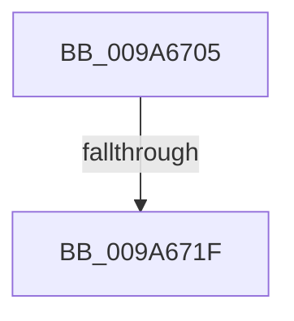

# sub_009A6705

- RVA: `0x009A6705`–`0x009A6724` (길이 `31` bytes)
- VA: `0x00000001409A6705`
- 실행 섹션: `PAGE`
- PDB 이름 있음: `아니요`; PDB Function 태그: `아니요`
- unwind 정보 RVA: `0x0009C7F8`
- 디코드: `8`개 명령, `31/31` bytes 표시
- 미해석 바이트: `0` (있으면 어셈블리에 `.byte`로 보존)

> 이 문서는 커널 이미지의 기계어와 PDB 기호를 분석해 생성했습니다. 4번과 5번은 함수 원형과 자료형을 바이너리 사용 방식에서 추정한 C 해석이며 원본 소스 복구 결과는 아닙니다.

## 1. Dependencies

- 직접 호출 지점: **1**; 고유 호출 대상: **1**
- 직접 호출자로 확인된 함수: **0**
- RIP 상대 이미지 참조: **0**

### Outgoing calls
- `0x009A6712` → [KeVerifyContextRecord](../../text/40/KeVerifyContextRecord_function_0040BE90.md) (function, `0x0040BE90`)

### Direct callers
- 이 함수 시작 RVA로 연결되는 직접 call은 확인되지 않았습니다. 간접 호출은 완전히 역산할 수 없습니다.

### Static image references
- 디코드된 RIP-relative 메모리 참조가 없습니다.

## 2. Other-region calls and transfers

- 다른 실행 섹션으로 향하는 call: **1**
  - `0x009A6712` → [KeVerifyContextRecord](../../text/40/KeVerifyContextRecord_function_0040BE90.md) (`PAGE` → `.text`)
- call이 아닌 외부 분기/꼬리 이동: **2**
  - `0x009A6719` → [sub_009A64C2](Unknown_function_009A64C2.md) (`tail-transfer`)
  - `0x009A671F` → [sub_009A61EA + 0x4F](Unknown_function_009A61EA.md) (`tail-transfer`)

## 3. Assembly (complete function range)

```asm
009A6705  48 8B 51 78                     mov rdx, qword ptr [rcx + 0x78]
009A6709  45 33 C9                        xor r9d, r9d
009A670C  49 8B CF                        mov rcx, r15
009A670F  45 33 C0                        xor r8d, r8d
009A6712  E8 79 57 A6 FF                  call 0x14040be90
009A6717  85 C0                           test eax, eax
009A6719  0F 88 A3 FD FF FF               js 0x1409a64c2
009A671F  E9 15 FB FF FF                  jmp 0x1409a6239
```

## 4. C-style interpretation (structured pseudocode)

```c
__int64 __fastcall sub_009A6705(__int64 a1, __int64 a2, int a3, int a4)
{
    __int64 result;

    a4 = 0;
    a3 = 0;
    result = KeVerifyContextRecord(v_r15, *(unsigned __int64 *)(a1 + 120), a3, a4);
}
```

## 5. (Beta) C Style

```c
int64_t sub_009A6705(void *Arg1, int64_t Arg2, int32_t Arg3, int32_t Arg4)
{
    uint8_t *arg1 = (uint8_t *)Arg1;

    int64_t result;

    Arg4 = 0;
    Arg3 = 0;
    result = KeVerifyContextRecord(local_r15, *(uint64_t *)(arg1 + 0x78), Arg3, Arg4);
}
```

### 관측된 메모리 오프셋

구조체 형식이 확인되지 않은 접근은 인자 기준의 오프셋으로만 기록했습니다.

| 기준 인자 | 오프셋 표현 | 폭 (bit) | 접근 |
|---|---:|---:|---|
| `Arg1` | `+ 0x78` | `64` | `R` |

## 6. Execution-region graph

[열기: 2D/3D 그래프와 함수 탐색 컨트롤 패널](../../../control-panel.html?section=page&rva=0x009A6705&view=graph)

- 2D 그래프는 위에서 아래로 흐르고, 3D 그래프는 빈 공간을 드래그해 회전합니다. Shift+드래그는 이동, 휠은 확대·축소, 함수 노드 선택은 대상 보고서 이동입니다.

### Static fallback


