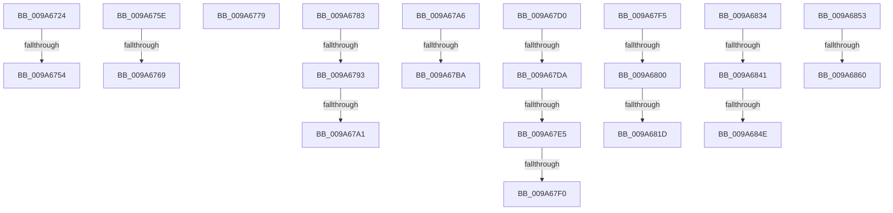

# sub_009A6724

- RVA: `0x009A6724`–`0x009A6867` (길이 `323` bytes)
- VA: `0x00000001409A6724`
- 실행 섹션: `PAGE`
- PDB 이름 있음: `아니요`; PDB Function 태그: `아니요`
- unwind 정보 RVA: `0x0009C814`
- 디코드: `67`개 명령, `323/323` bytes 표시
- 미해석 바이트: `0` (있으면 어셈블리에 `.byte`로 보존)

> 이 문서는 커널 이미지의 기계어와 PDB 기호를 분석해 생성했습니다. 4번과 5번은 함수 원형과 자료형을 바이너리 사용 방식에서 추정한 C 해석이며 원본 소스 복구 결과는 아닙니다.

## 1. Dependencies

- 직접 호출 지점: **5**; 고유 호출 대상: **5**
- 직접 호출자로 확인된 함수: **0**
- RIP 상대 이미지 참조: **2**

### Outgoing calls
- `0x009A6747` → [KeVerifyContextIpForUserCet](../../text/40/KeVerifyContextIpForUserCet_function_0040BDD0.md) (function, `0x0040BDD0`)
- `0x009A67AD` → [RtlGetExtendedContextLength](../../text/3D/RtlGetExtendedContextLength_function_003D7190.md) (function, `0x003D7190`)
- `0x009A67C6` → [VslGetSetSecureContext](../71/VslGetSetSecureContext_function_00718C8C.md) (function, `0x00718C8C`)
- `0x009A680D` → [PspGetContext](PspGetContext_function_009A6870.md) (function, `0x009A6870`)
- `0x009A682A` → [RtlCopyContext](../8D/RtlCopyContext_function_008D5940.md) (function, `0x008D5940`)

### Direct callers
- 이 함수 시작 RVA로 연결되는 직접 call은 확인되지 않았습니다. 간접 호출은 완전히 역산할 수 없습니다.

### Static image references
- `0x009A6834` → RVA `0x00F475F8` (`.data`; read)
- `0x009A6841` → RVA `0x00F475DC` (`.data`; read)

## 2. Other-region calls and transfers

- 다른 실행 섹션으로 향하는 call: **2**
  - `0x009A6747` → [KeVerifyContextIpForUserCet](../../text/40/KeVerifyContextIpForUserCet_function_0040BDD0.md) (`PAGE` → `.text`)
  - `0x009A67AD` → [RtlGetExtendedContextLength](../../text/3D/RtlGetExtendedContextLength_function_003D7190.md) (`PAGE` → `.text`)
- call이 아닌 외부 분기/꼬리 이동: **22**
  - `0x009A674E` → [sub_009A6520 + 0x4F](Unknown_function_009A6520.md) (`tail-transfer`)
  - `0x009A6759` → [sub_009A623D + 0x27D](Unknown_function_009A623D.md) (`tail-transfer`)
  - `0x009A6763` → [sub_009A6520 + 0x4F](Unknown_function_009A6520.md) (`tail-transfer`)
  - `0x009A6774` → [sub_009A6520 + 0x24](Unknown_function_009A6520.md) (`tail-transfer`)
  - `0x009A677E` → [sub_009A623D + 0x27D](Unknown_function_009A623D.md) (`tail-transfer`)
  - `0x009A678D` → [sub_009A6520 + 0x19F](Unknown_function_009A6520.md) (`tail-transfer`)
  - `0x009A679B` → [sub_009A623D + 0x3C](Unknown_function_009A623D.md) (`tail-transfer`)
  - `0x009A67A1` → [sub_009A6520 + 0x19F](Unknown_function_009A6520.md) (`tail-transfer`)
  - `0x009A67B4` → [sub_009A6520 + 0x1A4](Unknown_function_009A6520.md) (`tail-transfer`)
  - `0x009A67CB` → [sub_009A623D + 0x27D](Unknown_function_009A623D.md) (`tail-transfer`)
  - `0x009A67D4` → [sub_009A6520 + 0x80](Unknown_function_009A6520.md) (`tail-transfer`)
  - `0x009A67DF` → [sub_00B2D612](../B2/Unknown_function_00B2D612.md) (`tail-transfer`)
  - `0x009A67EA` → [sub_009A6520 + 0x80](Unknown_function_009A6520.md) (`tail-transfer`)
  - `0x009A67F0` → [sub_00B2D612](../B2/Unknown_function_00B2D612.md) (`tail-transfer`)
  - `0x009A67FA` → [sub_009A623D + 0x267](Unknown_function_009A623D.md) (`tail-transfer`)
  - `0x009A6817` → [sub_009A623D + 0x276](Unknown_function_009A623D.md) (`tail-transfer`)
  - `0x009A682F` → [sub_009A623D + 0x276](Unknown_function_009A623D.md) (`tail-transfer`)
  - `0x009A683B` → [sub_00B2D612 + 0x12](../B2/Unknown_function_00B2D612.md) (`tail-transfer`)
  - `0x009A6848` → [sub_00B2D612 + 0x12](../B2/Unknown_function_00B2D612.md) (`tail-transfer`)
  - `0x009A684E` → [sub_00B2D612 + 0x1F](../B2/Unknown_function_00B2D612.md) (`tail-transfer`)
  - `0x009A685A` → [sub_009A6520 + 0x192](Unknown_function_009A6520.md) (`tail-transfer`)
  - `0x009A6862` → [sub_009A6520 + 0x19F](Unknown_function_009A6520.md) (`tail-transfer`)

## 3. Assembly (complete function range)

```asm
009A6724  49 8B 56 78                     mov rdx, qword ptr [r14 + 0x78]
009A6728  4C 8D 4D 88                     lea r9, [rbp - 0x78]
009A672C  0F 57 C0                        xorps xmm0, xmm0
009A672F  4C 8D 45 C8                     lea r8, [rbp - 0x38]
009A6733  33 C0                           xor eax, eax
009A6735  49 8B CF                        mov rcx, r15
009A6738  0F 11 45 C8                     movups xmmword ptr [rbp - 0x38], xmm0
009A673C  C7 45 C8 03 00 00 00            mov dword ptr [rbp - 0x38], 3
009A6743  48 89 45 D8                     mov qword ptr [rbp - 0x28], rax
009A6747  E8 84 56 A6 FF                  call 0x14040bdd0
009A674C  85 C0                           test eax, eax
009A674E  0F 89 1B FE FF FF               jns 0x1409a656f
009A6754  48 8B 7C 24 78                  mov rdi, qword ptr [rsp + 0x78]
009A6759  E9 5C FD FF FF                  jmp 0x1409a64ba
009A675E  41 80 7E 58 01                  cmp byte ptr [r14 + 0x58], 1
009A6763  0F 85 06 FE FF FF               jne 0x1409a656f
009A6769  4D 8B 6E 78                     mov r13, qword ptr [r14 + 0x78]
009A676D  49 81 C5 00 01 00 00            add r13, 0x100
009A6774  E9 CB FD FF FF                  jmp 0x1409a6544
009A6779  48 8B 7C 24 78                  mov rdi, qword ptr [rsp + 0x78]
009A677E  E9 37 FD FF FF                  jmp 0x1409a64ba
009A6783  49 8B BF 90 00 00 00            mov rdi, qword ptr [r15 + 0x90]
009A678A  48 85 FF                        test rdi, rdi
009A678D  0F 84 2C FF FF FF               je 0x1409a66bf
009A6793  66 83 BF 70 01 00 00 10         cmp word ptr [rdi + 0x170], 0x10
009A679B  0F 84 D8 FA FF FF               je 0x1409a6279
009A67A1  E9 19 FF FF FF                  jmp 0x1409a66bf
009A67A6  48 8D 55 80                     lea rdx, [rbp - 0x80]
009A67AA  41 8B CC                        mov ecx, r12d
009A67AD  E8 DE 09 A3 FF                  call 0x1403d7190
009A67B2  85 C0                           test eax, eax
009A67B4  0F 88 0A FF FF FF               js 0x1409a66c4
009A67BA  44 8B 45 80                     mov r8d, dword ptr [rbp - 0x80]
009A67BE  49 8B 56 78                     mov rdx, qword ptr [r14 + 0x78]
009A67C2  48 8B 4D 88                     mov rcx, qword ptr [rbp - 0x78]
009A67C6  E8 C1 24 D7 FF                  call 0x140718c8c
009A67CB  E9 EA FC FF FF                  jmp 0x1409a64ba
009A67D0  41 80 F9 01                     cmp r9b, 1
009A67D4  0F 85 C6 FD FF FF               jne 0x1409a65a0
009A67DA  41 F6 46 59 02                  test byte ptr [r14 + 0x59], 2
009A67DF  0F 85 2D 6E 18 00               jne 0x140b2d612
009A67E5  41 F6 47 03 08                  test byte ptr [r15 + 3], 8
009A67EA  0F 84 B0 FD FF FF               je 0x1409a65a0
009A67F0  E9 1D 6E 18 00                  jmp 0x140b2d612
009A67F5  41 80 7E 58 01                  cmp byte ptr [r14 + 0x58], 1
009A67FA  0F 85 A4 FC FF FF               jne 0x1409a64a4
009A6800  49 8B 5E 78                     mov rbx, qword ptr [r14 + 0x78]
009A6804  48 8B D6                        mov rdx, rsi
009A6807  4C 8B C3                        mov r8, rbx
009A680A  48 8B CF                        mov rcx, rdi
009A680D  E8 5E 00 00 00                  call 0x1409a6870
009A6812  41 F6 47 03 08                  test byte ptr [r15 + 3], 8
009A6817  0F 84 96 FC FF FF               je 0x1409a64b3
009A681D  4D 8B 87 A8 06 00 00            mov r8, qword ptr [r15 + 0x6a8]
009A6824  48 8B CB                        mov rcx, rbx
009A6827  8B 53 30                        mov edx, dword ptr [rbx + 0x30]
009A682A  E8 11 F1 F2 FF                  call 0x1408d5940
009A682F  E9 7F FC FF FF                  jmp 0x1409a64b3
009A6834  44 38 2D BD 0D 5A 00            cmp byte ptr [rip + 0x5a0dbd], r13b
009A683B  0F 84 E3 6D 18 00               je 0x140b2d624
009A6841  44 38 2D 94 0D 5A 00            cmp byte ptr [rip + 0x5a0d94], r13b
009A6848  0F 85 D6 6D 18 00               jne 0x140b2d624
009A684E  E9 DE 6D 18 00                  jmp 0x140b2d631
009A6853  44 38 2D 82 0D 5A 00            cmp byte ptr [rip + 0x5a0d82], r13b
009A685A  0F 85 52 FE FF FF               jne 0x1409a66b2
009A6860  CD 2C                           int 0x2c
009A6862  E9 58 FE FF FF                  jmp 0x1409a66bf
```

## 4. C-style interpretation (structured pseudocode)

```c
__int64 __fastcall sub_009A6724(__int64 a1, __int64 a2, __int64 a3, __int64 a4, __int64 a5, __int64 a6, __int64 a7, __int64 a8, __int64 a9, __int64 a10, __int64 a11, __int64 a12, __int64 a13, __int64 a14, __int64 a15)
{
    __int64 result;
    unsigned __int64 v_stack_p78;

    result = 0;
    *(unsigned __int64 *)(v_rbp - 56) = v_xmm0;
    *(unsigned int *)(v_rbp - 56) = 3;
    *(unsigned __int64 *)(v_rbp - 40) = 0;
    result = KeVerifyContextIpForUserCet(v_r15, *(unsigned __int64 *)(v_r14 + 120), v_rbp - 56, v_rbp - 120);
}
```

## 5. (Beta) C Style

```c
int64_t sub_009A6724(int64_t Arg1, int64_t Arg2, int64_t Arg3, int64_t Arg4, uint64_t Arg5, uint64_t Arg6, uint64_t Arg7, uint64_t Arg8, uint64_t Arg9, uint64_t Arg10, uint64_t Arg11, uint64_t Arg12, uint64_t Arg13, uint64_t Arg14, int64_t Arg15)
{
    int64_t result;
    uint64_t v_stack_p78;

    result = 0;
    *(uint64_t *)(local_rbp - 0x38) = v_xmm0;
    *(uint32_t *)(local_rbp - 0x38) = 3;
    *(uint64_t *)(local_rbp - 0x28) = 0;
    result = KeVerifyContextIpForUserCet(local_r15, *(uint64_t *)(local_r14 + 0x78), local_rbp - 56, local_rbp - 120);
}
```

## 6. Execution-region graph

[열기: 2D/3D 그래프와 함수 탐색 컨트롤 패널](../../../control-panel.html?section=page&rva=0x009A6724&view=graph)

- 2D 그래프는 위에서 아래로 흐르고, 3D 그래프는 빈 공간을 드래그해 회전합니다. Shift+드래그는 이동, 휠은 확대·축소, 함수 노드 선택은 대상 보고서 이동입니다.

### Static fallback


