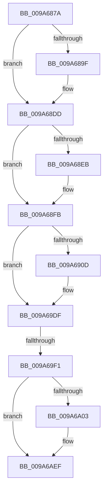

# sub_009A687A

- RVA: `0x009A687A`–`0x009A6B02` (길이 `648` bytes)
- VA: `0x00000001409A687A`
- 실행 섹션: `PAGE`
- PDB 이름 있음: `아니요`; PDB Function 태그: `아니요`
- unwind 정보 RVA: `0x0009C860`
- 디코드: `127`개 명령, `648/648` bytes 표시
- 미해석 바이트: `0` (있으면 어셈블리에 `.byte`로 보존)

> 이 문서는 커널 이미지의 기계어와 PDB 기호를 분석해 생성했습니다. 4번과 5번은 함수 원형과 자료형을 바이너리 사용 방식에서 추정한 C 해석이며 원본 소스 복구 결과는 아닙니다.

## 1. Dependencies

- 직접 호출 지점: **0**; 고유 호출 대상: **0**
- 직접 호출자로 확인된 함수: **0**
- RIP 상대 이미지 참조: **0**

### Outgoing calls
- 직접 디코드된 call 명령이 없습니다.

### Direct callers
- 이 함수 시작 RVA로 연결되는 직접 call은 확인되지 않았습니다. 간접 호출은 완전히 역산할 수 없습니다.

### Static image references
- 디코드된 RIP-relative 메모리 참조가 없습니다.

## 2. Other-region calls and transfers

- 다른 실행 섹션으로 향하는 call: **0**
- call이 아닌 외부 분기/꼬리 이동: **2**
  - `0x009A69EB` → [sub_009A6B56](Unknown_function_009A6B56.md) (`tail-transfer`)
  - `0x009A6B00` → [sub_009A6B1D](Unknown_function_009A6B1D.md) (`tail-transfer`)

## 3. Assembly (complete function range)

```asm
009A687A  48 89 6C 24 30                  mov qword ptr [rsp + 0x30], rbp
009A687F  49 8B D8                        mov rbx, r8
009A6882  48 89 74 24 38                  mov qword ptr [rsp + 0x38], rsi
009A6887  48 8B EA                        mov rbp, rdx
009A688A  41 8B 70 30                     mov esi, dword ptr [r8 + 0x30]
009A688E  48 8B F9                        mov rdi, rcx
009A6891  8B C6                           mov eax, esi
009A6893  25 01 00 10 00                  and eax, 0x100001
009A6898  3D 01 00 10 00                  cmp eax, 0x100001
009A689D  75 3E                           jne 0x1409a68dd
009A689F  48 8B 81 68 01 00 00            mov rax, qword ptr [rcx + 0x168]
009A68A6  49 89 80 F8 00 00 00            mov qword ptr [r8 + 0xf8], rax
009A68AD  0F B7 81 70 01 00 00            movzx eax, word ptr [rcx + 0x170]
009A68B4  66 41 89 40 38                  mov word ptr [r8 + 0x38], ax
009A68B9  0F B7 81 88 01 00 00            movzx eax, word ptr [rcx + 0x188]
009A68C0  66 41 89 40 42                  mov word ptr [r8 + 0x42], ax
009A68C5  48 8B 81 80 01 00 00            mov rax, qword ptr [rcx + 0x180]
009A68CC  49 89 80 98 00 00 00            mov qword ptr [r8 + 0x98], rax
009A68D3  8B 81 78 01 00 00               mov eax, dword ptr [rcx + 0x178]
009A68D9  41 89 40 44                     mov dword ptr [r8 + 0x44], eax
009A68DD  8B C6                           mov eax, esi
009A68DF  25 04 00 10 00                  and eax, 0x100004
009A68E4  3D 04 00 10 00                  cmp eax, 0x100004
009A68E9  75 10                           jne 0x1409a68fb
009A68EB  41 C7 40 3A 2B 00 2B 00         mov dword ptr [r8 + 0x3a], 0x2b002b
009A68F3  41 C7 40 3E 53 00 2B 00         mov dword ptr [r8 + 0x3e], 0x2b0053
009A68FB  8B C6                           mov eax, esi
009A68FD  25 02 00 10 00                  and eax, 0x100002
009A6902  3D 02 00 10 00                  cmp eax, 0x100002
009A6907  0F 85 D2 00 00 00               jne 0x1409a69df
009A690D  48 8B 41 30                     mov rax, qword ptr [rcx + 0x30]
009A6911  49 89 40 78                     mov qword ptr [r8 + 0x78], rax
009A6915  48 8B 41 38                     mov rax, qword ptr [rcx + 0x38]
009A6919  49 89 80 80 00 00 00            mov qword ptr [r8 + 0x80], rax
009A6920  48 8B 41 40                     mov rax, qword ptr [rcx + 0x40]
009A6924  49 89 80 88 00 00 00            mov qword ptr [r8 + 0x88], rax
009A692B  48 8B 41 48                     mov rax, qword ptr [rcx + 0x48]
009A692F  49 89 80 B8 00 00 00            mov qword ptr [r8 + 0xb8], rax
009A6936  48 8B 41 50                     mov rax, qword ptr [rcx + 0x50]
009A693A  49 89 80 C0 00 00 00            mov qword ptr [r8 + 0xc0], rax
009A6941  48 8B 41 58                     mov rax, qword ptr [rcx + 0x58]
009A6945  49 89 80 C8 00 00 00            mov qword ptr [r8 + 0xc8], rax
009A694C  48 8B 41 60                     mov rax, qword ptr [rcx + 0x60]
009A6950  49 89 80 D0 00 00 00            mov qword ptr [r8 + 0xd0], rax
009A6957  48 8B 82 98 00 00 00            mov rax, qword ptr [rdx + 0x98]
009A695E  48 8B 08                        mov rcx, qword ptr [rax]
009A6961  49 89 88 90 00 00 00            mov qword ptr [r8 + 0x90], rcx
009A6968  48 8B 82 A8 00 00 00            mov rax, qword ptr [rdx + 0xa8]
009A696F  48 8B 08                        mov rcx, qword ptr [rax]
009A6972  49 89 88 A0 00 00 00            mov qword ptr [r8 + 0xa0], rcx
009A6979  48 8B 82 B0 00 00 00            mov rax, qword ptr [rdx + 0xb0]
009A6980  48 8B 08                        mov rcx, qword ptr [rax]
009A6983  49 89 88 A8 00 00 00            mov qword ptr [r8 + 0xa8], rcx
009A698A  48 8B 82 B8 00 00 00            mov rax, qword ptr [rdx + 0xb8]
009A6991  48 8B 08                        mov rcx, qword ptr [rax]
009A6994  49 89 88 B0 00 00 00            mov qword ptr [r8 + 0xb0], rcx
009A699B  48 8B 82 E0 00 00 00            mov rax, qword ptr [rdx + 0xe0]
009A69A2  48 8B 08                        mov rcx, qword ptr [rax]
009A69A5  49 89 88 D8 00 00 00            mov qword ptr [r8 + 0xd8], rcx
009A69AC  48 8B 82 E8 00 00 00            mov rax, qword ptr [rdx + 0xe8]
009A69B3  48 8B 08                        mov rcx, qword ptr [rax]
009A69B6  49 89 88 E0 00 00 00            mov qword ptr [r8 + 0xe0], rcx
009A69BD  48 8B 82 F0 00 00 00            mov rax, qword ptr [rdx + 0xf0]
009A69C4  48 8B 08                        mov rcx, qword ptr [rax]
009A69C7  49 89 88 E8 00 00 00            mov qword ptr [r8 + 0xe8], rcx
009A69CE  48 8B 82 F8 00 00 00            mov rax, qword ptr [rdx + 0xf8]
009A69D5  48 8B 08                        mov rcx, qword ptr [rax]
009A69D8  49 89 88 F0 00 00 00            mov qword ptr [r8 + 0xf0], rcx
009A69DF  8B C6                           mov eax, esi
009A69E1  25 40 00 10 00                  and eax, 0x100040
009A69E6  3D 40 00 10 00                  cmp eax, 0x100040
009A69EB  0F 84 65 01 00 00               je 0x1409a6b56
009A69F1  8B C6                           mov eax, esi
009A69F3  25 08 00 10 00                  and eax, 0x100008
009A69F8  3D 08 00 10 00                  cmp eax, 0x100008
009A69FD  0F 85 EC 00 00 00               jne 0x1409a6aef
009A6A03  0F 10 47 70                     movups xmm0, xmmword ptr [rdi + 0x70]
009A6A07  0F 11 83 A0 01 00 00            movups xmmword ptr [rbx + 0x1a0], xmm0
009A6A0E  0F 10 87 80 00 00 00            movups xmm0, xmmword ptr [rdi + 0x80]
009A6A15  0F 11 83 B0 01 00 00            movups xmmword ptr [rbx + 0x1b0], xmm0
009A6A1C  0F 10 87 90 00 00 00            movups xmm0, xmmword ptr [rdi + 0x90]
009A6A23  0F 11 83 C0 01 00 00            movups xmmword ptr [rbx + 0x1c0], xmm0
009A6A2A  0F 10 87 A0 00 00 00            movups xmm0, xmmword ptr [rdi + 0xa0]
009A6A31  0F 11 83 D0 01 00 00            movups xmmword ptr [rbx + 0x1d0], xmm0
009A6A38  0F 10 87 B0 00 00 00            movups xmm0, xmmword ptr [rdi + 0xb0]
009A6A3F  0F 11 83 E0 01 00 00            movups xmmword ptr [rbx + 0x1e0], xmm0
009A6A46  0F 10 87 C0 00 00 00            movups xmm0, xmmword ptr [rdi + 0xc0]
009A6A4D  0F 11 83 F0 01 00 00            movups xmmword ptr [rbx + 0x1f0], xmm0
009A6A54  48 8B 45 30                     mov rax, qword ptr [rbp + 0x30]
009A6A58  0F 28 00                        movaps xmm0, xmmword ptr [rax]
009A6A5B  0F 11 83 00 02 00 00            movups xmmword ptr [rbx + 0x200], xmm0
009A6A62  48 8B 45 38                     mov rax, qword ptr [rbp + 0x38]
009A6A66  0F 28 00                        movaps xmm0, xmmword ptr [rax]
009A6A69  0F 11 83 10 02 00 00            movups xmmword ptr [rbx + 0x210], xmm0
009A6A70  48 8B 45 40                     mov rax, qword ptr [rbp + 0x40]
009A6A74  0F 28 00                        movaps xmm0, xmmword ptr [rax]
009A6A77  0F 11 83 20 02 00 00            movups xmmword ptr [rbx + 0x220], xmm0
009A6A7E  48 8B 45 48                     mov rax, qword ptr [rbp + 0x48]
009A6A82  0F 28 00                        movaps xmm0, xmmword ptr [rax]
009A6A85  0F 11 83 30 02 00 00            movups xmmword ptr [rbx + 0x230], xmm0
009A6A8C  48 8B 45 50                     mov rax, qword ptr [rbp + 0x50]
009A6A90  0F 28 00                        movaps xmm0, xmmword ptr [rax]
009A6A93  0F 11 83 40 02 00 00            movups xmmword ptr [rbx + 0x240], xmm0
009A6A9A  48 8B 45 58                     mov rax, qword ptr [rbp + 0x58]
009A6A9E  0F 28 00                        movaps xmm0, xmmword ptr [rax]
009A6AA1  0F 11 83 50 02 00 00            movups xmmword ptr [rbx + 0x250], xmm0
009A6AA8  48 8B 45 60                     mov rax, qword ptr [rbp + 0x60]
009A6AAC  0F 28 00                        movaps xmm0, xmmword ptr [rax]
009A6AAF  0F 11 83 60 02 00 00            movups xmmword ptr [rbx + 0x260], xmm0
009A6AB6  48 8B 45 68                     mov rax, qword ptr [rbp + 0x68]
009A6ABA  0F 28 00                        movaps xmm0, xmmword ptr [rax]
009A6ABD  0F 11 83 70 02 00 00            movups xmmword ptr [rbx + 0x270], xmm0
009A6AC4  48 8B 45 70                     mov rax, qword ptr [rbp + 0x70]
009A6AC8  0F 28 00                        movaps xmm0, xmmword ptr [rax]
009A6ACB  0F 11 83 80 02 00 00            movups xmmword ptr [rbx + 0x280], xmm0
009A6AD2  48 8B 45 78                     mov rax, qword ptr [rbp + 0x78]
009A6AD6  0F 28 00                        movaps xmm0, xmmword ptr [rax]
009A6AD9  0F 11 83 90 02 00 00            movups xmmword ptr [rbx + 0x290], xmm0
009A6AE0  8B 47 2C                        mov eax, dword ptr [rdi + 0x2c]
009A6AE3  89 43 34                        mov dword ptr [rbx + 0x34], eax
009A6AE6  8B 47 2C                        mov eax, dword ptr [rdi + 0x2c]
009A6AE9  89 83 18 01 00 00               mov dword ptr [rbx + 0x118], eax
009A6AEF  48 8B 6C 24 30                  mov rbp, qword ptr [rsp + 0x30]
009A6AF4  8B C6                           mov eax, esi
009A6AF6  25 10 00 10 00                  and eax, 0x100010
009A6AFB  3D 10 00 10 00                  cmp eax, 0x100010
009A6B00  74 1B                           je 0x1409a6b1d
```

## 4. C-style interpretation (structured pseudocode)

```c
__int64 __fastcall sub_009A687A(__int64 a1, __int64 a2, __int64 a3, __int64 a4, __int64 a5, __int64 a6)
{
    __int64 result;
    unsigned __int64 v_stack_p30;
    unsigned __int64 v_stack_p38;

    v_stack_p30 = v_rbp;
    v_stack_p38 = v_rsi;
    result = (unsigned int)(((unsigned int)((unsigned int)((unsigned int)(*(unsigned int *)(a3 + 48))))) & (0x100001ULL));
    if (((unsigned int)(result)) == 0x100001ULL) {
        result = *(unsigned __int64 *)(a1 + 360);
        *(unsigned __int64 *)(a3 + 248) = result;
        result = *(unsigned __int16 *)(a1 + 368);
        *(unsigned __int16 *)(a3 + 56) = (unsigned __int16)(result);
        result = *(unsigned __int16 *)(a1 + 392);
        *(unsigned __int16 *)(a3 + 66) = (unsigned __int16)(result);
        result = *(unsigned __int64 *)(a1 + 384);
        *(unsigned __int64 *)(a3 + 152) = result;
        result = *(unsigned int *)(a1 + 376);
        *(unsigned int *)(a3 + 68) = (unsigned int)(result);
    }
    result = (unsigned int)(((unsigned int)((unsigned int)((unsigned int)(*(unsigned int *)(a3 + 48))))) & (0x100004ULL));
    if (((unsigned int)(result)) == 0x100004ULL) {
        *(unsigned int *)(a3 + 58) = 0x2B002BULL;
        *(unsigned int *)(a3 + 62) = 0x2B0053ULL;
    }
    result = (unsigned int)(((unsigned int)((unsigned int)((unsigned int)(*(unsigned int *)(a3 + 48))))) & (0x100002ULL));
    if (((unsigned int)(result)) == 0x100002ULL) {
        result = *(unsigned __int64 *)(a1 + 48);
        *(unsigned __int64 *)(a3 + 120) = result;
        result = *(unsigned __int64 *)(a1 + 56);
        *(unsigned __int64 *)(a3 + 128) = result;
        result = *(unsigned __int64 *)(a1 + 64);
        *(unsigned __int64 *)(a3 + 136) = result;
        result = *(unsigned __int64 *)(a1 + 72);
        *(unsigned __int64 *)(a3 + 184) = result;
        result = *(unsigned __int64 *)(a1 + 80);
        *(unsigned __int64 *)(a3 + 192) = result;
        result = *(unsigned __int64 *)(a1 + 88);
        *(unsigned __int64 *)(a3 + 200) = result;
        result = *(unsigned __int64 *)(a1 + 96);
        *(unsigned __int64 *)(a3 + 208) = result;
        result = *(unsigned __int64 *)(a2 + 152);
        a1 = *(unsigned __int64 *)(result);
        *(unsigned __int64 *)(a3 + 144) = a1;
        result = *(unsigned __int64 *)(a2 + 168);
        a1 = *(unsigned __int64 *)(result);
        *(unsigned __int64 *)(a3 + 160) = a1;
        result = *(unsigned __int64 *)(a2 + 176);
        a1 = *(unsigned __int64 *)(result);
        *(unsigned __int64 *)(a3 + 168) = a1;
        result = *(unsigned __int64 *)(a2 + 184);
        a1 = *(unsigned __int64 *)(result);
        *(unsigned __int64 *)(a3 + 176) = a1;
        result = *(unsigned __int64 *)(a2 + 224);
        a1 = *(unsigned __int64 *)(result);
        *(unsigned __int64 *)(a3 + 216) = a1;
        result = *(unsigned __int64 *)(a2 + 232);
        a1 = *(unsigned __int64 *)(result);
        *(unsigned __int64 *)(a3 + 224) = a1;
        result = *(unsigned __int64 *)(a2 + 240);
        a1 = *(unsigned __int64 *)(result);
        *(unsigned __int64 *)(a3 + 232) = a1;
        result = *(unsigned __int64 *)(a2 + 248);
        a1 = *(unsigned __int64 *)(result);
        *(unsigned __int64 *)(a3 + 240) = a1;
    }
    result = (unsigned int)(((unsigned int)((unsigned int)((unsigned int)(*(unsigned int *)(a3 + 48))))) & (0x100040ULL));
    result = (unsigned int)(((unsigned int)((unsigned int)((unsigned int)(*(unsigned int *)(a3 + 48))))) & (0x100008ULL));
    if (((unsigned int)(result)) == 0x100008ULL) {
        *(unsigned __int64 *)(a3 + 416) = v_xmm0;
        *(unsigned __int64 *)(a3 + 432) = v_xmm0;
        *(unsigned __int64 *)(a3 + 448) = v_xmm0;
        *(unsigned __int64 *)(a3 + 464) = v_xmm0;
        *(unsigned __int64 *)(a3 + 480) = v_xmm0;
        *(unsigned __int64 *)(a3 + 496) = v_xmm0;
        result = *(unsigned __int64 *)(a2 + 48);
        *(unsigned __int64 *)(a3 + 512) = v_xmm0;
        result = *(unsigned __int64 *)(a2 + 56);
        *(unsigned __int64 *)(a3 + 528) = v_xmm0;
        result = *(unsigned __int64 *)(a2 + 64);
        *(unsigned __int64 *)(a3 + 544) = v_xmm0;
        result = *(unsigned __int64 *)(a2 + 72);
        *(unsigned __int64 *)(a3 + 560) = v_xmm0;
        result = *(unsigned __int64 *)(a2 + 80);
        *(unsigned __int64 *)(a3 + 576) = v_xmm0;
        result = *(unsigned __int64 *)(a2 + 88);
        *(unsigned __int64 *)(a3 + 592) = v_xmm0;
        result = *(unsigned __int64 *)(a2 + 96);
        *(unsigned __int64 *)(a3 + 608) = v_xmm0;
        result = *(unsigned __int64 *)(a2 + 104);
        *(unsigned __int64 *)(a3 + 624) = v_xmm0;
        result = *(unsigned __int64 *)(a2 + 112);
        *(unsigned __int64 *)(a3 + 640) = v_xmm0;
        result = *(unsigned __int64 *)(a2 + 120);
        *(unsigned __int64 *)(a3 + 656) = v_xmm0;
        result = *(unsigned int *)(a1 + 44);
        *(unsigned int *)(a3 + 52) = (unsigned int)(result);
        result = *(unsigned int *)(a1 + 44);
        *(unsigned int *)(a3 + 280) = (unsigned int)(result);
    }
    result = (unsigned int)(((unsigned int)((unsigned int)((unsigned int)(*(unsigned int *)(a3 + 48))))) & (0x100010ULL));
}
```

## 5. (Beta) C Style

```c
int64_t sub_009A687A(void *Arg1, void *Arg2, void *Arg3, int64_t Arg4, uint64_t Arg5, int64_t Arg6)
{
    uint8_t *arg1 = (uint8_t *)Arg1;
    uint8_t *arg2 = (uint8_t *)Arg2;
    uint8_t *arg3 = (uint8_t *)Arg3;

    int64_t result;
    uint64_t v_stack_p30;
    uint64_t v_stack_p38;

    v_stack_p30 = local_rbp;
    v_stack_p38 = local_rsi;
    result = (uint32_t)(((uint32_t)((uint32_t)((uint32_t)(*(uint32_t *)(arg3 + 0x30))))) & (0x100001ULL));
    if (((uint32_t)(result)) == 0x100001ULL) {
        result = *(uint64_t *)(arg1 + 0x168);
        *(uint64_t *)(arg3 + 0xF8) = result;
        result = *(uint16_t *)(arg1 + 0x170);
        *(uint16_t *)(arg3 + 0x38) = (uint16_t)(result);
        result = *(uint16_t *)(arg1 + 0x188);
        *(uint16_t *)(arg3 + 0x42) = (uint16_t)(result);
        result = *(uint64_t *)(arg1 + 0x180);
        *(uint64_t *)(arg3 + 0x98) = result;
        result = *(uint32_t *)(arg1 + 0x178);
        *(uint32_t *)(arg3 + 0x44) = (uint32_t)(result);
    }
    result = (uint32_t)(((uint32_t)((uint32_t)((uint32_t)(*(uint32_t *)(arg3 + 0x30))))) & (0x100004ULL));
    if (((uint32_t)(result)) == 0x100004ULL) {
        *(uint32_t *)(arg3 + 0x3A) = 0x2B002BULL;
        *(uint32_t *)(arg3 + 0x3E) = 0x2B0053ULL;
    }
    result = (uint32_t)(((uint32_t)((uint32_t)((uint32_t)(*(uint32_t *)(arg3 + 0x30))))) & (0x100002ULL));
    if (((uint32_t)(result)) == 0x100002ULL) {
        result = *(uint64_t *)(arg1 + 0x30);
        *(uint64_t *)(arg3 + 0x78) = result;
        result = *(uint64_t *)(arg1 + 0x38);
        *(uint64_t *)(arg3 + 0x80) = result;
        result = *(uint64_t *)(arg1 + 0x40);
        *(uint64_t *)(arg3 + 0x88) = result;
        result = *(uint64_t *)(arg1 + 0x48);
        *(uint64_t *)(arg3 + 0xB8) = result;
        result = *(uint64_t *)(arg1 + 0x50);
        *(uint64_t *)(arg3 + 0xC0) = result;
        result = *(uint64_t *)(arg1 + 0x58);
        *(uint64_t *)(arg3 + 0xC8) = result;
        result = *(uint64_t *)(arg1 + 0x60);
        *(uint64_t *)(arg3 + 0xD0) = result;
        result = *(uint64_t *)(arg2 + 0x98);
        Arg1 = *(uint64_t *)(result);
        *(void **)(arg3 + 0x90) = Arg1;
        result = *(uint64_t *)(arg2 + 0xA8);
        Arg1 = *(uint64_t *)(result);
        *(void **)(arg3 + 0xA0) = Arg1;
        result = *(uint64_t *)(arg2 + 0xB0);
        Arg1 = *(uint64_t *)(result);
        *(void **)(arg3 + 0xA8) = Arg1;
        result = *(uint64_t *)(arg2 + 0xB8);
        Arg1 = *(uint64_t *)(result);
        *(void **)(arg3 + 0xB0) = Arg1;
        result = *(uint64_t *)(arg2 + 0xE0);
        Arg1 = *(uint64_t *)(result);
        *(void **)(arg3 + 0xD8) = Arg1;
        result = *(uint64_t *)(arg2 + 0xE8);
        Arg1 = *(uint64_t *)(result);
        *(void **)(arg3 + 0xE0) = Arg1;
        result = *(uint64_t *)(arg2 + 0xF0);
        Arg1 = *(uint64_t *)(result);
        *(void **)(arg3 + 0xE8) = Arg1;
        result = *(uint64_t *)(arg2 + 0xF8);
        Arg1 = *(uint64_t *)(result);
        *(void **)(arg3 + 0xF0) = Arg1;
    }
    result = (uint32_t)(((uint32_t)((uint32_t)((uint32_t)(*(uint32_t *)(arg3 + 0x30))))) & (0x100040ULL));
    result = (uint32_t)(((uint32_t)((uint32_t)((uint32_t)(*(uint32_t *)(arg3 + 0x30))))) & (0x100008ULL));
    if (((uint32_t)(result)) == 0x100008ULL) {
        *(uint64_t *)(arg3 + 0x1A0) = v_xmm0;
        *(uint64_t *)(arg3 + 0x1B0) = v_xmm0;
        *(uint64_t *)(arg3 + 0x1C0) = v_xmm0;
        *(uint64_t *)(arg3 + 0x1D0) = v_xmm0;
        *(uint64_t *)(arg3 + 0x1E0) = v_xmm0;
        *(uint64_t *)(arg3 + 0x1F0) = v_xmm0;
        result = *(uint64_t *)(arg2 + 0x30);
        *(uint64_t *)(arg3 + 0x200) = v_xmm0;
        result = *(uint64_t *)(arg2 + 0x38);
        *(uint64_t *)(arg3 + 0x210) = v_xmm0;
        result = *(uint64_t *)(arg2 + 0x40);
        *(uint64_t *)(arg3 + 0x220) = v_xmm0;
        result = *(uint64_t *)(arg2 + 0x48);
        *(uint64_t *)(arg3 + 0x230) = v_xmm0;
        result = *(uint64_t *)(arg2 + 0x50);
        *(uint64_t *)(arg3 + 0x240) = v_xmm0;
        result = *(uint64_t *)(arg2 + 0x58);
        *(uint64_t *)(arg3 + 0x250) = v_xmm0;
        result = *(uint64_t *)(arg2 + 0x60);
        *(uint64_t *)(arg3 + 0x260) = v_xmm0;
        result = *(uint64_t *)(arg2 + 0x68);
        *(uint64_t *)(arg3 + 0x270) = v_xmm0;
        result = *(uint64_t *)(arg2 + 0x70);
        *(uint64_t *)(arg3 + 0x280) = v_xmm0;
        result = *(uint64_t *)(arg2 + 0x78);
        *(uint64_t *)(arg3 + 0x290) = v_xmm0;
        result = *(uint32_t *)(arg1 + 0x2C);
        *(uint32_t *)(arg3 + 0x34) = (uint32_t)(result);
        result = *(uint32_t *)(arg1 + 0x2C);
        *(uint32_t *)(arg3 + 0x118) = (uint32_t)(result);
    }
    result = (uint32_t)(((uint32_t)((uint32_t)((uint32_t)(*(uint32_t *)(arg3 + 0x30))))) & (0x100010ULL));
}
```

### 관측된 메모리 오프셋

구조체 형식이 확인되지 않은 접근은 인자 기준의 오프셋으로만 기록했습니다.

| 기준 인자 | 오프셋 표현 | 폭 (bit) | 접근 |
|---|---:|---:|---|
| `Arg1` | `+ 0x2C` | `32` | `R` |
| `Arg1` | `+ 0x30` | `64` | `R` |
| `Arg1` | `+ 0x38` | `64` | `R` |
| `Arg1` | `+ 0x40` | `64` | `R` |
| `Arg1` | `+ 0x48` | `64` | `R` |
| `Arg1` | `+ 0x50` | `64` | `R` |
| `Arg1` | `+ 0x58` | `64` | `R` |
| `Arg1` | `+ 0x60` | `64` | `R` |
| `Arg1` | `+ 0x70` | `128` | `R` |
| `Arg1` | `+ 0x80` | `128` | `R` |
| `Arg1` | `+ 0x90` | `128` | `R` |
| `Arg1` | `+ 0xA0` | `128` | `R` |
| `Arg1` | `+ 0xB0` | `128` | `R` |
| `Arg1` | `+ 0xC0` | `128` | `R` |
| `Arg1` | `+ 0x168` | `64` | `R` |
| `Arg1` | `+ 0x170` | `16` | `R` |
| `Arg1` | `+ 0x178` | `32` | `R` |
| `Arg1` | `+ 0x180` | `64` | `R` |
| `Arg1` | `+ 0x188` | `16` | `R` |
| `Arg2` | `+ 0x30` | `64` | `R` |
| `Arg2` | `+ 0x38` | `64` | `R` |
| `Arg2` | `+ 0x40` | `64` | `R` |
| `Arg2` | `+ 0x48` | `64` | `R` |
| `Arg2` | `+ 0x50` | `64` | `R` |
| `Arg2` | `+ 0x58` | `64` | `R` |
| `Arg2` | `+ 0x60` | `64` | `R` |
| `Arg2` | `+ 0x68` | `64` | `R` |
| `Arg2` | `+ 0x70` | `64` | `R` |
| `Arg2` | `+ 0x78` | `64` | `R` |
| `Arg2` | `+ 0x98` | `64` | `R` |
| `Arg2` | `+ 0xA8` | `64` | `R` |
| `Arg2` | `+ 0xB0` | `64` | `R` |

추가 오프셋 46개는 표에서 생략했습니다.

## 6. Execution-region graph

[열기: 2D/3D 그래프와 함수 탐색 컨트롤 패널](../../../control-panel.html?section=page&rva=0x009A687A&view=graph)

- 2D 그래프는 위에서 아래로 흐르고, 3D 그래프는 빈 공간을 드래그해 회전합니다. Shift+드래그는 이동, 휠은 확대·축소, 함수 노드 선택은 대상 보고서 이동입니다.

### Static fallback


