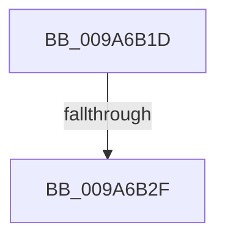

# sub_009A6B1D

- RVA: `0x009A6B1D`–`0x009A6B56` (길이 `57` bytes)
- VA: `0x00000001409A6B1D`
- 실행 섹션: `PAGE`
- PDB 이름 있음: `아니요`; PDB Function 태그: `아니요`
- unwind 정보 RVA: `0x0009C8A0`
- 디코드: `14`개 명령, `57/57` bytes 표시
- 미해석 바이트: `0` (있으면 어셈블리에 `.byte`로 보존)

> 이 문서는 커널 이미지의 기계어와 PDB 기호를 분석해 생성했습니다. 4번과 5번은 함수 원형과 자료형을 바이너리 사용 방식에서 추정한 C 해석이며 원본 소스 복구 결과는 아닙니다.

## 1. Dependencies

- 직접 호출 지점: **1**; 고유 호출 대상: **1**
- 직접 호출자로 확인된 함수: **0**
- RIP 상대 이미지 참조: **0**

### Outgoing calls
- `0x009A6B4F` → [KeCopyLastBranchInformation](../../text/44/KeCopyLastBranchInformation_function_00440150.md) (function, `0x00440150`)

### Direct callers
- 이 함수 시작 RVA로 연결되는 직접 call은 확인되지 않았습니다. 간접 호출은 완전히 역산할 수 없습니다.

### Static image references
- 디코드된 RIP-relative 메모리 참조가 없습니다.

## 2. Other-region calls and transfers

- 다른 실행 섹션으로 향하는 call: **1**
  - `0x009A6B4F` → [KeCopyLastBranchInformation](../../text/44/KeCopyLastBranchInformation_function_00440150.md) (`PAGE` → `.text`)
- call이 아닌 외부 분기/꼬리 이동: **2**
  - `0x009A6B29` → [sub_009A6C04](Unknown_function_009A6C04.md) (`tail-transfer`)
  - `0x009A6B54` → [sub_009A6B02](Unknown_function_009A6B02.md) (`tail-transfer`)

## 3. Assembly (complete function range)

```asm
009A6B1D  8B 87 00 01 00 00               mov eax, dword ptr [rdi + 0x100]
009A6B23  48 A9 55 03 00 00               test rax, 0x355
009A6B29  0F 85 D5 00 00 00               jne 0x1409a6c04
009A6B2F  33 C0                           xor eax, eax
009A6B31  48 8B D7                        mov rdx, rdi
009A6B34  48 89 43 48                     mov qword ptr [rbx + 0x48], rax
009A6B38  48 8B CB                        mov rcx, rbx
009A6B3B  48 89 43 50                     mov qword ptr [rbx + 0x50], rax
009A6B3F  48 89 43 58                     mov qword ptr [rbx + 0x58], rax
009A6B43  48 89 43 60                     mov qword ptr [rbx + 0x60], rax
009A6B47  48 89 43 68                     mov qword ptr [rbx + 0x68], rax
009A6B4B  48 89 43 70                     mov qword ptr [rbx + 0x70], rax
009A6B4F  E8 FC 95 A9 FF                  call 0x140440150
009A6B54  EB AC                           jmp 0x1409a6b02
```

## 4. C-style interpretation (structured pseudocode)

```c
__int64 __fastcall sub_009A6B1D(void)
{
    __int64 result;

    result = 0;
    *(unsigned __int64 *)(v_rbx + 72) = 0;
    *(unsigned __int64 *)(v_rbx + 80) = 0;
    *(unsigned __int64 *)(v_rbx + 88) = 0;
    *(unsigned __int64 *)(v_rbx + 96) = 0;
    *(unsigned __int64 *)(v_rbx + 104) = 0;
    *(unsigned __int64 *)(v_rbx + 112) = 0;
    result = KeCopyLastBranchInformation(v_rbx, v_rdi, a3, a4);
}
```

## 5. (Beta) C Style

```c
void sub_009A6B1D(void)
{
    int64_t result;

    result = 0;
    *(uint64_t *)(local_rbx + 0x48) = 0;
    *(uint64_t *)(local_rbx + 0x50) = 0;
    *(uint64_t *)(local_rbx + 0x58) = 0;
    *(uint64_t *)(local_rbx + 0x60) = 0;
    *(uint64_t *)(local_rbx + 0x68) = 0;
    *(uint64_t *)(local_rbx + 0x70) = 0;
    result = KeCopyLastBranchInformation(local_rbx, local_rdi, a3, a4);
}
```

## 6. Execution-region graph

[열기: 2D/3D 그래프와 함수 탐색 컨트롤 패널](../../../control-panel.html?section=page&rva=0x009A6B1D&view=graph)

- 2D 그래프는 위에서 아래로 흐르고, 3D 그래프는 빈 공간을 드래그해 회전합니다. Shift+드래그는 이동, 휠은 확대·축소, 함수 노드 선택은 대상 보고서 이동입니다.

### Static fallback


