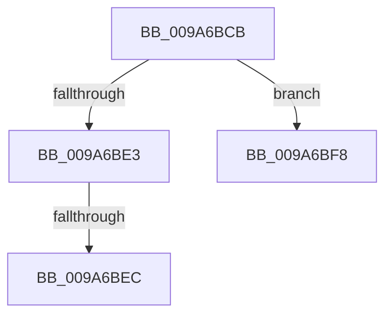

# sub_009A6BCB

- RVA: `0x009A6BCB`–`0x009A6C04` (길이 `57` bytes)
- VA: `0x00000001409A6BCB`
- 실행 섹션: `PAGE`
- PDB 이름 있음: `아니요`; PDB Function 태그: `아니요`
- unwind 정보 RVA: `0x0009C8F0`
- 디코드: `15`개 명령, `57/57` bytes 표시
- 미해석 바이트: `0` (있으면 어셈블리에 `.byte`로 보존)

> 이 문서는 커널 이미지의 기계어와 PDB 기호를 분석해 생성했습니다. 4번과 5번은 함수 원형과 자료형을 바이너리 사용 방식에서 추정한 C 해석이며 원본 소스 복구 결과는 아닙니다.

## 1. Dependencies

- 직접 호출 지점: **0**; 고유 호출 대상: **0**
- 직접 호출자로 확인된 함수: **0**
- RIP 상대 이미지 참조: **0**

### Outgoing calls
- 직접 디코드된 call 명령이 없습니다.

### Direct callers
- 이 함수 시작 RVA로 연결되는 직접 call은 확인되지 않았습니다. 간접 호출은 완전히 역산할 수 없습니다.

### Static image references
- 디코드된 RIP-relative 메모리 참조가 없습니다.

## 2. Other-region calls and transfers

- 다른 실행 섹션으로 향하는 call: **0**
- call이 아닌 외부 분기/꼬리 이동: **3**
  - `0x009A6BE6` → [sub_009A6B11](Unknown_function_009A6B11.md) (`tail-transfer`)
  - `0x009A6BF3` → [sub_009A6B11](Unknown_function_009A6B11.md) (`tail-transfer`)
  - `0x009A6BFF` → [sub_009A6B11](Unknown_function_009A6B11.md) (`tail-transfer`)

## 3. Assembly (complete function range)

```asm
009A6BCB  8B 43 30                        mov eax, dword ptr [rbx + 0x30]
009A6BCE  25 FF FF FF E7                  and eax, 0xe7ffffff
009A6BD3  0F BA E8 1F                     bts eax, 0x1f
009A6BD7  89 43 30                        mov dword ptr [rbx + 0x30], eax
009A6BDA  0F B6 4F 2B                     movzx ecx, byte ptr [rdi + 0x2b]
009A6BDE  80 F9 01                        cmp cl, 1
009A6BE1  74 15                           je 0x1409a6bf8
009A6BE3  80 F9 02                        cmp cl, 2
009A6BE6  0F 85 25 FF FF FF               jne 0x1409a6b11
009A6BEC  0F BA E8 1C                     bts eax, 0x1c
009A6BF0  89 43 30                        mov dword ptr [rbx + 0x30], eax
009A6BF3  E9 19 FF FF FF                  jmp 0x1409a6b11
009A6BF8  0F BA E8 1B                     bts eax, 0x1b
009A6BFC  89 43 30                        mov dword ptr [rbx + 0x30], eax
009A6BFF  E9 0D FF FF FF                  jmp 0x1409a6b11
```

## 4. C-style interpretation (structured pseudocode)

```c
__int64 __fastcall sub_009A6BCB(void)
{
    __int64 result;

    result = (unsigned int)(((unsigned int)(*(unsigned int *)(v_rbx + 48))) & (0xE7FFFFFFULL));
    *(unsigned int *)(v_rbx + 48) = (unsigned int)(result);
    if (((unsigned __int8)(*(unsigned __int8 *)(v_rdi + 43))) == 1) goto loc_009A6BF8;
    *(unsigned int *)(v_rbx + 48) = (unsigned int)(result);
loc_009A6BF8:
    *(unsigned int *)(v_rbx + 48) = (unsigned int)(result);
}
```

## 5. (Beta) C Style

```c
void sub_009A6BCB(void)
{
    int64_t result;

    result = (uint32_t)(((uint32_t)(*(uint32_t *)(local_rbx + 0x30))) & (0xE7FFFFFFULL));
    *(uint32_t *)(local_rbx + 0x30) = (uint32_t)(result);
    if (((uint8_t)(*(uint8_t *)(local_rdi + 0x2B))) == 1) goto loc_009A6BF8;
    *(uint32_t *)(local_rbx + 0x30) = (uint32_t)(result);
loc_009A6BF8:
    *(uint32_t *)(local_rbx + 0x30) = (uint32_t)(result);
}
```

## 6. Execution-region graph

[열기: 2D/3D 그래프와 함수 탐색 컨트롤 패널](../../../control-panel.html?section=page&rva=0x009A6BCB&view=graph)

- 2D 그래프는 위에서 아래로 흐르고, 3D 그래프는 빈 공간을 드래그해 회전합니다. Shift+드래그는 이동, 휠은 확대·축소, 함수 노드 선택은 대상 보고서 이동입니다.

### Static fallback


