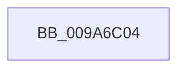

# sub_009A6C04

- RVA: `0x009A6C04`–`0x009A6C56` (길이 `82` bytes)
- VA: `0x00000001409A6C04`
- 실행 섹션: `PAGE`
- PDB 이름 있음: `아니요`; PDB Function 태그: `아니요`
- unwind 정보 RVA: `0x0009C900`
- 디코드: `16`개 명령, `82/82` bytes 표시
- 미해석 바이트: `0` (있으면 어셈블리에 `.byte`로 보존)

> 이 문서는 커널 이미지의 기계어와 PDB 기호를 분석해 생성했습니다. 4번과 5번은 함수 원형과 자료형을 바이너리 사용 방식에서 추정한 C 해석이며 원본 소스 복구 결과는 아닙니다.

## 1. Dependencies

- 직접 호출 지점: **1**; 고유 호출 대상: **1**
- 직접 호출자로 확인된 함수: **0**
- RIP 상대 이미지 참조: **0**

### Outgoing calls
- `0x009A6C4C` → [KeCopyLastBranchInformation](../../text/44/KeCopyLastBranchInformation_function_00440150.md) (function, `0x00440150`)

### Direct callers
- 이 함수 시작 RVA로 연결되는 직접 call은 확인되지 않았습니다. 간접 호출은 완전히 역산할 수 없습니다.

### Static image references
- 디코드된 RIP-relative 메모리 참조가 없습니다.

## 2. Other-region calls and transfers

- 다른 실행 섹션으로 향하는 call: **1**
  - `0x009A6C4C` → [KeCopyLastBranchInformation](../../text/44/KeCopyLastBranchInformation_function_00440150.md) (`PAGE` → `.text`)
- call이 아닌 외부 분기/꼬리 이동: **1**
  - `0x009A6C51` → [sub_009A6B02](Unknown_function_009A6B02.md) (`tail-transfer`)

## 3. Assembly (complete function range)

```asm
009A6C04  48 8B 87 D8 00 00 00            mov rax, qword ptr [rdi + 0xd8]
009A6C0B  48 8B D7                        mov rdx, rdi
009A6C0E  48 89 43 48                     mov qword ptr [rbx + 0x48], rax
009A6C12  48 8B CB                        mov rcx, rbx
009A6C15  48 8B 87 E0 00 00 00            mov rax, qword ptr [rdi + 0xe0]
009A6C1C  48 89 43 50                     mov qword ptr [rbx + 0x50], rax
009A6C20  48 8B 87 E8 00 00 00            mov rax, qword ptr [rdi + 0xe8]
009A6C27  48 89 43 58                     mov qword ptr [rbx + 0x58], rax
009A6C2B  48 8B 87 F0 00 00 00            mov rax, qword ptr [rdi + 0xf0]
009A6C32  48 89 43 60                     mov qword ptr [rbx + 0x60], rax
009A6C36  48 8B 87 F8 00 00 00            mov rax, qword ptr [rdi + 0xf8]
009A6C3D  48 89 43 68                     mov qword ptr [rbx + 0x68], rax
009A6C41  48 8B 87 00 01 00 00            mov rax, qword ptr [rdi + 0x100]
009A6C48  48 89 43 70                     mov qword ptr [rbx + 0x70], rax
009A6C4C  E8 FF 94 A9 FF                  call 0x140440150
009A6C51  E9 AC FE FF FF                  jmp 0x1409a6b02
```

## 4. C-style interpretation (structured pseudocode)

```c
__int64 __fastcall sub_009A6C04(void)
{
    __int64 result;

    *(unsigned __int64 *)(v_rbx + 72) = *(unsigned __int64 *)(v_rdi + 216);
    *(unsigned __int64 *)(v_rbx + 80) = *(unsigned __int64 *)(v_rdi + 224);
    *(unsigned __int64 *)(v_rbx + 88) = *(unsigned __int64 *)(v_rdi + 232);
    *(unsigned __int64 *)(v_rbx + 96) = *(unsigned __int64 *)(v_rdi + 240);
    *(unsigned __int64 *)(v_rbx + 104) = *(unsigned __int64 *)(v_rdi + 248);
    *(unsigned __int64 *)(v_rbx + 112) = *(unsigned __int64 *)(v_rdi + 256);
    result = KeCopyLastBranchInformation(v_rbx, v_rdi, a3, a4);
}
```

## 5. (Beta) C Style

```c
void sub_009A6C04(void)
{
    int64_t result;

    *(uint64_t *)(local_rbx + 0x48) = *(uint64_t *)(local_rdi + 0xD8);
    *(uint64_t *)(local_rbx + 0x50) = *(uint64_t *)(local_rdi + 0xE0);
    *(uint64_t *)(local_rbx + 0x58) = *(uint64_t *)(local_rdi + 0xE8);
    *(uint64_t *)(local_rbx + 0x60) = *(uint64_t *)(local_rdi + 0xF0);
    *(uint64_t *)(local_rbx + 0x68) = *(uint64_t *)(local_rdi + 0xF8);
    *(uint64_t *)(local_rbx + 0x70) = *(uint64_t *)(local_rdi + 0x100);
    result = KeCopyLastBranchInformation(local_rbx, local_rdi, a3, a4);
}
```

## 6. Execution-region graph

[열기: 2D/3D 그래프와 함수 탐색 컨트롤 패널](../../../control-panel.html?section=page&rva=0x009A6C04&view=graph)

- 2D 그래프는 위에서 아래로 흐르고, 3D 그래프는 빈 공간을 드래그해 회전합니다. Shift+드래그는 이동, 휠은 확대·축소, 함수 노드 선택은 대상 보고서 이동입니다.

### Static fallback


