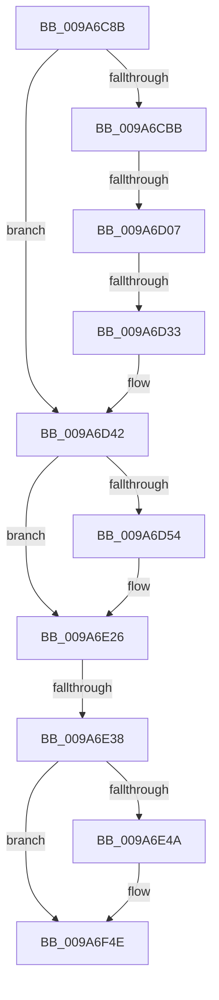

# sub_009A6C8B

- RVA: `0x009A6C8B`–`0x009A6F66` (길이 `731` bytes)
- VA: `0x00000001409A6C8B`
- 실행 섹션: `PAGE`
- PDB 이름 있음: `아니요`; PDB Function 태그: `아니요`
- unwind 정보 RVA: `0x0009C940`
- 디코드: `142`개 명령, `731/731` bytes 표시
- 미해석 바이트: `0` (있으면 어셈블리에 `.byte`로 보존)

> 이 문서는 커널 이미지의 기계어와 PDB 기호를 분석해 생성했습니다. 4번과 5번은 함수 원형과 자료형을 바이너리 사용 방식에서 추정한 C 해석이며 원본 소스 복구 결과는 아닙니다.

## 1. Dependencies

- 직접 호출 지점: **0**; 고유 호출 대상: **0**
- 직접 호출자로 확인된 함수: **0**
- RIP 상대 이미지 참조: **1**

### Outgoing calls
- 직접 디코드된 call 명령이 없습니다.

### Direct callers
- 이 함수 시작 RVA로 연결되는 직접 call은 확인되지 않았습니다. 간접 호출은 완전히 역산할 수 없습니다.

### Static image references
- `0x009A6F2A` → RVA `0x00FC5114` (`ALMOSTRO`; read)

## 2. Other-region calls and transfers

- 다른 실행 섹션으로 향하는 call: **0**
- call이 아닌 외부 분기/꼬리 이동: **4**
  - `0x009A6D01` → [sub_009A70D2](Unknown_function_009A70D2.md) (`tail-transfer`)
  - `0x009A6D2D` → [sub_009A7044](Unknown_function_009A7044.md) (`tail-transfer`)
  - `0x009A6E32` → [sub_009A6FDD](Unknown_function_009A6FDD.md) (`tail-transfer`)
  - `0x009A6F64` → [sub_009A6F66 + 0xC](Unknown_function_009A6F66.md) (`tail-transfer`)

## 3. Assembly (complete function range)

```asm
009A6C8B  48 89 6C 24 50                  mov qword ptr [rsp + 0x50], rbp
009A6C90  45 33 E4                        xor r12d, r12d
009A6C93  48 89 74 24 58                  mov qword ptr [rsp + 0x58], rsi
009A6C98  45 0F B6 F1                     movzx r14d, r9b
009A6C9C  41 8B 70 30                     mov esi, dword ptr [r8 + 0x30]
009A6CA0  49 8B D8                        mov rbx, r8
009A6CA3  8B C6                           mov eax, esi
009A6CA5  48 8B EA                        mov rbp, rdx
009A6CA8  25 01 00 10 00                  and eax, 0x100001
009A6CAD  48 8B F9                        mov rdi, rcx
009A6CB0  3D 01 00 10 00                  cmp eax, 0x100001
009A6CB5  0F 85 87 00 00 00               jne 0x1409a6d42
009A6CBB  45 8B 40 44                     mov r8d, dword ptr [r8 + 0x44]
009A6CBF  41 8B C0                        mov eax, r8d
009A6CC2  41 81 E0 D5 0D 21 00            and r8d, 0x210dd5
009A6CC9  25 D5 0F 25 00                  and eax, 0x250fd5
009A6CCE  41 0F BA E8 09                  bts r8d, 9
009A6CD3  45 84 C9                        test r9b, r9b
009A6CD6  44 0F 44 C0                     cmove r8d, eax
009A6CDA  44 89 81 78 01 00 00            mov dword ptr [rcx + 0x178], r8d
009A6CE1  48 8B 8B F8 00 00 00            mov rcx, qword ptr [rbx + 0xf8]
009A6CE8  48 89 8F 68 01 00 00            mov qword ptr [rdi + 0x168], rcx
009A6CEF  48 8B 83 98 00 00 00            mov rax, qword ptr [rbx + 0x98]
009A6CF6  48 89 87 80 01 00 00            mov qword ptr [rdi + 0x180], rax
009A6CFD  41 80 F9 01                     cmp r9b, 1
009A6D01  0F 85 CB 03 00 00               jne 0x1409a70d2
009A6D07  BA 33 00 00 00                  mov edx, 0x33
009A6D0C  66 C7 87 88 01 00 00 2B 00      mov word ptr [rdi + 0x188], 0x2b
009A6D15  66 39 53 38                     cmp word ptr [rbx + 0x38], dx
009A6D19  B8 23 00 00 00                  mov eax, 0x23
009A6D1E  66 0F 44 C2                     cmove ax, dx
009A6D22  66 89 87 70 01 00 00            mov word ptr [rdi + 0x170], ax
009A6D29  66 83 F8 23                     cmp ax, 0x23
009A6D2D  0F 84 11 03 00 00               je 0x1409a7044
009A6D33  48 C1 E1 10                     shl rcx, 0x10
009A6D37  48 C1 F9 10                     sar rcx, 0x10
009A6D3B  48 89 8F 68 01 00 00            mov qword ptr [rdi + 0x168], rcx
009A6D42  8B C6                           mov eax, esi
009A6D44  25 02 00 10 00                  and eax, 0x100002
009A6D49  3D 02 00 10 00                  cmp eax, 0x100002
009A6D4E  0F 85 D2 00 00 00               jne 0x1409a6e26
009A6D54  48 8B 43 78                     mov rax, qword ptr [rbx + 0x78]
009A6D58  48 89 47 30                     mov qword ptr [rdi + 0x30], rax
009A6D5C  48 8B 83 80 00 00 00            mov rax, qword ptr [rbx + 0x80]
009A6D63  48 89 47 38                     mov qword ptr [rdi + 0x38], rax
009A6D67  48 8B 83 88 00 00 00            mov rax, qword ptr [rbx + 0x88]
009A6D6E  48 89 47 40                     mov qword ptr [rdi + 0x40], rax
009A6D72  48 8B 83 B8 00 00 00            mov rax, qword ptr [rbx + 0xb8]
009A6D79  48 89 47 48                     mov qword ptr [rdi + 0x48], rax
009A6D7D  48 8B 83 C0 00 00 00            mov rax, qword ptr [rbx + 0xc0]
009A6D84  48 89 47 50                     mov qword ptr [rdi + 0x50], rax
009A6D88  48 8B 83 C8 00 00 00            mov rax, qword ptr [rbx + 0xc8]
009A6D8F  48 89 47 58                     mov qword ptr [rdi + 0x58], rax
009A6D93  48 8B 83 D0 00 00 00            mov rax, qword ptr [rbx + 0xd0]
009A6D9A  48 89 47 60                     mov qword ptr [rdi + 0x60], rax
009A6D9E  48 8B 8D 98 00 00 00            mov rcx, qword ptr [rbp + 0x98]
009A6DA5  48 8B 83 90 00 00 00            mov rax, qword ptr [rbx + 0x90]
009A6DAC  48 89 01                        mov qword ptr [rcx], rax
009A6DAF  48 8B 8D A8 00 00 00            mov rcx, qword ptr [rbp + 0xa8]
009A6DB6  48 8B 83 A0 00 00 00            mov rax, qword ptr [rbx + 0xa0]
009A6DBD  48 89 01                        mov qword ptr [rcx], rax
009A6DC0  48 8B 8D B0 00 00 00            mov rcx, qword ptr [rbp + 0xb0]
009A6DC7  48 8B 83 A8 00 00 00            mov rax, qword ptr [rbx + 0xa8]
009A6DCE  48 89 01                        mov qword ptr [rcx], rax
009A6DD1  48 8B 8D B8 00 00 00            mov rcx, qword ptr [rbp + 0xb8]
009A6DD8  48 8B 83 B0 00 00 00            mov rax, qword ptr [rbx + 0xb0]
009A6DDF  48 89 01                        mov qword ptr [rcx], rax
009A6DE2  48 8B 8D E0 00 00 00            mov rcx, qword ptr [rbp + 0xe0]
009A6DE9  48 8B 83 D8 00 00 00            mov rax, qword ptr [rbx + 0xd8]
009A6DF0  48 89 01                        mov qword ptr [rcx], rax
009A6DF3  48 8B 8D E8 00 00 00            mov rcx, qword ptr [rbp + 0xe8]
009A6DFA  48 8B 83 E0 00 00 00            mov rax, qword ptr [rbx + 0xe0]
009A6E01  48 89 01                        mov qword ptr [rcx], rax
009A6E04  48 8B 8D F0 00 00 00            mov rcx, qword ptr [rbp + 0xf0]
009A6E0B  48 8B 83 E8 00 00 00            mov rax, qword ptr [rbx + 0xe8]
009A6E12  48 89 01                        mov qword ptr [rcx], rax
009A6E15  48 8B 8D F8 00 00 00            mov rcx, qword ptr [rbp + 0xf8]
009A6E1C  48 8B 83 F0 00 00 00            mov rax, qword ptr [rbx + 0xf0]
009A6E23  48 89 01                        mov qword ptr [rcx], rax
009A6E26  8B C6                           mov eax, esi
009A6E28  25 40 00 10 00                  and eax, 0x100040
009A6E2D  3D 40 00 10 00                  cmp eax, 0x100040
009A6E32  0F 84 A5 01 00 00               je 0x1409a6fdd
009A6E38  8B C6                           mov eax, esi
009A6E3A  25 08 00 10 00                  and eax, 0x100008
009A6E3F  3D 08 00 10 00                  cmp eax, 0x100008
009A6E44  0F 85 04 01 00 00               jne 0x1409a6f4e
009A6E4A  0F 10 83 A0 01 00 00            movups xmm0, xmmword ptr [rbx + 0x1a0]
009A6E51  0F 11 47 70                     movups xmmword ptr [rdi + 0x70], xmm0
009A6E55  0F 10 83 B0 01 00 00            movups xmm0, xmmword ptr [rbx + 0x1b0]
009A6E5C  0F 11 87 80 00 00 00            movups xmmword ptr [rdi + 0x80], xmm0
009A6E63  0F 10 83 C0 01 00 00            movups xmm0, xmmword ptr [rbx + 0x1c0]
009A6E6A  0F 11 87 90 00 00 00            movups xmmword ptr [rdi + 0x90], xmm0
009A6E71  0F 10 83 D0 01 00 00            movups xmm0, xmmword ptr [rbx + 0x1d0]
009A6E78  0F 11 87 A0 00 00 00            movups xmmword ptr [rdi + 0xa0], xmm0
009A6E7F  0F 10 83 E0 01 00 00            movups xmm0, xmmword ptr [rbx + 0x1e0]
009A6E86  0F 11 87 B0 00 00 00            movups xmmword ptr [rdi + 0xb0], xmm0
009A6E8D  0F 10 83 F0 01 00 00            movups xmm0, xmmword ptr [rbx + 0x1f0]
009A6E94  0F 11 87 C0 00 00 00            movups xmmword ptr [rdi + 0xc0], xmm0
009A6E9B  48 8B 45 30                     mov rax, qword ptr [rbp + 0x30]
009A6E9F  0F 10 83 00 02 00 00            movups xmm0, xmmword ptr [rbx + 0x200]
009A6EA6  0F 29 00                        movaps xmmword ptr [rax], xmm0
009A6EA9  48 8B 45 38                     mov rax, qword ptr [rbp + 0x38]
009A6EAD  0F 10 83 10 02 00 00            movups xmm0, xmmword ptr [rbx + 0x210]
009A6EB4  0F 29 00                        movaps xmmword ptr [rax], xmm0
009A6EB7  48 8B 45 40                     mov rax, qword ptr [rbp + 0x40]
009A6EBB  0F 10 83 20 02 00 00            movups xmm0, xmmword ptr [rbx + 0x220]
009A6EC2  0F 29 00                        movaps xmmword ptr [rax], xmm0
009A6EC5  48 8B 45 48                     mov rax, qword ptr [rbp + 0x48]
009A6EC9  0F 10 83 30 02 00 00            movups xmm0, xmmword ptr [rbx + 0x230]
009A6ED0  0F 29 00                        movaps xmmword ptr [rax], xmm0
009A6ED3  48 8B 45 50                     mov rax, qword ptr [rbp + 0x50]
009A6ED7  0F 10 83 40 02 00 00            movups xmm0, xmmword ptr [rbx + 0x240]
009A6EDE  0F 29 00                        movaps xmmword ptr [rax], xmm0
009A6EE1  48 8B 45 58                     mov rax, qword ptr [rbp + 0x58]
009A6EE5  0F 10 83 50 02 00 00            movups xmm0, xmmword ptr [rbx + 0x250]
009A6EEC  0F 29 00                        movaps xmmword ptr [rax], xmm0
009A6EEF  48 8B 45 60                     mov rax, qword ptr [rbp + 0x60]
009A6EF3  0F 10 83 60 02 00 00            movups xmm0, xmmword ptr [rbx + 0x260]
009A6EFA  0F 29 00                        movaps xmmword ptr [rax], xmm0
009A6EFD  48 8B 45 68                     mov rax, qword ptr [rbp + 0x68]
009A6F01  0F 10 83 70 02 00 00            movups xmm0, xmmword ptr [rbx + 0x270]
009A6F08  0F 29 00                        movaps xmmword ptr [rax], xmm0
009A6F0B  48 8B 45 70                     mov rax, qword ptr [rbp + 0x70]
009A6F0F  0F 10 83 80 02 00 00            movups xmm0, xmmword ptr [rbx + 0x280]
009A6F16  0F 29 00                        movaps xmmword ptr [rax], xmm0
009A6F19  48 8B 45 78                     mov rax, qword ptr [rbp + 0x78]
009A6F1D  0F 10 83 90 02 00 00            movups xmm0, xmmword ptr [rbx + 0x290]
009A6F24  0F 29 00                        movaps xmmword ptr [rax], xmm0
009A6F27  8B 43 34                        mov eax, dword ptr [rbx + 0x34]
009A6F2A  23 05 E4 E1 61 00               and eax, dword ptr [rip + 0x61e1e4]
009A6F30  89 47 2C                        mov dword ptr [rdi + 0x2c], eax
009A6F33  0F AE 5C 24 60                  stmxcsr dword ptr [rsp + 0x60]
009A6F38  8B 44 24 60                     mov eax, dword ptr [rsp + 0x60]
009A6F3C  89 83 18 01 00 00               mov dword ptr [rbx + 0x118], eax
009A6F42  B8 3F 1F 00 00                  mov eax, 0x1f3f
009A6F47  66 21 83 00 01 00 00            and word ptr [rbx + 0x100], ax
009A6F4E  48 8B 6C 24 50                  mov rbp, qword ptr [rsp + 0x50]
009A6F53  81 E6 10 00 10 00               and esi, 0x100010
009A6F59  81 FE 10 00 10 00               cmp esi, 0x100010
009A6F5F  48 8B 74 24 58                  mov rsi, qword ptr [rsp + 0x58]
009A6F64  74 0C                           je 0x1409a6f72
```

## 4. C-style interpretation (structured pseudocode)

```c
__int64 __fastcall sub_009A6C8B(__int64 a1, __int64 a2, __int64 a3, unsigned __int8 a4, __int64 a5, __int64 a6, __int64 a7, __int64 a8, __int64 a9, __int64 a10, __int64 a11, unsigned int a12)
{
    __int64 result;
    __int64 v_r12;
    __int64 v_rsi;
    unsigned __int64 v_stack_p50;
    unsigned __int64 v_stack_p58;

    v_stack_p50 = v_rbp;
    v_r12 = 0;
    v_stack_p58 = v_rsi;
    result = (unsigned int)(((unsigned int)((unsigned int)((unsigned int)(*(unsigned int *)(a3 + 48))))) & (0x100001ULL));
    if (((unsigned int)(result)) != 0x100001ULL) goto loc_009A6D42;
    a3 = (unsigned int)(((unsigned int)(*(unsigned int *)(a3 + 68))) & (0x210DD5ULL));
    result = (unsigned int)(((unsigned int)((unsigned int)((unsigned int)(*(unsigned int *)(a3 + 68))))) & (0x250FD5ULL));
    if (a4 == 0) { a3 = (unsigned int)(result); }
    *(unsigned int *)(a1 + 376) = (unsigned int)(a3);
    *(unsigned __int64 *)(a1 + 360) = *(unsigned __int64 *)(a3 + 248);
    *(unsigned __int64 *)(a1 + 384) = *(unsigned __int64 *)(a3 + 152);
    *(unsigned __int16 *)(a1 + 392) = 43;
    result = 35;
    if ((*(unsigned __int16 *)(a3 + 56)) == 51) { result = 51; }
    *(unsigned __int16 *)(a1 + 368) = (unsigned __int16)(result);
    a1 = (*(unsigned __int64 *)(a3 + 248)) << (16);
    a1 = (a1) >> (16);
    *(unsigned __int64 *)(a1 + 360) = a1;
loc_009A6D42:
    result = (unsigned int)(((unsigned int)((unsigned int)((unsigned int)(*(unsigned int *)(a3 + 48))))) & (0x100002ULL));
    if (((unsigned int)(result)) == 0x100002ULL) {
        result = *(unsigned __int64 *)(a3 + 120);
        *(unsigned __int64 *)(a1 + 48) = result;
        result = *(unsigned __int64 *)(a3 + 128);
        *(unsigned __int64 *)(a1 + 56) = result;
        result = *(unsigned __int64 *)(a3 + 136);
        *(unsigned __int64 *)(a1 + 64) = result;
        result = *(unsigned __int64 *)(a3 + 184);
        *(unsigned __int64 *)(a1 + 72) = result;
        result = *(unsigned __int64 *)(a3 + 192);
        *(unsigned __int64 *)(a1 + 80) = result;
        result = *(unsigned __int64 *)(a3 + 200);
        *(unsigned __int64 *)(a1 + 88) = result;
        result = *(unsigned __int64 *)(a3 + 208);
        *(unsigned __int64 *)(a1 + 96) = result;
        a1 = *(unsigned __int64 *)(a2 + 152);
        result = *(unsigned __int64 *)(a3 + 144);
        *(unsigned __int64 *)(a1) = result;
        a1 = *(unsigned __int64 *)(a2 + 168);
        result = *(unsigned __int64 *)(a3 + 160);
        *(unsigned __int64 *)(a1) = result;
        a1 = *(unsigned __int64 *)(a2 + 176);
        result = *(unsigned __int64 *)(a3 + 168);
        *(unsigned __int64 *)(a1) = result;
        a1 = *(unsigned __int64 *)(a2 + 184);
        result = *(unsigned __int64 *)(a3 + 176);
        *(unsigned __int64 *)(a1) = result;
        a1 = *(unsigned __int64 *)(a2 + 224);
        result = *(unsigned __int64 *)(a3 + 216);
        *(unsigned __int64 *)(a1) = result;
        a1 = *(unsigned __int64 *)(a2 + 232);
        result = *(unsigned __int64 *)(a3 + 224);
        *(unsigned __int64 *)(a1) = result;
        a1 = *(unsigned __int64 *)(a2 + 240);
        result = *(unsigned __int64 *)(a3 + 232);
        *(unsigned __int64 *)(a1) = result;
        a1 = *(unsigned __int64 *)(a2 + 248);
        result = *(unsigned __int64 *)(a3 + 240);
        *(unsigned __int64 *)(a1) = result;
    }
    result = (unsigned int)(((unsigned int)((unsigned int)((unsigned int)(*(unsigned int *)(a3 + 48))))) & (0x100040ULL));
    result = (unsigned int)(((unsigned int)((unsigned int)((unsigned int)(*(unsigned int *)(a3 + 48))))) & (0x100008ULL));
    if (((unsigned int)(result)) == 0x100008ULL) {
        *(unsigned __int64 *)(a1 + 112) = v_xmm0;
        *(unsigned __int64 *)(a1 + 128) = v_xmm0;
        *(unsigned __int64 *)(a1 + 144) = v_xmm0;
        *(unsigned __int64 *)(a1 + 160) = v_xmm0;
        *(unsigned __int64 *)(a1 + 176) = v_xmm0;
        *(unsigned __int64 *)(a1 + 192) = v_xmm0;
        result = *(unsigned __int64 *)(a2 + 48);
        *(unsigned __int64 *)(result) = v_xmm0;
        result = *(unsigned __int64 *)(a2 + 56);
        *(unsigned __int64 *)(result) = v_xmm0;
        result = *(unsigned __int64 *)(a2 + 64);
        *(unsigned __int64 *)(result) = v_xmm0;
        result = *(unsigned __int64 *)(a2 + 72);
        *(unsigned __int64 *)(result) = v_xmm0;
        result = *(unsigned __int64 *)(a2 + 80);
        *(unsigned __int64 *)(result) = v_xmm0;
        result = *(unsigned __int64 *)(a2 + 88);
        *(unsigned __int64 *)(result) = v_xmm0;
        result = *(unsigned __int64 *)(a2 + 96);
        *(unsigned __int64 *)(result) = v_xmm0;
        result = *(unsigned __int64 *)(a2 + 104);
        *(unsigned __int64 *)(result) = v_xmm0;
        result = *(unsigned __int64 *)(a2 + 112);
        *(unsigned __int64 *)(result) = v_xmm0;
        result = *(unsigned __int64 *)(a2 + 120);
        *(unsigned __int64 *)(result) = v_xmm0;
        result = *(unsigned int *)(a3 + 52);
        result = (unsigned int)((result) & (*(unsigned int *)(v_rip + 6414820)));
        *(unsigned int *)(a1 + 44) = (unsigned int)(result);
        result = a12;
        *(unsigned int *)(a3 + 280) = (unsigned int)(result);
        result = 0x1F3FULL;
    }
    v_rsi = (unsigned int)(((unsigned int)(*(unsigned int *)(a3 + 48))) & (0x100010ULL));
}
```

## 5. (Beta) C Style

```c
int64_t sub_009A6C8B(void *Arg1, void *Arg2, void *Arg3, uint8_t Arg4, uint64_t Arg5, uint64_t Arg6, uint64_t Arg7, uint64_t Arg8, uint64_t Arg9, int64_t Arg10, int64_t Arg11, uint32_t Arg12)
{
    uint8_t *arg1 = (uint8_t *)Arg1;
    uint8_t *arg2 = (uint8_t *)Arg2;
    uint8_t *arg3 = (uint8_t *)Arg3;

    int64_t result;
    int64_t local_r12;
    int64_t local_rsi;
    uint64_t v_stack_p50;
    uint64_t v_stack_p58;

    v_stack_p50 = local_rbp;
    local_r12 = 0;
    v_stack_p58 = local_rsi;
    result = (uint32_t)(((uint32_t)((uint32_t)((uint32_t)(*(uint32_t *)(arg3 + 0x30))))) & (0x100001ULL));
    if (((uint32_t)(result)) != 0x100001ULL) goto loc_009A6D42;
    Arg3 = (uint32_t)(((uint32_t)(*(uint32_t *)(arg3 + 0x44))) & (0x210DD5ULL));
    result = (uint32_t)(((uint32_t)((uint32_t)((uint32_t)(*(uint32_t *)(arg3 + 0x44))))) & (0x250FD5ULL));
    if (Arg4 == 0) { Arg3 = (uint32_t)(result); }
    *(uint32_t *)(arg1 + 0x178) = (uint32_t)(Arg3);
    *(uint64_t *)(arg1 + 0x168) = *(uint64_t *)(arg3 + 0xF8);
    *(uint64_t *)(arg1 + 0x180) = *(uint64_t *)(arg3 + 0x98);
    *(uint16_t *)(arg1 + 0x188) = 43;
    result = 35;
    if ((*(uint16_t *)(arg3 + 0x38)) == 51) { result = 51; }
    *(uint16_t *)(arg1 + 0x170) = (uint16_t)(result);
    Arg1 = (*(uint64_t *)(arg3 + 0xF8)) << (16);
    Arg1 = (Arg1) >> (16);
    *(void **)(arg1 + 0x168) = Arg1;
loc_009A6D42:
    result = (uint32_t)(((uint32_t)((uint32_t)((uint32_t)(*(uint32_t *)(arg3 + 0x30))))) & (0x100002ULL));
    if (((uint32_t)(result)) == 0x100002ULL) {
        result = *(uint64_t *)(arg3 + 0x78);
        *(uint64_t *)(arg1 + 0x30) = result;
        result = *(uint64_t *)(arg3 + 0x80);
        *(uint64_t *)(arg1 + 0x38) = result;
        result = *(uint64_t *)(arg3 + 0x88);
        *(uint64_t *)(arg1 + 0x40) = result;
        result = *(uint64_t *)(arg3 + 0xB8);
        *(uint64_t *)(arg1 + 0x48) = result;
        result = *(uint64_t *)(arg3 + 0xC0);
        *(uint64_t *)(arg1 + 0x50) = result;
        result = *(uint64_t *)(arg3 + 0xC8);
        *(uint64_t *)(arg1 + 0x58) = result;
        result = *(uint64_t *)(arg3 + 0xD0);
        *(uint64_t *)(arg1 + 0x60) = result;
        Arg1 = *(uint64_t *)(arg2 + 0x98);
        result = *(uint64_t *)(arg3 + 0x90);
        *(uint64_t *)(arg1) = result;
        Arg1 = *(uint64_t *)(arg2 + 0xA8);
        result = *(uint64_t *)(arg3 + 0xA0);
        *(uint64_t *)(arg1) = result;
        Arg1 = *(uint64_t *)(arg2 + 0xB0);
        result = *(uint64_t *)(arg3 + 0xA8);
        *(uint64_t *)(arg1) = result;
        Arg1 = *(uint64_t *)(arg2 + 0xB8);
        result = *(uint64_t *)(arg3 + 0xB0);
        *(uint64_t *)(arg1) = result;
        Arg1 = *(uint64_t *)(arg2 + 0xE0);
        result = *(uint64_t *)(arg3 + 0xD8);
        *(uint64_t *)(arg1) = result;
        Arg1 = *(uint64_t *)(arg2 + 0xE8);
        result = *(uint64_t *)(arg3 + 0xE0);
        *(uint64_t *)(arg1) = result;
        Arg1 = *(uint64_t *)(arg2 + 0xF0);
        result = *(uint64_t *)(arg3 + 0xE8);
        *(uint64_t *)(arg1) = result;
        Arg1 = *(uint64_t *)(arg2 + 0xF8);
        result = *(uint64_t *)(arg3 + 0xF0);
        *(uint64_t *)(arg1) = result;
    }
    result = (uint32_t)(((uint32_t)((uint32_t)((uint32_t)(*(uint32_t *)(arg3 + 0x30))))) & (0x100040ULL));
    result = (uint32_t)(((uint32_t)((uint32_t)((uint32_t)(*(uint32_t *)(arg3 + 0x30))))) & (0x100008ULL));
    if (((uint32_t)(result)) == 0x100008ULL) {
        *(uint64_t *)(arg1 + 0x70) = v_xmm0;
        *(uint64_t *)(arg1 + 0x80) = v_xmm0;
        *(uint64_t *)(arg1 + 0x90) = v_xmm0;
        *(uint64_t *)(arg1 + 0xA0) = v_xmm0;
        *(uint64_t *)(arg1 + 0xB0) = v_xmm0;
        *(uint64_t *)(arg1 + 0xC0) = v_xmm0;
        result = *(uint64_t *)(arg2 + 0x30);
        *(uint64_t *)(result) = v_xmm0;
        result = *(uint64_t *)(arg2 + 0x38);
        *(uint64_t *)(result) = v_xmm0;
        result = *(uint64_t *)(arg2 + 0x40);
        *(uint64_t *)(result) = v_xmm0;
        result = *(uint64_t *)(arg2 + 0x48);
        *(uint64_t *)(result) = v_xmm0;
        result = *(uint64_t *)(arg2 + 0x50);
        *(uint64_t *)(result) = v_xmm0;
        result = *(uint64_t *)(arg2 + 0x58);
        *(uint64_t *)(result) = v_xmm0;
        result = *(uint64_t *)(arg2 + 0x60);
        *(uint64_t *)(result) = v_xmm0;
        result = *(uint64_t *)(arg2 + 0x68);
        *(uint64_t *)(result) = v_xmm0;
        result = *(uint64_t *)(arg2 + 0x70);
        *(uint64_t *)(result) = v_xmm0;
        result = *(uint64_t *)(arg2 + 0x78);
        *(uint64_t *)(result) = v_xmm0;
        result = *(uint32_t *)(arg3 + 0x34);
        result = (uint32_t)((result) & (*(uint32_t *)(v_rip + 0x61E1E4)));
        *(uint32_t *)(arg1 + 0x2C) = (uint32_t)(result);
        result = Arg12;
        *(uint32_t *)(arg3 + 0x118) = (uint32_t)(result);
        result = 0x1F3FULL;
    }
    local_rsi = (uint32_t)(((uint32_t)(*(uint32_t *)(arg3 + 0x30))) & (0x100010ULL));
}
```

### 관측된 메모리 오프셋

구조체 형식이 확인되지 않은 접근은 인자 기준의 오프셋으로만 기록했습니다.

| 기준 인자 | 오프셋 표현 | 폭 (bit) | 접근 |
|---|---:|---:|---|
| `Arg1` | `+ 0x2C` | `32` | `W` |
| `Arg1` | `+ 0x30` | `64` | `W` |
| `Arg1` | `+ 0x38` | `64` | `W` |
| `Arg1` | `+ 0x40` | `64` | `W` |
| `Arg1` | `+ 0x48` | `64` | `W` |
| `Arg1` | `+ 0x50` | `64` | `W` |
| `Arg1` | `+ 0x58` | `64` | `W` |
| `Arg1` | `+ 0x60` | `64` | `W` |
| `Arg1` | `+ 0x70` | `128` | `R` |
| `Arg1` | `+ 0x80` | `128` | `R` |
| `Arg1` | `+ 0x90` | `128` | `R` |
| `Arg1` | `+ 0xA0` | `128` | `R` |
| `Arg1` | `+ 0xB0` | `128` | `R` |
| `Arg1` | `+ 0xC0` | `128` | `R` |
| `Arg1` | `+ 0x168` | `64` | `W` |
| `Arg1` | `+ 0x170` | `16` | `W` |
| `Arg1` | `+ 0x178` | `32` | `W` |
| `Arg1` | `+ 0x180` | `64` | `W` |
| `Arg1` | `+ 0x188` | `16` | `W` |
| `Arg2` | `+ 0x30` | `64` | `R` |
| `Arg2` | `+ 0x38` | `64` | `R` |
| `Arg2` | `+ 0x40` | `64` | `R` |
| `Arg2` | `+ 0x48` | `64` | `R` |
| `Arg2` | `+ 0x50` | `64` | `R` |
| `Arg2` | `+ 0x58` | `64` | `R` |
| `Arg2` | `+ 0x60` | `64` | `R` |
| `Arg2` | `+ 0x68` | `64` | `R` |
| `Arg2` | `+ 0x70` | `64` | `R` |
| `Arg2` | `+ 0x78` | `64` | `R` |
| `Arg2` | `+ 0x98` | `64` | `R` |
| `Arg2` | `+ 0xA8` | `64` | `R` |
| `Arg2` | `+ 0xB0` | `64` | `R` |

추가 오프셋 44개는 표에서 생략했습니다.

## 6. Execution-region graph

[열기: 2D/3D 그래프와 함수 탐색 컨트롤 패널](../../../control-panel.html?section=page&rva=0x009A6C8B&view=graph)

- 2D 그래프는 위에서 아래로 흐르고, 3D 그래프는 빈 공간을 드래그해 회전합니다. Shift+드래그는 이동, 휠은 확대·축소, 함수 노드 선택은 대상 보고서 이동입니다.

### Static fallback


