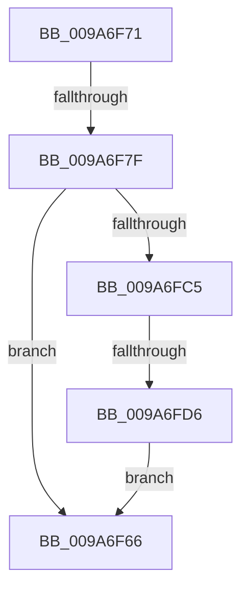

# sub_009A6F66

- RVA: `0x009A6F66`–`0x009A6FDD` (길이 `119` bytes)
- VA: `0x00000001409A6F66`
- 실행 섹션: `PAGE`
- PDB 이름 있음: `아니요`; PDB Function 태그: `아니요`
- unwind 정보 RVA: `0x0009C958`
- 디코드: `29`개 명령, `119/119` bytes 표시
- 미해석 바이트: `0` (있으면 어셈블리에 `.byte`로 보존)

> 이 문서는 커널 이미지의 기계어와 PDB 기호를 분석해 생성했습니다. 4번과 5번은 함수 원형과 자료형을 바이너리 사용 방식에서 추정한 C 해석이며 원본 소스 복구 결과는 아닙니다.

## 1. Dependencies

- 직접 호출 지점: **0**; 고유 호출 대상: **0**
- 직접 호출자로 확인된 함수: **0**
- RIP 상대 이미지 참조: **0**

### Outgoing calls
- 직접 디코드된 call 명령이 없습니다.

### Direct callers
- 이 함수 시작 RVA로 연결되는 직접 call은 확인되지 않았습니다. 간접 호출은 완전히 역산할 수 없습니다.

### Static image references
- 디코드된 RIP-relative 메모리 참조가 없습니다.

## 2. Other-region calls and transfers

- 다른 실행 섹션으로 향하는 call: **0**
- call이 아닌 외부 분기/꼬리 이동: **2**
  - `0x009A6F79` → [sub_009A704B + 0x11](Unknown_function_009A704B.md) (`tail-transfer`)
  - `0x009A6FD4` → [sub_009A704B](Unknown_function_009A704B.md) (`tail-transfer`)

## 3. Assembly (complete function range)

```asm
009A6F66  48 83 C4 28                     add rsp, 0x28
009A6F6A  41 5E                           pop r14
009A6F6C  41 5C                           pop r12
009A6F6E  5F                              pop rdi
009A6F6F  5B                              pop rbx
009A6F70  C3                              ret
009A6F71  CC                              int3
009A6F72  48 8B 43 48                     mov rax, qword ptr [rbx + 0x48]
009A6F76  45 84 F6                        test r14b, r14b
009A6F79  0F 85 DD 00 00 00               jne 0x1409a705c
009A6F7F  48 89 87 D8 00 00 00            mov qword ptr [rdi + 0xd8], rax
009A6F86  48 8B 43 50                     mov rax, qword ptr [rbx + 0x50]
009A6F8A  48 89 87 E0 00 00 00            mov qword ptr [rdi + 0xe0], rax
009A6F91  48 8B 43 58                     mov rax, qword ptr [rbx + 0x58]
009A6F95  48 89 87 E8 00 00 00            mov qword ptr [rdi + 0xe8], rax
009A6F9C  48 8B 43 60                     mov rax, qword ptr [rbx + 0x60]
009A6FA0  48 89 87 F0 00 00 00            mov qword ptr [rdi + 0xf0], rax
009A6FA7  B9 55 03 FF FF                  mov ecx, 0xffff0355
009A6FAC  4C 89 A7 F8 00 00 00            mov qword ptr [rdi + 0xf8], r12
009A6FB3  8B 43 70                        mov eax, dword ptr [rbx + 0x70]
009A6FB6  48 23 C1                        and rax, rcx
009A6FB9  48 89 87 00 01 00 00            mov qword ptr [rdi + 0x100], rax
009A6FC0  45 84 F6                        test r14b, r14b
009A6FC3  74 A1                           je 0x1409a6f66
009A6FC5  65 48 8B 0C 25 88 01 00 00      mov rcx, qword ptr gs:[0x188]
009A6FCE  48 A9 55 03 00 00               test rax, 0x355
009A6FD4  75 75                           jne 0x1409a704b
009A6FD6  F0 0F BA 31 18                  lock btr dword ptr [rcx], 0x18
009A6FDB  EB 89                           jmp 0x1409a6f66
```

## 4. C-style interpretation (structured pseudocode)

```c
__int64 __fastcall sub_009A6F66(void)
{
    __int64 v_rsp;

    v_rsp = (v_rsp) + (40);
    return result;
}
```

## 5. (Beta) C Style

```c
void sub_009A6F66(void)
{
    int64_t local_rsp;

    local_rsp = (local_rsp) + (40);
    return result;
}
```

## 6. Execution-region graph

[열기: 2D/3D 그래프와 함수 탐색 컨트롤 패널](../../../control-panel.html?section=page&rva=0x009A6F66&view=graph)

- 2D 그래프는 위에서 아래로 흐르고, 3D 그래프는 빈 공간을 드래그해 회전합니다. Shift+드래그는 이동, 휠은 확대·축소, 함수 노드 선택은 대상 보고서 이동입니다.

### Static fallback


