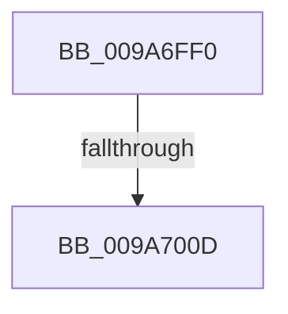

# sub_009A6FF0

- RVA: `0x009A6FF0`–`0x009A7044` (길이 `84` bytes)
- VA: `0x00000001409A6FF0`
- 실행 섹션: `PAGE`
- PDB 이름 있음: `아니요`; PDB Function 태그: `아니요`
- unwind 정보 RVA: `0x0009C984`
- 디코드: `16`개 명령, `84/84` bytes 표시
- 미해석 바이트: `0` (있으면 어셈블리에 `.byte`로 보존)

> 이 문서는 커널 이미지의 기계어와 PDB 기호를 분석해 생성했습니다. 4번과 5번은 함수 원형과 자료형을 바이너리 사용 방식에서 추정한 C 해석이며 원본 소스 복구 결과는 아닙니다.

## 1. Dependencies

- 직접 호출 지점: **2**; 고유 호출 대상: **2**
- 직접 호출자로 확인된 함수: **0**
- RIP 상대 이미지 참조: **0**

### Outgoing calls
- `0x009A6FFC` → [KiGetAllocatedXSaveArea](../../text/44/KiGetAllocatedXSaveArea_function_00449950.md) (function, `0x00449950`)
- `0x009A7035` → [RtlXRestoreS](../../text/3D/RtlXRestoreS_function_003D63C4.md) (function, `0x003D63C4`)

### Direct callers
- 이 함수 시작 RVA로 연결되는 직접 call은 확인되지 않았습니다. 간접 호출은 완전히 역산할 수 없습니다.

### Static image references
- 디코드된 RIP-relative 메모리 참조가 없습니다.

## 2. Other-region calls and transfers

- 다른 실행 섹션으로 향하는 call: **2**
  - `0x009A6FFC` → [KiGetAllocatedXSaveArea](../../text/44/KiGetAllocatedXSaveArea_function_00449950.md) (`PAGE` → `.text`)
  - `0x009A7035` → [RtlXRestoreS](../../text/3D/RtlXRestoreS_function_003D63C4.md) (`PAGE` → `.text`)
- call이 아닌 외부 분기/꼬리 이동: **2**
  - `0x009A7007` → [sub_009A70A8](Unknown_function_009A70A8.md) (`tail-transfer`)
  - `0x009A703F` → [sub_009A6C8B + 0x1AD](Unknown_function_009A6C8B.md) (`tail-transfer`)

## 3. Assembly (complete function range)

```asm
009A6FF0  4C 89 7C 24 20                  mov qword ptr [rsp + 0x20], r15
009A6FF5  4C 63 BB E0 04 00 00            movsxd r15, dword ptr [rbx + 0x4e0]
009A6FFC  E8 4F 29 AA FF                  call 0x140449950
009A7001  48 8B C8                        mov rcx, rax
009A7004  48 85 C0                        test rax, rax
009A7007  0F 85 9B 00 00 00               jne 0x1409a70a8
009A700D  48 B8 E0 03 00 00 80 F7 FF FF   movabs rax, 0xfffff780000003e0
009A7017  48 8D 8B D0 02 00 00            lea rcx, [rbx + 0x2d0]
009A701E  48 BA 08 07 00 00 80 F7 FF FF   movabs rdx, 0xfffff78000000708
009A7028  49 03 CF                        add rcx, r15
009A702B  48 8B 12                        mov rdx, qword ptr [rdx]
009A702E  48 0B 10                        or rdx, qword ptr [rax]
009A7031  48 83 E2 FC                     and rdx, 0xfffffffffffffffc
009A7035  E8 8A F3 A2 FF                  call 0x1403d63c4
009A703A  4C 8B 7C 24 20                  mov r15, qword ptr [rsp + 0x20]
009A703F  E9 F4 FD FF FF                  jmp 0x1409a6e38
```

## 4. C-style interpretation (structured pseudocode)

```c
__int64 __fastcall sub_009A6FF0(void)
{
    __int64 result;
    unsigned __int64 v_stack_p20;

    v_stack_p20 = v_r15;
    result = KiGetAllocatedXSaveArea(a1, a2, a3, a4);
    a1 = (v_rbx + 720) + ((int)(*(unsigned int *)(v_rbx + 1248)));
    a2 = (*(unsigned __int64 *)(a2)) | (*(unsigned __int64 *)(result));
    a2 = (a2) & (-4);
    result = RtlXRestoreS(a1, a2, a3, a4);
}
```

## 5. (Beta) C Style

```c
void sub_009A6FF0(void)
{
    int64_t result;
    uint64_t v_stack_p20;

    v_stack_p20 = local_r15;
    result = KiGetAllocatedXSaveArea(a1, a2, a3, a4);
    a1 = (local_rbx + 720) + ((int32_t)(*(uint32_t *)(local_rbx + 0x4E0)));
    a2 = (*(uint64_t *)(a2)) | (*(uint64_t *)(result));
    a2 = (a2) & (-4);
    result = RtlXRestoreS(a1, a2, a3, a4);
}
```

## 6. Execution-region graph

[열기: 2D/3D 그래프와 함수 탐색 컨트롤 패널](../../../control-panel.html?section=page&rva=0x009A6FF0&view=graph)

- 2D 그래프는 위에서 아래로 흐르고, 3D 그래프는 빈 공간을 드래그해 회전합니다. Shift+드래그는 이동, 휠은 확대·축소, 함수 노드 선택은 대상 보고서 이동입니다.

### Static fallback


