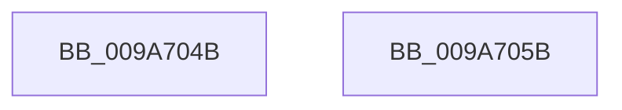

# sub_009A704B

- RVA: `0x009A704B`–`0x009A70A8` (길이 `93` bytes)
- VA: `0x00000001409A704B`
- 실행 섹션: `PAGE`
- PDB 이름 있음: `아니요`; PDB Function 태그: `아니요`
- unwind 정보 RVA: `0x0009C9A8`
- 디코드: `24`개 명령, `93/93` bytes 표시
- 미해석 바이트: `0` (있으면 어셈블리에 `.byte`로 보존)

> 이 문서는 커널 이미지의 기계어와 PDB 기호를 분석해 생성했습니다. 4번과 5번은 함수 원형과 자료형을 바이너리 사용 방식에서 추정한 C 해석이며 원본 소스 복구 결과는 아닙니다.

## 1. Dependencies

- 직접 호출 지점: **0**; 고유 호출 대상: **0**
- 직접 호출자로 확인된 함수: **0**
- RIP 상대 이미지 참조: **0**

### Outgoing calls
- 직접 디코드된 call 명령이 없습니다.

### Direct callers
- 이 함수 시작 RVA로 연결되는 직접 call은 확인되지 않았습니다. 간접 호출은 완전히 역산할 수 없습니다.

### Static image references
- 디코드된 RIP-relative 메모리 참조가 없습니다.

## 2. Other-region calls and transfers

- 다른 실행 섹션으로 향하는 call: **0**
- call이 아닌 외부 분기/꼬리 이동: **1**
  - `0x009A70A3` → [sub_009A6F66 + 0x3A](Unknown_function_009A6F66.md) (`tail-transfer`)

## 3. Assembly (complete function range)

```asm
009A704B  F0 0F BA 29 18                  lock bts dword ptr [rcx], 0x18
009A7050  48 83 C4 28                     add rsp, 0x28
009A7054  41 5E                           pop r14
009A7056  41 5C                           pop r12
009A7058  5F                              pop rdi
009A7059  5B                              pop rbx
009A705A  C3                              ret
009A705B  CC                              int3
009A705C  48 B9 FF FF FE FF FF 7F 00 00   movabs rcx, 0x7ffffffeffff
009A7066  48 3B C1                        cmp rax, rcx
009A7069  49 0F 47 C4                     cmova rax, r12
009A706D  48 89 87 D8 00 00 00            mov qword ptr [rdi + 0xd8], rax
009A7074  48 8B 43 50                     mov rax, qword ptr [rbx + 0x50]
009A7078  48 3B C1                        cmp rax, rcx
009A707B  49 0F 47 C4                     cmova rax, r12
009A707F  48 89 87 E0 00 00 00            mov qword ptr [rdi + 0xe0], rax
009A7086  48 8B 43 58                     mov rax, qword ptr [rbx + 0x58]
009A708A  48 3B C1                        cmp rax, rcx
009A708D  49 0F 47 C4                     cmova rax, r12
009A7091  48 89 87 E8 00 00 00            mov qword ptr [rdi + 0xe8], rax
009A7098  48 8B 43 60                     mov rax, qword ptr [rbx + 0x60]
009A709C  48 3B C1                        cmp rax, rcx
009A709F  49 0F 47 C4                     cmova rax, r12
009A70A3  E9 F8 FE FF FF                  jmp 0x1409a6fa0
```

## 4. C-style interpretation (structured pseudocode)

```c
__int64 __fastcall sub_009A704B(__int64 a1)
{
    __int64 v_rsp;

    v_rsp = (v_rsp) + (40);
    return result;
}
```

## 5. (Beta) C Style

```c
int64_t sub_009A704B(void *Arg1)
{
    uint8_t *arg1 = (uint8_t *)Arg1;

    int64_t local_rsp;

    local_rsp = (local_rsp) + (40);
    return result;
}
```

### 관측된 메모리 오프셋

구조체 형식이 확인되지 않은 접근은 인자 기준의 오프셋으로만 기록했습니다.

| 기준 인자 | 오프셋 표현 | 폭 (bit) | 접근 |
|---|---:|---:|---|
| `Arg1` | `+ 0x0` | `32` | `R/W` |

## 6. Execution-region graph

[열기: 2D/3D 그래프와 함수 탐색 컨트롤 패널](../../../control-panel.html?section=page&rva=0x009A704B&view=graph)

- 2D 그래프는 위에서 아래로 흐르고, 3D 그래프는 빈 공간을 드래그해 회전합니다. Shift+드래그는 이동, 휠은 확대·축소, 함수 노드 선택은 대상 보고서 이동입니다.

### Static fallback


