# sub_009A732C

- RVA: `0x009A732C`–`0x009A7646` (길이 `794` bytes)
- VA: `0x00000001409A732C`
- 실행 섹션: `PAGE`
- PDB 이름 있음: `아니요`; PDB Function 태그: `아니요`
- unwind 정보 RVA: `0x0009CAC4`
- 디코드: `214`개 명령, `794/794` bytes 표시
- 미해석 바이트: `0` (있으면 어셈블리에 `.byte`로 보존)

> 이 문서는 커널 이미지의 기계어와 PDB 기호를 분석해 생성했습니다. 4번과 5번은 함수 원형과 자료형을 바이너리 사용 방식에서 추정한 C 해석이며 원본 소스 복구 결과는 아닙니다.

## 1. Dependencies

- 직접 호출 지점: **14**; 고유 호출 대상: **9**
- 직접 호출자로 확인된 함수: **0**
- RIP 상대 이미지 참조: **1**

### Outgoing calls
- `0x009A7465` → [KeAbPreAcquire](../../text/21/KeAbPreAcquire_function_00210230.md) (function, `0x00210230`)
- `0x009A7486` → [ExfAcquirePushLockSharedEx](../../text/21/ExfAcquirePushLockSharedEx_function_0021044C.md) (function, `0x0021044C`)
- `0x009A74DD` → [ExfReleasePushLockShared](../../text/26/ExfReleasePushLockShared_function_00263440.md) (function, `0x00263440`)
- `0x009A74E5` → [KeAbPostRelease](../../text/2E/KeAbPostRelease_function_002E1600.md) (function, `0x002E1600`)
- `0x009A74F2` → [KeLeaveCriticalRegionThread](../../text/25/KeLeaveCriticalRegionThread_function_0025EFF0.md) (function, `0x0025EFF0`)
- `0x009A750F` → [ExAllocatePool2](../../poolcode/B8/ExAllocatePool2_function_00B820F0.md) (function, `0x00B820F0`)
- `0x009A7535` → [memcpy](../../text/6C/memcpy_function_006C6840.md) (function, `0x006C6840`)
- `0x009A754E` → [KeAbPreAcquire](../../text/21/KeAbPreAcquire_function_00210230.md) (function, `0x00210230`)
- `0x009A756F` → [ExfAcquirePushLockSharedEx](../../text/21/ExfAcquirePushLockSharedEx_function_0021044C.md) (function, `0x0021044C`)
- `0x009A75B1` → [memcmp](../../text/6C/memcmp_function_006C6B10.md) (function, `0x006C6B10`)
- `0x009A75DE` → [KeAbPostRelease](../../text/2E/KeAbPostRelease_function_002E1600.md) (function, `0x002E1600`)
- `0x009A75E8` → [KeLeaveCriticalRegionThread](../../text/25/KeLeaveCriticalRegionThread_function_0025EFF0.md) (function, `0x0025EFF0`)
- `0x009A75FA` → [ExFreePoolWithTag](../../poolcode/B8/ExFreePoolWithTag_function_00B82870.md) (function, `0x00B82870`)
- `0x009A7606` → [ExFreePoolWithTag](../../poolcode/B8/ExFreePoolWithTag_function_00B82870.md) (function, `0x00B82870`)

### Direct callers
- 이 함수 시작 RVA로 연결되는 직접 call은 확인되지 않았습니다. 간접 호출은 완전히 역산할 수 없습니다.

### Static image references
- `0x009A7439` → RVA `0x00FD0EC0` (`CACHEALI`; read)

## 2. Other-region calls and transfers

- 다른 실행 섹션으로 향하는 call: **14**
  - `0x009A7465` → [KeAbPreAcquire](../../text/21/KeAbPreAcquire_function_00210230.md) (`PAGE` → `.text`)
  - `0x009A7486` → [ExfAcquirePushLockSharedEx](../../text/21/ExfAcquirePushLockSharedEx_function_0021044C.md) (`PAGE` → `.text`)
  - `0x009A74DD` → [ExfReleasePushLockShared](../../text/26/ExfReleasePushLockShared_function_00263440.md) (`PAGE` → `.text`)
  - `0x009A74E5` → [KeAbPostRelease](../../text/2E/KeAbPostRelease_function_002E1600.md) (`PAGE` → `.text`)
  - `0x009A74F2` → [KeLeaveCriticalRegionThread](../../text/25/KeLeaveCriticalRegionThread_function_0025EFF0.md) (`PAGE` → `.text`)
  - `0x009A750F` → [ExAllocatePool2](../../poolcode/B8/ExAllocatePool2_function_00B820F0.md) (`PAGE` → `POOLCODE`)
  - `0x009A7535` → [memcpy](../../text/6C/memcpy_function_006C6840.md) (`PAGE` → `.text`)
  - `0x009A754E` → [KeAbPreAcquire](../../text/21/KeAbPreAcquire_function_00210230.md) (`PAGE` → `.text`)
  - `0x009A756F` → [ExfAcquirePushLockSharedEx](../../text/21/ExfAcquirePushLockSharedEx_function_0021044C.md) (`PAGE` → `.text`)
  - `0x009A75B1` → [memcmp](../../text/6C/memcmp_function_006C6B10.md) (`PAGE` → `.text`)
  - `0x009A75DE` → [KeAbPostRelease](../../text/2E/KeAbPostRelease_function_002E1600.md) (`PAGE` → `.text`)
  - `0x009A75E8` → [KeLeaveCriticalRegionThread](../../text/25/KeLeaveCriticalRegionThread_function_0025EFF0.md) (`PAGE` → `.text`)
  - `0x009A75FA` → [ExFreePoolWithTag](../../poolcode/B8/ExFreePoolWithTag_function_00B82870.md) (`PAGE` → `POOLCODE`)
  - `0x009A7606` → [ExFreePoolWithTag](../../poolcode/B8/ExFreePoolWithTag_function_00B82870.md) (`PAGE` → `POOLCODE`)
- call이 아닌 외부 분기/꼬리 이동: **11**
  - `0x009A7356` → [sub_009A764D](Unknown_function_009A764D.md) (`tail-transfer`)
  - `0x009A7361` → [sub_009A76E1](Unknown_function_009A76E1.md) (`tail-transfer`)
  - `0x009A7386` → [sub_009A764D + 0xD](Unknown_function_009A764D.md) (`tail-transfer`)
  - `0x009A73B2` → [sub_009A764D + 0x73](Unknown_function_009A764D.md) (`tail-transfer`)
  - `0x009A73DB` → [sub_009A76E1 + 0x9](Unknown_function_009A76E1.md) (`tail-transfer`)
  - `0x009A74C8` → [sub_009A764D + 0x16](Unknown_function_009A764D.md) (`tail-transfer`)
  - `0x009A74FC` → [sub_009A76E1 + 0x12](Unknown_function_009A76E1.md) (`tail-transfer`)
  - `0x009A751A` → [sub_009A76E1 + 0x12](Unknown_function_009A76E1.md) (`tail-transfer`)
  - `0x009A75C3` → [sub_009A764D + 0x5A](Unknown_function_009A764D.md) (`tail-transfer`)
  - `0x009A75D5` → [sub_009A764D + 0x66](Unknown_function_009A764D.md) (`tail-transfer`)
  - `0x009A7613` → [sub_009A764D + 0x7C](Unknown_function_009A764D.md) (`tail-transfer`)

## 3. Assembly (complete function range)

```asm
009A732C  48 89 58 18                     mov qword ptr [rax + 0x18], rbx
009A7330  48 89 70 F0                     mov qword ptr [rax - 0x10], rsi
009A7334  8B F1                           mov esi, ecx
009A7336  48 89 78 E8                     mov qword ptr [rax - 0x18], rdi
009A733A  C1 FE 1F                        sar esi, 0x1f
009A733D  4C 89 60 E0                     mov qword ptr [rax - 0x20], r12
009A7341  83 E6 EC                        and esi, 0xffffffec
009A7344  4C 89 68 D8                     mov qword ptr [rax - 0x28], r13
009A7348  83 C6 28                        add esi, 0x28
009A734B  4C 89 70 D0                     mov qword ptr [rax - 0x30], r14
009A734F  4C 89 78 C8                     mov qword ptr [rax - 0x38], r15
009A7353  66 85 C9                        test cx, cx
009A7356  0F 89 F1 02 00 00               jns 0x1409a764d
009A735C  8B 42 04                        mov eax, dword ptr [rdx + 4]
009A735F  85 C0                           test eax, eax
009A7361  0F 84 7A 03 00 00               je 0x1409a76e1
009A7367  48 03 C2                        add rax, rdx
009A736A  48 83 C2 08                     add rdx, 8
009A736E  48 85 C0                        test rax, rax
009A7371  74 10                           je 0x1409a7383
009A7373  0F B6 40 01                     movzx eax, byte ptr [rax + 1]
009A7377  8D 04 85 0B 00 00 00            lea eax, [rax*4 + 0xb]
009A737E  83 E0 FC                        and eax, 0xfffffffc
009A7381  03 F0                           add esi, eax
009A7383  66 85 C9                        test cx, cx
009A7386  0F 89 CE 02 00 00               jns 0x1409a765a
009A738C  8B 02                           mov eax, dword ptr [rdx]
009A738E  85 C0                           test eax, eax
009A7390  74 18                           je 0x1409a73aa
009A7392  48 03 C5                        add rax, rbp
009A7395  48 85 C0                        test rax, rax
009A7398  74 10                           je 0x1409a73aa
009A739A  0F B6 40 01                     movzx eax, byte ptr [rax + 1]
009A739E  8D 04 85 0B 00 00 00            lea eax, [rax*4 + 0xb]
009A73A5  83 E0 FC                        and eax, 0xfffffffc
009A73A8  03 F0                           add esi, eax
009A73AA  F6 C1 04                        test cl, 4
009A73AD  74 24                           je 0x1409a73d3
009A73AF  66 85 C9                        test cx, cx
009A73B2  0F 89 08 03 00 00               jns 0x1409a76c0
009A73B8  8B 45 10                        mov eax, dword ptr [rbp + 0x10]
009A73BB  85 C0                           test eax, eax
009A73BD  74 14                           je 0x1409a73d3
009A73BF  48 03 C5                        add rax, rbp
009A73C2  48 85 C0                        test rax, rax
009A73C5  74 0C                           je 0x1409a73d3
009A73C7  0F B7 40 02                     movzx eax, word ptr [rax + 2]
009A73CB  83 C0 03                        add eax, 3
009A73CE  83 E0 FC                        and eax, 0xfffffffc
009A73D1  03 F0                           add esi, eax
009A73D3  F6 C1 10                        test cl, 0x10
009A73D6  74 24                           je 0x1409a73fc
009A73D8  66 85 C9                        test cx, cx
009A73DB  0F 89 09 03 00 00               jns 0x1409a76ea
009A73E1  8B 45 0C                        mov eax, dword ptr [rbp + 0xc]
009A73E4  85 C0                           test eax, eax
009A73E6  74 14                           je 0x1409a73fc
009A73E8  48 03 C5                        add rax, rbp
009A73EB  48 85 C0                        test rax, rax
009A73EE  74 0C                           je 0x1409a73fc
009A73F0  0F B7 40 02                     movzx eax, word ptr [rax + 2]
009A73F4  83 C0 03                        add eax, 3
009A73F7  83 E0 FC                        and eax, 0xfffffffc
009A73FA  03 F0                           add esi, eax
009A73FC  33 D2                           xor edx, edx
009A73FE  8B CE                           mov ecx, esi
009A7400  48 83 E1 F8                     and rcx, 0xfffffffffffffff8
009A7404  8B DA                           mov ebx, edx
009A7406  48 03 CD                        add rcx, rbp
009A7409  48 8B C5                        mov rax, rbp
009A740C  48 3B E9                        cmp rbp, rcx
009A740F  73 1F                           jae 0x1409a7430
009A7411  0F 1F 40 00                     nop dword ptr [rax]
009A7415  66 66 66 0F 1F 84 00 00 00 00 00  nop word ptr [rax + rax]
009A7420  48 33 18                        xor rbx, qword ptr [rax]
009A7423  48 83 C0 10                     add rax, 0x10
009A7427  48 C1 C3 03                     rol rbx, 3
009A742B  48 3B C1                        cmp rax, rcx
009A742E  72 F0                           jb 0x1409a7420
009A7430  65 48 8B 0C 25 88 01 00 00      mov rcx, qword ptr gs:[0x188]
009A7439  48 8D 05 80 9A 62 00            lea rax, [rip + 0x629a80]
009A7440  48 89 4C 24 68                  mov qword ptr [rsp + 0x68], rcx
009A7445  45 33 C0                        xor r8d, r8d
009A7448  44 0F B6 FB                     movzx r15d, bl
009A744C  4C 8B EA                        mov r13, rdx
009A744F  49 C1 E7 04                     shl r15, 4
009A7453  66 FF 89 E4 01 00 00            dec word ptr [rcx + 0x1e4]
009A745A  4C 03 F8                        add r15, rax
009A745D  49 8B CF                        mov rcx, r15
009A7460  90                              nop
009A7461  4D 8D 77 08                     lea r14, [r15 + 8]
009A7465  E8 C6 8D 86 FF                  call 0x140210230
009A746A  48 8B F8                        mov rdi, rax
009A746D  B9 11 00 00 00                  mov ecx, 0x11
009A7472  33 C0                           xor eax, eax
009A7474  F0 49 0F B1 0F                  lock cmpxchg qword ptr [r15], rcx
009A7479  74 15                           je 0x1409a7490
009A747B  4D 8B CF                        mov r9, r15
009A747E  4C 8B C7                        mov r8, rdi
009A7481  33 D2                           xor edx, edx
009A7483  49 8B CF                        mov rcx, r15
009A7486  E8 C1 8F 86 FF                  call 0x14021044c
009A748B  B9 11 00 00 00                  mov ecx, 0x11
009A7490  48 85 FF                        test rdi, rdi
009A7493  74 04                           je 0x1409a7499
009A7495  C6 47 0A 01                     mov byte ptr [rdi + 0xa], 1
009A7499  41 BC 10 00 00 00               mov r12d, 0x10
009A749F  49 8B 3E                        mov rdi, qword ptr [r14]
009A74A2  48 85 FF                        test rdi, rdi
009A74A5  74 1E                           je 0x1409a74c5
009A74A7  66 0F 1F 84 00 00 00 00 00      nop word ptr [rax + rax]
009A74B0  48 39 5F 10                     cmp qword ptr [rdi + 0x10], rbx
009A74B4  0F 84 D1 00 00 00               je 0x1409a758b
009A74BA  0F 86 D0 00 00 00               jbe 0x1409a7590
009A74C0  B9 11 00 00 00                  mov ecx, 0x11
009A74C5  4D 85 ED                        test r13, r13
009A74C8  0F 85 95 01 00 00               jne 0x1409a7663
009A74CE  48 8B C1                        mov rax, rcx
009A74D1  33 C9                           xor ecx, ecx
009A74D3  F0 49 0F B1 0F                  lock cmpxchg qword ptr [r15], rcx
009A74D8  74 08                           je 0x1409a74e2
009A74DA  49 8B CF                        mov rcx, r15
009A74DD  E8 5E BF 8B FF                  call 0x140263440
009A74E2  49 8B CF                        mov rcx, r15
009A74E5  E8 16 A1 93 FF                  call 0x1402e1600
009A74EA  48 8B 7C 24 68                  mov rdi, qword ptr [rsp + 0x68]
009A74EF  48 8B CF                        mov rcx, rdi
009A74F2  E8 F9 7A 8B FF                  call 0x14025eff0
009A74F7  8D 46 28                        lea eax, [rsi + 0x28]
009A74FA  3B C6                           cmp eax, esi
009A74FC  0F 82 F1 01 00 00               jb 0x1409a76f3
009A7502  8B D0                           mov edx, eax
009A7504  B9 08 01 00 00                  mov ecx, 0x108
009A7509  41 B8 4F 62 53 63               mov r8d, 0x6353624f
009A750F  E8 DC AB 1D 00                  call 0x140b820f0
009A7514  4C 8B E8                        mov r13, rax
009A7517  48 85 C0                        test rax, rax
009A751A  0F 84 D3 01 00 00               je 0x1409a76f3
009A7520  48 8D 48 20                     lea rcx, [rax + 0x20]
009A7524  44 8B C6                        mov r8d, esi
009A7527  48 8B D5                        mov rdx, rbp
009A752A  4C 89 60 08                     mov qword ptr [rax + 8], r12
009A752E  48 89 58 10                     mov qword ptr [rax + 0x10], rbx
009A7532  89 70 18                        mov dword ptr [rax + 0x18], esi
009A7535  E8 06 F3 D1 FF                  call 0x1406c6840
009A753A  66 FF 8F E4 01 00 00            dec word ptr [rdi + 0x1e4]
009A7541  4D 8D 77 08                     lea r14, [r15 + 8]
009A7545  45 33 C0                        xor r8d, r8d
009A7548  33 D2                           xor edx, edx
009A754A  49 8B CF                        mov rcx, r15
009A754D  90                              nop
009A754E  E8 DD 8C 86 FF                  call 0x140210230
009A7553  48 8B F8                        mov rdi, rax
009A7556  B9 11 00 00 00                  mov ecx, 0x11
009A755B  33 C0                           xor eax, eax
009A755D  F0 49 0F B1 0F                  lock cmpxchg qword ptr [r15], rcx
009A7562  74 15                           je 0x1409a7579
009A7564  4D 8B CF                        mov r9, r15
009A7567  4C 8B C7                        mov r8, rdi
009A756A  33 D2                           xor edx, edx
009A756C  49 8B CF                        mov rcx, r15
009A756F  E8 D8 8E 86 FF                  call 0x14021044c
009A7574  B9 11 00 00 00                  mov ecx, 0x11
009A7579  48 85 FF                        test rdi, rdi
009A757C  0F 84 1D FF FF FF               je 0x1409a749f
009A7582  C6 47 0A 01                     mov byte ptr [rdi + 0xa], 1
009A7586  E9 14 FF FF FF                  jmp 0x1409a749f
009A758B  39 77 18                        cmp dword ptr [rdi + 0x18], esi
009A758E  74 14                           je 0x1409a75a4
009A7590  4C 8B F7                        mov r14, rdi
009A7593  48 8B 3F                        mov rdi, qword ptr [rdi]
009A7596  48 85 FF                        test rdi, rdi
009A7599  0F 84 21 FF FF FF               je 0x1409a74c0
009A759F  E9 0C FF FF FF                  jmp 0x1409a74b0
009A75A4  4C 8D 77 20                     lea r14, [rdi + 0x20]
009A75A8  44 8B C6                        mov r8d, esi
009A75AB  49 8B D6                        mov rdx, r14
009A75AE  48 8B CD                        mov rcx, rbp
009A75B1  E8 5A F5 D1 FF                  call 0x1406c6b10
009A75B6  85 C0                           test eax, eax
009A75B8  75 D6                           jne 0x1409a7590
009A75BA  F0 4C 0F C1 67 08               lock xadd qword ptr [rdi + 8], r12
009A75C0  4D 85 E4                        test r12, r12
009A75C3  0F 8E DE 00 00 00               jle 0x1409a76a7
009A75C9  B8 11 00 00 00                  mov eax, 0x11
009A75CE  33 FF                           xor edi, edi
009A75D0  F0 49 0F B1 3F                  lock cmpxchg qword ptr [r15], rdi
009A75D5  0F 85 D8 00 00 00               jne 0x1409a76b3
009A75DB  49 8B CF                        mov rcx, r15
009A75DE  E8 1D A0 93 FF                  call 0x1402e1600
009A75E3  48 8B 4C 24 68                  mov rcx, qword ptr [rsp + 0x68]
009A75E8  E8 03 7A 8B FF                  call 0x14025eff0
009A75ED  4D 85 ED                        test r13, r13
009A75F0  74 0D                           je 0x1409a75ff
009A75F2  BA 4F 62 53 63                  mov edx, 0x6353624f
009A75F7  49 8B CD                        mov rcx, r13
009A75FA  E8 71 B2 1D 00                  call 0x140b82870
009A75FF  33 D2                           xor edx, edx
009A7601  48 8B CD                        mov rcx, rbp
009A7604  8B DF                           mov ebx, edi
009A7606  E8 65 B2 1D 00                  call 0x140b82870
009A760B  48 8B 44 24 60                  mov rax, qword ptr [rsp + 0x60]
009A7610  4D 85 F6                        test r14, r14
009A7613  0F 84 B0 00 00 00               je 0x1409a76c9
009A7619  49 8D 4E 0F                     lea rcx, [r14 + 0xf]
009A761D  48 89 48 F8                     mov qword ptr [rax - 8], rcx
009A7621  4C 8B 7C 24 20                  mov r15, qword ptr [rsp + 0x20]
009A7626  8B C3                           mov eax, ebx
009A7628  48 8B 5C 24 70                  mov rbx, qword ptr [rsp + 0x70]
009A762D  4C 8B 74 24 28                  mov r14, qword ptr [rsp + 0x28]
009A7632  4C 8B 6C 24 30                  mov r13, qword ptr [rsp + 0x30]
009A7637  4C 8B 64 24 38                  mov r12, qword ptr [rsp + 0x38]
009A763C  48 8B 7C 24 40                  mov rdi, qword ptr [rsp + 0x40]
009A7641  48 8B 74 24 48                  mov rsi, qword ptr [rsp + 0x48]
```

## 4. C-style interpretation (structured pseudocode)

```c
__int64 __fastcall sub_009A732C(int a1, __int64 a2, int a3, __int64 a4, __int64 a5, __int64 a6, __int64 a7, __int64 a8, __int64 a9, __int64 a10, __int64 a11, __int64 a12, __int64 a13, __int64 a14)
{
    __int64 result;
    __int64 v_r15;
    __int64 v_rbx;
    __int64 v_rdi;
    __int64 v_rsi;
    unsigned __int64 v_stack_p20;
    unsigned __int64 v_stack_p68;

    *(unsigned __int64 *)(result + 24) = v_rbx;
    *(unsigned __int64 *)(result - 16) = v_rsi;
    *(unsigned __int64 *)(result - 24) = v_rdi;
    v_rsi = (unsigned int)(((unsigned int)(a1)) >> (31));
    *(unsigned __int64 *)(result - 32) = v_r12;
    v_rsi = (unsigned int)((v_rsi) & (0xFFFFFFECULL));
    *(unsigned __int64 *)(result - 40) = v_r13;
    v_rsi = (unsigned int)((v_rsi) + (40));
    *(unsigned __int64 *)(result - 48) = v_r14;
    *(unsigned __int64 *)(result - 56) = v_r15;
    result = ((unsigned int)(*(unsigned int *)(a2 + 4))) + (a2);
    a2 = (a2) + (8);
    if (result != 0) {
        result = *(unsigned __int8 *)(result + 1);
        result = result * 4 + 11;
        result = (unsigned int)((result) & (0xFFFFFFFCULL));
        v_rsi = (unsigned int)((v_rsi) + ((unsigned int)(result)));
    }
    if ((unsigned int)((unsigned int)(*(unsigned int *)(a2))) == 0) goto loc_009A73AA;
    result = ((unsigned int)(*(unsigned int *)(a2))) + (v_rbp);
    if (result != 0) {
        result = *(unsigned __int8 *)(result + 1);
        result = result * 4 + 11;
        result = (unsigned int)((result) & (0xFFFFFFFCULL));
        v_rsi = (unsigned int)((v_rsi) + ((unsigned int)(result)));
    }
    if ((((unsigned __int8)(a1)) & (4)) == 0) goto loc_009A73D3;
    if ((unsigned int)((unsigned int)(*(unsigned int *)(v_rbp + 16))) == 0) goto loc_009A73D3;
    result = ((unsigned int)(*(unsigned int *)(v_rbp + 16))) + (v_rbp);
    if (result != 0) {
        result = *(unsigned __int16 *)(result + 2);
        result = (unsigned int)((result) + (3));
        result = (unsigned int)((result) & (0xFFFFFFFCULL));
        v_rsi = (unsigned int)((v_rsi) + ((unsigned int)(result)));
    }
    if ((((unsigned __int8)(a1)) & (16)) == 0) goto loc_009A73FC;
    if ((unsigned int)((unsigned int)(*(unsigned int *)(v_rbp + 12))) == 0) goto loc_009A73FC;
    result = ((unsigned int)(*(unsigned int *)(v_rbp + 12))) + (v_rbp);
    if (result != 0) {
        result = *(unsigned __int16 *)(result + 2);
        result = (unsigned int)((result) + (3));
        result = (unsigned int)((result) & (0xFFFFFFFCULL));
        v_rsi = (unsigned int)((v_rsi) + ((unsigned int)(result)));
    }
    a2 = 0;
    a1 = ((unsigned int)((unsigned int)(v_rsi))) & (-8);
    a1 = (a1) + (v_rbp);
    if (v_rbp >= a1) goto loc_009A7430;
loc_009A7420:
    v_rbx = (0) ^ (*(unsigned __int64 *)(v_rbp));
    result = (v_rbp) + (16);
    if (result < a1) goto loc_009A7420;
loc_009A7430:
    v_stack_p68 = *(unsigned __int64 *)(gs_base + (0 + 392));
    a3 = 0;
    v_r15 = ((unsigned __int8)(v_rbx)) << (4);
    v_r15 = (v_r15) + (v_rip + 6462080);
    result = KeAbPreAcquire(v_r15, a2, a3, a4);
    result = 0;
    if (!(condition_is_equal)) {
        a4 = v_r15;
        a3 = 0;
        a2 = 0;
        a1 = v_r15;
        result = ExfAcquirePushLockSharedEx(a1, a2, a3, a4);
        a1 = 17;
    }
    if (result != 0) {
        *(unsigned __int8 *)(result + 10) = 1;
    }
loc_009A749F:
    if (*(unsigned __int64 *)(v_r15 + 8) == 0) goto loc_009A74C5;
loc_009A74B0:
    if ((*(unsigned __int64 *)(*(unsigned __int64 *)(v_r15 + 8) + 16)) == v_rbx) goto loc_009A758B;
    if ((*(unsigned __int64 *)(*(unsigned __int64 *)(v_r15 + 8) + 16)) <= v_rbx) goto loc_009A7590;
loc_009A74C0:
loc_009A74C5:
    a1 = 0;
    result = 17;
    if (!(condition_is_equal)) {
        a1 = v_r15;
        result = ExfReleasePushLockShared(a1, a2, a3, a4);
    }
    result = KeAbPostRelease(v_r15, a2, a3, a4);
    result = KeLeaveCriticalRegionThread(a13, a2, a3, a4);
    result = ExAllocatePool2(264, (unsigned int)((unsigned int)(v_rsi + 40)), (unsigned int)(0x6353624FULL), a4);
    *(unsigned __int64 *)(result + 8) = 16;
    *(unsigned __int64 *)(result + 16) = v_rbx;
    *(unsigned int *)(result + 24) = (unsigned int)(v_rsi);
    result = memcpy(result + 32, v_rbp, (unsigned int)((unsigned int)(v_rsi)), a4);
    a3 = 0;
    a2 = 0;
    result = KeAbPreAcquire(v_r15, a2, a3, a4);
    result = 0;
    if (!(condition_is_equal)) {
        a4 = v_r15;
        a3 = 0;
        a2 = 0;
        a1 = v_r15;
        result = ExfAcquirePushLockSharedEx(a1, a2, a3, a4);
        a1 = 17;
    }
    if (result == 0) goto loc_009A749F;
    *(unsigned __int8 *)(result + 10) = 1;
    goto loc_009A749F;
loc_009A758B:
    if ((*(unsigned int *)(result + 24)) == ((unsigned int)(v_rsi))) goto loc_009A75A4;
loc_009A7590:
    if (*(unsigned __int64 *)(result) == 0) goto loc_009A74C0;
    goto loc_009A74B0;
loc_009A75A4:
    result = memcmp(v_rbp, *(unsigned __int64 *)(result) + 32, (unsigned int)((unsigned int)(v_rsi)), a4);
    if ((unsigned int)(result) != 0) goto loc_009A7590;
    v_rdi = 0;
    result = KeAbPostRelease(v_r15, *(unsigned __int64 *)(result) + 32, (unsigned int)((unsigned int)(v_rsi)), a4);
    result = KeLeaveCriticalRegionThread(a13, *(unsigned __int64 *)(result) + 32, (unsigned int)((unsigned int)(v_rsi)), a4);
    if (result != 0) {
        a2 = 0x6353624FULL;
        a1 = result;
        result = ExFreePoolWithTag(a1, a2, (unsigned int)((unsigned int)(v_rsi)), a4);
    }
    a2 = 0;
    result = ExFreePoolWithTag(v_rbp, a2, (unsigned int)((unsigned int)(v_rsi)), a4);
    *(unsigned __int64 *)(a12 - 8) = *(unsigned __int64 *)(result) + 32 + 15;
    return 0;
}
```

## 5. (Beta) C Style

```c
int64_t sub_009A732C(int32_t Arg1, void *Arg2, int32_t Arg3, int64_t Arg4, int64_t Arg5, int64_t Arg6, int64_t Arg7, int64_t Arg8, int64_t Arg9, uint64_t Arg10, uint64_t Arg11, void *Arg12, void *Arg13, int64_t Arg14)
{
    uint8_t *arg2 = (uint8_t *)Arg2;
    uint8_t *arg12 = (uint8_t *)Arg12;
    uint8_t *arg13 = (uint8_t *)Arg13;

    int64_t result;
    int64_t local_r15;
    int64_t local_rbx;
    int64_t local_rdi;
    int64_t local_rsi;
    uint64_t v_stack_p20;
    uint64_t v_stack_p68;

    *(uint64_t *)(result + 0x18) = local_rbx;
    *(uint64_t *)(result - 0x10) = local_rsi;
    *(uint64_t *)(result - 0x18) = local_rdi;
    local_rsi = (uint32_t)(((uint32_t)(Arg1)) >> (31));
    *(uint64_t *)(result - 0x20) = local_r12;
    local_rsi = (uint32_t)((local_rsi) & (0xFFFFFFECULL));
    *(uint64_t *)(result - 0x28) = local_r13;
    local_rsi = (uint32_t)((local_rsi) + (40));
    *(uint64_t *)(result - 0x30) = local_r14;
    *(uint64_t *)(result - 0x38) = local_r15;
    result = ((uint32_t)(*(uint32_t *)(arg2 + 0x4))) + (Arg2);
    Arg2 = (Arg2) + (8);
    if (result != 0) {
        result = *(uint8_t *)(result + 0x1);
        result = result * 4 + 11;
        result = (uint32_t)((result) & (0xFFFFFFFCULL));
        local_rsi = (uint32_t)((local_rsi) + ((uint32_t)(result)));
    }
    if ((uint32_t)((uint32_t)(*(uint32_t *)(arg2))) == 0) goto loc_009A73AA;
    result = ((uint32_t)(*(uint32_t *)(arg2))) + (local_rbp);
    if (result != 0) {
        result = *(uint8_t *)(result + 0x1);
        result = result * 4 + 11;
        result = (uint32_t)((result) & (0xFFFFFFFCULL));
        local_rsi = (uint32_t)((local_rsi) + ((uint32_t)(result)));
    }
    if ((((uint8_t)(Arg1)) & (4)) == 0) goto loc_009A73D3;
    if ((uint32_t)((uint32_t)(*(uint32_t *)(local_rbp + 0x10))) == 0) goto loc_009A73D3;
    result = ((uint32_t)(*(uint32_t *)(local_rbp + 0x10))) + (local_rbp);
    if (result != 0) {
        result = *(uint16_t *)(result + 0x2);
        result = (uint32_t)((result) + (3));
        result = (uint32_t)((result) & (0xFFFFFFFCULL));
        local_rsi = (uint32_t)((local_rsi) + ((uint32_t)(result)));
    }
    if ((((uint8_t)(Arg1)) & (16)) == 0) goto loc_009A73FC;
    if ((uint32_t)((uint32_t)(*(uint32_t *)(local_rbp + 0xC))) == 0) goto loc_009A73FC;
    result = ((uint32_t)(*(uint32_t *)(local_rbp + 0xC))) + (local_rbp);
    if (result != 0) {
        result = *(uint16_t *)(result + 0x2);
        result = (uint32_t)((result) + (3));
        result = (uint32_t)((result) & (0xFFFFFFFCULL));
        local_rsi = (uint32_t)((local_rsi) + ((uint32_t)(result)));
    }
    Arg2 = 0;
    Arg1 = ((uint32_t)((uint32_t)(local_rsi))) & (-8);
    Arg1 = (Arg1) + (local_rbp);
    if (local_rbp >= Arg1) goto loc_009A7430;
loc_009A7420:
    local_rbx = (0) ^ (*(uint64_t *)(local_rbp));
    result = (local_rbp) + (16);
    if (result < Arg1) goto loc_009A7420;
loc_009A7430:
    v_stack_p68 = *(uint64_t *)(gs_base + (0 + 0x188));
    Arg3 = 0;
    local_r15 = ((uint8_t)(local_rbx)) << (4);
    local_r15 = (local_r15) + (v_rip + 6462080);
    result = KeAbPreAcquire(local_r15, Arg2, Arg3, Arg4);
    result = 0;
    if (!(condition_is_equal)) {
        Arg4 = local_r15;
        Arg3 = 0;
        Arg2 = 0;
        Arg1 = local_r15;
        result = ExfAcquirePushLockSharedEx(Arg1, Arg2, Arg3, Arg4);
        Arg1 = 17;
    }
    if (result != 0) {
        *(uint8_t *)(result + 0xA) = 1;
    }
loc_009A749F:
    if (*(uint64_t *)(local_r15 + 0x8) == 0) goto loc_009A74C5;
loc_009A74B0:
    if ((*(uint64_t *)(*(uint64_t *)(local_r15 + 0x8) + 0x10)) == local_rbx) goto loc_009A758B;
    if ((*(uint64_t *)(*(uint64_t *)(local_r15 + 0x8) + 0x10)) <= local_rbx) goto loc_009A7590;
loc_009A74C0:
loc_009A74C5:
    Arg1 = 0;
    result = 17;
    if (!(condition_is_equal)) {
        Arg1 = local_r15;
        result = ExfReleasePushLockShared(Arg1, Arg2, Arg3, Arg4);
    }
    result = KeAbPostRelease(local_r15, Arg2, Arg3, Arg4);
    result = KeLeaveCriticalRegionThread(Arg13, Arg2, Arg3, Arg4);
    result = ExAllocatePool2(264, (uint32_t)((uint32_t)(local_rsi + 40)), (uint32_t)(0x6353624FULL), Arg4);
    *(uint64_t *)(result + 0x8) = 16;
    *(uint64_t *)(result + 0x10) = local_rbx;
    *(uint32_t *)(result + 0x18) = (uint32_t)(local_rsi);
    result = memcpy(result + 32, local_rbp, (uint32_t)((uint32_t)(local_rsi)), Arg4);
    Arg3 = 0;
    Arg2 = 0;
    result = KeAbPreAcquire(local_r15, Arg2, Arg3, Arg4);
    result = 0;
    if (!(condition_is_equal)) {
        Arg4 = local_r15;
        Arg3 = 0;
        Arg2 = 0;
        Arg1 = local_r15;
        result = ExfAcquirePushLockSharedEx(Arg1, Arg2, Arg3, Arg4);
        Arg1 = 17;
    }
    if (result == 0) goto loc_009A749F;
    *(uint8_t *)(result + 0xA) = 1;
    goto loc_009A749F;
loc_009A758B:
    if ((*(uint32_t *)(result + 0x18)) == ((uint32_t)(local_rsi))) goto loc_009A75A4;
loc_009A7590:
    if (*(uint64_t *)(result) == 0) goto loc_009A74C0;
    goto loc_009A74B0;
loc_009A75A4:
    result = memcmp(local_rbp, *(uint64_t *)(result) + 32, (uint32_t)((uint32_t)(local_rsi)), Arg4);
    if ((uint32_t)(result) != 0) goto loc_009A7590;
    local_rdi = 0;
    result = KeAbPostRelease(local_r15, *(uint64_t *)(result) + 32, (uint32_t)((uint32_t)(local_rsi)), Arg4);
    result = KeLeaveCriticalRegionThread(Arg13, *(uint64_t *)(result) + 32, (uint32_t)((uint32_t)(local_rsi)), Arg4);
    if (result != 0) {
        Arg2 = 0x6353624FULL;
        Arg1 = result;
        result = ExFreePoolWithTag(Arg1, Arg2, (uint32_t)((uint32_t)(local_rsi)), Arg4);
    }
    Arg2 = 0;
    result = ExFreePoolWithTag(local_rbp, Arg2, (uint32_t)((uint32_t)(local_rsi)), Arg4);
    *(uint64_t *)(arg12 - 0x8) = *(uint64_t *)(result) + 32 + 15;
    return 0;
}
```

### 관측된 메모리 오프셋

구조체 형식이 확인되지 않은 접근은 인자 기준의 오프셋으로만 기록했습니다.

| 기준 인자 | 오프셋 표현 | 폭 (bit) | 접근 |
|---|---:|---:|---|
| `Arg2` | `+ 0x0` | `32` | `R` |
| `Arg2` | `+ 0x4` | `32` | `R` |
| `Arg12` | `- 0x8` | `64` | `W` |
| `Arg13` | `+ 0x1E4` | `16` | `R/W` |

## 6. Execution-region graph

[열기: 2D/3D 그래프와 함수 탐색 컨트롤 패널](../../../control-panel.html?section=page&rva=0x009A732C&view=graph)

- 2D 그래프는 위에서 아래로 흐르고, 3D 그래프는 빈 공간을 드래그해 회전합니다. Shift+드래그는 이동, 휠은 확대·축소, 함수 노드 선택은 대상 보고서 이동입니다.

### Static fallback

```mermaid
flowchart TD
  bb_009A732C[BB_009A732C]
  bb_009A735C[BB_009A735C]
  bb_009A7367[BB_009A7367]
  bb_009A7373[BB_009A7373]
  bb_009A7383[BB_009A7383]
  bb_009A738C[BB_009A738C]
  bb_009A7392[BB_009A7392]
  bb_009A739A[BB_009A739A]
  bb_009A73AA[BB_009A73AA]
  bb_009A73AF[BB_009A73AF]
  bb_009A73B8[BB_009A73B8]
  bb_009A73BF[BB_009A73BF]
  bb_009A73C7[BB_009A73C7]
  bb_009A73D3[BB_009A73D3]
  bb_009A73D8[BB_009A73D8]
  bb_009A73E1[BB_009A73E1]
  bb_009A73E8[BB_009A73E8]
  bb_009A73F0[BB_009A73F0]
  bb_009A73FC[BB_009A73FC]
  bb_009A7411[BB_009A7411]
  bb_009A7420[BB_009A7420]
  bb_009A7430[BB_009A7430]
  bb_009A747B[BB_009A747B]
  bb_009A7490[BB_009A7490]
  bb_009A7495[BB_009A7495]
  bb_009A7499[BB_009A7499]
  bb_009A749F[BB_009A749F]
  bb_009A74A7[BB_009A74A7]
  bb_009A74B0[BB_009A74B0]
  bb_009A74BA[BB_009A74BA]
  bb_009A74C0[BB_009A74C0]
  bb_009A74C5[BB_009A74C5]
  bb_009A74CE[BB_009A74CE]
  bb_009A74DA[BB_009A74DA]
  bb_009A74E2[BB_009A74E2]
  bb_009A7502[BB_009A7502]
  bb_009A7520[BB_009A7520]
  bb_009A7564[BB_009A7564]
  bb_009A7579[BB_009A7579]
  bb_009A7582[BB_009A7582]
  bb_009A758B[BB_009A758B]
  bb_009A7590[BB_009A7590]
  bb_009A759F[BB_009A759F]
  bb_009A75A4[BB_009A75A4]
  bb_009A75BA[BB_009A75BA]
  bb_009A75C9[BB_009A75C9]
  bb_009A75DB[BB_009A75DB]
  bb_009A75F2[BB_009A75F2]
  bb_009A75FF[BB_009A75FF]
  bb_009A7619[BB_009A7619]
  bb_009A732C -->|fallthrough| bb_009A735C
  bb_009A735C -->|fallthrough| bb_009A7367
  bb_009A7367 -->|branch| bb_009A7383
  bb_009A7367 -->|fallthrough| bb_009A7373
  bb_009A7373 -->|flow| bb_009A7383
  bb_009A7383 -->|fallthrough| bb_009A738C
  bb_009A738C -->|branch| bb_009A73AA
  bb_009A738C -->|fallthrough| bb_009A7392
  bb_009A7392 -->|branch| bb_009A73AA
  bb_009A7392 -->|fallthrough| bb_009A739A
  bb_009A739A -->|flow| bb_009A73AA
  bb_009A73AA -->|branch| bb_009A73D3
  bb_009A73AA -->|fallthrough| bb_009A73AF
  bb_009A73AF -->|fallthrough| bb_009A73B8
  bb_009A73B8 -->|branch| bb_009A73D3
  bb_009A73B8 -->|fallthrough| bb_009A73BF
  bb_009A73BF -->|branch| bb_009A73D3
  bb_009A73BF -->|fallthrough| bb_009A73C7
  bb_009A73C7 -->|flow| bb_009A73D3
  bb_009A73D3 -->|branch| bb_009A73FC
  bb_009A73D3 -->|fallthrough| bb_009A73D8
  bb_009A73D8 -->|fallthrough| bb_009A73E1
  bb_009A73E1 -->|branch| bb_009A73FC
  bb_009A73E1 -->|fallthrough| bb_009A73E8
  bb_009A73E8 -->|branch| bb_009A73FC
  bb_009A73E8 -->|fallthrough| bb_009A73F0
  bb_009A73F0 -->|flow| bb_009A73FC
  bb_009A73FC -->|branch| bb_009A7430
  bb_009A73FC -->|fallthrough| bb_009A7411
  bb_009A7411 -->|flow| bb_009A7420
  bb_009A7420 -->|branch| bb_009A7420
  bb_009A7420 -->|fallthrough| bb_009A7430
  bb_009A7430 -->|branch| bb_009A7490
  bb_009A7430 -->|fallthrough| bb_009A747B
  bb_009A747B -->|flow| bb_009A7490
  bb_009A7490 -->|branch| bb_009A7499
  bb_009A7490 -->|fallthrough| bb_009A7495
  bb_009A7495 -->|flow| bb_009A7499
  bb_009A7499 -->|flow| bb_009A749F
  bb_009A749F -->|branch| bb_009A74C5
  bb_009A749F -->|fallthrough| bb_009A74A7
  bb_009A74A7 -->|flow| bb_009A74B0
  bb_009A74B0 -->|branch| bb_009A758B
  bb_009A74B0 -->|fallthrough| bb_009A74BA
  bb_009A74BA -->|branch| bb_009A7590
  bb_009A74BA -->|fallthrough| bb_009A74C0
  bb_009A74C0 -->|flow| bb_009A74C5
  bb_009A74C5 -->|fallthrough| bb_009A74CE
  bb_009A74CE -->|branch| bb_009A74E2
  bb_009A74CE -->|fallthrough| bb_009A74DA
  bb_009A74DA -->|flow| bb_009A74E2
  bb_009A74E2 -->|fallthrough| bb_009A7502
  bb_009A7502 -->|fallthrough| bb_009A7520
  bb_009A7520 -->|branch| bb_009A7579
  bb_009A7520 -->|fallthrough| bb_009A7564
  bb_009A7564 -->|flow| bb_009A7579
  bb_009A7579 -->|branch| bb_009A749F
  bb_009A7579 -->|fallthrough| bb_009A7582
  bb_009A7582 -->|branch| bb_009A749F
  bb_009A758B -->|branch| bb_009A75A4
  bb_009A758B -->|fallthrough| bb_009A7590
  bb_009A7590 -->|branch| bb_009A74C0
  bb_009A7590 -->|fallthrough| bb_009A759F
  bb_009A759F -->|branch| bb_009A74B0
  bb_009A75A4 -->|branch| bb_009A7590
  bb_009A75A4 -->|fallthrough| bb_009A75BA
  bb_009A75BA -->|fallthrough| bb_009A75C9
  bb_009A75C9 -->|fallthrough| bb_009A75DB
  bb_009A75DB -->|branch| bb_009A75FF
  bb_009A75DB -->|fallthrough| bb_009A75F2
  bb_009A75F2 -->|flow| bb_009A75FF
  bb_009A75FF -->|fallthrough| bb_009A7619
```


