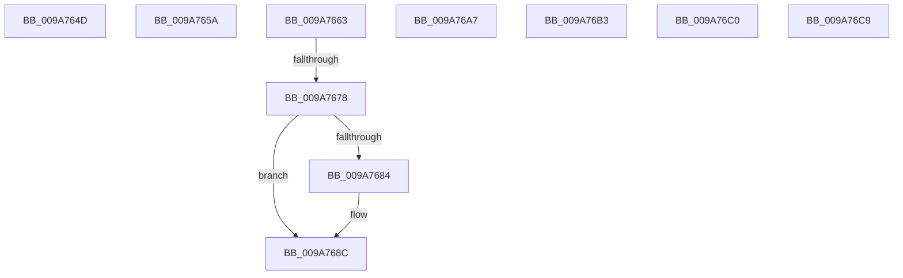

# sub_009A764D

- RVA: `0x009A764D`–`0x009A76D2` (길이 `133` bytes)
- VA: `0x00000001409A764D`
- 실행 섹션: `PAGE`
- PDB 이름 있음: `아니요`; PDB Function 태그: `아니요`
- unwind 정보 RVA: `0x0009CB04`
- 디코드: `32`개 명령, `133/133` bytes 표시
- 미해석 바이트: `0` (있으면 어셈블리에 `.byte`로 보존)

> 이 문서는 커널 이미지의 기계어와 PDB 기호를 분석해 생성했습니다. 4번과 5번은 함수 원형과 자료형을 바이너리 사용 방식에서 추정한 C 해석이며 원본 소스 복구 결과는 아닙니다.

## 1. Dependencies

- 직접 호출 지점: **4**; 고유 호출 대상: **3**
- 직접 호출자로 확인된 함수: **0**
- RIP 상대 이미지 참조: **0**

### Outgoing calls
- `0x009A7687` → [ExfReleasePushLockShared](../../text/26/ExfReleasePushLockShared_function_00263440.md) (function, `0x00263440`)
- `0x009A768F` → [KeAbPostRelease](../../text/2E/KeAbPostRelease_function_002E1600.md) (function, `0x002E1600`)
- `0x009A7699` → [KeLeaveCriticalRegionThread](../../text/25/KeLeaveCriticalRegionThread_function_0025EFF0.md) (function, `0x0025EFF0`)
- `0x009A76B6` → [ExfReleasePushLockShared](../../text/26/ExfReleasePushLockShared_function_00263440.md) (function, `0x00263440`)

### Direct callers
- 이 함수 시작 RVA로 연결되는 직접 call은 확인되지 않았습니다. 간접 호출은 완전히 역산할 수 없습니다.

### Static image references
- 디코드된 RIP-relative 메모리 참조가 없습니다.

## 2. Other-region calls and transfers

- 다른 실행 섹션으로 향하는 call: **4**
  - `0x009A7687` → [ExfReleasePushLockShared](../../text/26/ExfReleasePushLockShared_function_00263440.md) (`PAGE` → `.text`)
  - `0x009A768F` → [KeAbPostRelease](../../text/2E/KeAbPostRelease_function_002E1600.md) (`PAGE` → `.text`)
  - `0x009A7699` → [KeLeaveCriticalRegionThread](../../text/25/KeLeaveCriticalRegionThread_function_0025EFF0.md) (`PAGE` → `.text`)
  - `0x009A76B6` → [ExfReleasePushLockShared](../../text/26/ExfReleasePushLockShared_function_00263440.md) (`PAGE` → `.text`)
- call이 아닌 외부 분기/꼬리 이동: **8**
  - `0x009A7655` → [sub_009A732C + 0x42](Unknown_function_009A732C.md) (`tail-transfer`)
  - `0x009A765E` → [sub_009A732C + 0x69](Unknown_function_009A732C.md) (`tail-transfer`)
  - `0x009A7672` → [sub_009A732C + 0x173](Unknown_function_009A732C.md) (`tail-transfer`)
  - `0x009A76A2` → [sub_009A732C + 0x2D3](Unknown_function_009A732C.md) (`tail-transfer`)
  - `0x009A76AE` → [sub_009A732C + 0x29D](Unknown_function_009A732C.md) (`tail-transfer`)
  - `0x009A76BB` → [sub_009A732C + 0x2AF](Unknown_function_009A732C.md) (`tail-transfer`)
  - `0x009A76C4` → [sub_009A732C + 0x96](Unknown_function_009A732C.md) (`tail-transfer`)
  - `0x009A76CD` → [sub_009A732C + 0x2F5](Unknown_function_009A732C.md) (`tail-transfer`)

## 3. Assembly (complete function range)

```asm
009A764D  48 8B 42 08                     mov rax, qword ptr [rdx + 8]
009A7651  48 83 C2 08                     add rdx, 8
009A7655  E9 14 FD FF FF                  jmp 0x1409a736e
009A765A  48 8B 45 10                     mov rax, qword ptr [rbp + 0x10]
009A765E  E9 32 FD FF FF                  jmp 0x1409a7395
009A7663  49 89 7D 00                     mov qword ptr [r13], rdi
009A7667  48 8B C7                        mov rax, rdi
009A766A  F0 4D 0F B1 2E                  lock cmpxchg qword ptr [r14], r13
009A766F  4C 8B F0                        mov r14, rax
009A7672  0F 85 27 FE FF FF               jne 0x1409a749f
009A7678  48 8B C1                        mov rax, rcx
009A767B  33 FF                           xor edi, edi
009A767D  F0 49 0F B1 3F                  lock cmpxchg qword ptr [r15], rdi
009A7682  74 08                           je 0x1409a768c
009A7684  49 8B CF                        mov rcx, r15
009A7687  E8 B4 BD 8B FF                  call 0x140263440
009A768C  49 8B CF                        mov rcx, r15
009A768F  E8 6C 9F 93 FF                  call 0x1402e1600
009A7694  48 8B 4C 24 68                  mov rcx, qword ptr [rsp + 0x68]
009A7699  E8 52 79 8B FF                  call 0x14025eff0
009A769E  4D 8D 75 20                     lea r14, [r13 + 0x20]
009A76A2  E9 58 FF FF FF                  jmp 0x1409a75ff
009A76A7  B9 0E 00 00 00                  mov ecx, 0xe
009A76AC  CD 29                           int 0x29
009A76AE  E9 16 FF FF FF                  jmp 0x1409a75c9
009A76B3  49 8B CF                        mov rcx, r15
009A76B6  E8 85 BD 8B FF                  call 0x140263440
009A76BB  E9 1B FF FF FF                  jmp 0x1409a75db
009A76C0  48 8B 45 20                     mov rax, qword ptr [rbp + 0x20]
009A76C4  E9 F9 FC FF FF                  jmp 0x1409a73c2
009A76C9  48 89 78 F8                     mov qword ptr [rax - 8], rdi
009A76CD  E9 4F FF FF FF                  jmp 0x1409a7621
```

## 4. C-style interpretation (structured pseudocode)

```c
__int64 __fastcall sub_009A764D(__int64 a1, __int64 a2)
{
    unsigned __int64 v_stack_p68;

    a2 = (a2) + (8);
}
```

## 5. (Beta) C Style

```c
int64_t sub_009A764D(int64_t Arg1, void *Arg2)
{
    uint8_t *arg2 = (uint8_t *)Arg2;

    uint64_t v_stack_p68;

    Arg2 = (Arg2) + (8);
}
```

### 관측된 메모리 오프셋

구조체 형식이 확인되지 않은 접근은 인자 기준의 오프셋으로만 기록했습니다.

| 기준 인자 | 오프셋 표현 | 폭 (bit) | 접근 |
|---|---:|---:|---|
| `Arg2` | `+ 0x8` | `64` | `R` |

## 6. Execution-region graph

[열기: 2D/3D 그래프와 함수 탐색 컨트롤 패널](../../../control-panel.html?section=page&rva=0x009A764D&view=graph)

- 2D 그래프는 위에서 아래로 흐르고, 3D 그래프는 빈 공간을 드래그해 회전합니다. Shift+드래그는 이동, 휠은 확대·축소, 함수 노드 선택은 대상 보고서 이동입니다.

### Static fallback


