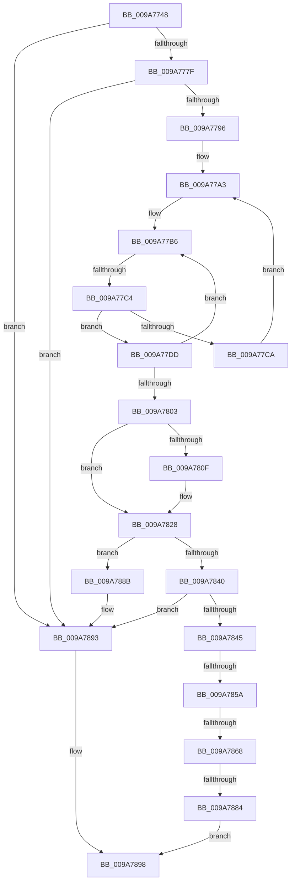

# sub_009A7748

- RVA: `0x009A7748`–`0x009A78B5` (길이 `365` bytes)
- VA: `0x00000001409A7748`
- 실행 섹션: `PAGE`
- PDB 이름 있음: `아니요`; PDB Function 태그: `아니요`
- unwind 정보 RVA: `0x0009CB7C`
- 디코드: `90`개 명령, `365/365` bytes 표시
- 미해석 바이트: `0` (있으면 어셈블리에 `.byte`로 보존)

> 이 문서는 커널 이미지의 기계어와 PDB 기호를 분석해 생성했습니다. 4번과 5번은 함수 원형과 자료형을 바이너리 사용 방식에서 추정한 C 해석이며 원본 소스 복구 결과는 아닙니다.

## 1. Dependencies

- 직접 호출 지점: **7**; 고유 호출 대상: **7**
- 직접 호출자로 확인된 함수: **0**
- RIP 상대 이미지 참조: **2**

### Outgoing calls
- `0x009A7785` → [ExpLookupHandleTableEntry](../86/ExpLookupHandleTableEntry_function_00869DB0.md) (function, `0x00869DB0`)
- `0x009A77D0` → [ExpBlockOnLockedHandleEntry](../86/ExpBlockOnLockedHandleEntry_function_00868838.md) (function, `0x00868838`)
- `0x009A782D` → [ExGetHandlePointer](../../text/43/ExGetHandlePointer_function_00430C90.md) (function, `0x00430C90`)
- `0x009A7848` → [IoThreadToProcess](../../text/44/IoThreadToProcess_function_00448540.md) (function, `0x00448540`)
- `0x009A7868` → [PsGetCurrentServerSilo](../../text/22/PsGetCurrentServerSilo_function_00225710.md) (function, `0x00225710`)
- `0x009A7877` → [PsIsProcessInSilo](../../text/41/PsIsProcessInSilo_function_004185E0.md) (function, `0x004185E0`)
- `0x009A788E` → [ObfDereferenceObject](../../text/2F/ObfDereferenceObject_function_002F9350.md) (function, `0x002F9350`)

### Direct callers
- 이 함수 시작 RVA로 연결되는 직접 call은 확인되지 않았습니다. 간접 호출은 완전히 역산할 수 없습니다.

### Static image references
- `0x009A776C` → RVA `0x00FC6CA8` (`ALMOSTRO`; read)
- `0x009A784D` → RVA `0x00FC6B70` (`ALMOSTRO`; read)

## 2. Other-region calls and transfers

- 다른 실행 섹션으로 향하는 call: **5**
  - `0x009A782D` → [ExGetHandlePointer](../../text/43/ExGetHandlePointer_function_00430C90.md) (`PAGE` → `.text`)
  - `0x009A7848` → [IoThreadToProcess](../../text/44/IoThreadToProcess_function_00448540.md) (`PAGE` → `.text`)
  - `0x009A7868` → [PsGetCurrentServerSilo](../../text/22/PsGetCurrentServerSilo_function_00225710.md) (`PAGE` → `.text`)
  - `0x009A7877` → [PsIsProcessInSilo](../../text/41/PsIsProcessInSilo_function_004185E0.md) (`PAGE` → `.text`)
  - `0x009A788E` → [ObfDereferenceObject](../../text/2F/ObfDereferenceObject_function_002F9350.md) (`PAGE` → `.text`)
- call이 아닌 외부 분기/꼬리 이동: **5**
  - `0x009A77BE` → [sub_009A7932](Unknown_function_009A7932.md) (`tail-transfer`)
  - `0x009A7854` → [sub_009A7932 + 0xAC](Unknown_function_009A7932.md) (`tail-transfer`)
  - `0x009A7862` → [sub_009A7932 + 0xF4](Unknown_function_009A7932.md) (`tail-transfer`)
  - `0x009A787E` → [sub_009A7932 + 0xAC](Unknown_function_009A7932.md) (`tail-transfer`)
  - `0x009A78B3` → [sub_009A78B5 + 0x12](Unknown_function_009A78B5.md) (`tail-transfer`)

## 3. Assembly (complete function range)

```asm
009A7748  48 89 58 08                     mov qword ptr [rax + 8], rbx
009A774C  4C 8B F2                        mov r14, rdx
009A774F  48 89 68 10                     mov qword ptr [rax + 0x10], rbp
009A7753  65 48 8B 2C 25 88 01 00 00      mov rbp, qword ptr gs:[0x188]
009A775C  4C 89 60 18                     mov qword ptr [rax + 0x18], r12
009A7760  4C 89 68 D8                     mov qword ptr [rax - 0x28], r13
009A7764  66 FF 8D E6 01 00 00            dec word ptr [rbp + 0x1e6]
009A776B  90                              nop
009A776C  48 8B 05 35 F5 61 00            mov rax, qword ptr [rip + 0x61f535]
009A7773  F7 C1 FC 03 00 00               test ecx, 0x3fc
009A7779  0F 84 14 01 00 00               je 0x1409a7893
009A777F  48 8B D1                        mov rdx, rcx
009A7782  48 8B C8                        mov rcx, rax
009A7785  E8 26 26 EC FF                  call 0x140869db0
009A778A  48 8B F8                        mov rdi, rax
009A778D  48 85 C0                        test rax, rax
009A7790  0F 84 FD 00 00 00               je 0x1409a7893
009A7796  4C 8B 25 0B F5 61 00            mov r12, qword ptr [rip + 0x61f50b]
009A779D  0F 0D 08                        prefetchw byte ptr [rax]
009A77A0  48 8B 00                        mov rax, qword ptr [rax]
009A77A3  48 8B 4F 08                     mov rcx, qword ptr [rdi + 8]
009A77A7  48 89 44 24 20                  mov qword ptr [rsp + 0x20], rax
009A77AC  4C 8B 44 24 20                  mov r8, qword ptr [rsp + 0x20]
009A77B1  48 89 4C 24 28                  mov qword ptr [rsp + 0x28], rcx
009A77B6  90                              nop
009A77B7  49 F7 C0 FE FF 01 00            test r8, 0x1fffe
009A77BE  0F 84 6E 01 00 00               je 0x1409a7932
009A77C4  41 F6 C0 01                     test r8b, 1
009A77C8  75 13                           jne 0x1409a77dd
009A77CA  48 8B D7                        mov rdx, rdi
009A77CD  49 8B CC                        mov rcx, r12
009A77D0  E8 63 10 EC FF                  call 0x140868838
009A77D5  0F 0D 0F                        prefetchw byte ptr [rdi]
009A77D8  48 8B 07                        mov rax, qword ptr [rdi]
009A77DB  EB C6                           jmp 0x1409a77a3
009A77DD  49 8D 58 FE                     lea rbx, [r8 - 2]
009A77E1  49 8B C0                        mov rax, r8
009A77E4  48 8B D1                        mov rdx, rcx
009A77E7  F0 48 0F C7 0F                  lock cmpxchg16b xmmword ptr [rdi]
009A77EC  4C 8B C0                        mov r8, rax
009A77EF  48 89 44 24 20                  mov qword ptr [rsp + 0x20], rax
009A77F4  0F 94 C0                        sete al
009A77F7  48 89 54 24 28                  mov qword ptr [rsp + 0x28], rdx
009A77FC  48 8B CA                        mov rcx, rdx
009A77FF  84 C0                           test al, al
009A7801  74 B3                           je 0x1409a77b6
009A7803  49 8B C8                        mov rcx, r8
009A7806  48 D1 E9                        shr rcx, 1
009A7809  66 83 F9 10                     cmp cx, 0x10
009A780D  75 19                           jne 0x1409a7828
009A780F  48 8D 41 FF                     lea rax, [rcx - 1]
009A7813  49 81 E0 01 00 FE FF            and r8, 0xfffffffffffe0001
009A781A  0F B7 C8                        movzx ecx, ax
009A781D  48 03 C9                        add rcx, rcx
009A7820  49 0B C8                        or rcx, r8
009A7823  48 89 4C 24 20                  mov qword ptr [rsp + 0x20], rcx
009A7828  48 8D 4C 24 20                  lea rcx, [rsp + 0x20]
009A782D  E8 5E 94 A8 FF                  call 0x140430c90
009A7832  48 8B D8                        mov rbx, rax
009A7835  0F B6 08                        movzx ecx, byte ptr [rax]
009A7838  80 E1 7F                        and cl, 0x7f
009A783B  80 F9 06                        cmp cl, 6
009A783E  75 4B                           jne 0x1409a788b
009A7840  48 85 DB                        test rbx, rbx
009A7843  74 4E                           je 0x1409a7893
009A7845  48 8B CB                        mov rcx, rbx
009A7848  E8 F3 0C AA FF                  call 0x140448540
009A784D  48 3B 05 1C F3 61 00            cmp rax, qword ptr [rip + 0x61f31c]
009A7854  0F 84 84 01 00 00               je 0x1409a79de
009A785A  8B 83 A0 05 00 00               mov eax, dword ptr [rbx + 0x5a0]
009A7860  A8 02                           test al, 2
009A7862  0F 84 BE 01 00 00               je 0x1409a7a26
009A7868  E8 A3 DE 87 FF                  call 0x140225710
009A786D  48 8B 8B 20 02 00 00            mov rcx, qword ptr [rbx + 0x220]
009A7874  48 8B D0                        mov rdx, rax
009A7877  E8 64 0D A7 FF                  call 0x1404185e0
009A787C  84 C0                           test al, al
009A787E  0F 84 5A 01 00 00               je 0x1409a79de
009A7884  48 8B F3                        mov rsi, rbx
009A7887  33 FF                           xor edi, edi
009A7889  EB 0D                           jmp 0x1409a7898
009A788B  48 8B C8                        mov rcx, rax
009A788E  E8 BD 1A 95 FF                  call 0x1402f9350
009A7893  BF 0B 00 00 C0                  mov edi, 0xc000000b
009A7898  4C 8B 6C 24 40                  mov r13, qword ptr [rsp + 0x40]
009A789D  90                              nop
009A789E  66 83 85 E6 01 00 00 01         add word ptr [rbp + 0x1e6], 1
009A78A6  4C 8B A4 24 80 00 00 00         mov r12, qword ptr [rsp + 0x80]
009A78AE  48 8B 5C 24 70                  mov rbx, qword ptr [rsp + 0x70]
009A78B3  75 12                           jne 0x1409a78c7
```

## 4. C-style interpretation (structured pseudocode)

```c
__int64 __fastcall sub_009A7748(__int64 a1, __int64 a2, __int64 a3, __int64 a4, __int64 a5, __int64 a6, __int64 a7, __int64 a8, __int64 a9, __int64 a10, __int64 a11, __int64 a12, __int64 a13, __int64 a14, __int64 a15, __int64 a16)
{
    __int64 result;
    __int64 v_rdi;
    unsigned __int64 v_stack_p20;
    unsigned __int64 v_stack_p28;

    *(unsigned __int64 *)(result + 8) = v_rbx;
    *(unsigned __int64 *)(result + 16) = v_rbp;
    *(unsigned __int64 *)(result + 24) = v_r12;
    *(unsigned __int64 *)(result - 40) = v_r13;
    if ((((unsigned int)(a1)) & (0x3FCULL)) == 0) goto loc_009A7893;
    result = ExpLookupHandleTableEntry(*(unsigned __int64 *)(v_rip + 6419765), a1, a3, a4);
    if (result == 0) goto loc_009A7893;
loc_009A77A3:
    v_stack_p20 = *(unsigned __int64 *)(result);
    v_stack_p28 = *(unsigned __int64 *)(result + 8);
loc_009A77B6:
    if ((((unsigned __int8)(v_stack_p20)) & (1)) != 0) goto loc_009A77DD;
    result = ExpBlockOnLockedHandleEntry(*(unsigned __int64 *)(v_rip + 6419723), result, v_stack_p20, a4);
    goto loc_009A77A3;
loc_009A77DD:
    v_stack_p20 = v_stack_p20;
    result = ((((unsigned __int8)(v_stack_p20)) & (1)) == 0) ? 1 : 0;
    v_stack_p28 = *(unsigned __int64 *)(v_rip + 6419723);
    if ((unsigned __int8)(result) == 0) goto loc_009A77B6;
    a1 = (v_stack_p20) >> (1);
    if (((unsigned __int16)(a1)) == 16) {
        result = a1 - 1;
        a3 = (v_stack_p20) & (0xFFFFFFFFFFFE0001ULL);
        a1 = (unsigned __int16)(result);
        a1 = (a1) + (a1);
        a1 = (a1) | (a3);
        v_stack_p20 = a1;
    }
    result = ExGetHandlePointer(v_stack_p20, *(unsigned __int64 *)(v_rip + 6419723), a3, a4);
    a1 = (unsigned __int8)((*(unsigned __int8 *)(result)) & (127));
    if (((unsigned __int8)(a1)) != 6) goto loc_009A788B;
    if (result == 0) goto loc_009A7893;
    result = IoThreadToProcess(result, *(unsigned __int64 *)(v_rip + 6419723), a3, a4);
    result = PsGetCurrentServerSilo(result, *(unsigned __int64 *)(v_rip + 6419723), a3, a4);
    result = PsIsProcessInSilo(*(unsigned __int64 *)(result + 544), result, a3, a4);
    v_rdi = 0;
    goto loc_009A7898;
loc_009A788B:
    result = ObfDereferenceObject(result, result, a3, a4);
loc_009A7893:
loc_009A7898:
}
```

## 5. (Beta) C Style

```c
int64_t sub_009A7748(int64_t Arg1, int64_t Arg2, int64_t Arg3, int64_t Arg4, uint64_t Arg5, uint64_t Arg6, uint64_t Arg7, int64_t Arg8, uint64_t Arg9, uint64_t Arg10, uint64_t Arg11, uint64_t Arg12, uint64_t Arg13, int64_t Arg14, uint64_t Arg15, int64_t Arg16)
{
    int64_t result;
    int64_t local_rdi;
    uint64_t v_stack_p20;
    uint64_t v_stack_p28;

    *(uint64_t *)(result + 0x8) = local_rbx;
    *(uint64_t *)(result + 0x10) = local_rbp;
    *(uint64_t *)(result + 0x18) = local_r12;
    *(uint64_t *)(result - 0x28) = local_r13;
    if ((((uint32_t)(Arg1)) & (0x3FCULL)) == 0) goto loc_009A7893;
    result = ExpLookupHandleTableEntry(*(uint64_t *)(v_rip + 0x61F535), Arg1, Arg3, Arg4);
    if (result == 0) goto loc_009A7893;
loc_009A77A3:
    v_stack_p20 = *(uint64_t *)(result);
    v_stack_p28 = *(uint64_t *)(result + 0x8);
loc_009A77B6:
    if ((((uint8_t)(v_stack_p20)) & (1)) != 0) goto loc_009A77DD;
    result = ExpBlockOnLockedHandleEntry(*(uint64_t *)(v_rip + 0x61F50B), result, v_stack_p20, Arg4);
    goto loc_009A77A3;
loc_009A77DD:
    v_stack_p20 = v_stack_p20;
    result = ((((uint8_t)(v_stack_p20)) & (1)) == 0) ? 1 : 0;
    v_stack_p28 = *(uint64_t *)(v_rip + 0x61F50B);
    if ((uint8_t)(result) == 0) goto loc_009A77B6;
    Arg1 = (v_stack_p20) >> (1);
    if (((uint16_t)(Arg1)) == 16) {
        result = Arg1 - 1;
        Arg3 = (v_stack_p20) & (0xFFFFFFFFFFFE0001ULL);
        Arg1 = (uint16_t)(result);
        Arg1 = (Arg1) + (Arg1);
        Arg1 = (Arg1) | (Arg3);
        v_stack_p20 = Arg1;
    }
    result = ExGetHandlePointer(v_stack_p20, *(uint64_t *)(v_rip + 0x61F50B), Arg3, Arg4);
    Arg1 = (uint8_t)((*(uint8_t *)(result)) & (127));
    if (((uint8_t)(Arg1)) != 6) goto loc_009A788B;
    if (result == 0) goto loc_009A7893;
    result = IoThreadToProcess(result, *(uint64_t *)(v_rip + 0x61F50B), Arg3, Arg4);
    result = PsGetCurrentServerSilo(result, *(uint64_t *)(v_rip + 0x61F50B), Arg3, Arg4);
    result = PsIsProcessInSilo(*(uint64_t *)(result + 0x220), result, Arg3, Arg4);
    local_rdi = 0;
    goto loc_009A7898;
loc_009A788B:
    result = ObfDereferenceObject(result, result, Arg3, Arg4);
loc_009A7893:
loc_009A7898:
}
```

## 6. Execution-region graph

[열기: 2D/3D 그래프와 함수 탐색 컨트롤 패널](../../../control-panel.html?section=page&rva=0x009A7748&view=graph)

- 2D 그래프는 위에서 아래로 흐르고, 3D 그래프는 빈 공간을 드래그해 회전합니다. Shift+드래그는 이동, 휠은 확대·축소, 함수 노드 선택은 대상 보고서 이동입니다.

### Static fallback


